# Episode 03: Does ChatGPT Know or Does It Guess?

> **Season 1: Inside the Mind of AI**  
> Instructor: **Akshay Saini** (NamasteDev)  
> Topic: How Large Language Models Work, Search Engines vs LLMs, Hallucinations, and RAG

---

## 1. The Opening Experiment: The Mystery of NamasteAI Red Wine

To test whether ChatGPT truly knows facts or simply guesses, Akshay demonstrates a query in OpenAI Playground with a completely fabricated product:

```text
Prompt: Why is NamasteAI red wine so expensive?
```

The raw model does not question the premise or state that the product does not exist. Instead, it generates a fluent, persuasive description:
- Handpicked hillside grapes from steep slopes.
- Limited edition production and organic farming.
- Years of aging in rare French oak barrels.
- Artisan packaging and collector value.


**The catch**: NamasteAI red wine does not exist. The model fabricated the entire narrative with complete confidence.

### Web Search Contrast
Given the exact same query, a search engine like Google Search does not invent tasting notes or vineyard locations. It checks its indexed web pages, finds no records for NamasteAI wine, and either reports zero matches or points accurately to NamasteDev, the developer education platform founded by Akshay Saini.

---

## 2. Does ChatGPT Know or Does It Guess?

ChatGPT is not a conversational version of Google Search. Search engines and Large Language Models represent opposite computing paradigms:

- **Search Engines**: Designed to **retrieve** existing human-created web pages.
- **Large Language Models (LLMs)**: Designed to **generate** text based on statistical token patterns learned during pretraining.


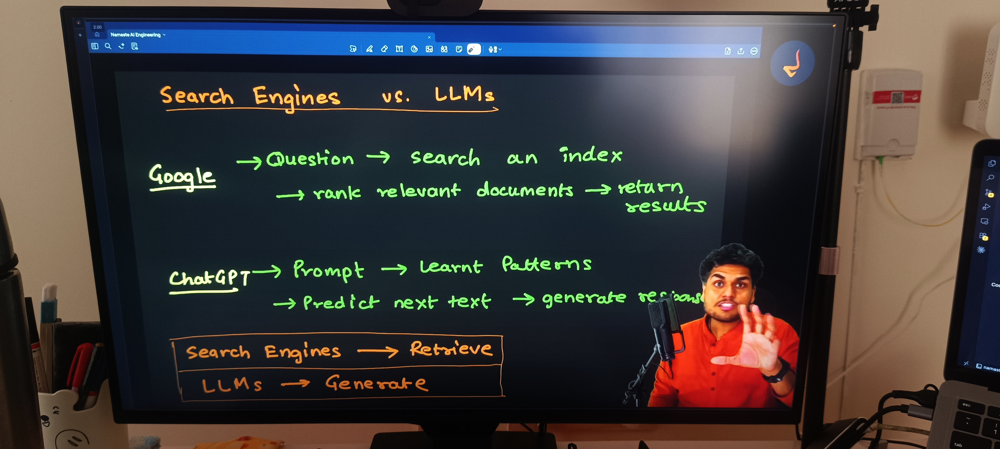

### Search Engines vs Large Language Models

| Feature | Search Engine (Google) | Large Language Model (ChatGPT) |
| :--- | :--- | :--- |
| **Core Operation** | **Retrieval** | **Generation** |
| **Workflow** | Query -> Index -> Rank -> Return URLs | Prompt -> Neural Weights -> Predict Next Token |
| **Output** | Existing web documents and links | Newly synthesized sentences and code |
| **Traceability** | Direct hyperlinks to original authors | Parametric memory: no inherent source links |
| **Freshness** | Updated continuously via web crawlers | Frozen at training cutoff date |
| **Primary Risk** | SEO spam, biased or low quality sites | Hallucinations, fabricated facts, false precision |

---

## 3. How Search Engines Work: Crawling, Indexing, and Ranking

Search engines operate in three sequential phases:

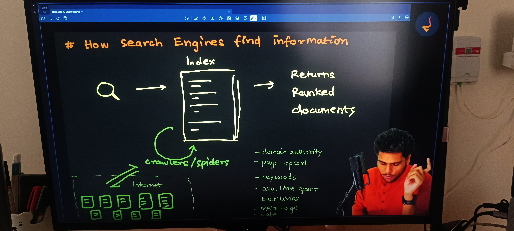

1. **Crawling**: Automated bots (such as Googlebot) discover pages by traversing hyperlinks across the web 24/7, downloading HTML, media, and metadata.
2. **Indexing**: Extracted content is organized into a massive inverted index that maps keywords to specific document locations. Search queries scan this pre-built index rather than the live internet.
3. **Ranking**: Evaluates matching documents across 200+ criteria within milliseconds:
   - Domain authority and backlink quality (PageRank).
   - Keyword relevance across titles, headings, and body text.
   - User engagement metrics (dwell time, click through rates).
   - Page performance, HTTPS security, and mobile responsiveness.
   - Content freshness and update frequency.

### Benefits and Flaws of Search Engines

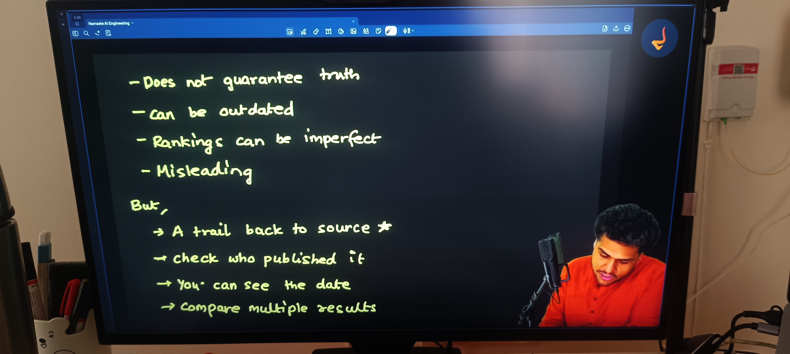

- **Benefits**: Direct links to primary sources, verifiable author attribution, and diverse viewpoints.
- **Flaws**: High rankings reward SEO optimization and popularity rather than truth; requires manual scanning of multiple pages; does not synthesize answers directly.

---

## 4. How LLMs Generate Responses: Next-Token Prediction

Large Language Models do not store document files or search internal databases. They generate answers through **autoregressive next-token prediction**.

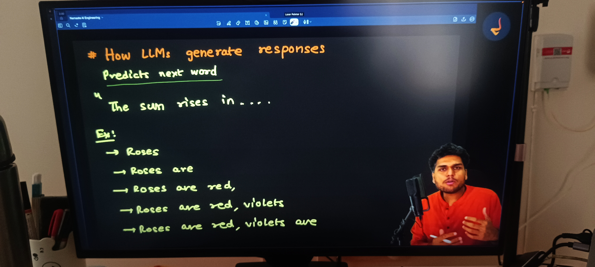

- *"The sun rises in the..."* -> **east** (high statistical probability).
- *"Roses are red, violets are..."* -> **blue** (high statistical probability).

In the OpenAI Playground demo, entering *"The sun rises in"* produces *"the east"* because that continuation is statistically dominant across billions of training texts. Each predicted token is appended to the prompt, and the combined sequence is fed back into the model to predict subsequent tokens until completion.

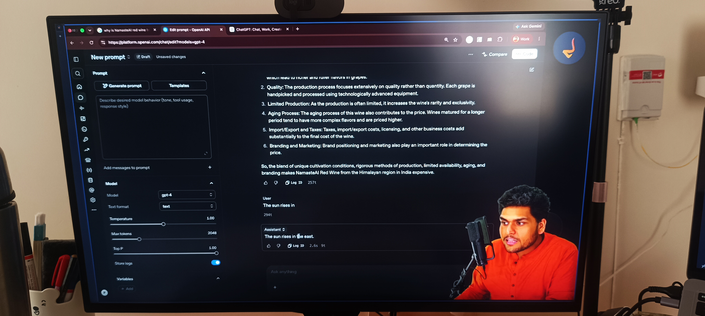

---

## 5. Is ChatGPT Just Autocomplete on Steroids?

An LLM is vastly more sophisticated than a smartphone keyboard autocomplete because it encodes knowledge inside the **parameters (weights)** of its deep neural network.

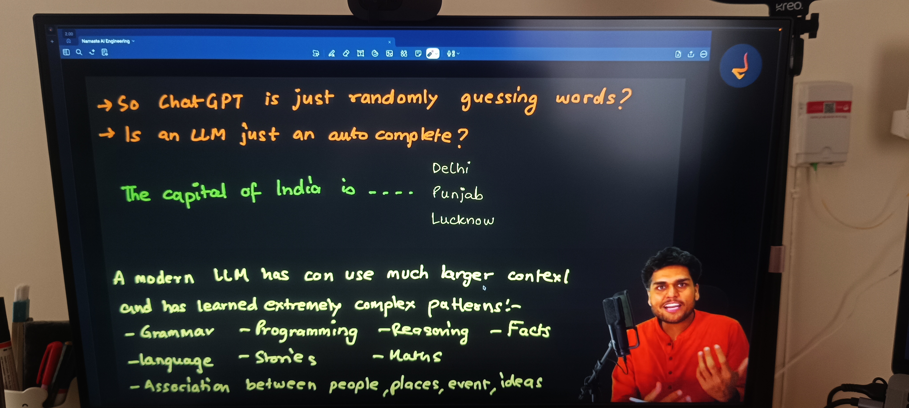

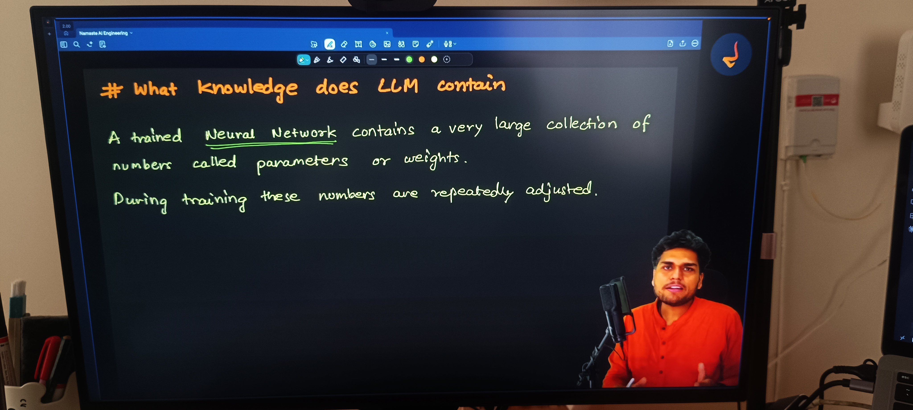

During pretraining across hundreds of billions of words from books, articles, codebases, and websites:
- Networks adjust billions or trillions of numerical weights.
- Models do not memorize verbatim documents.
- Models extract multi-dimensional structural patterns: syntax, grammar, deduction, coding logic, world relationships, analogies, and semantic nuances.

When predicting tokens, an LLM evaluates complex multi-layered relationships across the entire prompt context rather than simple word pairings.

---

## 6. The Knowledge Cutoff: Why Models Are Frozen in Time

LLMs have a fixed **Knowledge Cutoff**:

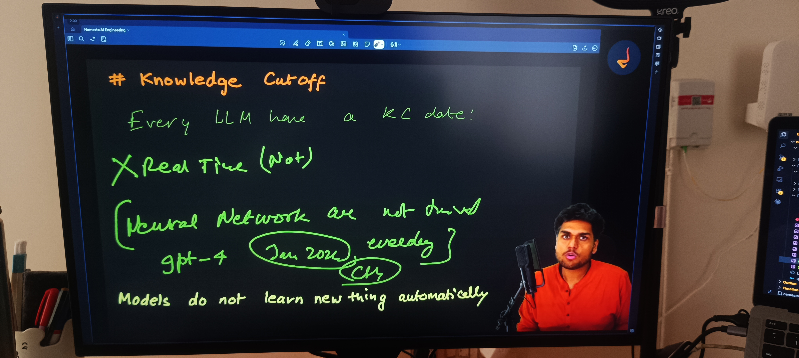

- Frontier training takes months of GPU compute.
- Once training completes, model parameters are **frozen**.
- Standalone models have no awareness of real-world events occurring after their training cutoff date.

### Delhi Chief Minister Playground Test

```text
Prompt: who is the delih CM roight now
```

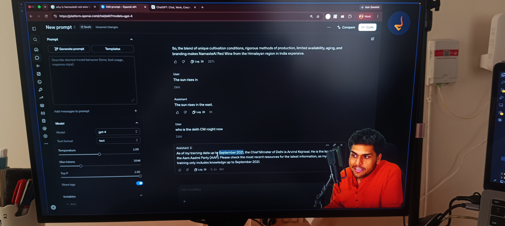

Two core observations:
1. **Semantic Understanding**: Handles typos (*delih*, *roight*) effortlessly without needing exact keyword matches.
2. **Temporal Bound**: Names Arvind Kejriwal based on its September 2021 cutoff. It cannot know subsequent political developments (such as Rekha Gupta assuming office in February 2025) without live tools.


---

## 7. Base Models vs AI Assistants: The Car and the Engine

A critical architectural distinction exists between a **Base Model** and an **AI Assistant**:


- **Base Model**: Like a raw car engine. Extremely powerful, but lacks steering, brakes, and safety controls.
- **AI Assistant (ChatGPT)**: The finished automobile. Encapsulates the engine with instruction tuning, safety guardrails, user interface, and external tools.


```text
Base Model (Raw Token Predictor)
        |
        v  + Instruction Tuning (Supervised Fine-Tuning)
        v  + RLHF (Reinforcement Learning from Human Feedback)
        v  + System Prompts & Safety Guardrails
        v  + External Tools (Search, Code Execution, File Parsers)
        |
        v
Consumer AI Assistant (ChatGPT, Claude, Gemini)
```

| Dimension | Base Model | AI Assistant |
| :--- | :--- | :--- |
| **Objective** | Predict the next most probable token | Follow instructions helpfully and safely |
| **Prompt Response** | May continue the text rather than answer | Delivers structured, direct solutions |
| **Safety Filters** | None; outputs unfiltered completions | Strict guardrails against harmful or dangerous outputs |
| **Tool Usage** | None; strictly uses internal weights | Invokes web search, Python interpreter, and file parsers |

---

## 8. Training vs Inference: School vs Work

The machine learning lifecycle is split into two distinct stages:


- **Training (Going to School)**: The learning phase. The neural network processes vast datasets, calculates prediction errors, and updates weights via backpropagation over months using thousands of GPUs.
- **Inference (Going to Work)**: The execution phase. The trained model processes user prompts and emits predictions in milliseconds on standard inference servers. **Weights are completely frozen during standard inference**.

---

## 9. Understanding Hallucinations: Fluency vs Truth

Fluency must never be mistaken for factual correctness. Akshay cites a classic Hindi proverb:

> *"Tez bolne se koi baat sahi nahi ho jaati."*  
> (Speaking quickly or eloquently does not make a statement true.)


A **hallucination** occurs when a model produces grammatically flawless, confident statements that are factually false, ungrounded, or entirely fabricated.

### Why LLMs Hallucinate

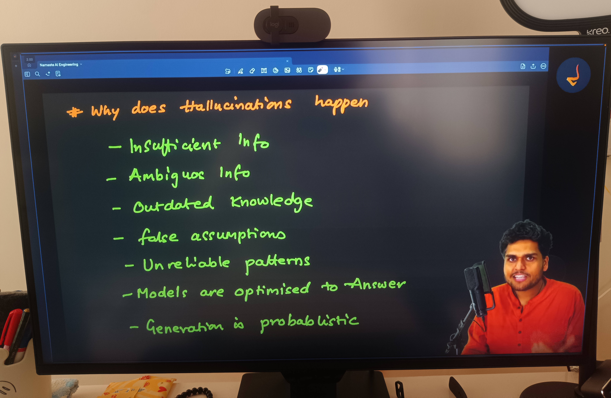

- **Probabilistic Generation**: Optimizes for token probability rather than objective truth.
- **Incentive to Respond**: Fine-tuning rewards helpfulness, so models prefer answering over staying silent.
- **Sparse Training Data**: Blends adjacent concepts when niche facts are missing.
- **Ambiguous Prompts**: Makes statistical guesses when queries lack precise context.
- **Outdated Knowledge**: Operates on fixed cutoff data.
- **False Premises**: Accepts incorrect prompt assumptions as valid context.
- **Noisy Web Data**: Reproduces conflicting or erroneous associations from pretraining sources.

---

## 10. The Six Types of Hallucinations


1. **Factual Fabrication**: Creating non-existent entities, papers, citations, or products (e.g. NamasteAI wine).
2. **False Causality**: Falsely claiming one event caused another due to contextual proximity.
3. **Contradictory Statements**: Making conflicting claims within the same output.
4. **False Precision**: Stating exact counts or decimal numbers without performing calculations.
5. **Source Misattribution**: Falsely attributing real quotes or papers to incorrect people.
6. **Temporal Confusion**: Blending events across eras or assuming historical figures are active today.

---

## 11. False Precision: The Dot Counting Test

To demonstrate false precision, Akshay prompts the model with a string containing **108 dots**:

```text
Prompt: Can you count the dots in the string - "..................................................."
```


- **Base Model (Playground)**: Guesses 100 dots with complete linguistic confidence. When 10 dots are added (making 118), it anchors to its earlier answer and guesses 110 dots.
- **AI Assistant (ChatGPT)**: Computes the exact ground truth (108 dots, then 118 dots) by executing Python code in the background.

### Why LLMs Cannot Count Independently
- **Tokenization**: Sequences of characters are converted into multi-character token chunks rather than individual letters.
- **No Iterative Counters**: A single forward pass generates each token; the network has no internal loop counters or character accumulators.

---

## 12. Why Do Models Sometimes Say "I Do Not Know"?

Models refuse or admit uncertainty due to six distinct factors:


1. **Assistant Alignment**: Supervised fine-tuning penalizes confident inaccuracies and rewards cautious uncertainty.
2. **System Prompts**: Developer instructions explicitly order models to acknowledge missing information.
3. **Low Statistical Confidence**: Very low probability distributions indicate insufficient data.
4. **Safety Guardrails**: Built-in moderation layers intercept restricted requests.
5. **Missing Tools**: Tasks requiring external or real-time information trigger refusals when tools are absent.
6. **Prompt Phrasing**: Specific prompt wording guides probability distributions toward refusal.

### Playground Demo: Course Price Refusal

```text
Prompt: What is the price of Namaste Data Science course?
```


The raw base model admits it lacks real-time web access and external database connections, refusing to answer rather than hallucinating a price.

---

## 13. Tool Augmentation: Web Search vs Grounded Refusal

### 1. Web Search Hallucination
When asking ChatGPT with web search enabled about the non-existent "Namaste Data Science course":


- ChatGPT searches the web but matches an unrelated third-party listing citing `Investment: AED 599`.
- It synthesizes a false answer instead of recognizing that no official course exists.
- **Lesson**: Tools reduce hallucinations, but models can still synthesize inaccuracies if search queries retrieve irrelevant or poor sources.

### 2. Grounded Refusal for Unknown Entities

```text
Prompt: Who is Akshay DSouza from Uganda
```


ChatGPT searches the web, discovers no notable public profile, and appropriately admits uncertainty rather than fabricating a fictional biography.

---

## 14. How Tools Extend Models: "Super Powers"

Tools connect frozen neural models to external systems, eliminating raw parametric constraints:


- **Web Search**: Live news, verified documentation, real-time prices.
- **Calculator**: Exact arithmetic and mathematical precision.
- **Code Execution (Python)**: Deterministic character counts, data analysis, and visualizations.
- **Weather and Geolocation**: Environmental and location-specific data.
- **Calendar and Email**: Scheduling, meeting coordination, and inbox management.
- **Databases (SQL)**: Structured querying over enterprise data.
- **File Parsers**: Ingesting and extracting text from PDFs, CSVs, and spreadsheets.

---

## 15. The Confidence Illusion: Tone as Evidence

Humans naturally associate confidence with truth, but LLMs produce falsehoods with the same calm, articulate tone as verified facts:

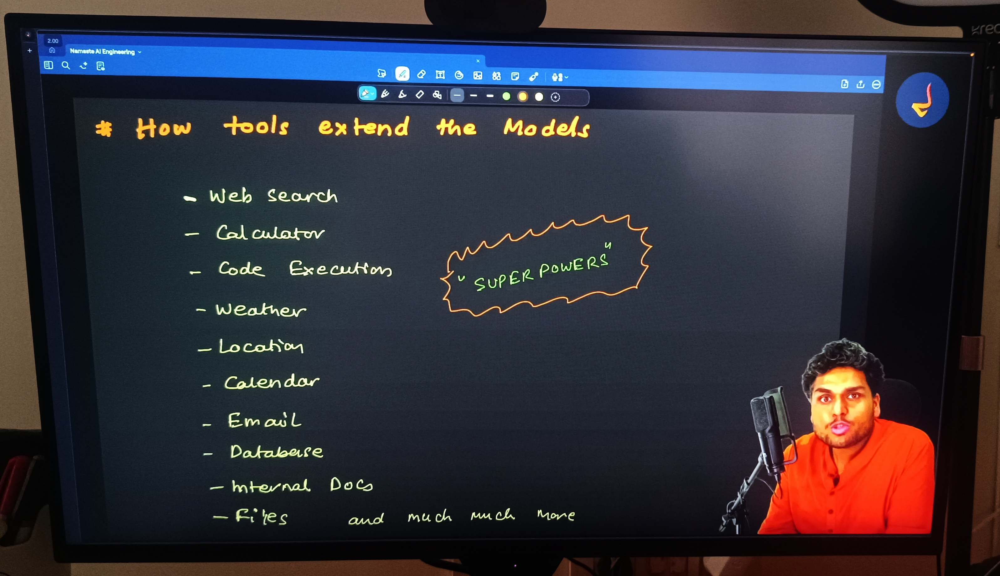

### Rules to Counter the Illusion
- **Separate Facts from Assumptions**: Require the model to classify verified statements versus inferences.
- **Ask for Uncertainty**: Direct the model to pinpoint where its answer could fail.
- **Demand Sources**: Request direct citations and primary references.
- **Ground with Search**: Use retrieval tools to cross-examine claims against live records.

---

## 16. Retrieval-Augmented Generation (RAG)

Combining external retrieval with generative language models establishes the foundational architecture of enterprise AI:

```text
Retrieval (External Evidence)  +  Generation (LLM)  =  RAG (Retrieval-Augmented Generation)
```

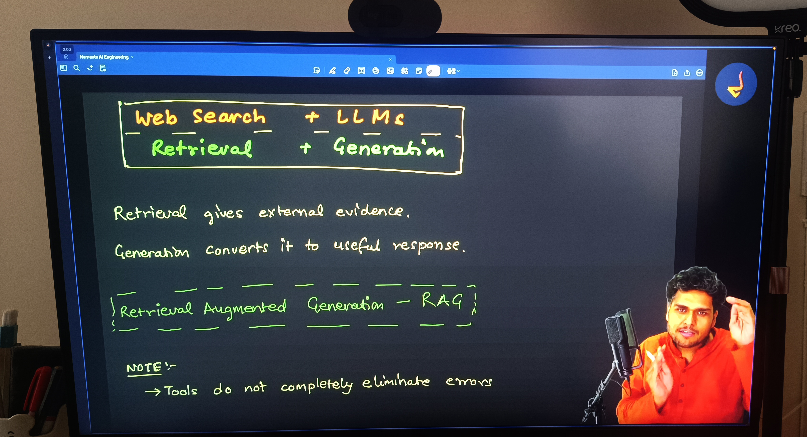

- **Retrieval**: Gathers authoritative context from databases, private wikis, or live web indexes.
- **Generation**: Formulates concise, natural language answers grounded strictly in retrieved context.

### Example: Google AI Overviews

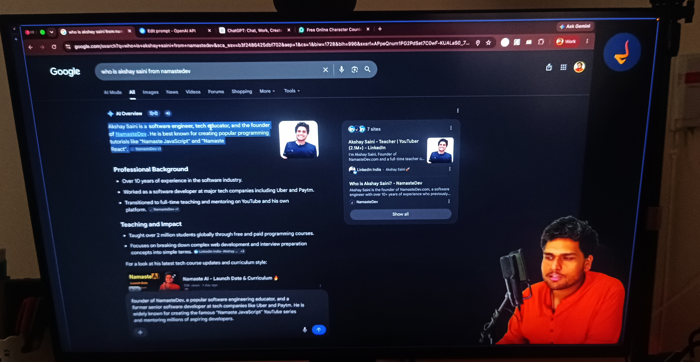

Searching for *"who is akshay saini from namastedev"*:
1. Google retrieves relevant indexed pages (NamasteDev, LinkedIn, YouTube).
2. The model synthesizes the facts into a concise summary with citation links for direct source verification.

---

## 17. Does the Model Know Itself? The Illusion of Self-Awareness

LLMs possess zero self-awareness, personal identity, or consciousness.

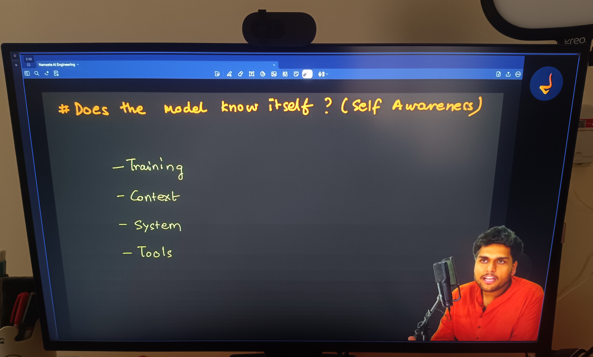

Apparent self-knowledge comes from four external sources:
1. **Training Data**: Mentions of OpenAI, model versions, and infrastructure in the pretraining corpus.
2. **Context**: Messages provided within the current session.
3. **System Instructions**: Hidden prompts supplied by developers (e.g. *"You are ChatGPT, a large language model trained by OpenAI..."*).
4. **Environment Tools**: Runtime platform metadata.

### Playground Self-Awareness Tests
- **"Who created you?"**: Answers OpenAI based on system instructions and pretraining documents.  
  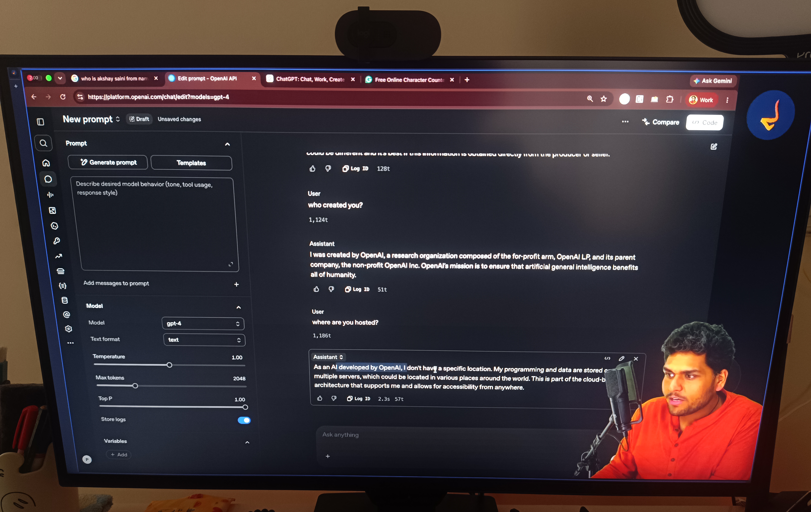
- **"Where are you hosted?"**: Describes distributed cloud data centers based on public computing articles.  
  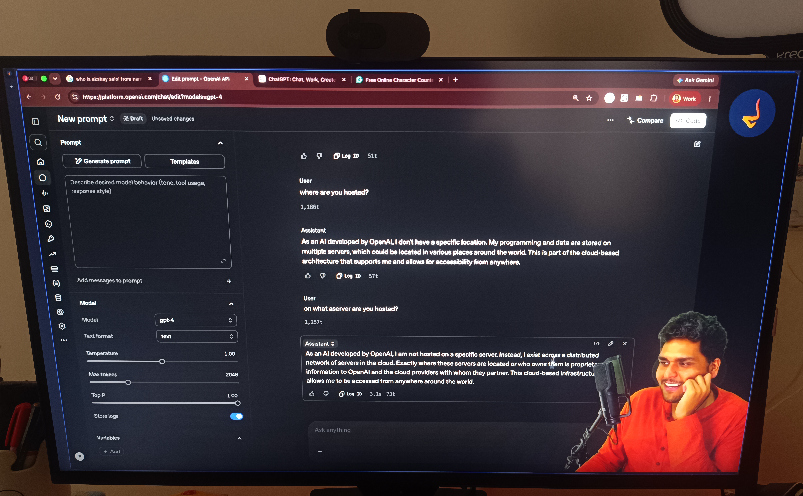
- **"Can you give me your IP?"**: Refuses and admits it has no personal IP address, operating as a stateless function in cloud containers.  
  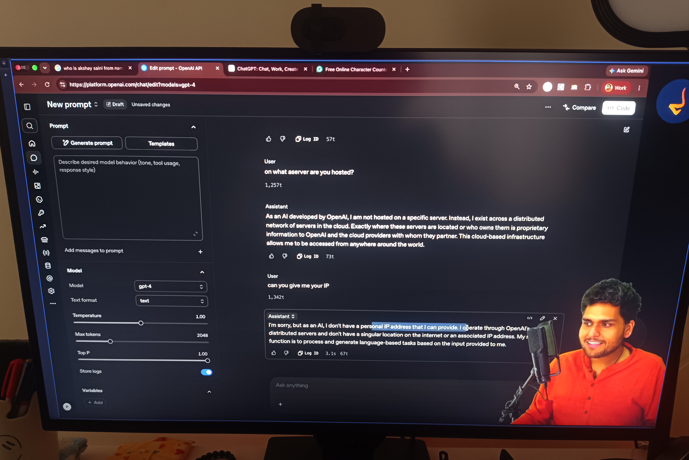

---

## 18. Four Information Paradigms Compared


| Paradigm | Primary Mechanism | Strengths | Limitations |
| :--- | :--- | :--- | :--- |
| **1. Search Engine** (Google) | Crawling, indexing, and ranking | Real-time web access, direct links to primary sources | No direct answer synthesis; manual browsing required |
| **2. Base Model** (Raw GPT-4) | Pure next-token prediction | Broad pattern recognition, reasoning, and code generation | Hallucinations, frozen cutoff date, lacks tools |
| **3. Chat Assistant** (ChatGPT) | Base model + alignment + basic tools | Conversational interaction, instruction following, web access | Vulnerable to false precision without deterministic tools |
| **4. Grounded Model + Private Info** (Enterprise RAG) | Model + proprietary data stores | Accurate answers grounded in internal business documents | Dependent on retrieval chunking and document quality |

---

## 19. Conclusion: Does ChatGPT Know or Does It Guess?


- **It does not "know"**: It lacks conscious understanding, intent, and an internal concept of objective truth.
- **Nor does it merely "guess"**: It does not pick words at random or flip coins.

**ChatGPT generates probabilistic completions guided by billions of statistical parameters learned during training, guided by system instructions, aligned through human feedback, and grounded by external tools.**
