# Episode 04: The Secret Language of LLMs

> **Season 1: Inside the Mind of AI**  
> Instructor: **Akshay Saini** (NamasteDev)  
> Topic: How LLMs Process Language, Tokens, Token IDs, Tokenizers, Subword Tokenization, Context Windows, and Fertility

---

## 1. The Core Question: Can LLMs Understand Human Words?

Large Language Models can converse in English, Hindi, Punjabi, Bengali, Telugu, Tamil, Kannada, Malayalam, French, German, and many other languages.

However, from first principles:
- **Computers cannot directly understand words**: A computer does not grasp what "Namaste", "AI", or "amazing" means. When a human reads a word, a conceptual click occurs in the mind. That mental association does not exist inside silicon circuits.
- **The native language of LLMs is numbers**: Neural networks perform matrix multiplications, dot products, and statistical probabilities on numerical vectors. To process human text, every word, subword, or symbol must first be translated into numbers.

---

## 2. From Text to Numbers: The Token Pipeline

When a prompt like `Namaste AI is amazing` is passed to an LLM, the raw text does not enter the model directly. The processing pipeline works as follows:

1. **Splitting into Units**: The incoming text is broken into smaller chunks called **tokens**.
2. **Assigning Numbers**: Each token receives a unique numerical identifier called a **Token ID**.
3. **Feeding to the Model**: The resulting array of Token IDs, such as `[78, 12, 37, 108]`, is passed to the LLM.


### Next-Token Prediction in Numbers

In Episode 03, LLMs were described as next-word prediction engines. At the architectural level:
- The LLM does **not** directly predict human words.
- The LLM predicts the **next Token ID** based on statistical probability over its vocabulary.
- The predicted Token ID is subsequently translated back into human text and streamed to the user.

---

## 3. What is a Token?

A simple, accurate definition:

> **A Token is a unit of text defined by a tokenizer.**


Key characteristics of tokens:
- A token is not strictly a single word.
- A token is not strictly a single character.
- A token is whatever segment of text the tokenizer algorithm splits off as a single discrete item.

---

## 4. What is a Tokenizer?

A tokenizer is a software program and algorithm written by engineers to convert text into tokens and assign corresponding Token IDs.

A tokenizer has two core responsibilities:
1. **Encoding (Text to Numbers)**: Breaks raw input strings into tokens and maps each token to its numerical Token ID.
2. **Decoding (Numbers to Text)**: Reconstructs text strings from the numerical Token IDs generated by the LLM.

### Tokenizer Characteristics

- **Software code, not physical hardware**: A tokenizer is a deterministic program running before and after the neural network.
- **Critical across training and inference**: The exact same tokenizer used to train the LLM must be used when sending prompts during inference.
- **No universal tokenizer**: Different models and AI providers build distinct tokenizers. For instance, GPT-3, GPT-4, and newer models use different tokenizer implementations with different vocabulary sizes. Meta LLaMA uses SentencePiece-BPE.

---

## 5. Words vs Characters vs Tokens: Subword Tokenization

A common misconception is that one word equals one token. In modern LLMs:
- Common, frequent words may exist as single tokens (for example, `AI` or `is`).
- Less common words or compound words are broken into smaller subword pieces (for example, `playing` can split into `play` and `ing`).
- Unfamiliar words or non-English terms may be chopped into individual character fragments.


### Live Demonstration: "Namaste AI is amazing"

Testing `Namaste AI is amazing` in tokenization tools demonstrates subword splitting:
- Text: `Namaste AI is amazing`
- Split into 6 tokens: `[N, am, aste,  AI,  is,  amazing]`
- Corresponding Token IDs: `[45, 321, 4594, 9552, 318, 4998]`

Notice that `Namaste` is split into three subword tokens: `N`, `am`, and `aste` because the full word was not stored as a single contiguous token entry in that specific tokenizer vocabulary.

### The Role of Spaces and Case Sensitivity

In modern tokenizers, whitespace and letter casing are integral parts of the token:
- A leading space changes the token: `" amazing"` with a leading space has a different Token ID than `"amazing"` without a space.
- Casing matters: `"Amazing"` starting with a capital letter produces a different Token ID than lowercase `"amazing"`.
- Punctuation, dashes, and brackets each possess dedicated token mappings.

### Tokenizer Inspection Tools

The tokenization process can be observed interactively using:
- **OpenAI Tokenizer**: `https://platform.openai.com/tokenizer`
- **Tiktokenizer**: `https://tiktokenizer.vercel.app/`

---

## 6. Why Models Use Subword Tokenization

To understand why modern LLMs use subwords, consider the trade-offs of the three alternative strategies:

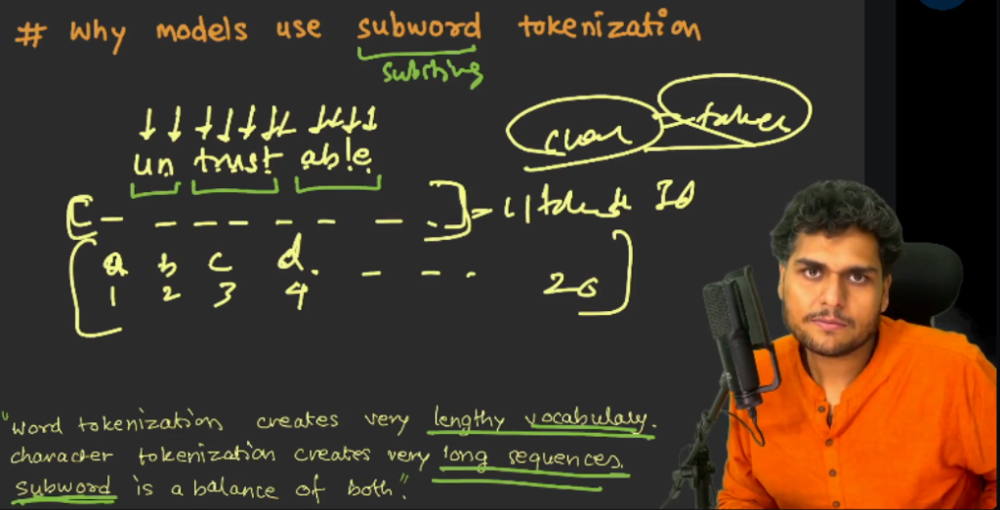

> **Key Rule of Thumb**:
> "Word tokenization creates very lengthy vocabulary. Character tokenization creates very long sequences. Subword is a balance of both."

### Comparison of Tokenization Strategies

| Strategy | Vocabulary Size | Sequence Length | Primary Disadvantage |
| :--- | :--- | :--- | :--- |
| **Word Tokenization** | Massive (millions of words) | Short | Out of Vocabulary (OOV) errors for new words, typos, or slang; huge memory footprint. |
| **Character Tokenization** | Tiny (100 to 256 characters) | Extremely long | Quadratic compute cost in attention; wastes context window; hard to learn word semantics. |
| **Subword Tokenization** | Balanced (32k to 200k tokens) | Moderate | Requires an algorithmic tokenizer step, but handles unseen words gracefully. |

### Advantages of the Subword Approach

- **Vocabulary Efficiency**: Decomposes complex terms into reusable subword components. For example, `untrustable` splits into `un`, `trust`, and `able`. The prefix `un` and suffix `able` can be reused across hundreds of other words.
- **Zero Out of Vocabulary Failures**: Any brand-new word, slang term, or typo can still be processed by breaking it down into known subwords or characters.
- **Context Window Conservation**: Produces compact sequences compared to character-based approaches, saving valuable context window space and compute.

---

## 7. Vocabulary and Token ID Mapping

Every tokenizer contains a fixed **vocabulary**.

> **Vocabulary**: The complete collection of tokens that the tokenizer knows how to represent directly.

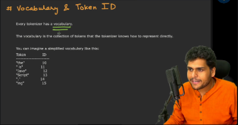

### Simplified Vocabulary Example

| Token | Token ID |
| :--- | :--- |
| `"the"` | 10 |
| `"is"` | 11 |
| `"Java"` | 12 |
| `"Script"` | 13 |
| `"."` | 14 |
| `"ing"` | 15 |

When the tokenizer encounters `"JavaScript"`, it maps the string to two sequential tokens: `"Java"` (ID 12) followed by `"Script"` (ID 13).

### Real-World Vocabulary Scales

Different generations of models feature varying vocabulary sizes:
- **GPT-3 (`r50k_base`)**: Approximately 50,000 tokens.
- **GPT-4 (`cl100k_base`)**: Approximately 100,000 tokens.
- **GPT-4o (`o200k_base`)**: Approximately 200,000 tokens.
- **LLaMA 3**: Approximately 128,000 tokens.

A larger vocabulary allows a model to represent text in fewer tokens, improving processing speed and multi-language efficiency.

> [!NOTE]
> Token IDs represent arbitrary integer indices within the vocabulary table. They carry no intrinsic mathematical ranking: Token ID 108 is not greater or more meaningful than Token ID 12.

---

## 8. Subword Tokenization Algorithms

Different AI organizations employ different mathematical algorithms to build and optimize tokenizers:

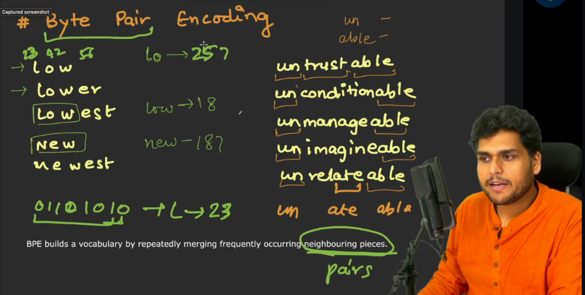

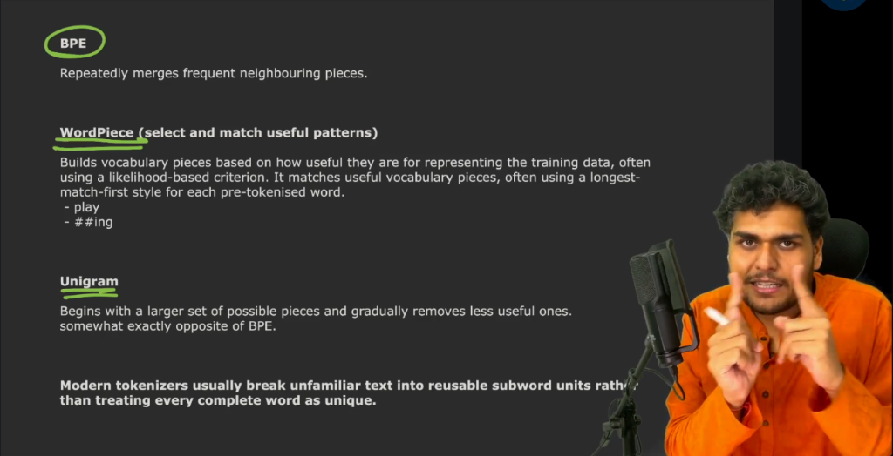

### 1. Byte Pair Encoding (BPE)

- **How it works**: Starts with single letters and glues together letters that appear side by side most often.
- **Example**: `l` and `o` appear together a lot, so they become `lo`. Then `lo` and `w` join to make `low`.
- **Used by**: OpenAI (GPT models) and Meta (LLaMA).

### 2. WordPiece

- **How it works**: Like BPE, but glues pieces together based on which combination makes the most sense mathematically, not just which one appears the most.
- **Example**: Breaks words into a base word plus an ending tag, such as `playing` into `play` and `##ing`.
- **Used by**: Google (BERT).

### 3. Unigram

- **How it works**: Starts with a massive basket of words and pieces, then throws away the least useful ones until only the best pieces remain.
- **Example**: Begins with thousands of possible combinations and cuts out rare, useless pieces.
- **Used by**: Google (SentencePiece, T5).

---

## 9. English vs Other Languages and the Hinglish Challenge

Token efficiency varies drastically across languages because pretraining corpora historically contained an overwhelming proportion of English text.

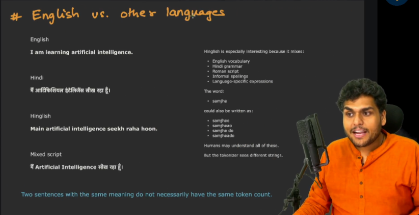

> **Key Rule**:
> "Two sentences with the same meaning do not necessarily have the same token count."

### The Language Disparity

Comparing identical meaning across scripts:
- **English**: `I am learning artificial intelligence.` (Fewest tokens, highly compressed)
- **Hindi**: `मैं आर्टिफिशियल इंटेलिजेंस सीख रहा हूँ।` (Higher token count)
- **Hinglish**: `Main artificial intelligence seekh raha hoon.` (Subword fragmentation)
- **Mixed script**: `मैं Artificial Intelligence सीख रहा हूँ।` (Switching vocabularies)

In GPT-3, a Hindi sentence often consumed 3 to 5 times more tokens than its English equivalent. Modern tokenizers like GPT-4o (`o200k_base`) significantly improved non-English efficiency, but English remains the most compact.

### The Hinglish Fragmentation Problem

Hinglish mixes English vocabulary, Hindi grammar, Roman script, informal spellings, and colloquial expressions:
- **Informal spelling variations**: The word `samjha` can be typed as `samjhao`, `samjhaao`, `samjha do`, or `samjhaado`.
- **Subword shattering**: Humans understand all these variants effortlessly, but the tokenizer sees completely different text strings.
- Because tokenizers cannot store thousands of informal phonetic variations, words get chopped into multiple tiny fragments (such as `sam` + `jha` + `o`), driving up token counts and API costs.

---

## 10. Tokenization Fertility

A formal metric to quantify how efficiently a tokenizer handles a given language or dataset is **Tokenization Fertility**.

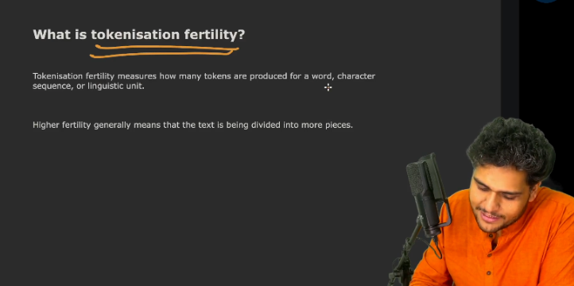

> **Tokenization Fertility**: Measures how many tokens are produced for a word, character sequence, or linguistic unit.
>
> `Fertility = Total Tokens / Total Words`

### Low Fertility vs High Fertility

- **Low Fertility (Close to 1.0)**:
  - Typical in English (around 1.1 to 1.3 tokens per word).
  - Complete words or large morphemes map directly to single tokens.
  - Benefits: Faster generation speed, lower inference costs, and maximal context window utilization.
- **High Fertility (2.0 to 4.0+)**:
  - Common in non-Latin scripts, regional Indian languages, and informal transliterations.
  - Text is divided into numerous tiny pieces.
  - Drawbacks: Higher API billing, slower output generation, and premature context window exhaustion.

---

## 11. Emojis, Code, and Formatting Tokens

LLMs process all digital characters through the same token pipeline, including emojis and programming syntax.

### Emojis in Tokenization

- **One visible emoji is not always one token**:
  - Standard, common emojis (like a basic heart or smiley) often exist as 1 or 2 tokens in modern models.
  - Complex emojis (combinations using zero-width joiners, modified skin tones, or compound flags) can consume 3, 4, or more tokens each.
  - In older models like GPT-3, single emojis regularly broke into multiple byte-level tokens.

### Code and Indentation Tokens

- Whitespace, tabs, and indentation levels are critical in code.
- Modern tokenizers include specialized tokens for common code keywords (such as `function`, `const`, `return`, `import`) and indentation blocks (such as two spaces, four spaces, or tab indentation).
- Modifying indentation or bracket styles changes the token sequence and token count.

---

## 12. Special Tokens and System Instructions

When a prompt enters an LLM, the raw user text is wrapped with hidden **special tokens** that establish structural boundaries between roles.

### Delimiter Tokens

Special tokens tell the model where instructions begin, where user inputs end, and where assistant output should start:
- Examples of boundary tokens: `<|startoftext|>`, `<|endoftext|>`, `<|im_start|>`, `<|im_end|>`.
- These tokens prevent the model from confusing system rules with user text.

### System Instructions vs User Instructions

- **System Instruction**: A hidden, foundational rulebook provided to the model that establishes its persona, tone, guardrails, and behavioral boundaries.
- **User Instruction**: The specific query or request typed directly by the human user.

The AI framework bundles the system instructions, conversation history, and user prompt into a structured format before converting the entire payload into tokens.

---

## 13. The Context Window and Short-Term Memory

A language model does not have unlimited working memory. When an AI remembers earlier parts of a conversation, it is because previous messages are repeatedly passed back into the model on every new turn.

> **Context Window**: The maximum volume of tokenized information that a model can accept and process within a single inference request.

In simple terms, the context window is the **short-term working memory** of the AI.

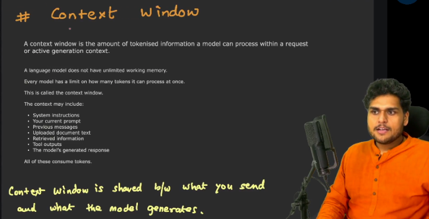

> **Key Rule**:
> "Context window is shared between what you send and what the model generates."

### What Occupies the Context Window?

The context window holds:
1. System instructions and safety guardrails.
2. Complete preceding chat history.
3. Uploaded documents and code files.
4. Retrieved information (via RAG).
5. Tool and function outputs.
6. Current user prompt.
7. Model generated response tokens.

All of these consume tokens from the same maximum context allocation.

### Context Window Capacity Across Model Generations

- **GPT-3**: 2,048 to 4,096 tokens.
- **GPT-3.5**: 4,096 tokens, later expanded to 16,384 tokens.
- **GPT-4**: 8,192 tokens, later expanded to 32,768 and 128,000 tokens.
- **GPT-4o**: 128,000 tokens.
- **Gemini 1.5 Pro**: 1,000,000 to 2,000,000+ tokens.

### What Happens When the Context Window Fills?

When conversation volume or reference documentation exceeds the maximum context length, applications employ different strategies:

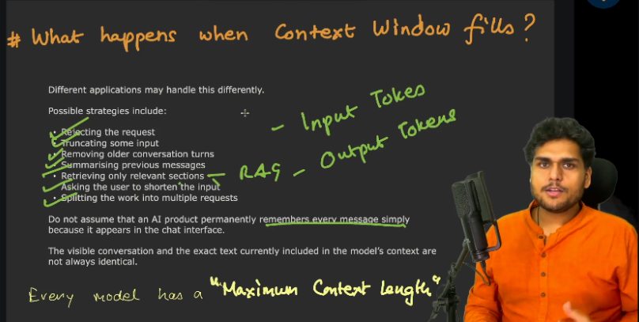

1. **Rejecting the request**: Throwing an error when input tokens exceed capacity.
2. **Truncating input**: Discarding portions of user input or conversation history.
3. **Removing older conversation turns**: Dropping the earliest messages so recent exchanges remain active.
4. **Summarizing previous messages**: Condensing long discussion history into a compact summary block.
5. **Retrieving only relevant sections (RAG)**: Using vector search to inject only pertinent excerpts rather than entire libraries.
6. **Asking the user to shorten input**: Prompting the user to trim their text.
7. **Splitting the work into multiple requests**: Modularizing large tasks across separate requests or chats.

> [!IMPORTANT]
> Do not assume that an AI product permanently remembers every message simply because it appears in the chat interface. The visible conversation in the UI and the exact text currently included in the context of the model are not always identical.

### The "Lost in the Middle" Phenomenon

A massive context window does not ensure flawless recall:
- Research and empirical testing show models recall information located at the very beginning and very end of a prompt with high accuracy.
- Details placed deep inside the middle of a massive context window are frequently overlooked or diluted.

---

## 14. Prompt Length, Efficiency, and Cost

A common misconception is that a longer prompt always produces a superior answer.

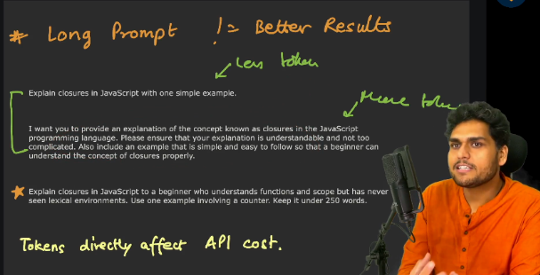

> **Key Rule**:
> "Tokens directly affect API cost."

### Comparing Prompt Styles

- **Concise Prompt (Fewer tokens)**:
  ```text
  Explain closures in JavaScript with one simple example.
  ```
- **Bloated Prompt (Unnecessary tokens, same output)**:
  ```text
  I want you to provide an explanation of the concept known as closures in the JavaScript programming language. Please ensure that your explanation is understandable and not too complicated. Also include an example that is simple and easy to follow so that a beginner can understand the concept of closures properly.
  ```
- **Targeted Prompt (Optimal constraints, high quality)**:
  ```text
  Explain closures in JavaScript to a beginner who understands functions and scope but has never seen lexical environments. Use one example involving a counter. Keep it under 250 words.
  ```

### Why Bloated Prompts Hurt Performance

- Unnecessary fluff dilutes the attention mechanism of the neural network.
- Increased token volume directly inflates inference latency and billing.
- Clear, well-constrained instructions yield faster and more accurate responses.

---

## 15. Common Misconceptions: Fact vs Fiction

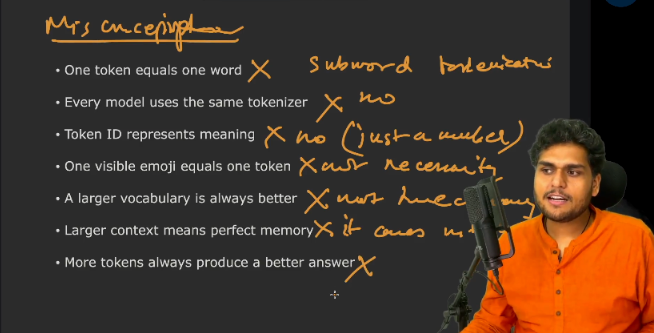

| Misconception | Reality |
| :--- | :--- |
| **One token equals one word** | **False**. A token is a unit defined by a tokenizer. Words are frequently split into subwords or characters. |
| **All models use the same tokenizer** | **False**. Different models and companies design custom tokenizers with distinct vocabulary sizes and algorithms. |
| **Token IDs carry semantic meaning** | **False**. Token IDs are arbitrary integer lookup indices in a vocabulary table. ID 108 has no greater value than ID 12. |
| **One visible emoji is one token** | **False**. Compound or modifier emojis frequently require 2 to 4 or more tokens. |
| **A larger vocabulary is always better** | **False**. Larger vocabularies compress text into fewer tokens, but increase embedding table parameters, memory footprint, and training complexity. |
| **A larger context window means perfect memory** | **False**. Models suffer from attention dilution and the "lost in the middle" effect when searching large contexts. |
| **More tokens in a prompt always lead to better results** | **False**. Precise, concise prompts outperform verbose prompts by keeping attention focused on core constraints. |

---

## 16. Looking Ahead: The Bridge to Embeddings

Tokenization solves the fundamental problem of converting human text into numerical values (`[45, 321, 4594, 9552, 318, 4998]`).

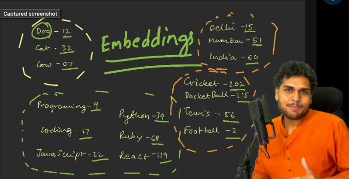

However, Token IDs alone contain zero semantic understanding:
- How does an LLM understand that `Dog` (ID 12), `Cat` (ID 32), and `Cow` (ID 07) belong together as animals?
- How does it recognize that `Delhi` (ID 15), `Mumbai` (ID 51), and `India` (ID 60) share a geographical relationship?
- How does it know that `Cricket` (ID 202), `Basketball` (ID 115), `Tennis` (ID 56), and `Football` (ID 2) are sports?
- How does it cluster `Programming` (ID 9), `Coding` (ID 17), `JavaScript` (ID 22), `Python` (ID 34), `Ruby` (ID 68), and `React` (ID 119)?

Token IDs provide only isolated integer identifiers. The mathematical representation of **semantic meaning, conceptual relationships, and high-dimensional clusters** is accomplished through **Embeddings**, the subject of Episode 05.
