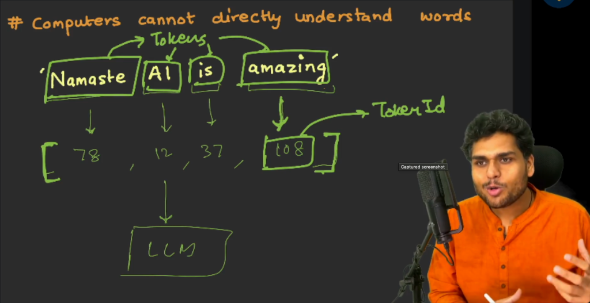
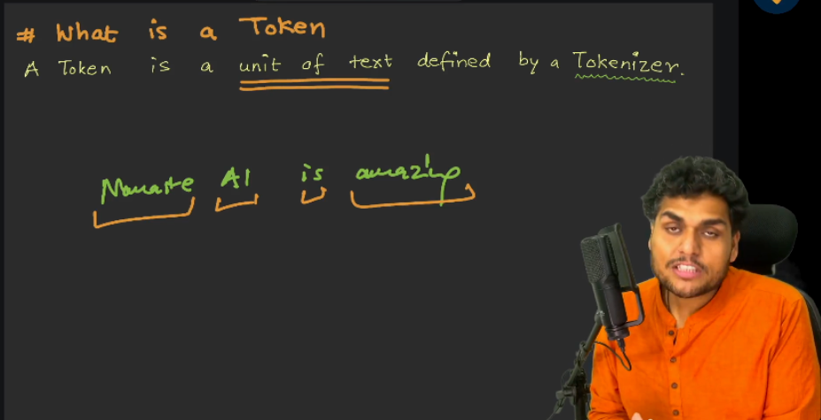
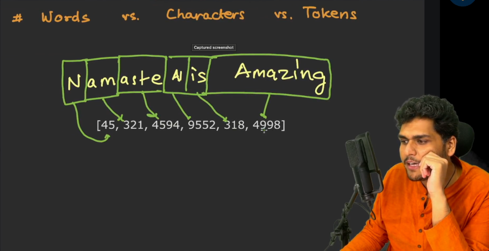

# Episode 04: The Secret Language of LLMs

> **Season 1: Inside the Mind of AI**  
> Instructor: **Akshay Saini** (NamasteDev)  
> Topic: How LLMs Process Language, Tokens, Token IDs, Tokenizers, and Subword Tokenization

---

## 1. The Core Question: Can LLMs Understand Human Words?

Large Language Models can converse in English, Hindi, Punjabi, Bengali, Telugu, Tamil, Kannada, Malayalam, French, German, and many other languages.

However, from first principles:
- **Computers cannot directly understand words**: A computer does not grasp what "Namaste", "AI", or "amazing" means. When a human reads a word, a conceptual click occurs in the mind. That mental association does not exist inside silicon circuits.
- **The native language of LLMs is numbers**: Neural networks perform matrix multiplications, dot products, and statistical probabilities on numerical vectors. To process human text, every word, subword, or symbol must first be translated into numbers.

---

## 2. From Text to Numbers: The Token Pipeline

When a prompt like `Namaste AI is amazing` is passed to an LLM, the raw text does not enter the model directly. The processing pipeline works as follows:

1. **Splitting into Units**: The incoming text is broken into smaller chunks called **tokens**.
2. **Assigning Numbers**: Each token receives a unique numerical identifier called a **Token ID**.
3. **Feeding to the Model**: The resulting array of Token IDs, such as `[78, 12, 37, 108]`, is passed to the LLM.

### Next-Token Prediction in Numbers

In Episode 03, LLMs were described as next-word prediction engines. At the architectural level:
- The LLM does **not** directly predict human words.
- The LLM predicts the **next Token ID** based on statistical probability over its vocabulary.
- The predicted Token ID is subsequently translated back into human text and streamed to the user.

---

## 3. What is a Token?

A simple, accurate definition:

> **A Token is a unit of text defined by a tokenizer.**

Key characteristics of tokens:
- A token is not strictly a single word.
- A token is not strictly a single character.
- A token is whatever segment of text the tokenizer algorithm splits off as a single discrete item.

---

## 4. What is a Tokenizer?

A tokenizer is a software program and algorithm written by engineers to convert text into tokens and assign corresponding Token IDs.

A tokenizer has two core responsibilities:
1. **Encoding (Text to Numbers)**: Breaks raw input strings into tokens and maps each token to its numerical Token ID.
2. **Decoding (Numbers to Text)**: Reconstructs text strings from the numerical Token IDs generated by the LLM.

### Tokenizer Characteristics

- **Software code, not physical hardware**: A tokenizer is a deterministic program running before and after the neural network.
- **Critical across training and inference**: The exact same tokenizer used to train the LLM must be used when sending prompts during inference.
- **No universal tokenizer**: Different models and AI providers build distinct tokenizers. For instance, GPT-3, GPT-4, and newer models use different tokenizer implementations with different vocabulary sizes. Meta LLaMA uses SentencePiece-BPE.

---

## 5. Words vs Characters vs Tokens: Subword Tokenization

A common misconception is that one word equals one token. In modern LLMs:
- Common, frequent words may exist as single tokens (for example, `AI` or `is`).
- Less common words or compound words are broken into smaller subword pieces (for example, `playing` can split into `play` and `ing`).
- Unfamiliar words or non-English terms may be chopped into individual character fragments.

### Live Demonstration: "Namaste AI is amazing"

Testing `Namaste AI is amazing` in tokenization tools demonstrates subword splitting:
- Text: `Namaste AI is amazing`
- Split into 6 tokens: `[N, amaste, AI,  is,   amazing]`
- Corresponding Token IDs: `[45, 321, 4594, 9552, 318, 4998]`

Notice that `Namaste` is split into `N` and `amaste` because the full word was not stored as a single contiguous token entry in that specific tokenizer vocabulary.

### Tokenizer Inspection Tools

The tokenization process can be observed interactively using:
- **OpenAI Tokenizer**: `https://platform.openai.com/tokenizer`
- **Tiktokenizer**: `https://tiktokenizer.vercel.app/`
