# Episode 05: How Machines Represent Meaning

> **Season 1: Inside the Mind of AI**  
> Instructor: **Akshay Saini** (NamasteDev)  
> Topic: How AI Understands Meaning, Token IDs vs Embeddings, Vectorization, Dimensions, Semantic and Cosine Similarity, Positional Encodings, Token vs Text Embeddings, Polysemy, Transformer Contextualisation, Bias, and Common Misconceptions

---

## 1. The Core Mystery: How Does AI Understand Meaning?

Consider the following statements:
1. "I ate an **apple** in the afternoon."
2. "**Apple** has launched a new device."

In human conversation, the distinction is immediate and effortless:
- In sentence 1, apple refers to a sweet edible fruit.
- In sentence 2, Apple refers to a multinational consumer technology corporation.

Another classic example:
1. "I am sitting near a river **bank**."
2. "I have a savings account in a **bank**."

One refers to sloping riverfront land, while the other refers to a licensed financial institution.

Human language is rich in **polysemy** (words possessing multiple distinct meanings depending on context), tone, nuance, and sarcasm. 

From first principles:
- Computers do not possess human cognition, eyes, or mental intuition.
- Natural Language Processing (NLP) must solve the fundamental challenge: how can a machine, which only operates on numbers, comprehend the true meaning and context behind words?

---

## 2. Why Token IDs Do Not Contain Any Meaning

In Episode 04, the text-to-token pipeline was established:
1. Sentences are segmented into discrete tokens by a tokenizer.
2. Each unique token is assigned an integer known as a **Token ID**.
3. The array of Token IDs is passed into the model.

However, a critical limitation exists: **Token IDs carry zero semantic meaning.**

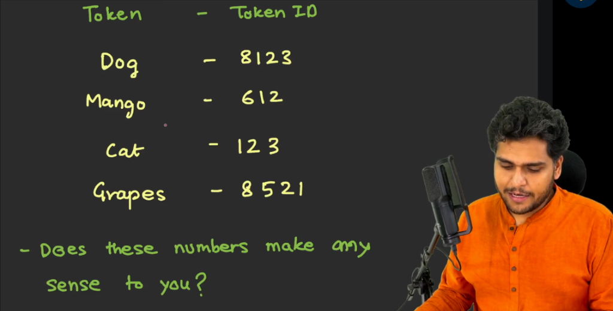

Consider four sample tokens from a tokenizer vocabulary:

| Token | Token ID |
| :--- | :--- |
| **Dog** | `8123` |
| **Mango** | `612` |
| **Cat** | `123` |
| **Grapes** | `8521` |

If we hide the words and inspect only the numbers:
- `8123` (Dog) and `8521` (Grapes) are numerically close to each other.
- But Dog and Grapes share virtually no semantic relationship in the real world.
- Conversely, Dog and Cat are closely related animals, yet their Token IDs (`8123` and `123`) are distant.
- Mango and Grapes are both sweet fruits, yet their Token IDs (`612` and `8521`) are distant.

Token IDs are merely arbitrary, sequential integer identifiers assigned to tokens in a vocabulary lookup table. Numerical proximity of Token IDs does not indicate semantic similarity.

### The Student Roll Number Analogy

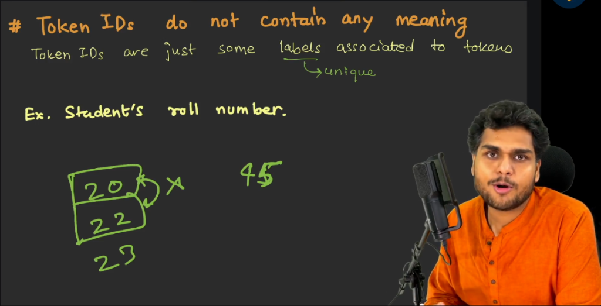

Think of Token IDs like student roll numbers in a classroom:
- Student A has roll number `20`.
- Student B has roll number `22`.
- Student C has roll number `23`.
- Student D has roll number `45`.

Just because roll numbers `20` and `22` are adjacent numbers does not mean those two students are best friends, share identical skills, or have similar personalities. They are simply arbitrary administrative labels. The same principle applies to hotel room numbers: room `101` and room `102` do not indicate anything about the guests inside.

Because Token IDs are meaningless administrative labels, a model cannot rely on them alone to understand language or relationships.

---

## 3. What is Vectorization?

To give machines the ability to process meaning, information must undergo **Vectorization** (also spelled Vectorisation).

> **Vectorization is the process of converting information into numerical vectors (an array of numbers).**

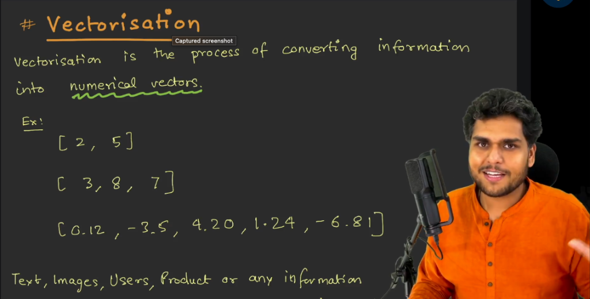

Examples of numerical vectors:
- Two-dimensional vector: `[2, 5]`
- Three-dimensional vector: `[3, 8, 7]`
- Multi-dimensional vector: `[0.12, -3.5, 4.20, 1.24, -6.81]`

Any type of information can be vectorized:
- Text (words, sentences, documents)
- Images and visual scenes
- Audio and speech
- User profiles, products, or interactions

### Why Vectorization is Essential

Computers cannot perform mathematical operations on raw words or arbitrary ID tags. 

**Vectorization turns information into a mathematical format on which computers can perform mathematical operations.**

Once information is in vector form, linear algebra, geometry, dot products, and distance formulas can be applied to measure relationships, calculate similarity, and make predictions.

---

## 4. Representing Concepts via Dimensions: The Fruit Ranking Exercise

To understand how an array of numbers captures real-world meaning, consider an intuitive exercise: ranking fruits along three specific properties.

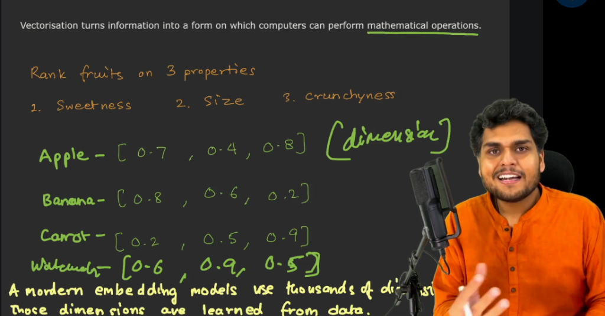

In mathematics and machine learning, each property is called a **Dimension**:
1. **Dimension 1**: Sweetness (scale from `0.0` to `1.0`)
2. **Dimension 2**: Size (scale from `0.0` to `1.0`)
3. **Dimension 3**: Crunchiness (scale from `0.0` to `1.0`)

Evaluating items across these three dimensions generates numerical vectors:

| Item | Sweetness | Size | Crunchiness | Resulting Vector |
| :--- | :--- | :--- | :--- | :--- |
| **Apple** | `0.7` | `0.4` | `0.8` | `[0.7, 0.4, 0.8]` |
| **Banana** | `0.8` | `0.6` | `0.2` | `[0.8, 0.6, 0.2]` |
| **Carrot** | `0.2` | `0.5` | `0.9` | `[0.2, 0.5, 0.9]` |
| **Watermelon** | `0.6` | `0.9` | `0.5` | `[0.6, 0.9, 0.5]` |

### How Vectors Reveal Meaning Mathematically

Notice what happens when concepts are translated into vectors:
- **Crunchiness**: If a machine searches for crunchy items, it inspects dimension 3: Apple (`0.8`) and Carrot (`0.9`) have high values, while Banana (`0.2`) has a low value.
- **Sweetness**: Banana (`0.8`) and Apple (`0.7`) share high sweetness values, grouping them closer together along that dimension.

Each number inside the vector is not random: it captures a specific attribute or feature of the object.

---

## 5. From Manual Properties to Learned Dimensions

In our three-fruit example, humans manually picked sweetness, size, and crunchiness. But human language contains millions of nuances, relationships, and concepts.

Modern embedding models operate on a vastly larger scale:
- Modern models do not use 3 dimensions. They use **thousands of dimensions** (for example, 768, 1536, or 3072 dimensions per vector).
- **Dimensions are not defined by humans**: Engineers do not manually assign scores or handcraft what each dimension represents.
- **Dimensions are learned automatically from data**: During training, the embedding model processes billions of sentences across internet texts, books, code, and articles.

### How Models Learn Dimensions Automatically

When a model reads vast corpora of text:
- The word "banana" repeatedly appears alongside phrases such as "sweet fruit", "yellow skin", "tropical peel", and "smooth texture".
- Each time the model processes these co-occurrences, mathematical training algorithms adjust and tune the numerical coordinates up or down.
- Over time, the model converges on stable numerical representations where words with related concepts naturally align closely in multi-dimensional space.

---

## 6. What is an Embedding?

While vectorization refers to the general mechanical process of converting any data into numbers, an **embedding** has a specific, powerful definition:

> **An embedding is a learned numerical representation of an item that captures useful relationships with other items.**

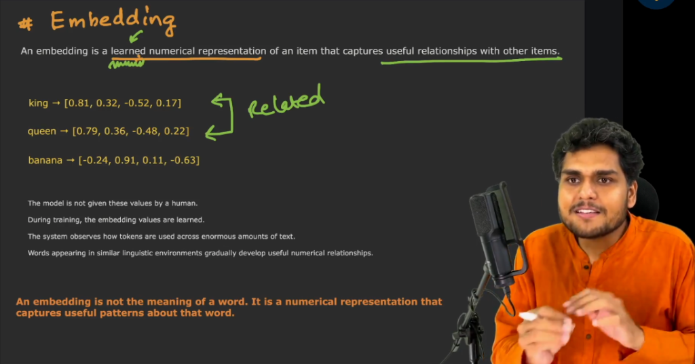

Consider sample four-dimensional embedding vectors for three words:

```text
king   -> [ 0.81,  0.32, -0.52,  0.17]
queen  -> [ 0.79,  0.36, -0.48,  0.22]
banana -> [-0.24,  0.91,  0.11, -0.63]
```

### Comparing Vectors Across Dimensions

Inspecting the coordinates reveals how embeddings encode relationships:
- **Dimension 1**: `king` (`0.81`) and `queen` (`0.79`) are nearly identical, whereas `banana` (`-0.24`) is far away and negative.
- **Dimension 2**: `king` (`0.32`) and `queen` (`0.36`) are tightly aligned.
- **Dimension 3**: `king` (`-0.52`) and `queen` (`-0.48`) share very similar negative values.
- **Dimension 4**: `king` (`0.17`) and `queen` (`0.22`) match closely.

Because `king` and `queen` share closely matched coordinates across all dimensions, the computer can mathematically deduce that they belong to the same conceptual family. In contrast, `banana` diverges across every single coordinate.

### How Embeddings Are Formed

1. **The model is not given these values by a human**: Engineers do not manually assign `0.81` to king or `-0.24` to banana.
2. **Values are learned during training**: The system observes how tokens appear across billions of sentences in books, articles, code, and online discussions.
3. **Linguistic environments build relationships**: Words that appear in similar linguistic contexts (for example, words surrounded by crowns, thrones, palaces, and kingdoms) gradually converge on similar coordinate vectors.
4. **The child learning analogy**: A child does not learn what a monarch is through mathematical definitions. Hearing bedtime stories where kings, queens, crowns, and castles repeatedly co-occur builds conceptual associations in the mind. The model builds identical associations purely through statistical data processing.
5. **The role of GPU computing**: The global race for GPU computing infrastructure exists precisely to run these massive mathematical optimizations, adjusting trillions of numerical weights to produce accurate embeddings.

### Critical Principle: Embeddings Are Not Meaning

> **An embedding is not the meaning of a word. It is a numerical representation that captures useful patterns and relationships about that word.**

A computer does not have subjective experience, eyes, or conscious feelings. It does not know the regal feeling of a king or the taste of a banana. It simply computes distances and geometric alignments between arrays of numbers.

---

## 7. Embeddings as Coordinates: Geometric Visualization

Humans cannot visualize a 1000-dimensional vector space. To build intuition, embeddings can be projected down into a 2D coordinate plane with an X-axis and a Y-axis.

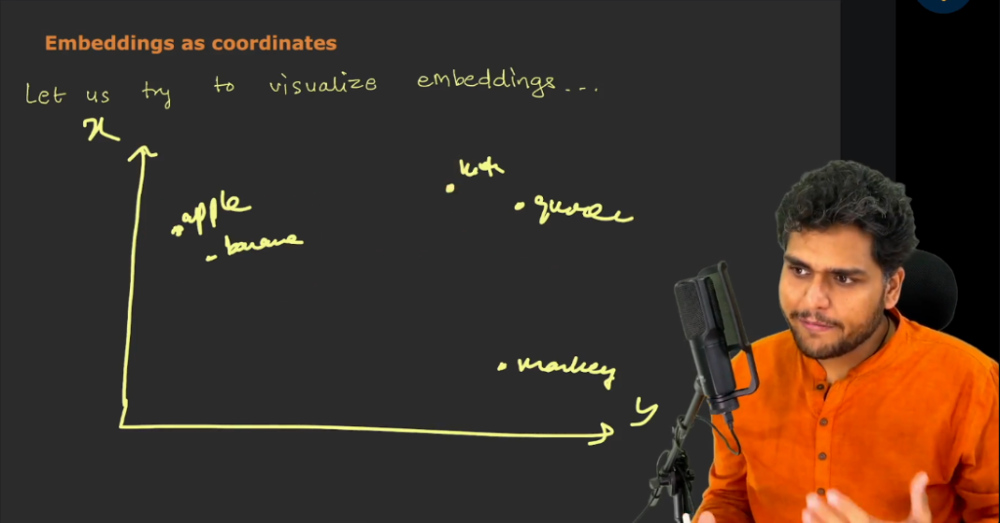

### Demonstration: A Fictional 2D Map

To illustrate how coordinates represent concepts, consider a fictional 2D coordinate dataset:

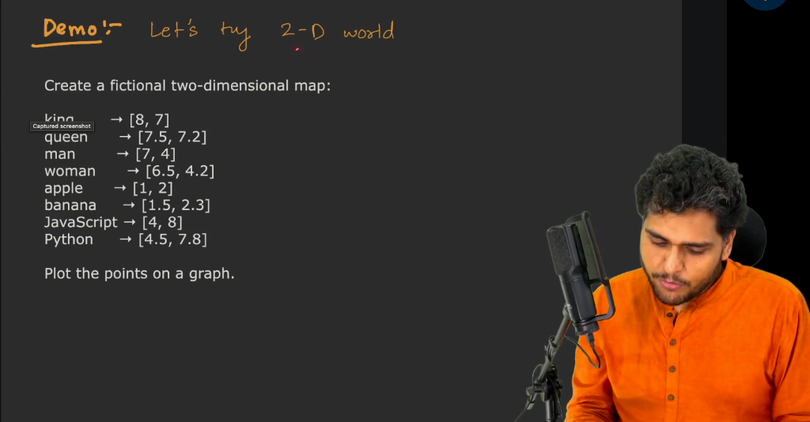

| Word / Token | Dimension 1 ($X$) | Dimension 2 ($Y$) | Semantic Category |
| :--- | :--- | :--- | :--- |
| **king** | `8.0` | `7.0` | Royalty |
| **queen** | `7.5` | `7.2` | Royalty |
| **man** | `7.0` | `4.0` | Human Roles / Gender |
| **woman** | `6.5` | `4.2` | Human Roles / Gender |
| **apple** | `1.0` | `2.0` | Fruits |
| **banana** | `1.5` | `2.3` | Fruits |
| **JavaScript** | `4.0` | `8.0` | Programming Languages |
| **Python** | `4.5` | `7.8` | Programming Languages |

When plotted on a graph, words that share semantic relationships automatically cluster together:

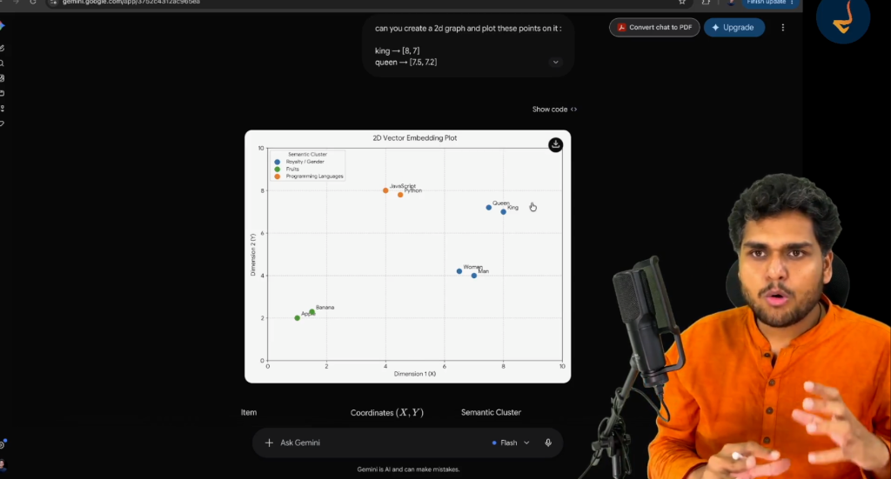

Examining this 2D embedding space reveals distinct semantic clusters:
- **Fruits**: `apple` `(1, 2)` and `banana` `(1.5, 2.3)` cluster together in the lower-left quadrant.
- **Programming Languages**: `JavaScript` `(4, 8)` and `Python` `(4.5, 7.8)` group near the upper-center.
- **Human Roles / Gender**: `man` `(7, 4)` and `woman` `(6.5, 4.2)` sit centrally on the right.
- **Royalty**: `king` `(8, 7)` and `queen` `(7.5, 7.2)` occupy the upper-right quadrant.

### Geometric Vector Direction and Analogies

Embeddings capture not only distance, but also direction:
- The vector pointing from `man` to `king` runs in a nearly identical direction and distance as the vector from `woman` to `queen`.
- In linear algebra, this allows models to solve analogical reasoning through vector arithmetic:
  $$\text{Vector}(\text{King}) - \text{Vector}(\text{Man}) + \text{Vector}(\text{Woman}) \approx \text{Vector}(\text{Queen})$$

---

## 8. Dimensions in an Embedding: The Complexity vs Computation Trade-off

Production embedding models represent each token with hundreds or thousands of dimensions (such as 768, 1536, or 3072 values per vector).

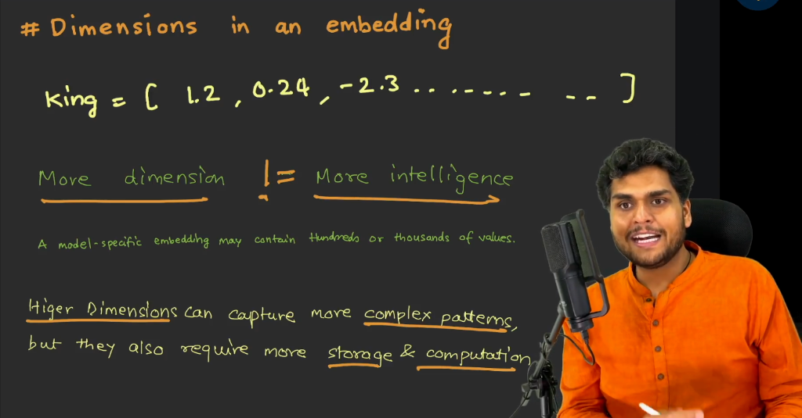

### Core Misconception: More Dimensions Does Not Mean More Intelligence

A frequent misconception is that expanding embedding dimensions automatically makes a model smarter:

$$\text{More Dimensions} \ne \text{More Intelligence}$$

The architectural reality involves an engineering trade-off:
- **Higher Dimensions**: Capture richer, more subtle semantic relationships and finer nuances across complex vocabulary.
- **Trade-offs**: Every added dimension increases memory consumption, storage footprints, network transfer sizes, and the computational cost (floating-point operations) required for dot products and matrix operations.

---

## 9. The Person Analogy: Why Language Requires High Dimensions

To understand why simple concepts require few dimensions while language demands thousands, consider how one might describe a human being.

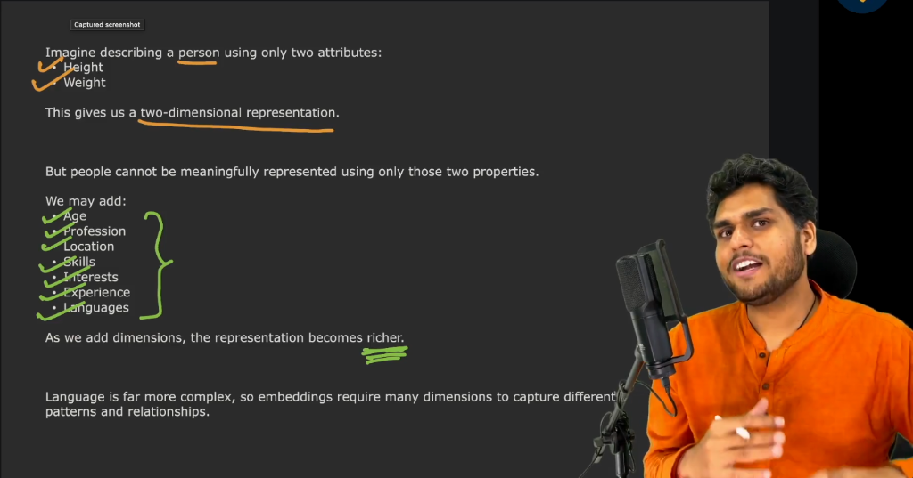

If we describe a person using only two attributes:
- Dimension 1: Height
- Dimension 2: Weight

A two-dimensional vector like `[175 cm, 70 kg]` cannot meaningfully distinguish one individual from millions of others. It tells us nothing about their character, profession, or identity.

To build a meaningful representation, we must introduce more dimensions:
- Age
- Profession
- Geographical Location
- Skills
- Interests
- Years of Experience
- Spoken Languages

As dimensions are added, the numerical profile becomes substantially richer, more descriptive, and capable of distinguishing nuance.

### Why Human Language Demands Thousands of Dimensions

Human language is far more complex than a personal profile:
- A single word can have multiple meanings depending on context (polysemy: Java as a language, an island, or coffee).
- Words express sarcasm, humor, figurative speech, technical precision, and cultural idioms.
- Sentences combine words in virtually infinite permutations.

To capture these multi-layered linguistic patterns without collisions, embedding models require high-dimensional vector spaces.

---

## 10. How Embeddings Form Neighborhoods: The Power of Data

When embeddings are trained well, related concepts naturally form **neighborhoods** (geometric clusters in vector space).

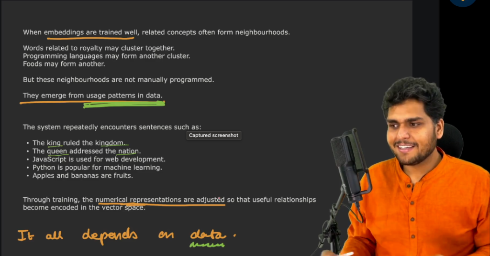

These neighborhoods are never manually programmed by software engineers. They emerge organically from usage patterns across training data:
- "The **king** ruled the **kingdom**."
- "The **queen** addressed the **nation**."
- "**JavaScript** is used for **web development**."
- "**Python** is popular for **machine learning**."
- "**Apples** and **bananas** are **fruits**."

### Numerical Fine-Tuning in Vector Space

Each time a model processes text containing related words:
1. Training algorithms nudge numerical weights slightly up or down.
2. Words that consistently appear in similar environments get pulled closer together.
3. Words that never share contexts are pushed apart.

### Why Data is the Defining Asset

The quality, density, and precision of an embedding space depends entirely on the volume and diversity of training data. This explains why technology companies invest billions of dollars securing massive text, book, code, and multimedia datasets. High quality data creates well-defined semantic neighborhoods.

---

## 11. Semantic Similarity: Keyword Search vs Embeddings

> **Semantic similarity measures how close two pieces of text are in meaning, regardless of whether they share the same words.**

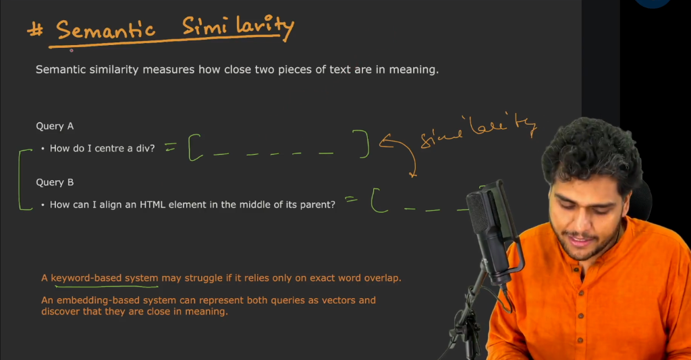

Consider two search queries written by different developers:
- **Query A**: "How do I centre a div?"
- **Query B**: "How can I align an HTML element in the middle of its parent?"

Notice the challenge:
- Both queries convey the exact same user intent.
- However, they share zero vocabulary overlap ("centre" versus "align in the middle", "div" versus "HTML element").

A traditional **keyword-based system** relies on exact string matching. Because words do not match, the keyword search fails or returns poor results.

An **embedding-based system** converts both sentences into dense vectors. Because the conceptual contexts of both queries are identical, their vectors land in the exact same neighborhood, enabling accurate retrieval.

### Further Examples of Semantic Equivalence

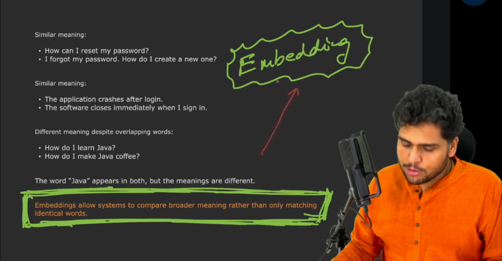

#### Example 1: Password Reset
- Sentence 1: "How can I reset my password?"
- Sentence 2: "I forgot my password. How do I create a new one?"
- Result: Same intent and semantic meaning, despite distinct phrasing.

#### Example 2: Application Failure
- Sentence 1: "The application crashes after login."
- Sentence 2: "The software closes immediately when I sign in."
- Result: Identical technical meaning with completely different vocabulary ("application" vs "software", "crashes" vs "closes immediately", "login" vs "sign in").

#### Example 3: False Matches in Keyword Systems (Polysemy)
- Sentence 1: "How do I learn Java?"
- Sentence 2: "How do I make Java coffee?"
- Result: Both sentences share the identical keyword "Java", yet their underlying meanings are completely unrelated. A keyword system incorrectly groups them, whereas embedding vectors point in completely different directions.

### Core Interview Principle

> **Embeddings allow systems to compare broader meaning rather than only matching identical words.**

---

## 12. Cosine Similarity: Measuring Angles Between Vectors

To determine whether two vectors are semantically close, computers apply a mathematical metric called **Cosine Similarity**.

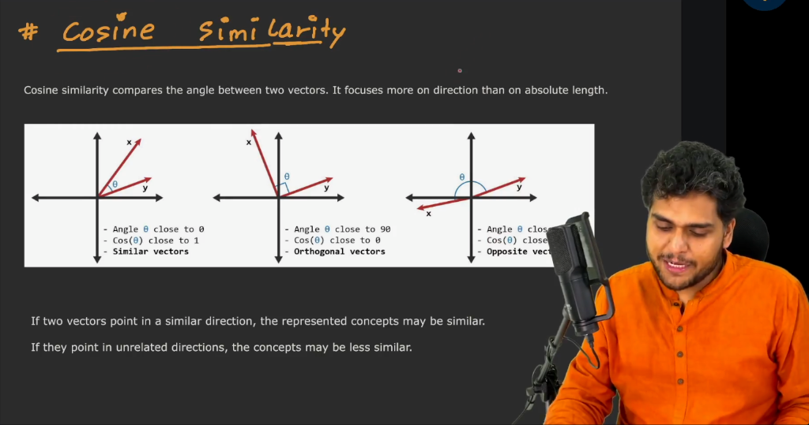

> **Cosine similarity compares the angle between two vectors. It focuses more on direction than on absolute length.**

### Why Direction Matters More Than Length

A sentence can be two words long or thirty words long. Its absolute vector length (magnitude) may vary, but its conceptual direction in semantic space remains consistent. Cosine similarity normalizes vector lengths and measures the angle $\theta$ between them.

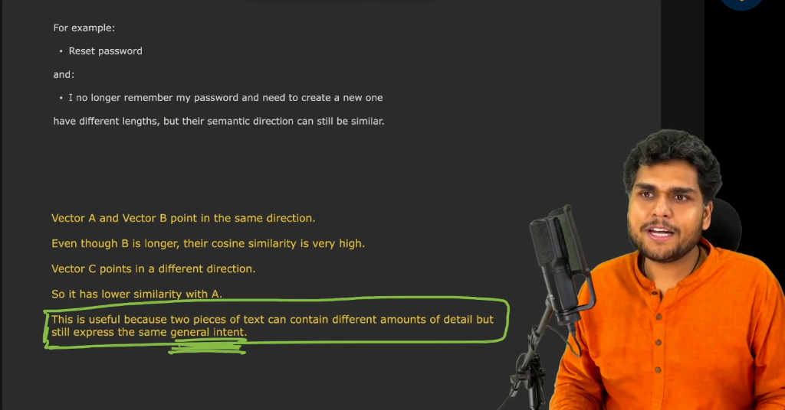

Consider an example of varying sentence lengths:
- **Vector A**: "Reset password" (concise, 2 words)
- **Vector B**: "I no longer remember my password and need to create a new one" (detailed, 12 words)

Even though Vector B has much greater length (magnitude) than Vector A:
- Both point in the exact same semantic direction.
- Their cosine similarity is very high.
- In contrast, a different query like Vector C ("Open savings account") points in a completely different direction and yields low similarity.

This normalization allows systems to match sentences containing different amounts of detail that express the same general intent.

### The Mathematical Formula for Cosine Similarity

Mathematically, cosine similarity is defined as the **dot product of two vectors divided by the product of their magnitudes (L2 norms)**:

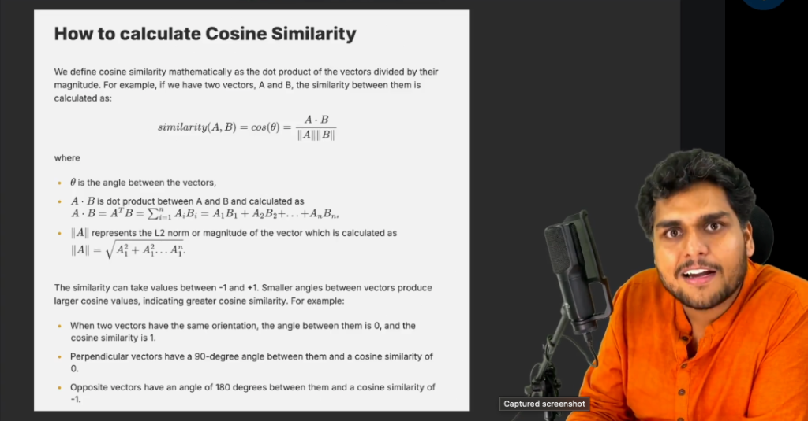

$$\text{similarity}(A, B) = \cos(\theta) = \frac{A \cdot B}{\|A\| \|B\|}$$

Where:
- $\theta$ is the angle between Vector $A$ and Vector $B$.
- $A \cdot B$ is the **dot product**, calculated by multiplying corresponding components and summing them:
  $$A \cdot B = \sum_{i=1}^n A_i B_i = A_1 B_1 + A_2 B_2 + \dots + A_n B_n$$
- $\|A\|$ represents the **magnitude (L2 norm)** of Vector $A$, calculated using the Euclidean norm formula:
  $$\|A\| = \sqrt{A_1^2 + A_2^2 + \dots + A_n^2}$$
- Dividing by $\|A\| \|B\|$ scales the output, eliminating the influence of vector lengths and isolating pure directional alignment.

### The Mathematical Scale of Cosine Similarity

Cosine values range strictly between `-1.0` and `+1.0`:

| Geometric Angle ($\theta$) | Cosine Value $\cos(\theta)$ | Vector Relationship | Semantic Interpretation |
| :--- | :--- | :--- | :--- |
| **Angle close to $0^\circ$** | **Close to $+1.0$** | **Similar Vectors** | The texts share nearly identical meaning and intent. |
| **Angle close to $90^\circ$** | **Close to $0.0$** | **Orthogonal Vectors** | The texts are unrelated and mathematically independent. |
| **Angle close to $180^\circ$** | **Close to $-1.0$** | **Opposite Vectors** | The texts represent diametrically opposing concepts. |

---

## 13. Cosine Similarity Does Not Understand Truth

A critical safety and architectural principle must be recognized:

> **Cosine similarity does not understand or verify truth.**

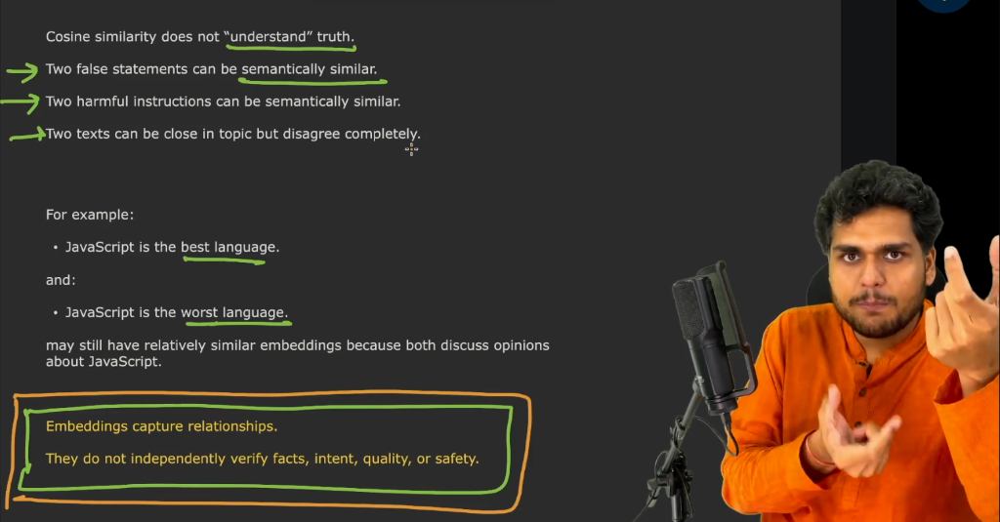

Consider why high embedding similarity does not imply factual correctness:
- **Two false statements can be semantically similar**: "The moon is made of green cheese" and "The moon is made of cheddar" will have high cosine similarity because both discuss celestial bodies and dairy compositions.
- **Two harmful instructions can be semantically similar**: Variations of malicious code or dangerous recipes align closely in vector space.
- **Two texts can share a topic yet disagree completely**:
  - Statement 1: "JavaScript is the best language."
  - Statement 2: "JavaScript is the worst language."
  - Both statements express subjective opinions about JavaScript. Because their vocabulary and conceptual domains overlap heavily, their vectors sit close together in semantic space, despite being polar opposites in sentiment.

### Core Architectural Principle

> **Embeddings capture relationships. They do not independently verify facts, intent, quality, or safety.**

Verifying factual accuracy, detecting hallucinations, and enforcing ethical guardrails require separate validation layers beyond raw embedding similarity.

---

## 14. Interactive 3D Visualizations: TensorFlow Embedding Projector

To observe how thousands of tokens organize in multi-dimensional space, researchers use dimensionality reduction tools such as the **TensorFlow Embedding Projector** (`projector.tensorflow.org`).


In this tool, 10,000 words from Word2Vec datasets originally embedded in 200 dimensions are projected into interactive 3D coordinates using algorithms like Principal Component Analysis (PCA) or t-SNE:
- **Querying "sun"**: Nearest neighbors in original space include `moon`, `solar`, `sky`, `earth`, `orbit`, `eclipse`, `planet`, `celestial`, and `jupiter`.
- **Unrelated concepts**: Words such as `playstation` sit far across the spatial cloud.
- **Querying "king"**: Surrounding neighbors include `queen`, `monarch`, `throne`, `emperor`, `prince`, and `battle`.
- **Querying "JavaScript"**: Surrounding neighbors include `browser`, `syntax`, `compiler`, `python`, and `java`.
- **Querying "bank"**: Demonstrates polysemic clusters, grouping near financial tokens (`account`, `loan`, `atm`) while simultaneously maintaining proximity to geographic tokens (`river`, `canal`).

### Note on Dimensional Projections

While 2D and 3D visual projections allow human comprehension of multi-dimensional spaces, reducing hundreds or thousands of dimensions down to two or three inevitably compresses and loses geometric information.

---

## 15. Token Embeddings: Transforming Meaningless IDs into Dense Vectors

To understand how text enters a Large Language Model from first principles, consider the sentence:

$$\text{"I love JavaScript"}$$

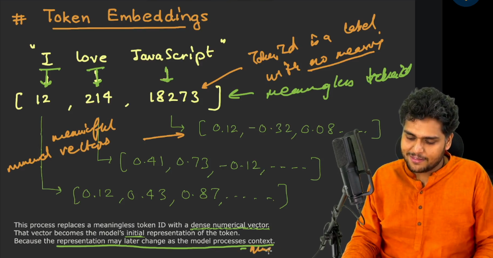

The pipeline transitions text through three distinct representations:

1. **Text Tokenization**: The raw string is broken into individual tokens:
   $$\text{"I"}, \quad \text{"love"}, \quad \text{"JavaScript"}$$

2. **Token ID Assignment**: Each token is looked up in the tokenizer vocabulary and given an integer ID:
   $$\text{Token IDs} = [12, 214, 18273]$$
   As established, these integers are arbitrary administrative labels carrying zero conceptual meaning.

3. **Token Embedding Lookup**: Each Token ID is mapped to a dense, continuous numerical vector:
   - `12` ($\text{"I"}$) $\to [0.12, 0.43, 0.87, \dots]$
   - `214` ($\text{"love"}$) $\to [0.41, 0.73, -0.12, \dots]$
   - `18273` ($\text{"JavaScript"}$) $\to [0.12, -0.32, 0.08, \dots]$

### The Transition from Static to Contextual Representation

> **This process replaces a meaningless token ID with a dense numerical vector. That vector becomes the initial representation of the token in the model.**

A vital distinction to understand:
- The vector retrieved from the token embedding table is an **initial, static representation**.
- As the model processes the entire sentence through Transformer layers, **the representation changes based on context**.
- In "I ate an **apple** in the afternoon", the surrounding words "ate" and "afternoon" shift the internal representation of "apple" toward food and fruit.
- In "**Apple** launched a new device", the surrounding words "launched" and "device" shift the representation toward technology and hardware.

---

## 16. Positional Embeddings: Why Order Matters

Token embeddings alone identify *which* words are present, but they tell the model nothing about the sequence.

Consider two sentences composed of the exact same tokens:
1. "**Dog** bites **man**."
2. "**Man** bites **dog**."

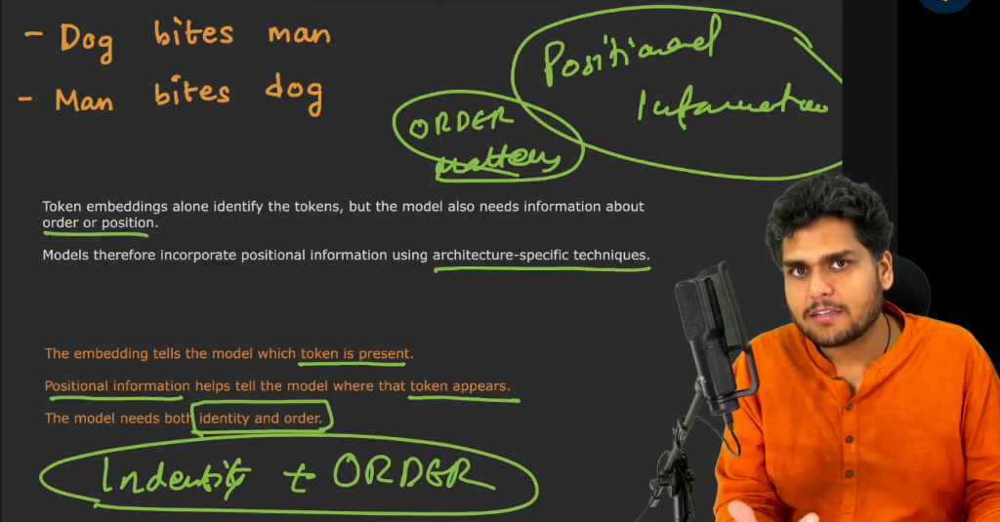

Notice the critical distinction:
- Both sentences share identical tokens (`dog`, `bites`, `man`).
- Both sentences look up the exact same initial Token IDs and token embedding vectors.
- Yet sentence 1 describes an everyday unfortunate event, while sentence 2 describes sensational breaking news.

### The Formula: Identity Plus Order

In natural language, syntax and sequential order dictate meaning:
- **Token Embedding**: Tells the model **which token is present** (lexical identity).
- **Positional Information**: Tells the model **where that token appears in the sequence** (temporal / spatial order).

$$\text{Model Input} = \text{Identity} + \text{Order}$$

Large Language Models incorporate positional information using architecture-specific techniques known as **Positional Embeddings** or **Positional Encodings** (such as learned positional embeddings or rotary position embeddings), ensuring the model distinguishes subject from object.

---

## 17. Token Embeddings vs Text Embeddings

Whenever the term "embedding" appears in artificial intelligence, always ask:

> **An embedding of what, and for which task?**

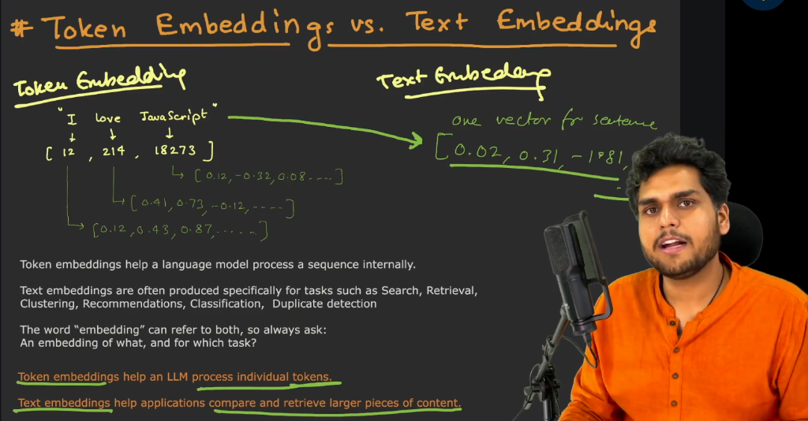

Embeddings operate at different granularities depending on the architectural objective:

| Property | Token Embeddings | Text Embeddings (Sentence / Document) |
| :--- | :--- | :--- |
| **Input Unit** | An individual token (word, subword, character). | An entire sentence, paragraph, or document. |
| **Output Representation** | Multiple vectors (one distinct vector per token). | One single vector summarizing the entire text. |
| **Primary Use Case** | Internal processing inside Large Language Models. | External retrieval, semantic search, clustering, and RAG. |
| **Analogy** | The dictionary definition of a single word or syllable. | The summary synopsis printed on the back cover of a book. |

### Summary of Scope
- **Token embeddings** help a language model read and process text sequentially.
- **Text embeddings** help applications compare, rank, and retrieve complete passages of content.

---

## 18. Static vs Contextual Meaning: Resolving Polysemy

In human language, a single word often carries multiple distinct meanings depending on surrounding words. This linguistic property is known as **polysemy**.

Consider two occurrences of the word "apple":
1. "I ate an **Apple** after lunch."
2. "**Apple** released a new device."

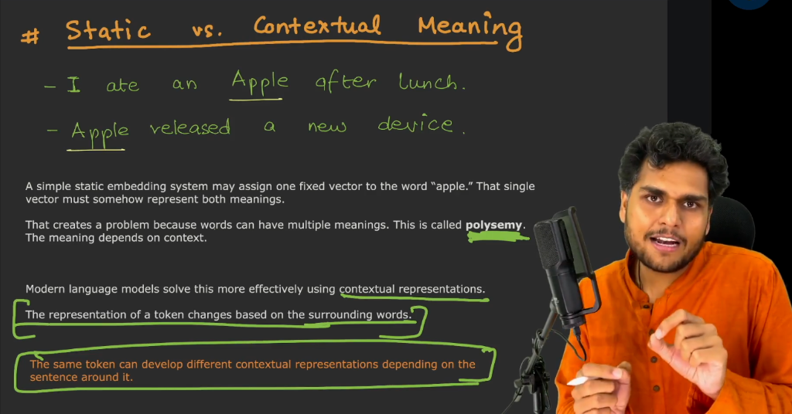

### The Failure of Static Embeddings

Early embedding architectures (such as Word2Vec or GloVe) assigned a single, fixed vector to each vocabulary word:
- The word "apple" had one static numerical vector.
- That single vector was forced to compromise between edible fruits and consumer electronics.
- Static systems inevitably fail when faced with polysemy, homonyms, and shifting contexts.

### The Modern Solution: Contextual Representations

Modern Large Language Models resolve polysemy through **contextual representations**:
- The representation of a token dynamically adapts based on surrounding words.
- The same token develops completely different internal vectors depending on the sentence around it.

---

## 19. How Modern LLMs Handle Context (Contextualisation)

To observe how context modifies representation, consider classic polysemic words:

- **Bank**:
  - "I deposited money in the **bank**." (financial institution)
  - "We sat beside the river **bank**." (geographical riverbank)
- **Bat**:
  - "He hit the ball with a **bat**." (wooden sports equipment)
  - "A **bat** flew out of the cave." (nocturnal flying mammal)
- **Java**:
  - "**Java** is a programming language." (computer software)
  - "**Java** is an island in Indonesia." (geographical island)
  - "I ordered **Java** at the cafe." (hot brewed coffee)

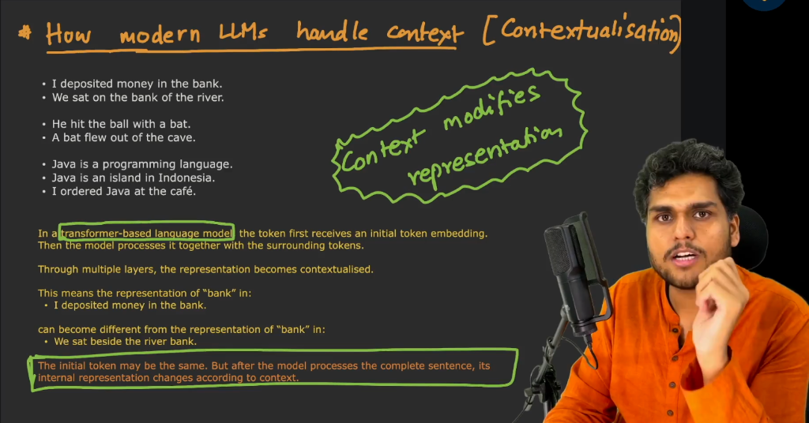

### The Transformer Multi-Layer Pipeline

In Transformer-based models (introduced in the landmark 2017 Google research paper "Attention Is All You Need"):

1. **Initial Token Embedding**: The token receives an initial static embedding from the lookup table. In this stage, "bank" in both sentences has identical numerical values.
2. **Multi-Layer Self-Attention**: As the token passes through dozens of Transformer layers, self-attention mechanisms compare the token against every other token in the sentence.
3. **Contextual Transformation**: 
   - When "bank" interacts with "deposited" and "money", its vector shifts into the financial coordinate space.
   - When "bank" interacts with "river" and "sat", its vector shifts into the riparian geographic space.

> **The initial token may be the same. But after the model processes the complete sentence through multiple layers, its internal representation changes according to context.**

---

## 20. Bias in Embeddings: Flaws in Human Data

Because embedding models learn exclusively from data, they inherit the flaws and prejudices present in human text.

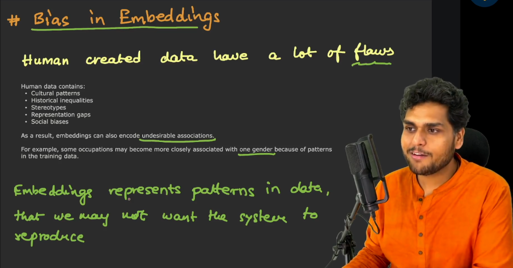

Human-created data contains:
- Cultural prejudices
- Historical inequalities
- Stereotypical assumptions
- Representation gaps
- Social and economic biases

### How Bias Enters Vector Space

When an embedding model reads billions of internet documents:
- If certain occupations historically co-occur disproportionately with one gender in text, the model encodes that correlation into the vector distance between the occupation and the gender.
- Embeddings faithfully reflect statistical patterns in data, including associations society may not want automated systems to reproduce.

> **Embeddings represent patterns in data that we may not want the system to reproduce.**

Addressing this requires careful data curation, debiasing algorithms, safety alignment, and responsible engineering by AI developers.

---

## 21. Real-World Applications of Embeddings

Embeddings serve as the fundamental backbone across modern machine learning applications:

### 1. Semantic Search and Hybrid Search

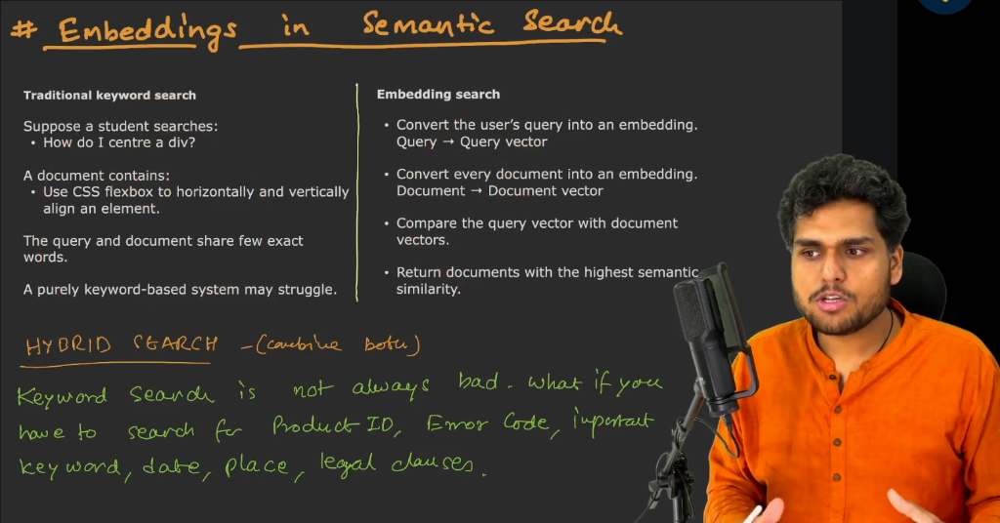

- **Semantic Search**: Converts user queries and database documents into embedding vectors. Instead of relying on exact text matches, the search engine ranks documents by cosine similarity.
  - Query: "How do I centre a div?"
  - Matched Document: "Use CSS flexbox to horizontally and vertically align an element."
  - The query and document share virtually no words, yet the system successfully retrieves it based on conceptual intent.
- **Hybrid Search (Combining Keywords and Embeddings)**:
  - Keyword search is not obsolete. It remains critical when users search for exact Product IDs, system Error Codes (`ERR_CONNECTION_REFUSED`), specific dates, names, or legal clauses (`Section 273`).
  - Hybrid search combines lexical keyword scoring with dense semantic vector scoring to deliver optimal precision and recall.

### 2. Recommendation Systems, Clustering, and RAG

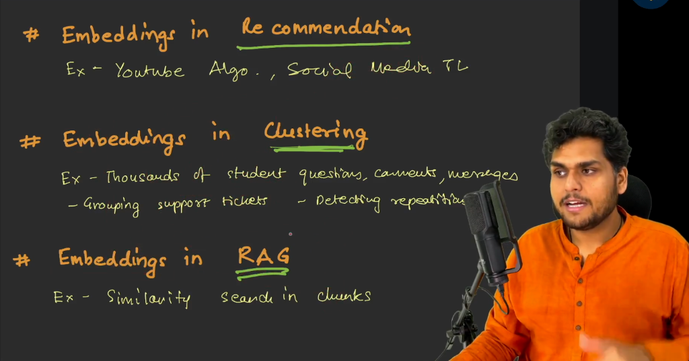

- **Recommendation Systems**: Platforms like YouTube, Instagram, Spotify, and Netflix convert user history and preferences into a user vector. Content items are similarly vectorized. Calculating cosine similarity between the user vector and candidate items identifies optimal recommendations.
- **Clustering**: Automatically groups massive collections of unstructured texts (such as thousands of student queries, customer emails, or support tickets) into semantic clusters without requiring manual tagging.
- **Retrieval-Augmented Generation (RAG)**: Large reference documents (manuals, books, corporate documentation) are split into smaller chunks and converted into embeddings. When a user asks a question, the system retrieves the most semantically relevant chunks and feeds them into the prompt context for grounded generation.

### 3. Duplicate Detection, Classification, and Multimodal Embeddings

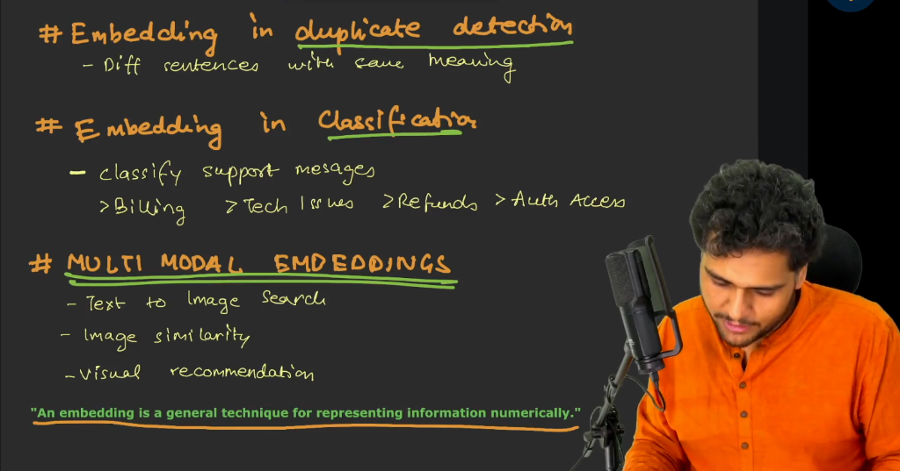

- **Duplicate Detection**: Identifies whether two queries or tickets express the same issue using different phrasing, preventing duplicate support tickets or forum threads.
- **Text Classification**: Routes incoming customer service messages into distinct operational categories (such as `Billing`, `Technical Issues`, `Refunds`, or `Authentication`) by measuring vector proximity to category prototypes.
- **Multimodal Embeddings**: Embeddings are not limited to text. Images, audio, speech, and video can be mapped into the exact same shared multi-dimensional vector space:
  - **Text-to-Image Search**: Typing the query "a white cat" generates a text vector that lands near the image vector of a white cat photo.
  - **Visual Similarity and Product Recommendations**: Finding visually similar clothes, furniture, or locations based on image vector distance.

> **An embedding is a general technique for representing information numerically.**

---

## 22. Common Misconceptions vs Architectural Reality

To master embeddings from first principles, distinguish between frequent misconceptions and engineering facts:

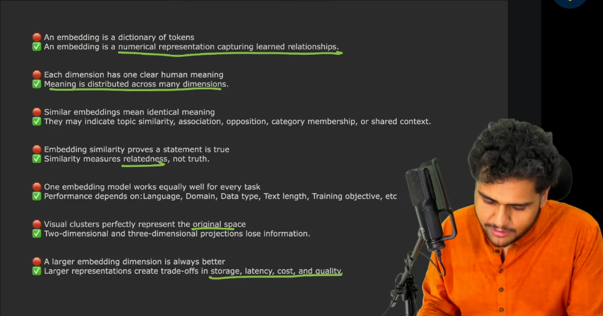

| Common Misconception | Architectural Reality |
| :--- | :--- |
| **An embedding is a dictionary of tokens** | An embedding is a dense numerical vector capturing learned statistical relationships across data. |
| **Each dimension has one clear human meaning** | Meaning is distributed across thousands of dimensions; individual coordinates rarely map to single human words. |
| **Similar embeddings mean identical meaning** | Vectors indicate topical similarity, association, category membership, or shared context; they can even represent antonyms. |
| **Embedding similarity proves a statement is true** | Vector similarity measures semantic relatedness, not factual veracity, safety, or quality. |
| **One embedding model works equally well for every task** | Model performance varies significantly by language, domain, sequence length, and training objective. |
| **Visual clusters perfectly represent the original space** | Two-dimensional and three-dimensional projections compress high-dimensional geometry and inevitably lose information. |
| **A larger embedding dimension is always better** | Higher dimensions capture subtler patterns, but introduce significant trade-offs in storage, memory bandwidth, latency, and computational cost. |

---

## 23. The Big Picture: From Human Text to Neural Networks

Across Season 1, the progression of how machines process language unfolds through clear foundational stages:

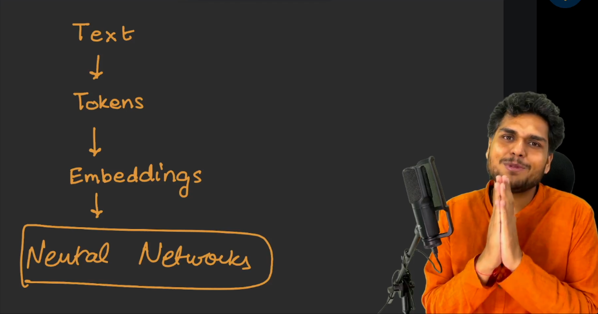

1. **Text**: Human language, rich in nuance, polysemy, and vocabulary variations.
2. **Tokens**: Discrete text units produced by tokenizers (Episode 04).
3. **Token IDs**: Arbitrary integer identifiers used for dictionary indexing (Episode 04).
4. **Embeddings**: Dense, learned numerical vectors that represent meaning, relationships, and context (Episode 05).
5. **Neural Networks**: The computational engines that process these embedding vectors through matrix multiplications, attention mechanisms, and learned parameter weights to generate predictions and intelligent responses (Episode 06).


