# Episode 06: The Computational Brain of Machines

> **Season 1: Inside the Mind of AI**  
> Instructor: **Akshay Saini** (NamasteDev)  
> Topic: Neural Networks, Next-Token Prediction Loop, Probability Distributions, Autoregressive Generation, Termination Tokens, GPT Deconstruction, and the Transformer Architecture

---

## 1. The Computational Brain of a Machine

Modern artificial intelligence performs tasks once thought unique to human intelligence:
- Composing poetry and writing music
- Generating realistic video sequences and photorealistic imagery
- Solving complex mathematical proofs and passing professional examinations
- Conducting automated research across scientific domains

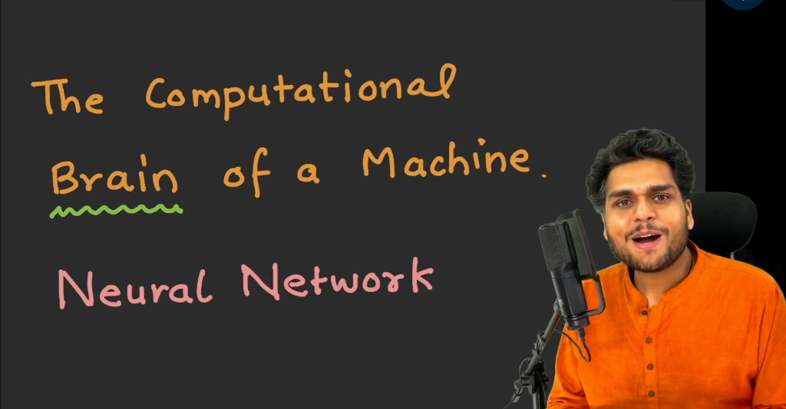

From first principles:
- Humans use biological brains to process information and make decisions.
- Machines rely on an artificial computational brain to perform intelligent tasks.
- That computational brain is the **Neural Network**.
- Every modern AI system (including ChatGPT, Claude, Gemini, and Grok) relies on a neural network as its foundational core.

---

## 2. Large Language Models as Prediction Machines

At the most fundamental level, a Large Language Model (LLM) is a **prediction machine**:
- Given an input sequence of text, its objective is to predict the most appropriate next token.
- It repeats this next-token prediction repeatedly until a complete response is formed.

### The Pizza Example

Consider an incomplete input prompt:

$$\text{"The pizza is \_\_\_\_\_"}$$

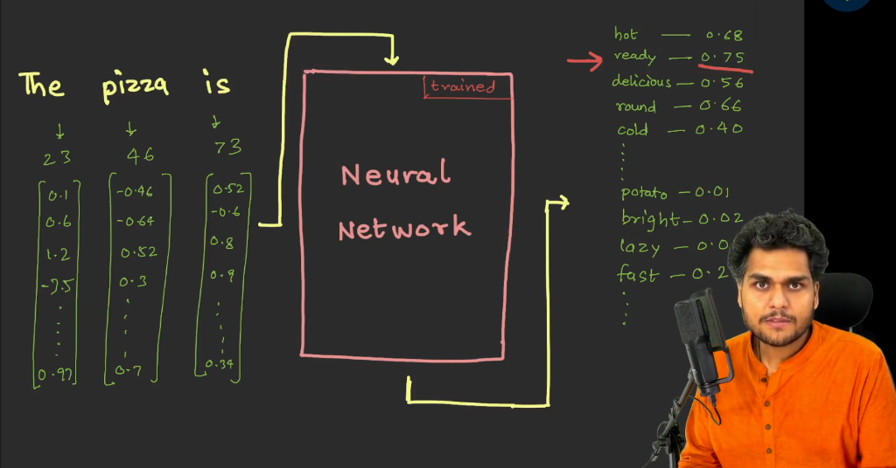

What should come next? A human might complete the sentence with words like "hot", "ready", "delicious", "round", or "cold". 

To make this decision mathematically, the system executes the following pipeline:
1. **Tokenization**: The input text is split into discrete tokens: `"The"`, `"pizza"`, `"is"`.
2. **Token ID Lookup**: Each token receives an arbitrary integer identifier from the vocabulary table (for example, `23`, `46`, `73`).
3. **Embedding Vector Lookup**: Each Token ID is mapped to its learned multi-dimensional embedding vector.
4. **Neural Network Processing**: The collection of embedding vectors is fed into the trained neural network.

### Probability Distribution Over Candidate Tokens

The neural network does not merely guess blindly. It computes a numerical probability score for every word in its vocabulary:

| Candidate Token | Probability Score | Likelihood Assessment |
| :--- | :--- | :--- |
| **ready** | `0.75` | High probability (selected candidate) |
| **hot** | `0.68` | High probability |
| **round** | `0.66` | High probability |
| **delicious** | `0.56` | Moderate probability |
| **cold** | `0.40` | Moderate probability |
| **fast** | `0.20` | Low probability |
| **bright** | `0.02` | Negligible probability |
| **potato** | `0.01` | Contextually irrelevant |
| **cricket** | `0.001` | Contextually irrelevant |
| **lazy** | `0.000` | Zero relevance |

The candidate token with the highest probability (here, **ready** with `0.75`) is selected to extend the sequence.

---

## 3. The Autoregressive Generation Loop

Language generation is an iterative, sequential feedback process known as an **autoregressive loop**.

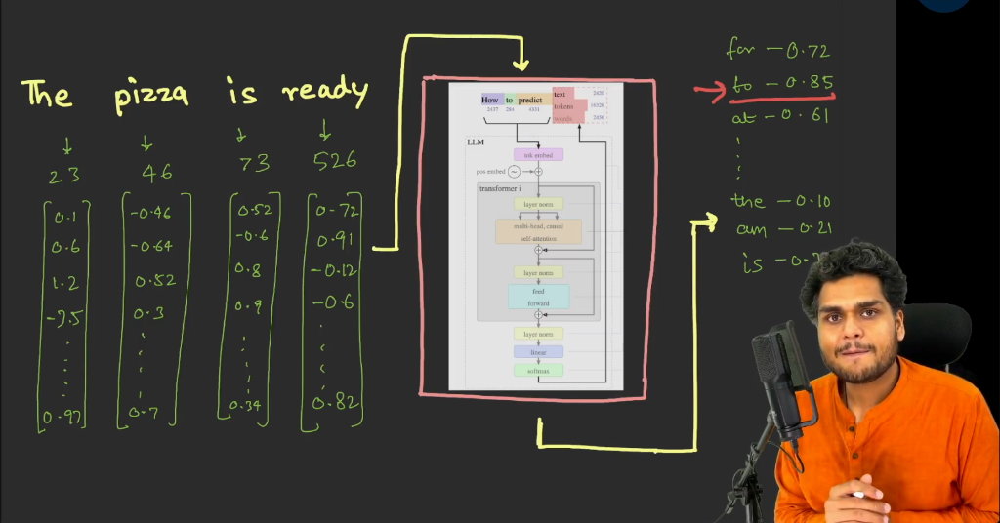

Once the neural network predicts "ready", the generation does not stop:
1. The newly generated token is appended to the existing input sequence, forming:
   $$\text{"The pizza is ready"}$$
2. The entire expanded sequence is tokenized (`23`, `46`, `73`, `526`), converted into four embedding vectors, and fed back into the neural network.
3. The neural network computes fresh probabilities for the next position:
   - `to`: `0.85` (highest probability)
   - `for`: `0.72`
   - `at`: `0.61`
   - `the`: `-0.10`
   - `am`: `-0.21`
   - `is`: `-0.78`
4. The token `"to"` is selected and appended to the prompt.

### Continuing the Step-by-Step Chain

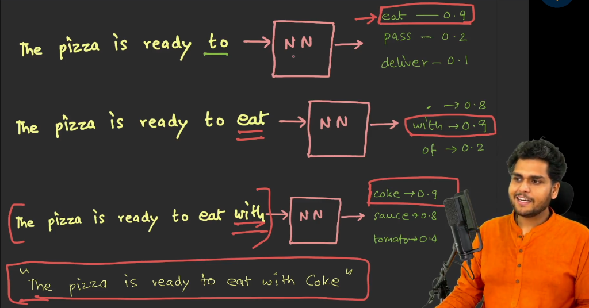

The neural network repeats this cycle sequentially:
- **Step 1**: `"The pizza is ready"` $\to$ Neural Network $\to$ predicts `"to"` (`0.85`)
- **Step 2**: `"The pizza is ready to"` $\to$ Neural Network $\to$ predicts `"eat"` (`0.90`)
- **Step 3**: `"The pizza is ready to eat"` $\to$ Neural Network $\to$ predicts `"with"` (`0.90`)
- **Step 4**: `"The pizza is ready to eat with"` $\to$ Neural Network $\to$ predicts `"Coke"` (`0.90`)

The final generated sentence becomes:

$$\text{"The pizza is ready to eat with Coke"}$$

### Sampling vs Pure Argmax

In production LLMs, the model does not always select the absolute highest probability token. If it strictly chose the top number every single time, responses would be rigid and repetitive. Instead, decoding algorithms (governed by parameters like temperature, top-k, and top-p) sample among top candidates to introduce controlled creativity.

### Termination Logic: When Does Generation Stop?

An autoregressive model requires explicit rules to know when to conclude:
1. **End-of-Sequence (EOS) Token**: Models are trained on special delimiter tokens indicating sequence completion. When the model outputs an EOS token, generation halts.
2. **Punctuation**: A full stop (`.`), question mark, or newline can trigger termination depending on formatting constraints. Punctuation characters and whitespace are distinct tokens.
3. **Maximum Token Limit**: Hard safety cutoffs stop generation if output exceeds maximum context length.

---

## 4. Deconstructing GPT: Generative Pre-trained Transformer

The acronym **GPT** stands for **Generative Pre-trained Transformer**.

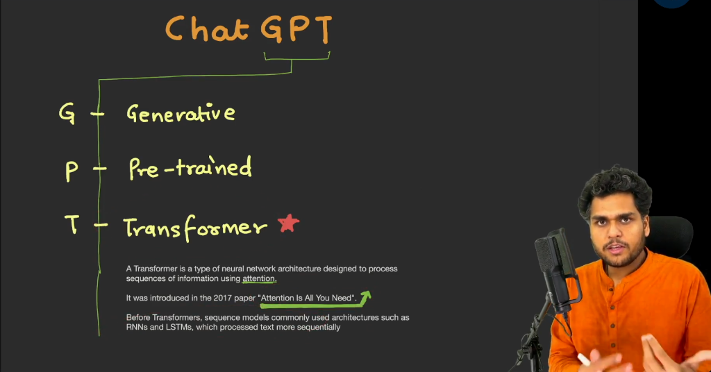

Every word in this name defines a foundational architectural property:

### 1. Generative (G)
- The model generates novel text rather than merely retrieving stored documents.
- Unlike a search engine that searches an index and fetches exact existing pages, an LLM synthesizes answers from patterns in its neural weights.
- It does not engage in rote memorization. It understands statistical relationships and composes contextually relevant answers.

### 2. Pre-trained (P)
- The model has already completed extensive training on massive internet-scale datasets before serving user requests.
- Training optimizes billions of internal parameters, ensuring the model possesses broad linguistic and world knowledge out of the box.

### 3. Transformer (T)
- The underlying deep learning architecture that serves as the computational engine of modern artificial intelligence.
- The Transformer is the true architectural hero enabling current foundation models.

### GPT as an Architecture vs ChatGPT as a Product

A common industry point of confusion:
- **GPT is an architectural classification**: Any model based on a Generative Pre-trained Transformer is a GPT. Gemini, Claude, Grok, and Meta Llama are all generative pre-trained transformers under the hood.
- **ChatGPT is a specific product**: OpenAI was the first mover to launch a conversational assistant built on a GPT, branding it "ChatGPT".
- The analogy of a vehicle manufacturer naming a car model "DriveCar": consumers might associate driving with that brand, but the underlying mechanics represent the general category of automobiles.

---

## 5. The Transformer Architecture and Attention

Before 2017, sequence modeling relied primarily on:
- **Recurrent Neural Networks (RNNs)**
- **Long Short-Term Memory networks (LSTMs)**

### The Limitation of Pre-Transformer Architectures

RNNs and LSTMs process language sequentially, one word after another:
- Word 1 is evaluated, then Word 2, then Word 3.
- Sequential processing created severe computational bottlenecks, preventing models from leveraging massive parallel GPU processing.
- Long-range relationships across extended paragraphs degraded because information had to pass through every intermediate step.

### The 2017 Revolution: "Attention Is All You Need"

In 2017, a team of researchers at Google and the University of Toronto published the landmark research paper titled **"Attention Is All You Need"**:


The eight contributing authors:
1. **Ashish Vaswani** (Google Brain)
2. **Noam Shazeer** (Google Brain)
3. **Niki Parmar** (Google Research)
4. **Jakob Uszkoreit** (Google Research)
5. **Llion Jones** (Google Research)
6. **Aidan N. Gomez** (University of Toronto)
7. **Łukasz Kaiser** (Google Brain)
8. **Illia Polosukhin** (Google Research)

This paper discarded recurrent architectures entirely, proposing that sequence processing could rely solely on **Attention mechanisms**.

> **A Transformer is a type of neural network design that reads entire sentences or blocks of data all at once instead of word by word.**

### The Nested Hierarchy of Modern AI


To visualize how modern language models are structured:
- At the outer system level is the **Large Language Model (LLM)**.
- Inside the heart of the LLM resides the **Transformer architecture**.
- Inside the heart of the Transformer resides the **Attention mechanism**.

$$\text{Attention} \subset \text{Transformer} \subset \text{LLM}$$

---

## 6. Attention and Self-Attention Explained

What does the term **Attention** mean in artificial intelligence?

> **Attention is a mathematical tool that helps computer models focus on the most important parts of data while ignoring the rest.**

In intuitive terms, attention answers a simple question:
$$\text{"Which pieces of information should I focus on right now, and how much?"}$$

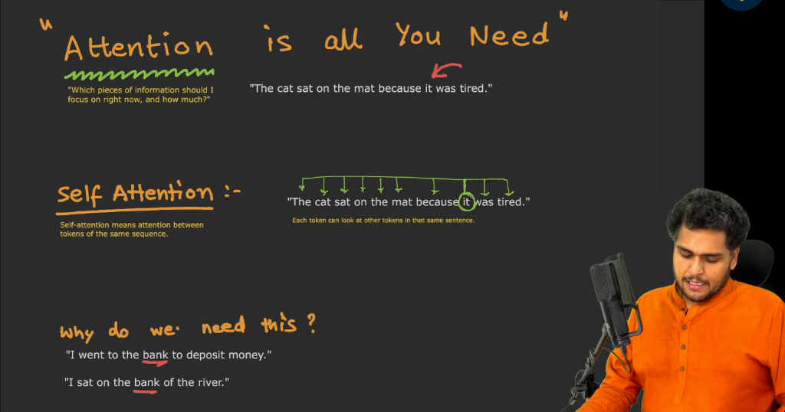

### What is Self-Attention?

> **Self-attention is attention between tokens of the same sequence.**

Self-attention allows every token in a sentence to look at all other tokens in that same sentence simultaneously to understand their relationships and contextual meaning.

### Resolving Pronoun Ambiguity

Consider the sentence:

$$\text{"The cat sat on the mat because it was tired."}$$

In older sequential networks (RNNs), resolving the pronoun `"it"` was difficult:
- Does `"it"` refer to the `"cat"` or the `"mat"`?
- Because cats get tired, a human immediately links `"it"` to `"cat"`.

With self-attention, the token `"it"` computes numerical relationship scores against every other token in the sentence:
- `"it"` $\to$ `"cat"`: `0.90` (strongest relationship)
- `"it"` $\to$ `"mat"`: `0.40`
- `"it"` $\to$ `"sat"`: `0.20`
- `"it"` $\to$ `"the"`: `0.10`

The model mathematically concludes that `"it"` refers to `"cat"`.

If the sentence is modified:
$$\text{"The cat sat on the mat because it was cozy."}$$

Because a mat is cozy, the self-attention weights shift, linking `"it"` with high probability to `"mat"`.

### Resolving Polysemic Words

Self-attention also solves words with multiple meanings (polysemy):
- **Example A**: `"I went to the bank to deposit money."`
  - The token `"bank"` attends heavily to `"deposit"` and `"money"`.
  - Its vector shifts into the financial coordinate space.
- **Example B**: `"I sat on the bank of the river."`
  - The token `"bank"` attends to `"sat"` and `"river"`.
  - Its vector shifts into the geographical riverfront coordinate space.

---

## 7. Entering the Transformer Block: Token and Positional Embeddings

Before information enters the Transformer computation stages, input tokens are transformed:

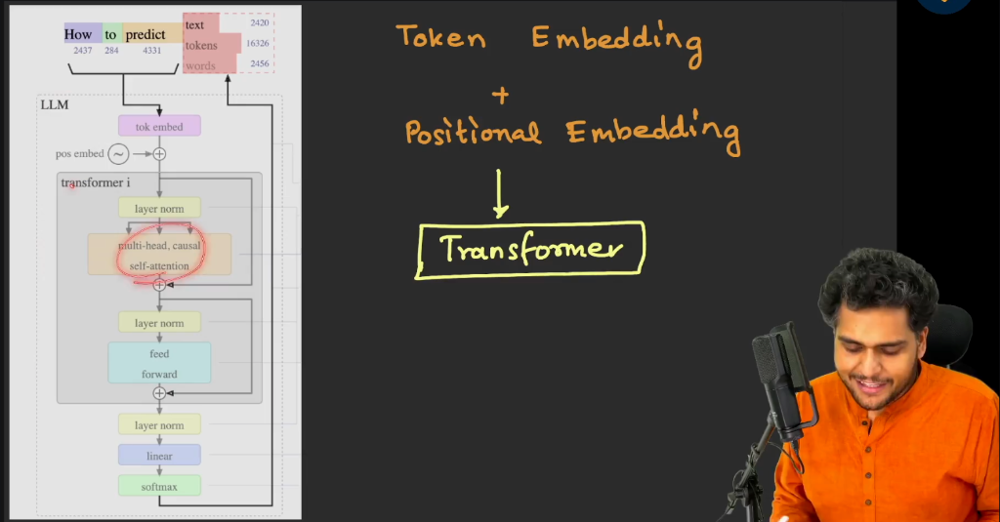

1. **Token Embeddings**: Numerical vectors retrieved from the embedding matrix that represent the lexical identity of each token (answering "which token is present").
2. **Positional Embeddings**: Numerical vectors encoding sequence position (answering "where the token appears").

### Why Both Are Essential

Consider two sentences composed of the exact same vocabulary:
- `"The dog bites a man."`
- `"The man bites a dog."`

Both sentences share identical tokens and initial token vectors. Without positional information, a machine would see no distinction between everyday misfortune and breaking news.

$$\text{Transformer Input} = \text{Token Embedding} + \text{Positional Embedding}$$

Adding these two vectors creates a combined numerical array that captures both identity and order, which is then passed into the Transformer block.

---

## 8. Layer Normalization (LayerNorm): Stabilizing Deep Computations

Inside the Transformer block, the very first operation applied to the input is **Layer Normalization** (abbreviated as **LayerNorm**).

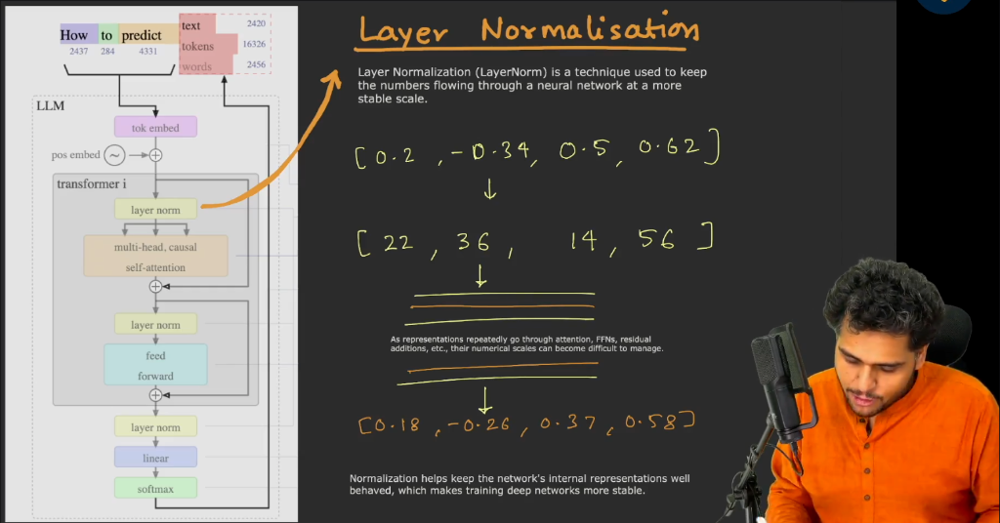

> **Layer Normalization is a technique used to keep the numbers flowing through a neural network at a more stable scale.**

### The Problem: Unstable Scales in Deep Networks

Modern LLMs consist of dozens of stacked layers performing intensive mathematical operations:
- Repeated matrix multiplications, dot products, additions, and feed-forward updates.
- As activations pass through consecutive layers, numerical values can drift or explode:
  $$\text{Initial Vector}: [0.20, -0.34, 0.50, 0.62] \implies \text{After Unbounded Math}: [22.0, 36.0, 14.0, 56.0]$$
- If numbers become excessively large or small:
  - Gradients can explode or vanish during training.
  - Floating-point calculations lose precision.
  - The network becomes difficult or impossible to train stably.

### The Solution: Normalizing Scale While Preserving Meaning

Layer Normalization adjusts the numbers across each layer so that:
- The mean (average) centers around `0`.
- The variance (spread) scales to `1`.

Example transformation:
$$[22.0, 36.0, 14.0, 56.0] \xrightarrow{\text{LayerNorm}} [0.18, -0.26, 0.37, 0.58]$$

Does Layer Normalization destroy meaning?
- No. Normalization rescales the numbers down by proportional ratios.
- The relative relationships, angles, and directional patterns between features remain intact, while their absolute magnitude is brought back into a stable numerical range.

### Pervasive Stabilization

Layer normalization is not performed once. It is applied repeatedly inside every Transformer block (before or after attention, and before or after feed-forward networks) to guarantee that internal representations remain well-behaved throughout deep architectures.

---

## 9. Multi-Head Causal (Masked) Self-Attention

Following the initial normalization, representations enter the core engine of the Transformer block: **Multi-Head Causal (Masked) Self-Attention**.

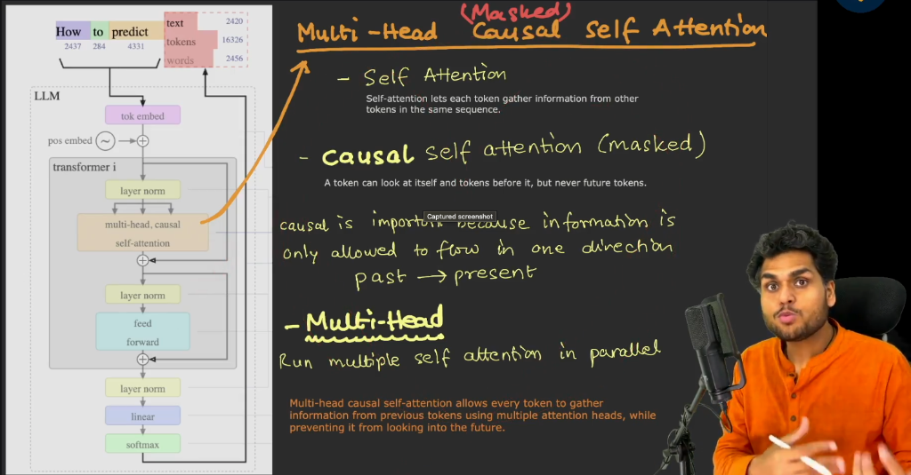

To master this subsystem from first principles, break down each term:

### 1. Self-Attention
- Allows each token to gather information from other tokens across the same sequence.
- Every token evaluates its relationship with every other token simultaneously.

### 2. Causal / Masked Attention
- **Masked** means deliberately hiding portions of the sequence.
- **Causal** means causes precede effects (the past leads into the future).
- Information is strictly constrained to flow in one direction:
  $$\text{Past} \longrightarrow \text{Present}$$
- A token is allowed to look at itself and preceding tokens in the sequence, but it is strictly blocked from looking at future tokens.
- **Why Causal Masking is Vital**: In autoregressive generation, future words have not been generated yet. If a model could look into the future during training, it would cheat by copying future answers rather than learning to predict.

### 3. Multi-Head Attention
- Rather than running a single self-attention mechanism, the network runs **multiple self-attention heads in parallel**.
- **Why Multi-Head is Necessary**: A single sentence contains multiple layers of linguistic information:
  - One attention head may focus on grammatical structure and subject-verb agreements.
  - Another head may track pronoun references (connecting "it" to "cat").
  - Another head may monitor domain and topical associations (connecting "bank" to "money").
- Running multiple heads in parallel allows the network to capture diverse, complex relationships simultaneously.

> **Multi-head causal self-attention allows every token to gather information from previous tokens using multiple attention heads, while preventing it from looking into the future.**

---

## 10. Residual / Skip Connections: Learning Incremental Updates

Surrounding the attention block is a shortcut known as a **Residual Connection** (or **Skip Connection**), indicated in architecture diagrams by an arrow and a plus (`+`) symbol bypassing the layer.

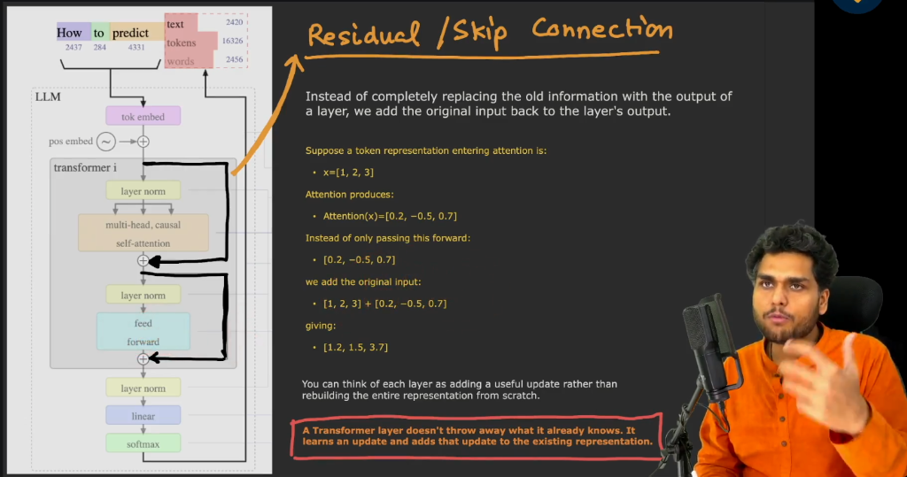

> **A residual connection is a direct shortcut that lets input data bypass a processing layer and add itself to the layer output.**

Instead of replacing the existing vector representation with the output of the attention layer, the model adds the original input back to the result:

$$\text{Output} = x + \text{Attention}(x)$$

### Numerical Walkthrough

Suppose the token representation entering attention is:
$$x = [1.0, 2.0, 3.0]$$

The self-attention mechanism processes this vector and generates an attention adjustment:
$$\text{Attention}(x) = [0.2, -0.5, 0.7]$$

Instead of passing only the new numbers forward, the network adds the original vector back:
$$\text{Combined Output} = [1.0, 2.0, 3.0] + [0.2, -0.5, 0.7] = [1.2, 1.5, 3.7]$$

### The Architectural Philosophy of Residuals

- **No Information Loss**: Without skip connections, passing data through dozens of deep layers causes original signals to degrade.
- **Incremental Refinement**:
  > **A Transformer layer does not throw away what it already knows. It learns an update and adds that update on top of the existing representation.**
- Each layer functions as a modifier that enriches the representation rather than rebuilding it from scratch.

---

## 11. Feed-Forward Networks (FFN): Independent Token Processing

After self-attention, residual addition, and layer normalization, representations pass into the **Feed-Forward Network (FFN)** (also known as a Multi-Layer Perceptron or MLP).

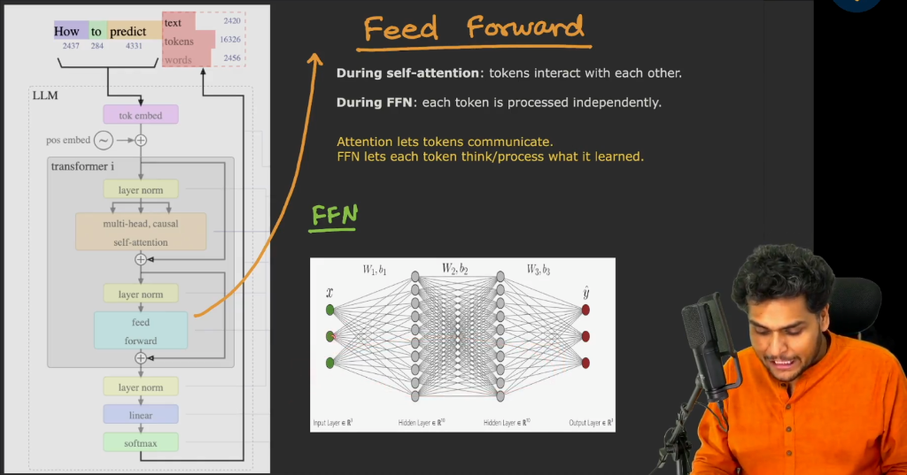

### The Core Division of Labor

The relationship between Self-Attention and the Feed-Forward Network follows a distinct division of labor:
- **During Self-Attention**: Tokens interact and communicate with each other across the sequence.
- **During FFN**: Each token is processed independently.

> **Attention lets tokens communicate. FFN lets each token think and process what it learned.**

### Structure and Function of the FFN

1. **Fully Connected Architecture**: Composed of stacked linear layers with non-linear activation functions.
2. **Dimensional Expansion**: The network typically projects the token vector from its base dimension ($d_{\text{model}}$) into a much wider hidden dimension (often $4 \times d_{\text{model}}$), allowing the model to compute complex feature interactions, before projecting it back down.
3. **Updating Internal Meaning**: When a word like `"bank"` gathers context about `"river"` during self-attention, the FFN takes that gathered context and modifies the internal coordinates of `"bank"` so it behaves like a riparian landform in subsequent stages.
4. **Second Residual and LayerNorm**: Just like the attention block, the FFN is surrounded by a residual skip connection followed by layer normalization:
   $$\text{Block Output} = \text{LayerNorm}(x + \text{FFN}(x))$$

---

## 12. Linear Layer and Softmax: Transforming Vectors into Probabilities

After passing through stacked Transformer blocks, the model possesses a refined continuous numerical vector for the final position in the prompt.

However, a raw continuous vector cannot be directly printed as text. The system must map this vector back to the vocabulary to select an actual word. This transformation is handled by two final stages: the **Linear Layer** and the **Softmax Layer**.

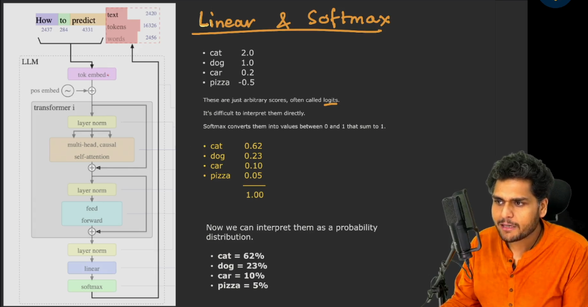

### 1. The Linear Layer (Vocabulary Projection)

The linear layer acts as a mathematical projection matrix that changes the size and shape of the data:
- It projects the final embedding vector (for example, 768 or 1536 dimensions) across the entire vocabulary size (e.g., 50,000 to 200,000 distinct tokens).
- It produces an unnormalized raw score for every token in the vocabulary.
- These raw numerical scores are known as **Logits**.

Sample raw logits for candidate tokens:
- `cat`: `2.0`
- `dog`: `1.0`
- `car`: `0.2`
- `pizza`: `-0.5`

Because logits are arbitrary real numbers with varying magnitudes and negative signs, they cannot be interpreted directly as probabilities.

### 2. The Softmax Layer (Probability Normalization)

> **A linear layer acts like a math machine that changes the size and shape of information, while a Softmax layer acts like a referee that turns raw numbers into percentages that add up to 100%.**

The Softmax function applies an exponential normalization formula to all logits:

$$P(\text{token}_i) = \frac{e^{\text{logit}_i}}{\sum_{j} e^{\text{logit}_j}}$$

This mathematical transformation guarantees two essential properties:
1. Every score is converted into a positive value between `0.0` and `1.0`.
2. All scores across the entire vocabulary sum to exactly `1.0` (`100%`).

Applying Softmax to the sample logits yields:
- `cat`: `0.62` (`62%` probability)
- `dog`: `0.23` (`23%` probability)
- `car`: `0.10` (`10%` probability)
- `pizza`: `0.05` (`5%` probability)
- **Total Sum**: `1.00` (`100%`)

Now the system has an interpretable probability distribution across its entire vocabulary, allowing decoding strategies to select the next predicted token.

---

## 13. The Full Transformer Architecture: 2017 Paper vs Modern LLMs

The foundational Transformer blueprint was detailed in Figure 1 of the 2017 research paper *"Attention Is All You Need"*:

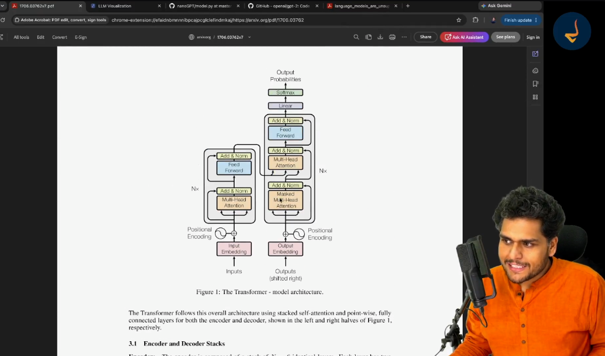

### The Original Encoder-Decoder Design

The original 2017 architecture was designed for sequence-to-sequence translation (for example, translating English text into German) and contained two distinct towers:
1. **The Encoder (Left Tower)**: Processes the complete input sentence simultaneously using unmasked bidirectional self-attention to build a rich representation of the source text.
2. **The Decoder (Right Tower)**: Generates the target translation autoregressively, using masked self-attention on already generated tokens and cross-attention into the encoder representations.

### The Evolution to Modern Decoder-Only LLMs

While the 2017 paper introduced the encoder-decoder structure, modern autoregressive foundation models (such as GPT-3, GPT-4, Gemini, Claude, and LLaMA) adopted a **Decoder-Only architecture**:
- The separate encoder tower is eliminated.
- Text prompts and responses are treated as a single continuous sequence.
- The model consists of stacked decoder blocks using causal (masked) multi-head self-attention, residual connections, layer normalization, and feed-forward networks.
- This simplified, highly scalable structure allows models to train on massive web corpora and predict subsequent tokens with unprecedented accuracy.

---

## 14. Interactive 3D Architecture Walkthrough: Brendan Bycroft Visualizer

To observe how mathematical operations flow through a complete language model, researchers and students rely on the interactive 3D visualizer created by **Brendan Bycroft** (`bbycroft.net/llm`).

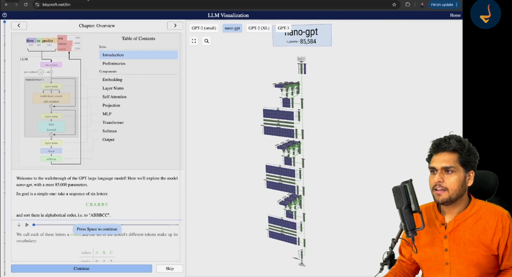

### Exploring nano-gpt

The visualizer demonstrates **nano-gpt**, a small educational model with 85,584 parameters designed by Andrej Karpathy:
- **Task**: Takes an input sequence of six characters (`C B A B B C`) and sorts them alphabetically into (`A B B C C`).
- **Input Pipeline**: Each character is mapped to a Token ID (`2, 1, 0, 1, 1, 2`), converted into a 48-dimensional token embedding, and added to a 48-dimensional positional embedding.
- **Architecture**: Contains 3 stacked Transformer blocks, each featuring 3 parallel attention heads and a feed-forward network.

---

## 15. The Mathematics of Self-Attention: Query (Q), Key (K), and Value (V)

Inside each self-attention head, information retrieval relies on three distinct vectors: **Query ($Q$)**, **Key ($K$)**, and **Value ($V$)**.

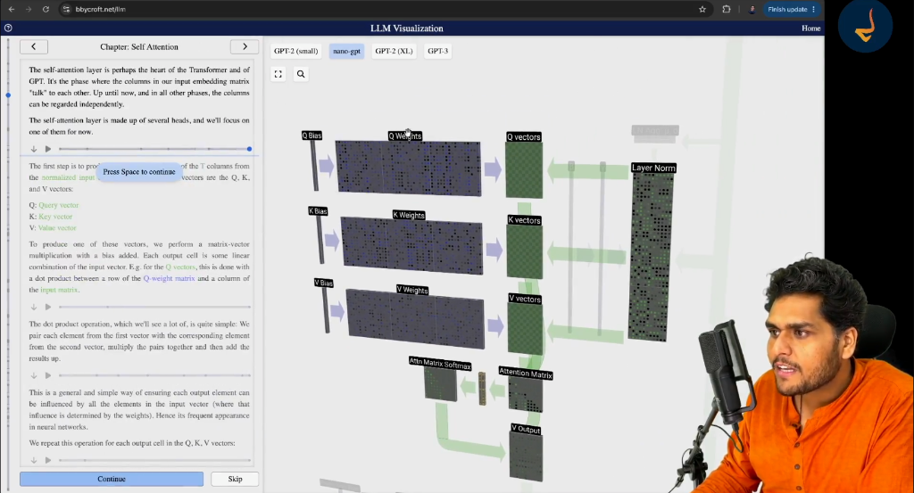

### The Core Meaning of Q, K, and V

For every token passing through an attention head:
1. **Query ($Q$)**: The question posed by the token: *"What information am I looking for?"*
2. **Key ($K$)**: The label or identity card offered by every other token: *"What information do I have to offer?"*
3. **Value ($V$)**: The actual content or feature payload: *"Here is my actual representation."*

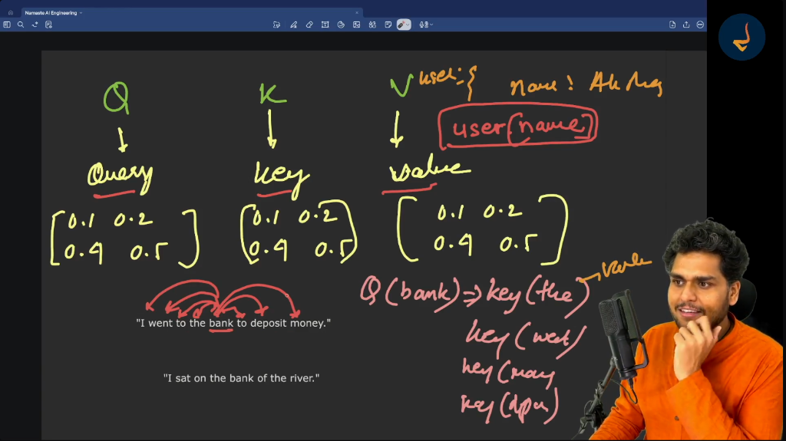

### The Object / Dictionary Analogy

Think of self-attention like accessing a JavaScript dictionary object:

```javascript
const user = { name: "Akshay" };
user["name"]; // "name" is the Key, matching our Query, returning the Value "Akshay"
```

In language modeling:
- In the sentence `"I went to the bank to deposit money"`, consider evaluating the token `"bank"`.
- The token `"bank"` sends out a Query vector $Q(\text{"bank"})$.
- Every other token in the sentence provides a Key vector: $K(\text{"went"})$, $K(\text{"deposit"})$, $K(\text{"money"})$, etc.
- By computing the dot product between $Q(\text{"bank"})$ and all Keys, the model calculates how relevant each token is to `"bank"`.
- Because $Q(\text{"bank"})$ matches strongly with $K(\text{"deposit"})$ and $K(\text{"money"})$, the model retrieves large fractions of their Value vectors ($V$), blending financial context into `"bank"`.

### The Scaled Dot-Product Attention Formula

The complete mathematical definition of self-attention from the 2017 Google paper is:

$$\text{Attention}(Q, K, V) = \text{softmax}\left(\frac{Q K^T}{\sqrt{d_k}}\right) V$$

Where:
- $Q K^T$ calculates the **dot product** between every Query vector and every Key vector, measuring raw compatibility scores across all token pairs.
- $\sqrt{d_k}$ is the **scaling factor**, where $d_k$ is the dimension of the Key vectors. When vectors have high dimensionality, dot products grow very large in magnitude, which pushes Softmax into regions with near-zero gradients. Dividing by $\sqrt{d_k}$ keeps numbers in a stable range.
- $\text{softmax}(\dots)$ converts raw compatibility scores into non-negative probabilities summing to $1.0$ across the sequence. This produces the **Attention Matrix**.
- Multiplying by $V$ computes a weighted sum of the Value vectors, producing the updated, context-rich representation for each token.

---

## 16. Why the Attention Matrix is Triangular: Causal Masking in Action

When inspecting the Attention Matrix in the 3D visualizer, notice its distinctive **lower-triangular shape**:
- All values in the upper-right portion of the matrix are zero (`0.00`).
- This triangular structure is the direct mathematical manifestation of **Causal Masking**.

### The Masking Rule

$$\text{Token at position } t \text{ can only attend to positions } 1, 2, \dots, t$$

- Token 1 (`"I"`) can only look at `"I"`.
- Token 2 (`"went"`) can look at `"I"` and `"went"`.
- Token 3 (`"to"`) can look at `"I"`, `"went"`, and `"to"`.
- Token 4 (`"the"`) can look at `"I"`, `"went"`, `"to"`, and `"the"`.
- Token 5 (`"bank"`) can look at all preceding tokens up to `"bank"`. Future tokens (`"deposit"`, `"money"`) are completely blocked.

### The Forward-Context Paradox Resolved

If `"bank"` appears before `"money"`, how can the model know that `"bank"` refers to a financial institution when future words are masked?

- While the initial token `"bank"` cannot peek forward into `"money"`:
- When the sequence later reaches the word `"money"`, the token `"money"` looks backward and attends strongly to `"bank"`.
- In subsequent stacked Transformer layers, this joint relationship is mixed across the entire sequence representation.
- By the time the final token is generated, the network possesses full contextual awareness of all prior tokens.

---

## 17. Stacking Transformer Blocks and Model Scaling

A single Transformer block consists of:
1. **Layer Normalization 1**
2. **Multi-Head Causal Self-Attention** ($Q, K, V$ matrix operations across parallel heads)
3. **Residual Connection 1** ($x + \text{Attention}(x)$)
4. **Layer Normalization 2**
5. **Feed-Forward Network (MLP)** (dimensional expansion, activation, dimensional compression)
6. **Residual Connection 2** ($x + \text{FFN}(x)$)

### From Educational Models to Frontier LLMs

Modern frontier models do not invent a new architecture: they stack this identical Transformer block dozens of times and scale internal dimensions:

| Model Architecture | Layers (Blocks) | Attention Heads | Embedding Dimension ($d_{\text{model}}$) | Total Parameters |
| :--- | :--- | :--- | :--- | :--- |
| **nano-gpt** | 3 | 3 | 48 | ~85,000 |
| **GPT-2 (Small)** | 12 | 12 | 768 | 117 Million |
| **GPT-2 (XL)** | 48 | 25 | 1600 | 1.5 Billion |
| **GPT-3** | 96 | 96 | 12,288 | 175 Billion |

The intelligence of modern language models emerges from repeating this disciplined linear algebra pipeline across hundreds of billions of trained parameters.

---

## 18. The Astronomical Scale of Modern LLMs

When zooming out in the 3D visualizer from **nano-gpt** to **GPT-3**, the visual contrast illustrates the staggering scale of modern foundation models:

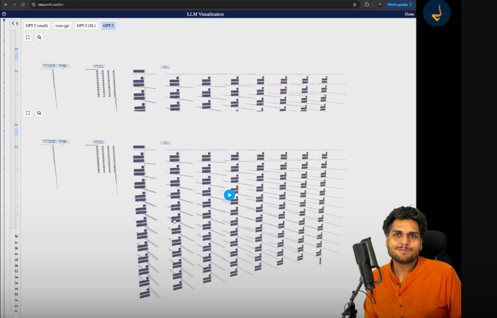

### The Galaxy Analogy

- `nano-gpt` appears as a small, barely visible line at the far left edge of the screen.
- `GPT-3` stands as an immense wall of 96 stacked layers, spanning 96 parallel attention heads per block.
- Comparing `nano-gpt` to `GPT-3` is like comparing an individual grain of sand to an entire mountain range.

### All That Math for a Single Token

A crucial realization about autoregressive inference:
- The entire forward pass (spanning 96 deep blocks, thousands of matrix multiplications, hundreds of thousands of dot products, layer normalizations, and softmax distributions) executes just to produce **one single predicted token**.
- To generate a paragraph of 200 words, that entire massive mathematical apparatus runs from beginning to end 200 separate times.
- Modern high-performance GPUs execute trillions of floating-point operations per second to make this computation feel instantaneous to the end user.

---

## 19. The Surprising Simplicity of LLM Code

A widespread misconception among software engineers is that creating a Large Language Model requires millions of lines of intricate, proprietary code.

The reality is far more elegant: the entire model architecture of a GPT can be written in roughly **300 lines of standard Python code** using PyTorch.


As demonstrated in Andrej Karpathy open-source implementation of `nanoGPT` (`model.py`):
- `LayerNorm`: Simple custom class that standardizes activation values across dimensions.
- `CausalSelfAttention`: Computes the Query, Key, and Value projections, applies the lower-triangular causal mask, evaluates scaled dot products, and projects through attention heads.
- `MLP`: A clean feed-forward network with an input projection, a GELU non-linear activation, and an output projection.
- `Block`: Ties one self-attention layer and one MLP layer together with residual skip connections.
- `GPT`: Stacks the desired number of blocks, adds learned positional encodings, and maps the final representations through a linear layer and softmax.

The intellectual breakthrough of the Transformer is its conceptual simplicity. The complexity does not lie in convoluted codebases, but in the mathematical harmony of the architecture and the scale of training data.

---

## 20. How to Approach AI Research Papers

The primary research paper *"Attention Is All You Need"* (Vaswani et al., 2017) changed the course of technological history:
- When first opening the paper on arXiv (`arxiv.org/abs/1706.03762`), the dense notation can feel intimidating.
- Understanding research papers is a skill developed through iterative exploration:
  - Do not expect complete comprehension on the first pass.
  - Break down individual symbols and terms (such as $Q, K, V$, LayerNorm, and causal masking) into intuitive concepts.
  - Relate mathematical equations directly to software constructs (like dictionaries, projections, and triangular matrices).
  - Cultivate active curiosity by continuously asking *why* specific architectural choices were made.

---

## 21. Looking Ahead: Sharpening the Brain

In this episode, we examined the **computational brain at inference time**: how a pre-trained neural network processes input prompts and generates predictions using fixed weights and biases.

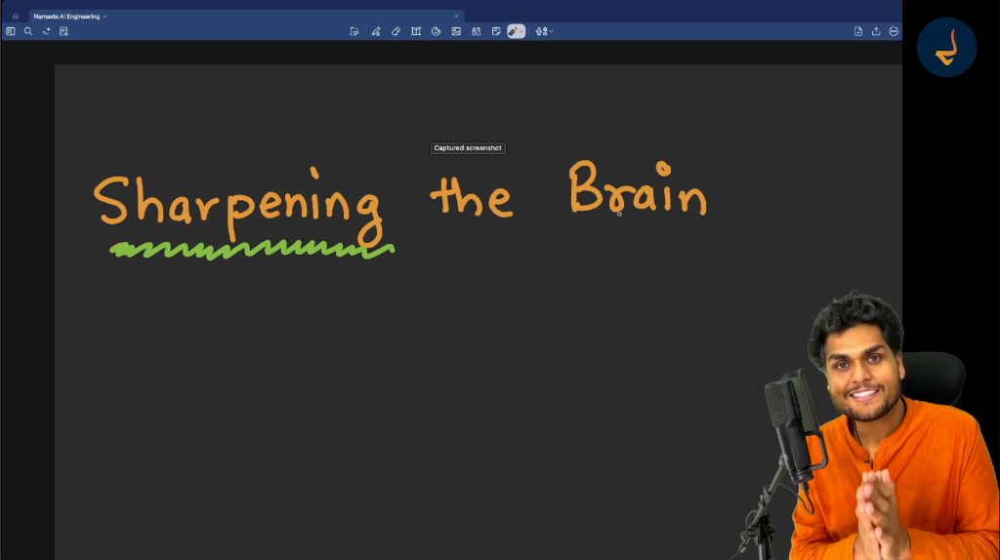

This leaves a fundamental question unanswered:
- How does an untrained neural network (which begins with purely random numerical weights producing complete gibberish) transform into an intelligent system capable of reasoning, coding, and writing?
- How do we calculate errors and update billions of parameters?
- How does the machine learn from mistakes?

That learning process is called **Training** or **Sharpening the Brain**:
- **Loss Functions**: Mathematically measuring how wrong a prediction is.
- **Backpropagation**: Tracing errors backward through dozens of Transformer layers.
- **Gradient Descent and Optimizers**: Systematically adjusting weights and biases so future predictions become accurate.

These training mechanics form the foundation of our next deep dive: **Episode 07: Sharpening the Brain**.


