# Episode 07: Sharpening the Brain

> **Season 1: Inside the Mind of AI**  
> Instructor: **Akshay Saini** (NamasteDev)  
> Topic: How AI Models Learn: Parameters, Weights and Biases, Training Data, Forward Pass, Loss Function, Backpropagation, Gradients, Gradient Descent Optimization, Self-Supervised Learning, Generalization, and Distributed Training

---

## 1. Introduction: Sharpening the Brain

In previous episodes, we analyzed what happens after a neural network is already built and trained:
- The input text is tokenized into numbers.
- Embeddings capture semantic meaning.
- The Transformer architecture processes tokens through self-attention mechanisms and feed-forward layers.
- A probability distribution is computed, and the model predicts the next token.

This runtime phase is known as **inferencing**.

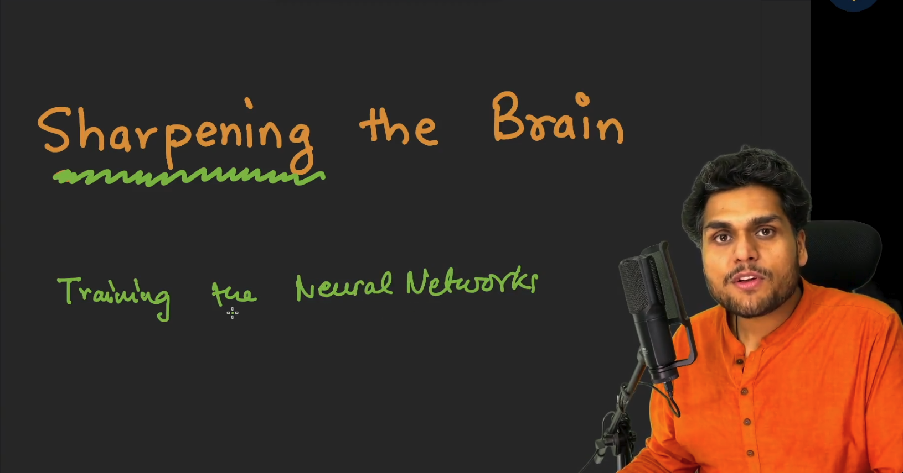

Inferencing assumes that the neural network is already intelligent. But how does an artificial neural network acquire that intelligence in the first place? How do Large Language Models learn?

**Sharpening the brain** refers to the process of **training the neural network**: transforming an empty, untrained collection of mathematical equations into a system capable of fluent language, reasoning, and problem solving.

---

## 2. The Untrained Neural Network

To understand training from first principles, consider what a neural network looks like before training begins:
- An **untrained neural network** is like the brain of a newborn baby. It has no prior knowledge of grammar, facts, human language, or reasoning. Everything to it is gibberish.
- A **trained neural network** is like an adult who has practiced a specialized craft for decades.

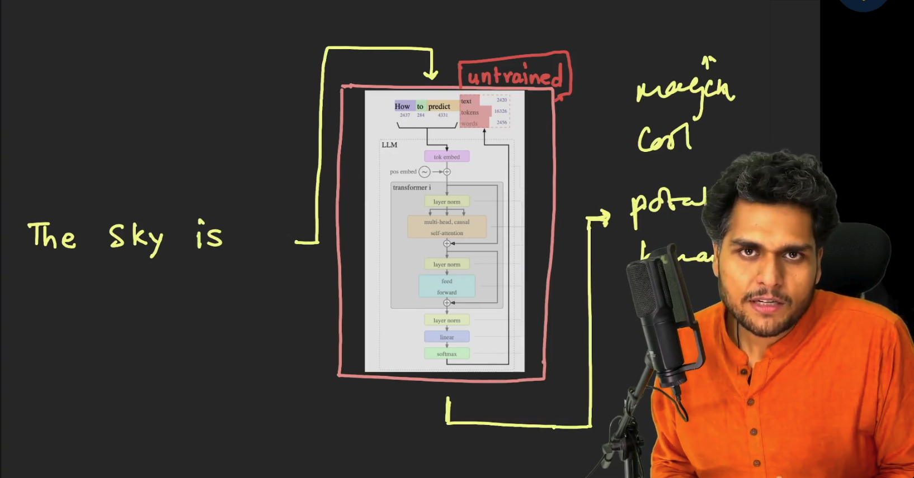

If you prompt an untrained neural network with an incomplete sentence:

$$\text{"The sky is \_\_\_\_\_"}$$

Because its internal connections are uncalibrated, it generates completely arbitrary, random tokens:
- `"magic"`
- `"cool"`
- `"potato"`
- `"banana"`

It does not know that the sky can be blue, dark, or cloudy. To transform these random outputs into coherent, accurate predictions, the network must undergo training.

---

## 3. What Does "Learning" Mean in a Machine?

In human beings, learning involves reading, observing, forming mental models, and building biological synaptic connections. How does a machine learn?

From first principles:
1. A neural network contains a massive collection of adjustable numbers called **parameters**.
2. During training, we repeatedly modify those parameters so that the model becomes better at a particular objective.
3. For a neural network, **learning means adjusting parameters so that future predictions become better**.

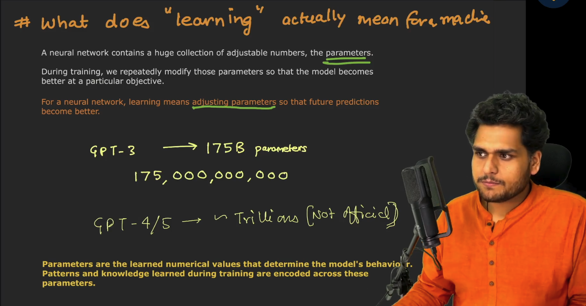

### The Scale of Model Parameters

When tech companies announce frontier AI models, their scale is defined by the parameter count:
- **GPT-3**: Has **175,000,000,000 (175 billion)** parameters. In Indian numbering terminology, that is 17,500 crore parameters.
- **GPT-4 / GPT-5**: Estimated in the trillions (for example, approximately 1.8 trillion parameters).

Parameters are the learned numerical values that dictate model behavior. All patterns, linguistic structures, and knowledge acquired during training are encoded directly across these numbers.

---

## 4. Parameters as Internal Knobs and Dials

A helpful physical analogy for parameters is a professional audio mixer used by a DJ or sound engineer:
- To achieve the perfect sound, the DJ regulates hundreds of sliders, knobs, and frequency dials.
- The soundboard itself is the model.
- The knobs and dials that get adjusted are the **parameters**.

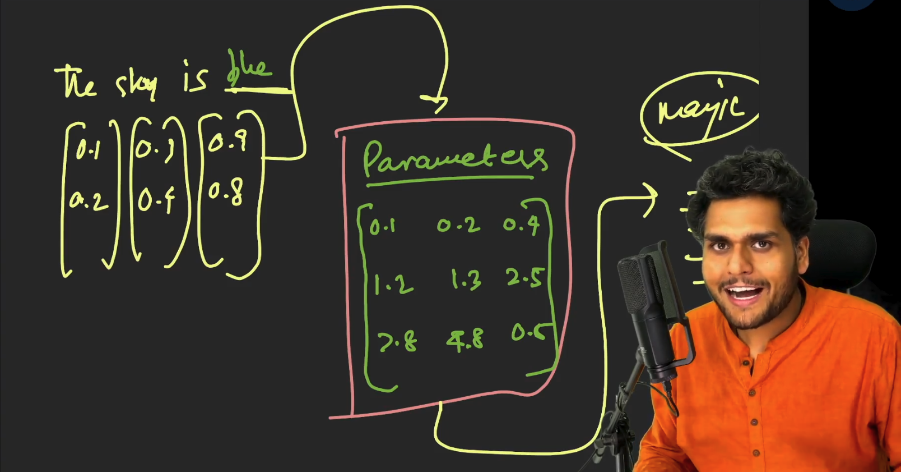

In an audio setup, a human DJ turns the knobs. In an artificial neural network, **the model adjusts its own knobs automatically during training**.

When input text enters the network:
1. Tokens convert into embedding vectors (arrays of floating-point numbers).
2. The network performs massive matrix multiplications and arithmetic calculations between these token numbers and the parameter matrices.
3. The resulting values pass forward to generate output probabilities.

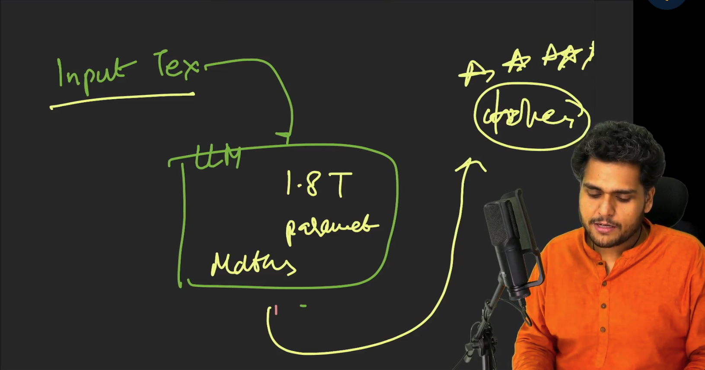

When an LLM contains 1.8 trillion parameters, every single token generation passes through this immense landscape of calibrated numbers to produce meaningful output.

---

## 5. Where Parameters Live Inside the Transformer Architecture

Parameters are not abstract entities; they exist inside every component of the Transformer architecture:

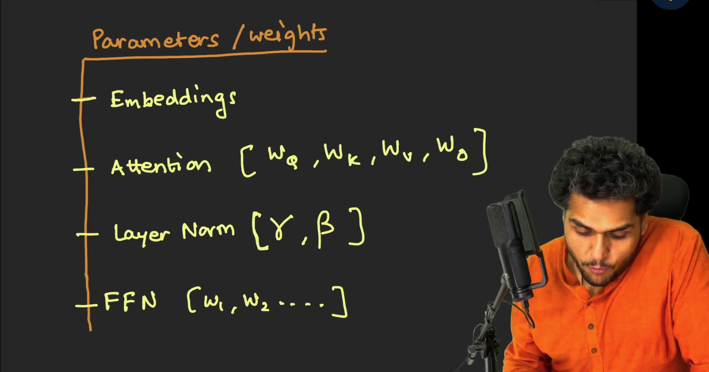

Every parameter falls primarily into two mathematical categories:
- **Weights**: Multiplicative factors that act like volume controls, determining how much influence a particular input feature exerts on the output.
- **Biases**: Additive offsets that shift activation thresholds, allowing artificial neurons to fire even when incoming inputs are zero or low.

Across the Transformer pipeline, parameters reside in:
- **Token Embeddings**: The embedding table contains rows of adjustable numerical vectors for every token in the vocabulary.
- **Self-Attention Projections**: The Query ($W_Q$), Key ($W_K$), Value ($W_V$), and Output ($W_O$) projection matrices consist entirely of learnable weights.
- **Layer Normalization**: Learnable scale factor ($\gamma$) and shift factor ($\beta$) adjust and stabilize numerical distributions.
- **Feed-Forward Networks (FFN / MLP)**: Massive dense linear transformation layers ($W_1$, $W_2$) and their accompanying bias vectors contain the bulk of parameter counts in modern models.

---

## 6. Do Parameters Store Knowledge?

A common misconception is that neural network parameters store facts, encyclopedic articles, or databases like a hard drive.

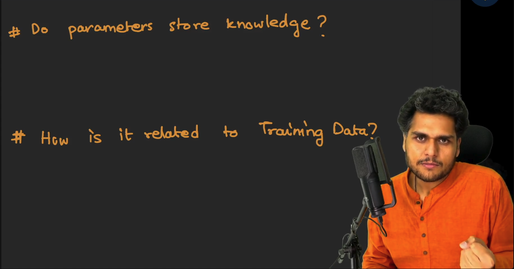

The answer is **no, not in the human sense**:
- Parameters do not store files, documents, or explicit memory records.
- Parameters store **statistical patterns, relationships, correlations, and structures** discovered across data.
- The mathematical algorithms combine input tokens with these learned weights to calculate the most logical continuation.

### The Role of Training Data

If parameters are the internal dials of the neural network, **training data is the feed that shapes them**:
- Training data is the collection of texts, books, web articles, encyclopedias, code repositories, and dialogues used to teach the model.
- Just as students use textbooks and practice problems to study, the AI uses training datasets to identify linguistic and conceptual patterns.

---

## 7. The Core Training Loop

Training an AI model is an iterative four-step cycle:
1. **Forward Pass**: Make a prediction.
2. **Loss Calculation**: Measure prediction error.
3. **Backpropagation**: Compute sensitivity gradients backward through the network.
4. **Optimization (Gradient Descent)**: Update parameters to reduce future error.

---

## 8. Step 1: The Forward Pass

The forward pass is the journey data takes through the neural network from initial input to final prediction:

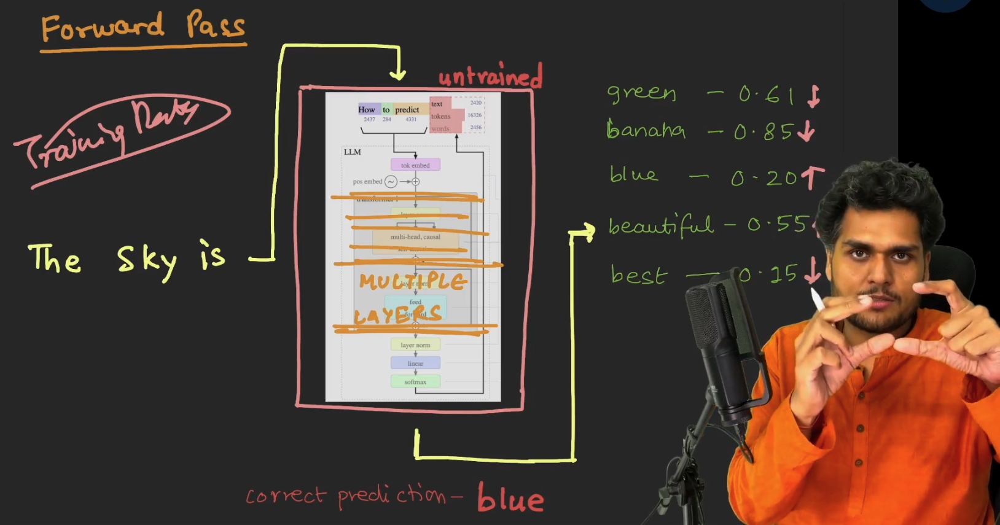

Consider an example input sequence from the training dataset:

$$\text{"The sky is \_\_\_\_\_"}$$

During the forward pass:
1. The text tokens pass through the embedding layer and positional encodings.
2. The numerical representations pass sequentially through multiple Transformer layers (self-attention blocks, layer normalization, and feed-forward networks).
3. The final linear projection and softmax function convert hidden states into a probability distribution over the entire vocabulary.

In an untrained neural network, the initial parameter values are random. Consequently, the output probabilities are distorted:

| Candidate Token | Model Probability | Ground Truth Status |
| :--- | :--- | :--- |
| **banana** | `0.85` | Incorrect |
| **green** | `0.61` | Contextually unlikely |
| **beautiful** | `0.55` | Plausible but suboptimal |
| **blue** | `0.20` | Correct target |
| **best** | `0.15` | Contextually unlikely |

Because the network predicted `"banana"` with the highest probability (`0.85`) instead of `"blue"`, the system must measure this failure mathematically.

---

## 9. Step 2: The Loss Function

A **loss function** is a mathematical formula that converts the quality of a prediction into a single numerical score representing error:

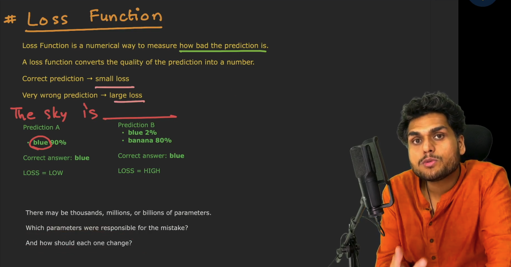

From first principles:
- **Accurate prediction** $\implies$ Small loss (approaching zero).
- **Inaccurate prediction** $\implies$ Large loss.

### The Grading Analogy

Think of the loss function as an impartial teacher grading an exam:
- If the target answer is `"blue"` and the model assigns 90 percent confidence to `"blue"`, the error is minimal, yielding a **low loss**.
- If the model assigns 80 percent confidence to `"banana"` and only 2 percent to `"blue"`, the error is severe, yielding a **high loss**.

The primary objective of training is to drive this loss score as close to zero as possible across all training examples.

However, knowing that the model produced a high loss is not enough. In a network containing billions of parameters, which specific parameters caused the mistake, and in which direction should each parameter change?

---

## 10. Step 3: Backpropagation (The Backward Pass)

Once the loss is computed at the output layer, the network executes **backpropagation** (the backward pass):

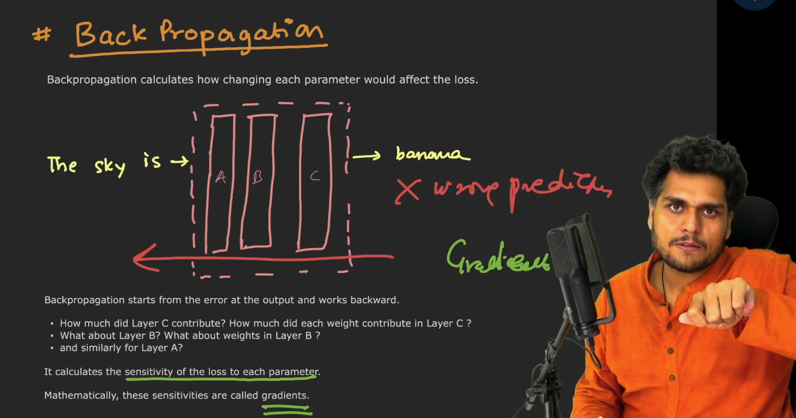

Backpropagation starts at the output error and moves in reverse through the network:
1. It analyzes the final output layer: how much did the parameters in Layer C contribute to the total loss?
2. It moves to the preceding layer: how much did the parameters in Layer B contribute?
3. It steps backward to Layer A, all the way back to the token embeddings.

Mathematically, backpropagation applies the calculus chain rule to calculate the partial derivative of the loss with respect to every single parameter:

$$\frac{\partial \text{Loss}}{\partial w}$$

This sensitivity value is called the **gradient**.

---

## 11. What Is a Gradient?

A gradient measures the sensitivity of the loss function to changes in a specific parameter:

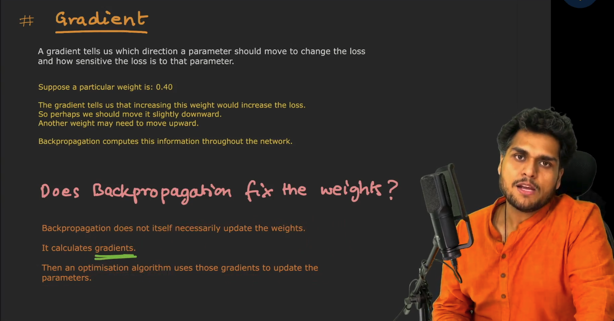

The gradient provides two vital pieces of information for every knob in the network:
1. **Direction**: Should this weight increase or decrease to lower the loss?
2. **Magnitude**: How sensitive is the loss to a tiny nudge in this weight?

Suppose a specific weight currently equals `0.40`:
- If the gradient indicates that increasing this weight increases the loss, the parameter must move downward.
- If another weight shows that increasing it reduces the loss, that parameter must move upward.

### Does Backpropagation Update the Weights?

A critical theoretical distinction: **backpropagation does not modify the weights directly**.
- Backpropagation calculates the **gradients** (the sensitivities).
- An **optimization algorithm** takes those gradients and applies the actual parameter updates.

---

## 12. Step 4: Gradient Descent Optimization

**Gradient Descent** is an iterative optimization algorithm used to minimize a function (such as loss or error) by adjusting parameters in the opposite direction of the gradient.

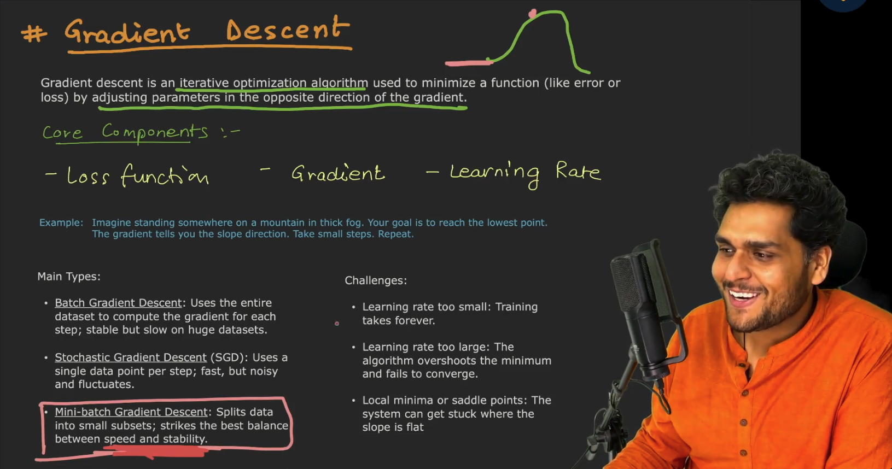

### The Foggy Mountain Analogy

Imagine being lost on a mountain blanketed in thick fog at night, with the goal of reaching the bottom of the valley:
- You cannot see the destination or the surrounding terrain.
- You feel the slope of the ground beneath your feet.
- You take a small step in the steepest downward direction.
- You repeat this process step by step until you arrive at the lowest point.

In AI:
- The **mountain height** represents the loss (error).
- The **slope direction** is the gradient.
- The **step size** is the learning rate.
- The **valley bottom** is the state of minimum loss, where predictions are accurate.

### Core Components of Gradient Descent

1. **Loss Function**: Quantifies total prediction error.
2. **Gradient**: Indicates the direction of steepest error increase; the optimizer steps in the exact opposite direction.
3. **Learning Rate**: A hyperparameter controlling the size of the adjustment step taken during each update.

### Challenges in Gradient Descent

- **Learning rate too small**: Adjustments are minuscule; training takes months or stalls completely.
- **Learning rate too large**: The algorithm overshoots the minimum valley, oscillates wildly, or diverges to infinity.
- **Local minima and saddle points**: The optimizer can become trapped in flat plateaus or suboptimal dips where the slope is near zero.

### Variants of Gradient Descent

| Variant | Mechanism | Advantages | Disadvantages |
| :--- | :--- | :--- | :--- |
| **Batch Gradient Descent** | Computes the loss across the entire dataset before making a single parameter update. | Highly stable and accurate trajectory toward minimum. | Extremely slow; requires impossible amounts of GPU memory for large datasets. |
| **Stochastic Gradient Descent (SGD)** | Updates parameters after evaluating one single random sample. | Extremely fast; requires minimal memory per update. | Noisy and chaotic updates; bounces erratically around the minimum. |
| **Mini-Batch Gradient Descent** | Splits data into small batches (e.g. 32, 64, or 128 samples), computes average loss, and updates parameters. | Strikes the ideal balance of speed, parallel GPU hardware efficiency, and trajectory stability. | Requires tuning batch size hyperparameter. |

**Mini-Batch Gradient Descent is the universal industry standard** for training modern Large Language Models.

---

## 13. The Complete Training Cycle

Putting all components together reveals the complete lifecycle of training:

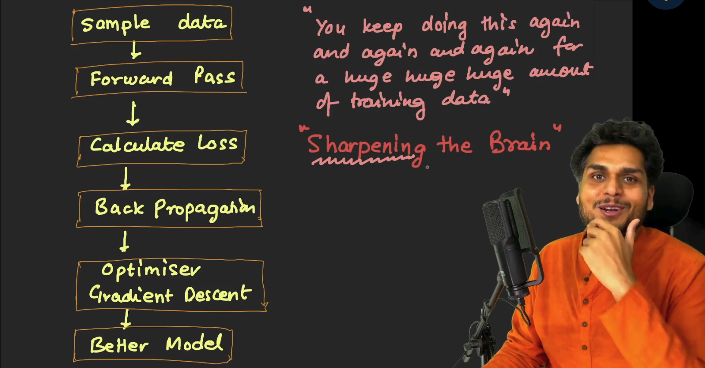

The pipeline executes continuously:

$$\text{Sample Data} \longrightarrow \text{Forward Pass} \longrightarrow \text{Calculate Loss} \longrightarrow \text{Backpropagation} \longrightarrow \text{Optimizer (Gradient Descent)} \longrightarrow \text{Better Model}$$

This loop is executed again and again across trillions of tokens to progressively sharpen the artificial brain.

---

## 14. Pattern Recognition Across Billions of Samples

How does repeating this loop transform numbers into language understanding?

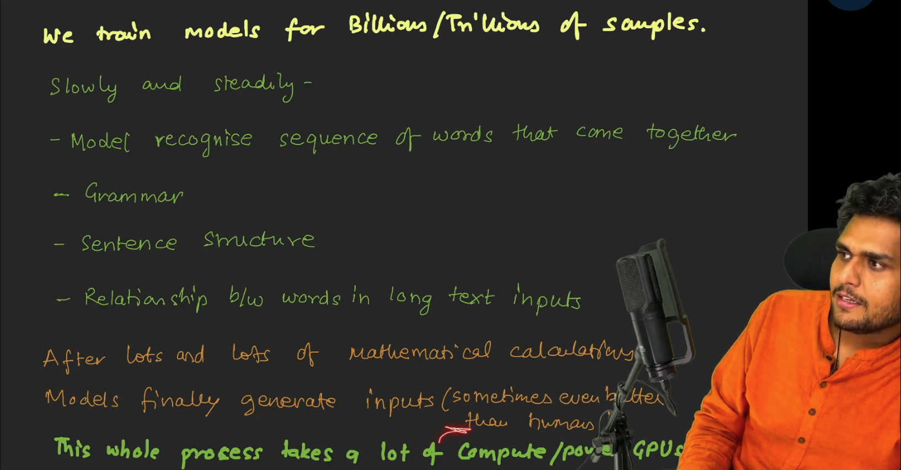

As models train over billions and trillions of text samples, mathematical adjustments accumulate:
- The network begins to recognize regular sequences of words that frequently appear together.
- It learns grammatical structures, verb conjugations, and punctuation conventions.
- It captures intricate relationships between concepts across long spans of text.
- Over time, the model generates fluent, articulate answers that can match or exceed human performance on specific benchmarks.

Achieving this requires massive computational clusters, thousands of GPUs, and vast electrical power.

---

## 15. Self-Supervised Learning: The Next Token as Target

In classic machine learning, supervised learning requires humans to manually label vast datasets (for example, tagging millions of photos as "cat" or "dog"). Labeling trillions of sentences manually is impossible.

How do LLMs train at massive scale? They use **self-supervised learning**:

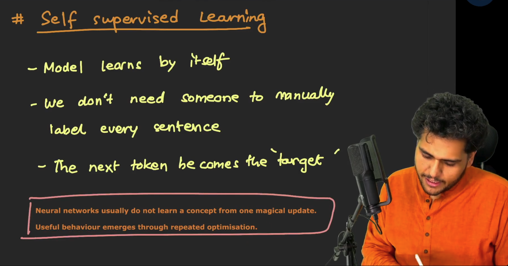

In self-supervised learning:
- The model teaches itself directly from raw, uncurated text.
- No human annotators are required to label every sentence.
- The input text itself provides the supervision: the model receives preceding tokens and attempts to predict the next word.
- The actual next word in the document serves as the ground-truth target.

Useful, sophisticated behavior emerges organically through repeated self-supervised optimization.

---

## 16. Essential Training Terminology

To understand modern AI training workflows, four technical terms are fundamental:

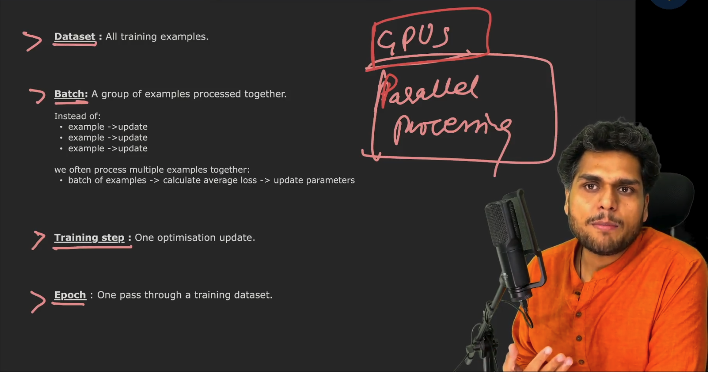

1. **Dataset**: The entire collection of training data assembled to train the model (e.g. trillions of tokens gathered from the internet, books, code, and papers).
2. **Batch**: A discrete group of training examples processed simultaneously. GPUs leverage parallel processing to compute forward passes and losses across batches concurrently.
3. **Training Step**: One complete optimization update, consisting of processing one batch, calculating loss, executing backpropagation, and updating parameters once.
4. **Epoch**: One complete pass through the entire dataset from beginning to end. Just as students reread a textbook multiple times to master material, AI models often train across multiple epochs to reinforce learned patterns.

---

## 17. Training Versus Inference

Understanding the difference between training and inference is critical for systems architecture and cost planning:

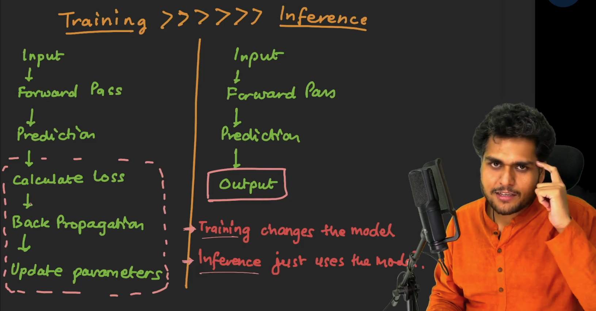

| Dimension | Training | Inference |
| :--- | :--- | :--- |
| **Pipeline Stages** | Input $\to$ Forward Pass $\to$ Prediction $\to$ Calculate Loss $\to$ Backpropagation $\to$ Parameter Update | Input $\to$ Forward Pass $\to$ Prediction $\to$ Output Token |
| **Parameter State** | Dynamic; continuously modified via optimization. | Static; parameters are completely frozen. |
| **Execution Direction** | Bidirectional (Forward pass + Backward pass). | Unidirectional (Forward pass only). |
| **Compute Demands** | Massive clusters of high-end GPUs running for weeks or months. | Lightweight; can run on single GPUs, consumer chips, or edge devices. |
| **Financial Cost** | Millions of dollars per training run. | Fractions of a cent per API request. |
| **Objective** | Teach the model how to capture general patterns from data. | Apply learned patterns to generate responses for user queries. |

---

## 18. Generalization: Discovering Underlying Patterns

The ultimate test of learning in an AI model is **generalization**:

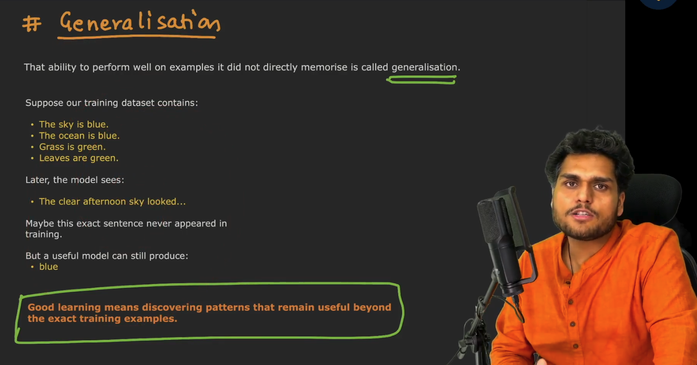

From first principles:
- **Generalization** is the ability of a machine learning model to perform accurately on brand-new, unseen examples that it did not directly memorize during training.
- **Good learning means discovering patterns that remain useful beyond the exact training examples.**

### Generalization in Practice

Suppose the training dataset contains specific sentences such as:
- `"The sky is blue."`
- `"The ocean is blue."`
- `"Grass is green."`
- `"Leaves are green."`

Later, during inference, the user supplies a completely novel sentence:

$$\text{"The clear afternoon sky looked \_\_\_\_\_"}$$

Even if this exact phrasing never appeared in its training dataset, a properly generalized model understands the underlying association between clear skies and the color blue, successfully outputting `"blue"`.

---

## 19. Overfitting and Distributed Training

When generalization fails, the model suffers from **overfitting**:

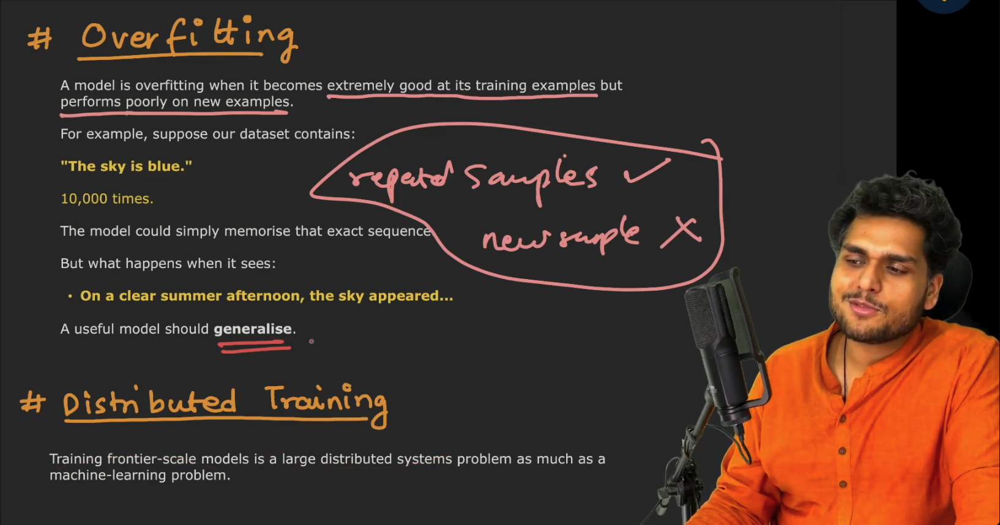

### What Is Overfitting?

A model is **overfitting** when it becomes exceptionally good at predicting its exact training examples but performs poorly on new, unseen examples:
- The model memorizes exact training samples rather than abstracting general rules.
- If a dataset repeats `"The sky is blue"` 10,000 times, an overfitted model will memorize that rigid string. When presented with `"On a stormy night, the sky appeared _____"`, it might still rigidly output `"blue"`.
- A valuable model must generalize, adapting flexibly to varied contexts.

### Distributed Training

Training frontier-scale models is a massive **distributed systems engineering challenge** as much as a machine learning problem:
- A model with hundreds of billions or trillions of parameters cannot fit into the memory of a single GPU.
- Processing trillions of tokens sequentially on one machine would take centuries.
- In distributed training, the workload is partitioned across thousands of interconnected GPU nodes:
  - **Data Parallelism**: The dataset is split across multiple GPUs, each processing a different batch and synchronizing parameter updates.
  - **Model Parallelism**: The layers and parameter matrices of the model itself are sliced across multiple GPUs.
  - **Pipeline Parallelism**: Different layers run sequentially across dedicated devices.
- Hardware requirements involve state of the art accelerators such as NVIDIA H100 GPUs (which cost between 25 lakh and 40 lakh Indian Rupees each).

---

## 20. How Token Embeddings Are Learned Parameters

In Episode 05, we saw that semantic concepts like `"king"` and `"queen"` or `"man"` and `"woman"` share meaningful geometric relationships inside multi-dimensional embedding space. How do these numbers get there?

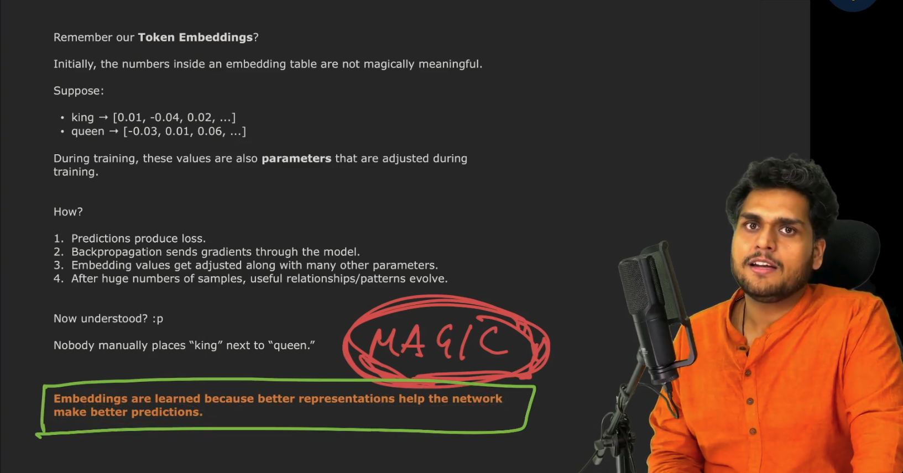

From first principles:
- Initially, numbers in an embedding lookup table are initialized randomly (for example, `king` $\to [0.01, -0.04, 0.02, \dots]$).
- Nobody manually places `"king"` next to `"queen"` in vector space.
- The embedding values themselves are **learnable parameters**:
  1. The forward pass uses embedding vectors to generate predictions.
  2. Predictions generate loss against ground-truth tokens.
  3. Backpropagation routes gradients all the way back to the embedding weights.
  4. Optimization updates the embedding numbers alongside attention and feed-forward parameters.
- After processing billions of samples, tokens appearing in similar semantic and syntactic contexts naturally cluster together.
- **Embeddings are learned because better vector representations help the network make better predictions.**

---

## 21. Philosophical Reflection: Prediction Versus Understanding

The episode concludes with a profound philosophical inquiry into artificial intelligence:

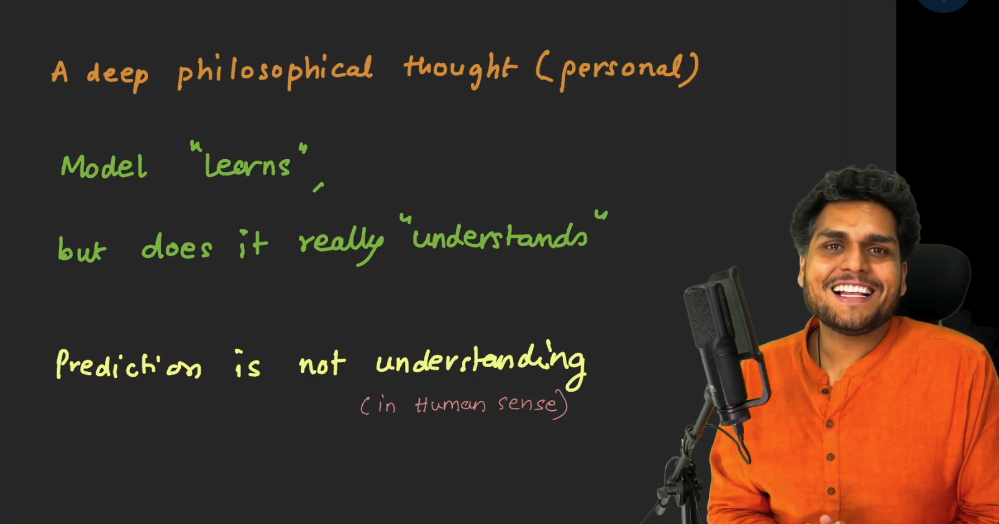

An artificial neural network learns to adjust trillions of parameters, minimize loss, and generate articulate responses. But does it truly **understand**?

From first principles:
- **Prediction is not understanding in the human biological sense.**
- Humans possess consciousness, lived experience, sensory grounding, intentionality, and emotional comprehension.
- An artificial neural network executes linear algebra, matrix multiplications, dot products, and probability calculations over numerical weights.
- When an LLM generates a thoughtful response, it is calculating the most statistically probable sequence of tokens based on calibrated parameters.
- The appearance of comprehension is the mathematical consequence of massive scale, self-supervised learning, and rigorous gradient optimization.
