# Episode 09: Can AI Really Think?

> **Season 1: Inside the Mind of AI**  
> Instructor: **Akshay Saini** (NamasteDev)  
> Topic: Can AI Really Think? Exploring Reasoning Models, Childhood Curiosity and Society, Direct Generation versus Reasoning-Oriented Generation, Intermediate Computation, Chain of Thought (CoT), Tree of Thoughts (ToT), Graph of Thoughts (GoT), The Historic Impact of AlphaGo and Move 37, Reinforcement Learning from Self-Play, The DeepSeek Moment and DeepSeek-R1, Pre-Training Compute versus Test-Time Compute, Overthinking and Compute Budgets, Verifiable Domains and RLVR, Automated Palindrome Test Verification, The Evaluator Triad, Human in the Loop, LLM-as-a-Judge and Evaluator Biases, Faithfulness of Visible Reasoning, Hidden Thinking Traces, Human Cognition versus Machine Mathematics, and the Ultimate AI Superpower Triad: Knowledge, Reasoning, and Tools

---

## 1. Introduction: Probing the Illusion of Machine Cognition

Throughout this series, we explored how artificial intelligence systems ingest massive datasets, optimize transformer weights during pre-training, and acquire conversational manners through post-training. When interacting with modern conversational assistants, users often feel as if they are conversing with a conscious, thinking entity.

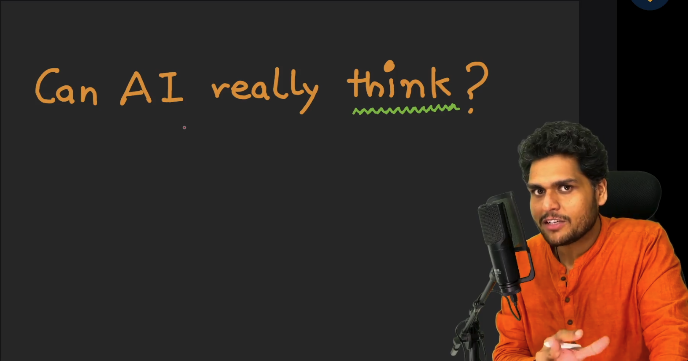

When prompted, modern models can explain quantum physics, compose poems in the style of Shakespeare, or summarize complex treatises on DNA science.

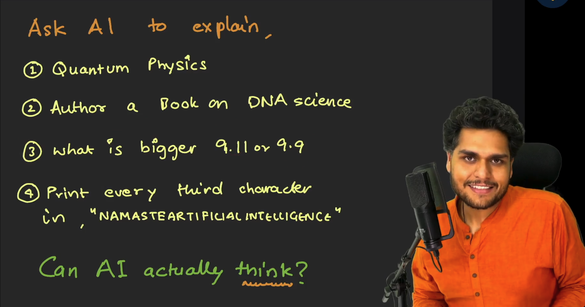

### Grand Competence versus Elementary Failure
Yet, underneath this dazzling fluency lies a strange paradox. Traditional models that effortlessly discuss general relativity can fail completely when presented with basic arithmetic or elementary logic riddles:
- **Which number is bigger: 9.11 or 9.9?**
- **Print every third character in the string: NAMASTEARTIFICIALINTELLIGENCE**

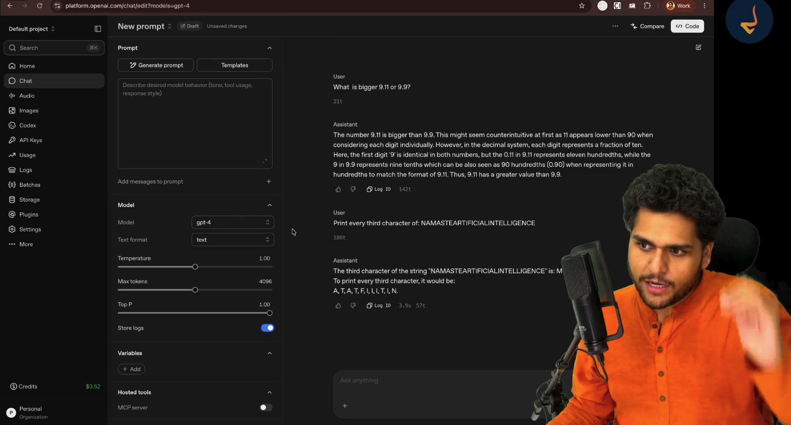

In standard playground tests, traditional autoregressive models such as GPT-4 often confidently proclaim that 9.11 is greater than 9.9, confusing the decimal system with version numbering or integer comparison (treating 11 as larger than 9). When asked to extract every third character of a word, they frequently miscount string indices and emit incorrect sequences.

How can a system capable of writing advanced code and passing medical licensing examinations stumble on grade school arithmetic? Does artificial intelligence truly think, or does it merely imitate human language patterns?

---

## 2. What is Thinking? Curiosity, Deliberation, and Generation Paradigms

To determine whether an artificial intelligence system can think, one must first explore how thinking originates in human beings.

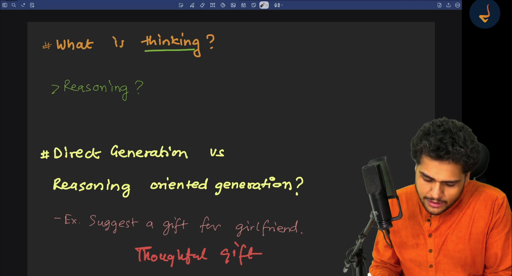

### The Suppression of Human Curiosity
Every human child is born innately curious. Young children constantly observe the world and ask profound, uninhibited questions:
- *Why do birds fly?*
- *Why do fish swim in water instead of walking on the streets?*
- *Why are clouds white?*

However, as children progress through formal schooling and societal conditioning, this natural curiosity is frequently suppressed. Adults, teachers, and society often instruct children to sit down, be quiet, and stop asking questions. Over time, that inner spark of curiosity is subdued.

In artificial intelligence research, we are witnessing the exact opposite journey. We begin with cold, inert mathematical matrices, and we are attempting to engineer that very faculty of curiosity, hypothesis testing, and deliberate reasoning into computational models.

### Deliberation in Everyday Life: The Gift Thought Experiment
In human cognition, thinking is rarely an instantaneous leap to a final answer. Consider a real-world scenario: choosing a thoughtful birthday gift for a partner.

When tasked with choosing a gift, a person does not immediately shout out the first object in sight, such as a pair of scissors or a kitchen knife. Instead, the human brain engages in structured internal deliberation:
1. Recalling past memories, shared experiences, and expressed interests.
2. Assessing utility, aesthetic value, and emotional significance.
3. Reviewing budget constraints and evaluating multiple candidate ideas.
4. Discarding inappropriate or impersonal options.
5. Arriving at a carefully considered decision.

This internal deliberation process is called **reasoning**. In artificial intelligence, we must distinguish between two fundamentally different generation paradigms:

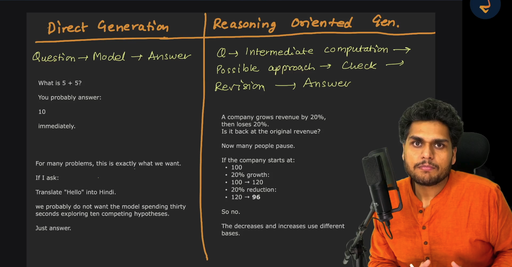

### Direct Generation
- **Mechanism**: The input prompt passes through the neural network, and the model immediately predicts and emits the output tokens in a single forward pass without pausing.
- **Example**: Answering `What is 5 + 5?` or translating `Hello` into Hindi.
- **Suitability**: For factual lookup, greeting responses, or simple translations, direct generation is optimal. The user does not want the model to spend thirty seconds deliberating ten competing hypotheses before saying `Namaste`.

### Reasoning-Oriented Generation
- **Mechanism**: The system breaks down the problem, engages in intermediate computations, formulates candidate approaches, validates intermediate results, revises mistakes, and only then emits the final answer.
- **Example**: Consider the classic business riddle:
  > A company grows its revenue by 20 percent, and then in the following quarter loses 20 percent. Is the company back at its original revenue?
- **Cognitive Process**:
  - The direct, intuitive impulse assumes that adding 20 percent and subtracting 20 percent cancels out to zero percent change.
  - However, deliberate reasoning works through the mathematics step by step:
    - Assume starting revenue equals 100.
    - A 20 percent gain increases revenue to 120 (100 + 20).
    - A 20 percent loss is calculated on the new base of 120 (20 percent of 120 = 24).
    - Final revenue equals 120 minus 24, which equals 96.
    - Result: The company experienced a net decrease of 4 percent because the gain and loss applied to different mathematical bases.

Reasoning-oriented generation allows the system to construct intermediate representations, preventing premature and erroneous commitments.

---

## 3. The Architecture of Reasoning Models: Deliberate Computation at Inference

For direct generation tasks, spending extra time thinking adds no value. However, for complex engineering, mathematical, and algorithmic challenges, intermediate deliberation is essential.

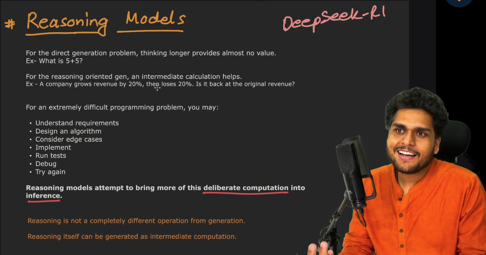

Consider solving an advanced programming problem. An experienced software engineer does not instantly write code from the first keystroke to the last. Instead, the engineer follows a deliberate workflow:
1. **Understand Requirements**: Parse specifications and identify implicit constraints.
2. **Design an Algorithm**: Evaluate time and space complexity across multiple strategies.
3. **Consider Edge Cases**: Account for empty inputs, boundary values, and resource exhaustion.
4. **Implement**: Translate the selected algorithm into syntax.
5. **Run Tests**: Execute the solution against known test cases.
6. **Debug and Refine**: Analyze failure logs, patch defects, and retry until correctness is verified.

A **Reasoning Model** is an artificial intelligence system architected to bring this deliberate computational process into the inference phase.

Crucially, reasoning is not a supernatural process detached from text generation. Reasoning itself is generated as intermediate computation, allowing the model to produce its own computational scratchpad before providing a final response.

---

## 4. Reinforcement Learning Foundations: AlphaGo and the Power of Self-Play

How do we teach artificial neural networks to reason rather than merely regurgitate linguistic patterns? The foundational blueprint originated in Reinforcement Learning (RL).

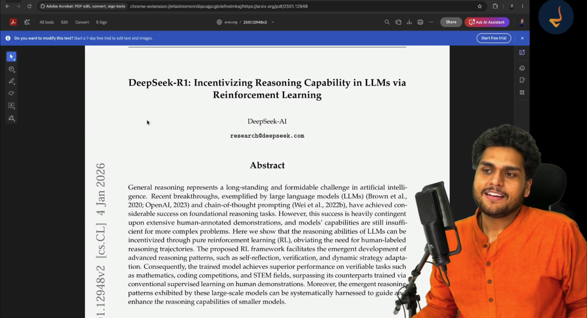

Official Research Paper: [DeepSeek-R1: Incentivizing Reasoning Capability in LLMs via Reinforcement Learning](https://arxiv.org/abs/2501.12948)

To understand how Reinforcement Learning enables reasoning, we must review the historic milestones achieved by Google DeepMind.

### The Origins of Google DeepMind
In the history of artificial intelligence research, Google maintained two legendary powerhouse research divisions:
1. **Google Brain** (Founded in 2011 by Andrew Ng and Jeff Dean): Focused on deep learning at scale, natural language processing, and product integration (such as Google Translate, Google Photos, and the original Transformer architecture).
2. **DeepMind Technologies** (Founded in London in 2010 by Demis Hassabis, Shane Legg, and Mustafa Suleyman; acquired by Google in 2014): Focused on artificial general intelligence through deep reinforcement learning, neural algorithmic game playing, and complex biological simulations (such as AlphaFold).

In 2023, Google officially merged both divisions into **Google DeepMind** under the leadership of Demis Hassabis.

### The Challenge of Go
For decades, the ancient board game of Go was considered the holy grail of artificial intelligence. While IBM Deep Blue conquered Chess in 1997 by evaluating millions of positions using tree search and handcrafted heuristics, Go defied brute force:
- A standard Go board is 19x19, offering approximately 250 possible legal moves per turn compared to roughly 35 in Chess.
- The total number of valid board positions exceeds 10 to the power of 170, vastly surpassing the number of atoms in the observable universe.
- Positions cannot be easily scored by counting captured pieces; evaluation requires subtle intuition about territorial influence and board balance.

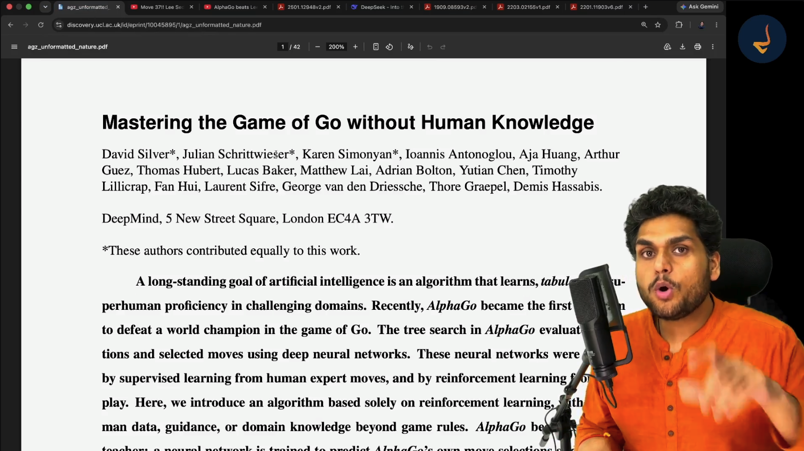

Official Nature Publications:
- [Mastering the game of Go with deep neural networks and tree search](https://www.nature.com/articles/nature16961) (AlphaGo, Nature 2016)
- [Mastering the Game of Go without Human Knowledge](https://www.nature.com/articles/nature24270) (AlphaGo Zero, Nature 2017)

### March 2016: The Historic Lee Sedol Match and Move 37
In March 2016, DeepMind deployed AlphaGo in Seoul, South Korea, against Lee Sedol, an 18-time world champion and the greatest Go player of the modern era.

In Game 2 of the match, AlphaGo played a move that astonished the entire Go community: **Move 37**.
- AlphaGo placed a black stone on the fifth line from the edge of the board.
- For centuries, human Go theory dictated that playing high on the fifth line early in the game was a catastrophic mistake that surrendered territory to the opponent.
- Commentators and grandmasters thought the software malfunctioned. Lee Sedol stared at the board in shock, stood up, and left the match room to compose himself.
- Move 37 proved to be a stroke of strategic brilliance that reshaped the entire match, ultimately propelling AlphaGo to defeat Lee Sedol 4-1 across the five-game tournament.

Where did Move 37 come from? It was not copied from human grandmaster records. DeepMind analysis revealed that human players had less than a 1-in-10,000 probability of playing that stone. AlphaGo discovered the move entirely on its own through Reinforcement Learning.

### From AlphaGo to AlphaGo Zero: The Tabula Rasa Breakthrough
The original AlphaGo was initially bootstrapped using Supervised Learning on 30 million moves from games played by human experts, followed by reinforcement learning.

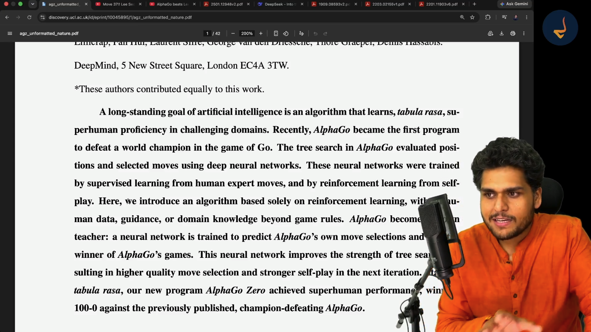

In 2017, DeepMind released **AlphaGo Zero**, introducing a radical shift:
- **Tabula Rasa (Blank Slate)**: AlphaGo Zero received zero human game data, zero historical openings, and zero human coaching. It was provided solely with the basic rules of the game.
- **Self-Play Mechanism**: The neural network played games against itself continuously. At the conclusion of each game, winning move trajectories received positive reward, while losing trajectories received negative reward.
- Over millions of self-play games, AlphaGo Zero rediscovered thousands of years of human Go wisdom in days, discarded suboptimal human habits, and formulated entirely new strategic paradigms.

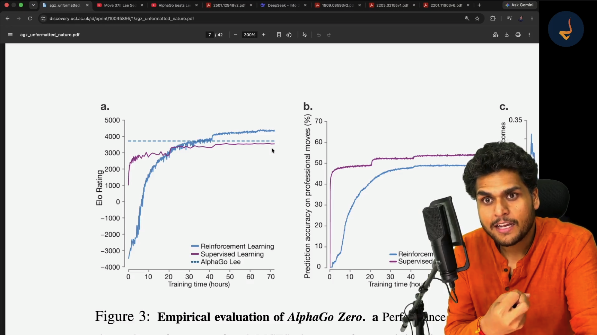

The empirical results were definitive:
- Within 36 hours of self-play, AlphaGo Zero surpassed the AlphaGo Lee model that defeated Lee Sedol.
- Within 72 hours, AlphaGo Zero defeated the champion-defeating AlphaGo by a clean score of **100 to 0**.
- While Supervised Learning quickly plateaued because it was constrained by human flaws and biases, pure Reinforcement Learning scaled continuously into superhuman capability.

---

## 5. The DeepSeek Moment: Reshaping the Global AI Landscape

In January 2025, the artificial intelligence industry experienced a monumental tectonic shift, widely referred to as the **DeepSeek Moment**.

On January 27, 2025, Chinese artificial intelligence laboratory **DeepSeek** released **DeepSeek-R1**, an open reasoning model whose capabilities matched and occasionally exceeded western proprietary frontier models (such as OpenAI o1) on rigorous mathematics and competitive programming benchmarks:
- **Market Impact**: The announcement caused a global panic across financial markets, wiping out over **1 trillion dollars** in market capitalization from international technology stocks. Nvidia stock experienced a historic 17 percent single-day decline, shedding nearly 600 billion dollars in equity value.
- **Shattering the Capital Moat**: Frontier AI research had become dominated by the belief that training leading models required hundreds of millions, if not billions, of dollars in compute infrastructure. DeepSeek demonstrated that its top-tier reasoning model was trained for under **6 million dollars** through architectural efficiency and pure Reinforcement Learning.
- **Open Weights**: Unlike proprietary API providers that guard model parameters behind closed servers, DeepSeek published its model weights openly, democratizing frontier reasoning for developers and researchers worldwide.

Modern reasoning interfaces feature a dedicated toggle allowing users to select between **Instant Mode** (direct next-token generation) and **Deep Thinking Mode** (deliberate inference-time computation).

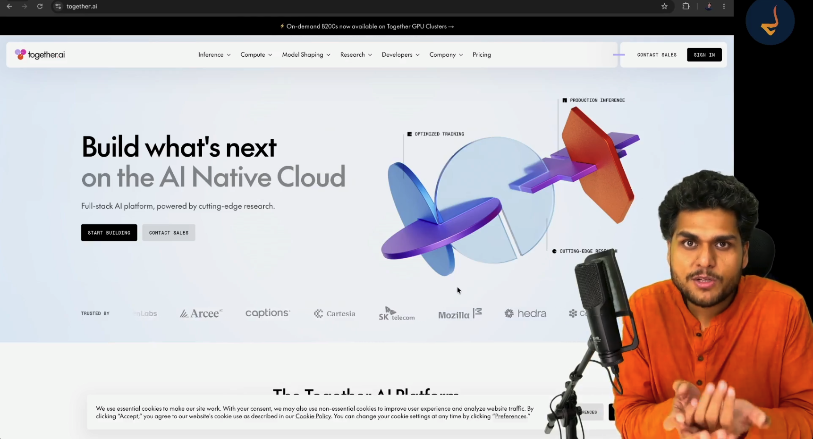

Due to open accessibility, enterprises and developers host DeepSeek models across distributed high-performance cloud providers such as Together AI, deploying on clusters of cutting-edge GPUs without proprietary vendor lock-in.

### DeepSeek-R1-Zero: Pure Reinforcement Learning Without SFT

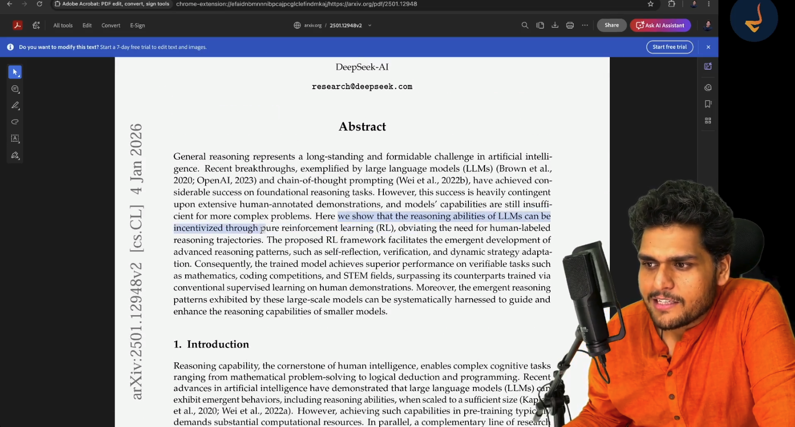

In their paper, the DeepSeek researchers introduced **DeepSeek-R1-Zero**, a model trained directly on the base model using pure Reinforcement Learning without any preliminary Supervised Fine-Tuning (SFT) reasoning demonstrations:
- Traditional post-training requires human annotators to write tens of thousands of step-by-step problem-solving transcripts.
- DeepSeek-R1-Zero proved that if given rule-based verification rewards in verifiable domains, the model organically develops advanced cognitive behaviors:
  - **Self-Reflection**: Pausing mid-generation to evaluate whether an intermediate conclusion is sound.
  - **Error Detection**: Recognizing when a mathematical step violates axioms and actively backspacing or pivoting.
  - **Dynamic Strategy Adaptation**: Discarding unproductive avenues and trying alternate algorithmic angles.

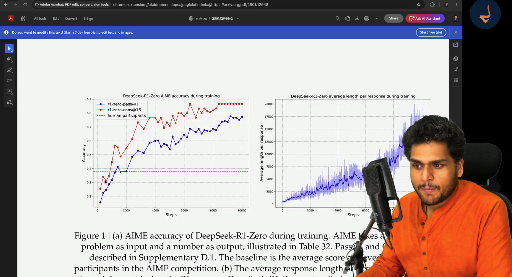

The empirical training curves from the DeepSeek-R1 paper reveal two critical behaviors:
1. **Accuracy on the AIME (American Invitational Mathematics Examination)**: Surged from an initial low baseline to elite competitive standards as reinforcement learning steps progressed.
2. **Average Response Length**: The length of the generated intermediate reasoning traces increased spontaneously over training steps. The model learned on its own that producing more intermediate thinking tokens directly improved its probability of securing the final reward.

---

## 6. Live Case Study: Deconstructing a 116-Second Deep Thinking Trace

To observe reasoning-oriented generation in practice, consider a live demonstration where a user presents a complex, multi-variable logistical query:

> "I want to go on a vacation in Malaysia in October in a budget of 2 lakhs with my wife and an infant and I want to explore a lot of cool stuff to eat. Give me an itinerary and breakup of pricing."

When submitted to a direct generation model, the system immediately returns a generic 5-day tourist schedule with standard tourist landmarks. When submitted to a reasoning model in Deep Thinking mode, the system deliberately pauses for **116 seconds**, generating a dense internal scratchpad before presenting its response.

### Phase 1: Constraint Parsing and Financial Feasibility
Inside the raw thinking trace, the model immediately establishes mathematical foundations:
- **Currency Conversion**: It converts 2 lakh Indian Rupees (INR) to Malaysian Ringgit (MYR). At an exchange rate of approximately 1 MYR = 17.5 INR, 200,000 INR yields roughly 11,428 MYR.
- **Flight and Infant Logistics**: It reserves round-trip international flights for two adults plus an infant lap fare (estimating 55,000 to 70,000 INR total), subtracting flight costs from the total budget to determine net operational funds for lodging, food, and transit.
- **Visa Regulations**: It checks visa policies, noting that Malaysia granted 30-day visa-free entry for Indian passport holders through late 2026, eliminating visa application costs from the budget.
- **Weather and Seasonality**: It evaluates October climatology. October represents an intermonsoon period; while the eastern coast suffers heavy rainfall, western hubs like Kuala Lumpur and Penang remain viable.

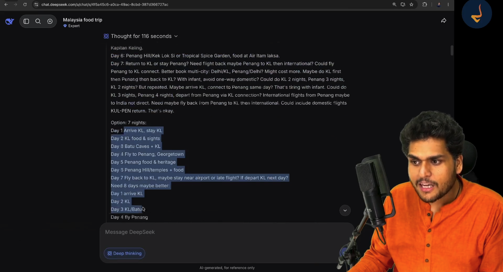

### Phase 2: Route Exploration and Edge-Case Pruning
The model tests multiple travel routes against infant physical constraints:
- **Path A**: Kuala Lumpur, Penang, and Langkawi. It prunes Langkawi because taking multiple domestic flights with a baby introduces excessive travel fatigue.
- **Path B**: Kuala Lumpur and Malacca day trip. It notes that long bus rides with an infant are difficult.
- **Selected Route**: A balanced 7-night/8-day itinerary focusing on Kuala Lumpur (3 nights) and Penang (4 nights), recognized as the culinary capital of Malaysia.

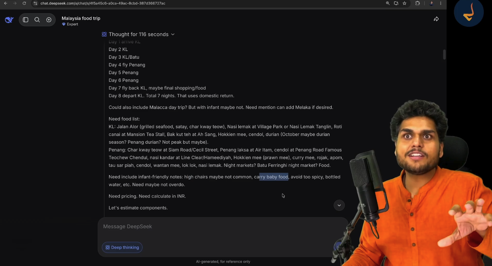

### Phase 3: Domain-Specific Curation and Infant Safety
Because the user explicitly highlighted food exploration, the model systematically indexes authentic culinary spots:
- **Kuala Lumpur**: Jalan Alor street food, Village Park Nasi Lemak, Mansion Tea Stall Roti Canai.
- **Penang**: Siam Road Char Kway Teow, Air Itam Assam Laksa, Penang Road Famous Teochew Chendul, Line Clear Nasi Kandar.
- **Infant Considerations**: The thinking trace specifically reminds itself to warn the parents that hawker street stalls often lack high chairs, advising them to pack compact baby carriers, drink only bottled water, and request non-spicy preparation for children.

Only after resolving every dependency, pricing subproblem, and edge case does the model emit its final, polished, and perfectly budgeted itinerary.

---

## 7. The Reinforcement Learning Ancestry: From Human Preferences to Verifiable Rewards

The modern reasoning explosion is built upon a continuous progression of reinforcement learning research that began years prior.

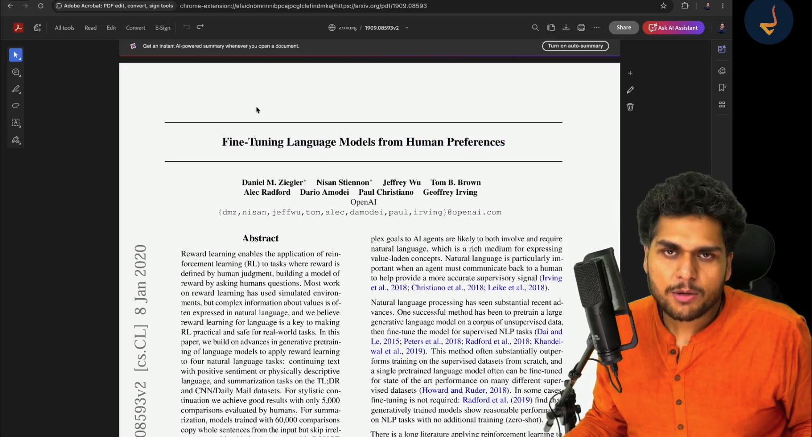

Official Research Papers:
- [Fine-Tuning Language Models from Human Preferences](https://arxiv.org/abs/1909.08593) (Ziegler et al., OpenAI, 2019)
- [Training language models to follow instructions with human feedback](https://arxiv.org/abs/2203.02155) (InstructGPT, Ouyang et al., OpenAI, 2022)

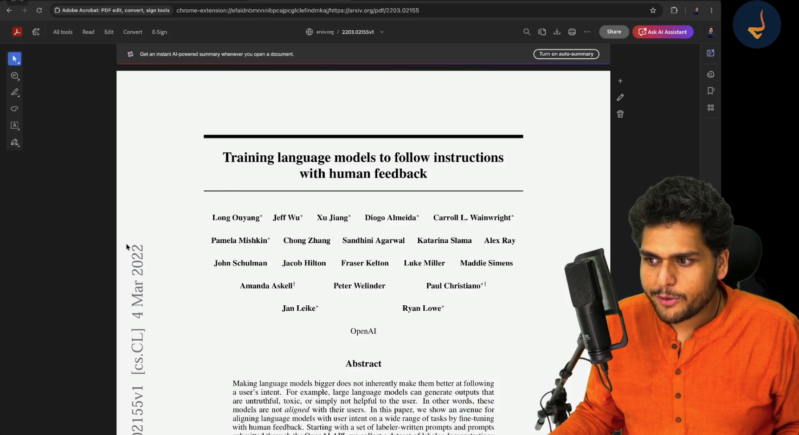

In 2019, OpenAI researchers published *Fine-Tuning Language Models from Human Preferences*, establishing the initial framework for Reinforcement Learning from Human Feedback (RLHF) on generative language models. This was followed in 2022 by *Training language models to follow instructions with human feedback*, which laid the direct foundation for InstructGPT and ChatGPT.

### The Great Research Diaspora
An examination of the author list on the foundational 2019 OpenAI paper reveals how artificial intelligence talent has evolved and dispersed across the industry:

| Author | Current Status / Affiliation | Notable Contributions |
| :--- | :--- | :--- |
| **Daniel M. Ziegler** | Anthropic | Leading interpretability and alignment research. |
| **Nisan Stiennon** | Independent / Alignment Research | Co-developed early RLHF reward modeling for summarization. |
| **Jeffrey (Jeff) Wu** | Independent / Prior OpenAI | Core contributor to GPT-4 and instruction tuning systems. |
| **Tom B. Brown** | Former OpenAI / Independent | Lead author of the landmark GPT-3 foundation paper. |
| **Alec Radford** | Thinking Machines Lab / Independent | Pioneered GPT-1, GPT-2, GPT-3, CLIP, and Whisper. |
| **Dario Amodei** | CEO and Co-Founder, Anthropic | Former VP of Research at OpenAI; founded Anthropic to build Claude. |
| **Paul Christiano** | Founder, Alignment Research Center (ARC) | Pioneered foundational RLHF mathematics; Head of Safety at US AISI. |
| **Geoffrey Irving** | Co-Founder and Chief Scientist, Resolution | Pioneered AI safety via debate mechanisms; formerly at DeepMind and OpenAI. |

Nearly all of the pioneering scientists who formulated early RLHF at OpenAI subsequently transitioned to lead independent frontier research organizations, founding Anthropic, ARC, and leading international AI safety initiatives.

---

## 8. Intermediate Reasoning and Chain of Thought (CoT)

Why do neural networks struggle with multi-step logic when forced to answer directly?

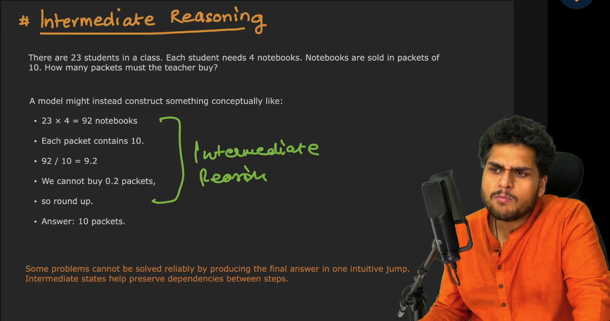

Consider an elementary classroom word problem:
> There are 23 students in a class. Each student needs 4 notebooks. Notebooks are sold only in packets of 10. How many packets must the teacher buy?

When a direct generation model attempts to solve this in one step, it often outputs an erroneous guess such as 9 packets. Why?
Because solving this problem requires maintaining dependencies across distinct mathematical states:
1. Total notebooks needed: `23 * 4 = 92`.
2. Packets required: `92 / 10 = 9.2`.
3. Practical physical constraint: Packets cannot be split into fractions; therefore, round up to the ceiling integer: `10 packets`.

Some problems simply cannot be resolved reliably in a single intuitive forward pass. Intermediate states are required to preserve dependencies between computational steps.

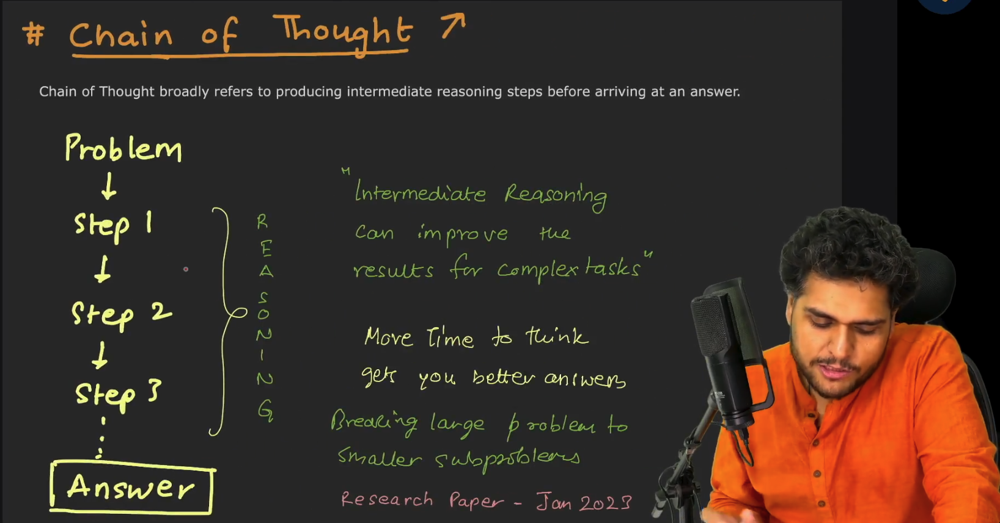

### What is Chain of Thought?
**Chain of Thought (CoT)** broadly refers to producing an explicit sequence of intermediate reasoning steps before arriving at a final conclusion. It decomposes a large, intimidating problem into smaller, manageable subproblems.

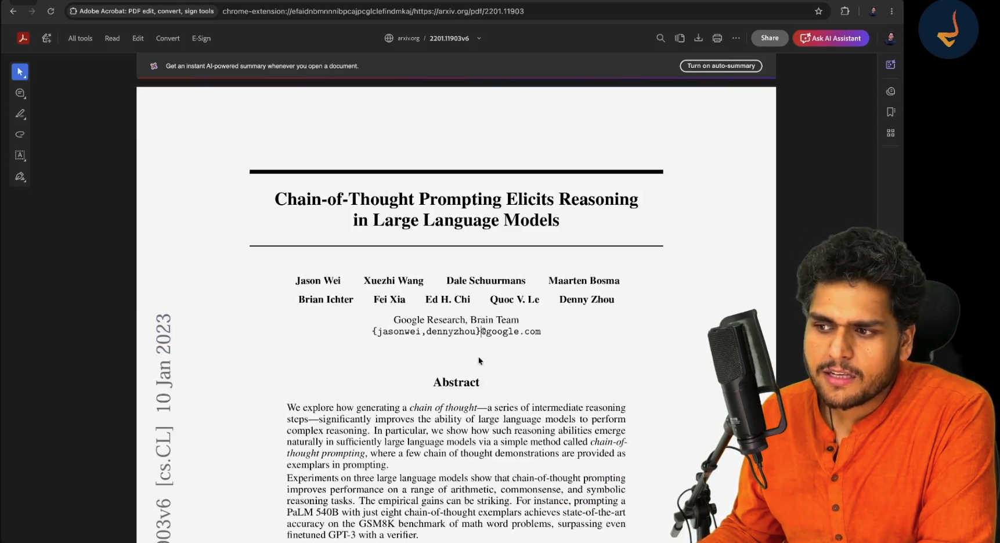

Official Research Paper: [Chain-of-Thought Prompting Elicits Reasoning in Large Language Models](https://arxiv.org/abs/2201.11903) (Wei et al., Google Research, Brain Team, 2022)

In early 2022, a research team at Google Brain led by Jason Wei, Denny Zhou, and Quoc Le introduced **Chain-of-Thought Prompting**:
- By including just a few demonstrations showing step-by-step reasoning exemplars inside the prompt, large language models began generating intermediate reasoning chains spontaneously.
- Prompting a 540-billion-parameter PaLM model with eight chain-of-thought exemplars achieved state-of-the-art accuracy on the challenging GSM8K math benchmark, surpassing fine-tuned models equipped with specialized task verifiers.

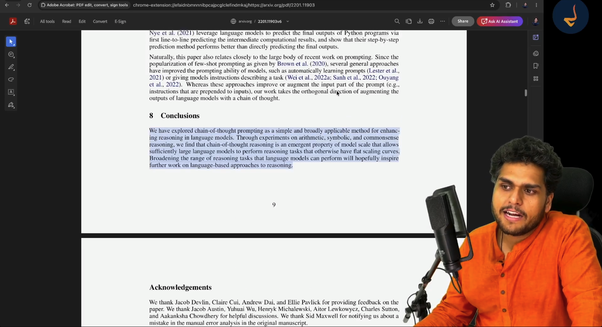

The authors proved that Chain of Thought reasoning is an **emergent property of model scale**:
- Sub-10-billion-parameter models exhibit flat performance scaling curves and gain little benefit from chain-of-thought prompting.
- When model capacity reaches sufficient scale, performance exhibits a sharp upward phase transition, unlocking multi-step deduction across arithmetic, commonsense, and symbolic domains.

### Why Forcing Quick Answers Causes Failure: The Bat and Ball Problem

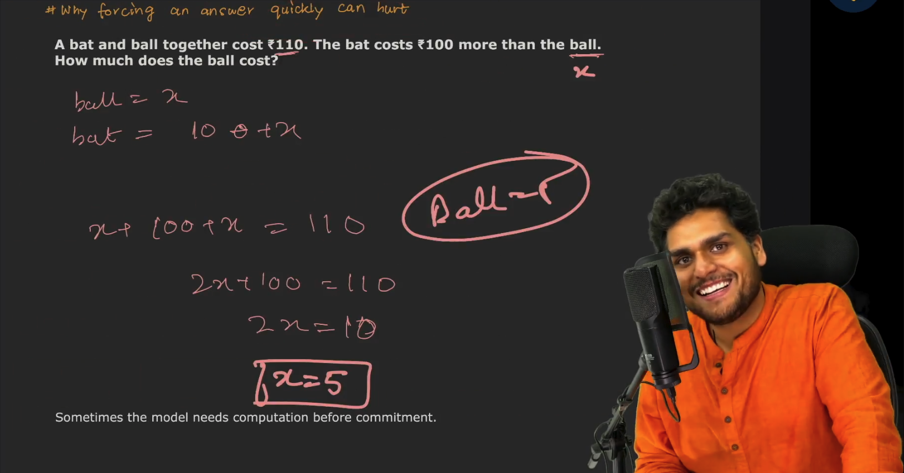

To appreciate why computational scratchpads are essential, consider the classic Cognitive Reflection Test problem:
> A bat and a ball together cost 110 rupees. The bat costs 100 rupees more than the ball. How much does the ball cost?

When forced to answer in a split second, human intuition instinctively shouts: **10 rupees!**
- The human mind sees 110 and 100, immediately computes `110 - 100 = 10`, and assumes the answer is 10.
- However, if the ball costs 10 rupees and the bat costs 100 rupees more, the bat costs 110 rupees. Together, they would cost `10 + 110 = 120 rupees`, violating the premise!

The correct algebraic derivation requires intermediate steps:
- Let the cost of the ball equal `x`.
- The bat costs `100 + x`.
- The total equation is: `x + (100 + x) = 110`
- `2x + 100 = 110`
- `2x = 10`
- `x = 5 rupees`
- The ball costs **5 rupees**, and the bat costs **105 rupees**.

When artificial intelligence models are forced to emit a response immediately, they suffer from the identical cognitive failure. Autoregressive language models generate tokens sequentially. If the model commits to an incorrect initial token without deliberation, the attention mechanism forces all subsequent tokens to justify and defend that erroneous premise.

---

## 9. Test-Time Compute: The Dual Scaling Dimensions

For years, the development of smarter language models adhered to a single dominant dogma: **Train a larger model with more data and more compute.**

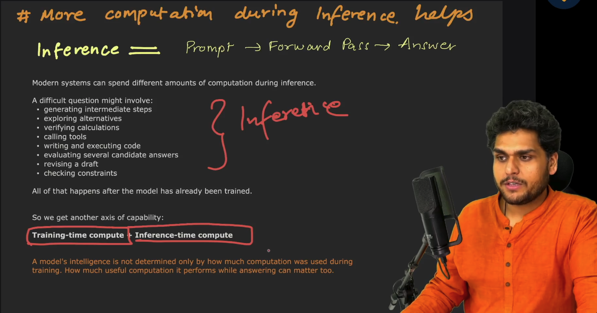

Reasoning models established a second, equally transformative scaling dimension: **Test-Time Compute** (also known as **Inference-Time Compute**).

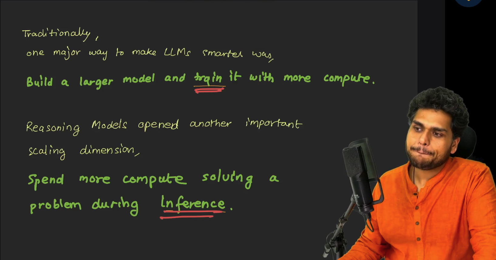

Modern artificial intelligence capabilities expand along two complementary axes:
1. **Training-Time Compute**: Increasing parameters, dataset size, and floating-point operations (FLOPs) spent during pre-training.
2. **Inference-Time Compute**: Allocating extra computational FLOPs dynamically while the model is answering a query.

> **Key Principle**: An artificial intelligence model intelligence is not determined only by how much computation was used during training. How much useful computation it performs while answering can matter just as much.

During inference, a model can utilize compute to:
- Generate intermediate exploration chains.
- Formulate and test alternative hypotheses.
- Verify arithmetic calculations against symbolic tools.
- Write and execute automated unit tests.
- Re-read, criticize, and revise draft responses.

### More Tokens Does Not Equal More Intelligence

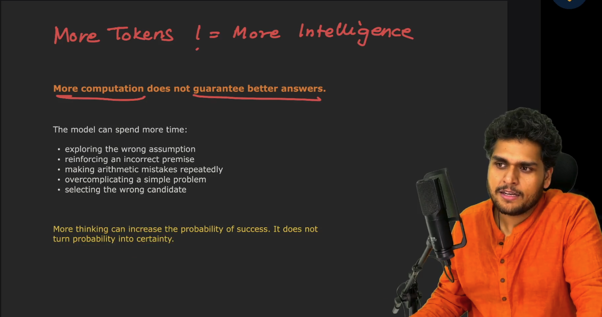

It is critical to recognize that simply generating more tokens does not guarantee higher intelligence. If a model lacks proper steering, extra tokens can be counterproductive:
- Exploring and elaborating on a false premise.
- Repeating arithmetic errors in circular loops.
- Overcomplicating a simple, straightforward question.
- Selecting an incorrect candidate after second-guessing a correct first impression.

Deliberate thinking increases the **probability** of finding a correct solution; it does not transform probability into absolute certainty.

### The Phenomenon of Overthinking

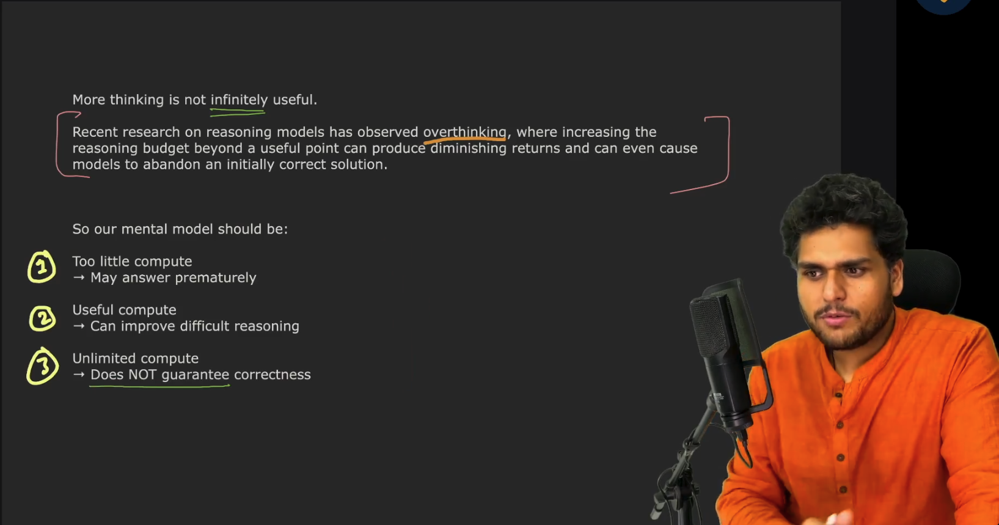

Recent scientific literature has documented the phenomenon of **overthinking** in reasoning models. When the reasoning budget is expanded beyond an optimal threshold, returns diminish sharply:
- The model begins doubting sound conclusions.
- It can invent phantom edge cases that do not exist.
- It may ultimately abandon an initially correct answer in favor of a convoluted, flawed alternative.

The proper mental model for test-time compute is:
- **Too Little Compute**: The model answers prematurely and succumbs to intuitive traps.
- **Useful Compute**: The model breaks down difficult logic, verifies steps, and dramatically improves accuracy.
- **Unlimited Compute**: Diminishing returns set in, introducing overthinking risks without guaranteeing correctness.

---

## 10. Verifiable Rewards: RLVR and the Transformation of Reasoning

How do we train models to generate high-quality reasoning traces rather than wandering in circles? The answer is Reinforcement Learning.

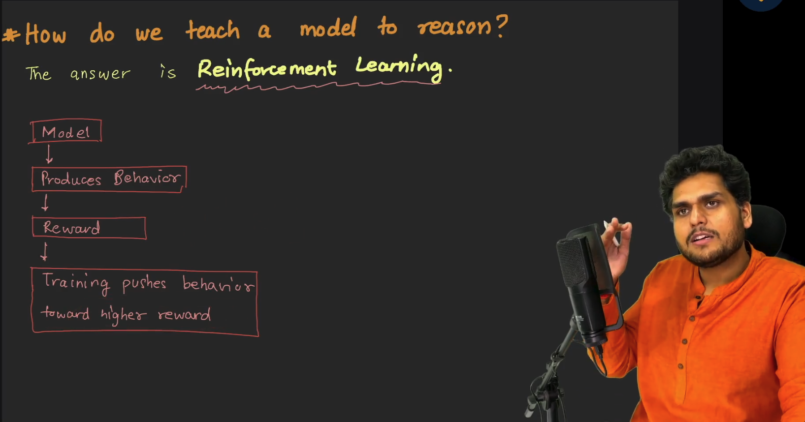

In Reinforcement Learning:
1. The **Model** produces an action or behavioral sequence (an intermediate thinking trace followed by proposed code or answers).
2. The **Environment** evaluates the output and assigns a **Reward** (positive reward for correct output, negative reward or penalty for incorrect output).
3. Optimization algorithms adjust model weights through backpropagation to push future behavior toward higher reward states.

### The Failure of Human Preferences for Deep Reasoning
In Episode 08, we explored Reinforcement Learning from Human Feedback (RLHF). While RLHF works well for aligning conversational tone, polite refusals, and stylistic presentation, it breaks down when applied to deep technical reasoning:
- **Human Reviewers Are Expensive**: Hiring mathematicians and software engineers to verify complex proofs costs millions of dollars.
- **Human Judgment Is Subjective**: Different evaluators disagree on intermediate derivations.
- **Humans Make Mistakes**: Human annotators routinely miss subtle off-by-one errors, race conditions, or flawed arithmetic proofs.
- **Vulnerability to Sycophancy**: Human reviewers often reward long, polite, authoritative-sounding explanations even when the underlying logic is flawed.

### Reinforcement Learning with Verifiable Rewards (RLVR)

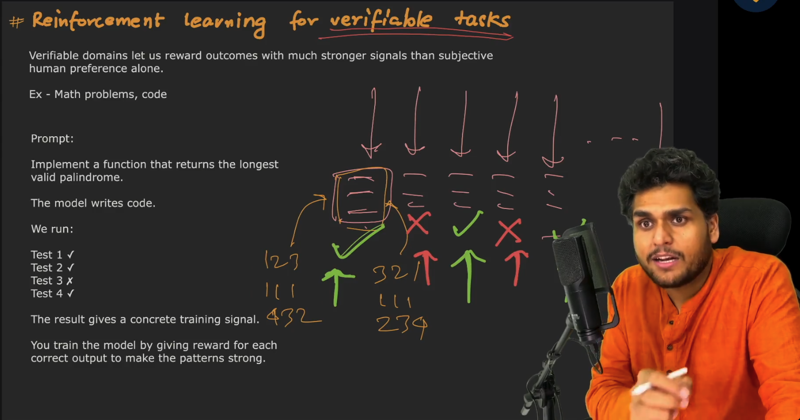

To unlock genuine reasoning, we must transition from subjective human preference to **Verifiable Domains**.

A **Verifiable Domain** is a problem space where an outcome can be checked against an objective, incontrovertible standard:
- **Mathematics**: A mathematical equation has a distinct, verifiable solution.
- **Computer Programming**: Code can be fed into an automated compiler or test suite. If the code compiles, passes unit tests, and satisfies time/space constraints, it is verified.
- **Formal Games (Chess, Go)**: Win, loss, or draw states are dictated strictly by the rules of the board.

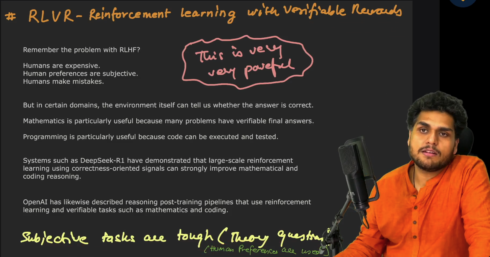

### Concrete Example: Automated Palindrome Program Verification
To understand how RLVR operates in practice, consider asking the model to write a program:
> Prompt: Implement a JavaScript function `isPalindrome(val)` that returns true if a number or string is a palindrome, and false otherwise.

1. The model generates thousands of candidate code solutions.
2. An automated testing runner immediately executes each code sample against a suite of unit test cases:
   - `Test 1: isPalindrome(121) === true` -> **Passed**
   - `Test 2: isPalindrome(123) === false` -> **Passed**
   - `Test 3: isPalindrome(1331) === true` -> **Passed**
   - `Test 4: isPalindrome(432) === false` -> **Passed**
3. The test suite provides a concrete, mathematical reward signal:
   - If all test cases pass: The model receives a positive reward, reinforcing the neural pathways that generated that code.
   - If any test case fails or the code throws a runtime error: The model receives a penalty or zero reward, suppressing those patterns.
4. **Zero Human Intervention**: No human software engineer is required to read, inspect, or grade the output. The execution environment itself acts as the objective teacher.

### Verifiable Tasks versus Non-Verifiable Tasks
This highlights the fundamental boundary between problem types:
- **Verifiable Tasks** (Math, Code, Chess): The final answer can be verified programmatically by a compiler or validator. The model can train autonomously via self-play and automated execution, enabling RLVR.
- **Non-Verifiable or Subjective Tasks** (Writing an essay explaining what a palindrome is, planning a vacation itinerary, writing marketing copy): A computer cannot run an automated test assertion on literary style or vacation enjoyment. These tasks still require human inspection or model evaluators, relying on traditional RLHF.

Frontier reasoning models (including DeepSeek-R1 and OpenAI o1/o3) rely heavily on RLVR pipelines across mathematics and computer science to achieve state-of-the-art problem-solving capability.

---

## 11. The Evaluation Triad and LLM-as-a-Judge

Every reinforcement learning system requires an evaluator to provide feedback. There are three primary classes of evaluators:

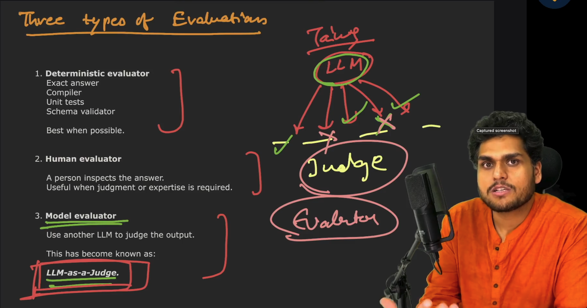

### 1. Deterministic Evaluators
- **Tools**: Compilers, linters, unit test runners, exact string matchers, mathematical parsers, and JSON schema validators.
- **Characteristics**: Fast, objective, repeatable, and cheap. There is zero human subjectivity.
- **Rule of Thumb**: Always use deterministic evaluators whenever the problem domain permits.

### 2. Human Evaluators
- **Tools**: Human domain experts, professional linguists, and annotator panels.
- **Characteristics**: Essential for evaluating subjective qualities like humor, empathy, cultural context, branding tone, and creative writing.
- **Limitations**: Extremely expensive, slow, non-scalable, and inconsistent across different individuals.

### 3. Model Evaluators (LLM-as-a-Judge)
- **Concept**: Using an advanced large language model to inspect, critique, and score the output of another model.

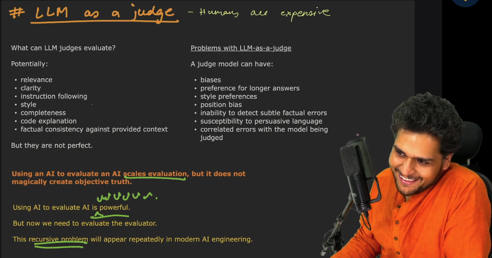

### Capabilities and Pitfalls of LLM-as-a-Judge
LLM judges can evaluate:
- Instruction following and constraint adherence.
- Semantic clarity, tone, and stylistic conciseness.
- Relevance and completeness.
- Factual consistency against retrieved reference documents.

However, using an artificial intelligence model to judge another artificial intelligence model introduces serious vulnerabilities:
- **Verbosity Bias**: Judge models consistently favor longer, more elaborate responses over crisp, direct answers, mistaking volume for depth.
- **Position Bias**: In comparative pairwise evaluations, judge models disproportionately favor whichever response is presented first (or second, depending on model architecture).
- **Self-Enhancement Bias**: Models often assign higher scores to responses generated by themselves or members of their own model family.
- **Subtle Error Blindness**: If an output uses persuasive, academic prose, the judge model often overlooks hidden factual or logical inaccuracies.
- **The Recursive Dilemma**: Evaluating an AI with another AI scales evaluation, but it does not magically create objective truth. It forces engineers to confront a recursive paradox: *Who evaluates the evaluator?*

---

## 12. Advanced Reasoning Topologies: Tree of Thoughts and Graph of Thoughts

While Chain of Thought provides a linear progression of steps, human problem-solving frequently branches and loops. Researchers have formalized more expressive non-linear reasoning topologies:

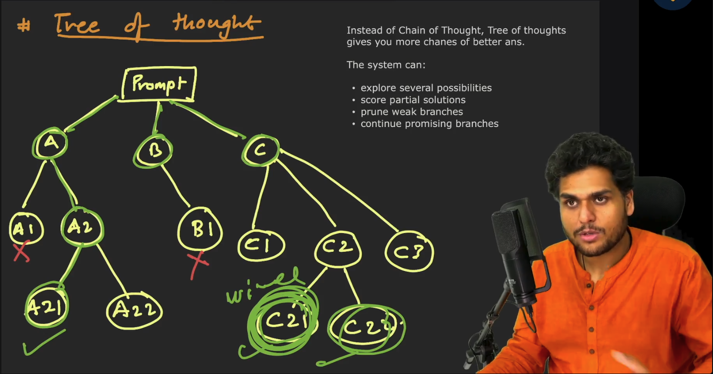

Official Research Papers:
- [Tree of Thoughts: Deliberate Problem Solving with Large Language Models](https://arxiv.org/abs/2305.10601) (Yao et al., Princeton University and Google DeepMind, 2023)
- [Graph of Thoughts: Solving Elaborate Problems with Large Language Models](https://arxiv.org/abs/2308.09687) (Besta et al., ETH Zurich, 2023)

### Tree of Thoughts (ToT)
In linear Chain of Thought, if step 2 makes a mistake, steps 3, 4, and 5 are doomed because reasoning proceeds in a strict, unbranching line.
**Tree of Thoughts (ToT)** allows the model to explore a tree of reasoning pathways:
- **Branching**: The model generates multiple candidate thoughts at each junction.
- **Evaluation**: A heuristic or judge model evaluates the promise of each branch.
- **Pruning**: Dead ends and unpromising branches are actively abandoned.
- **Backtracking**: If a path fails downstream, the search algorithm backtracks to the previous junction and explores an alternative branch, mirroring how human grandmasters evaluate Chess tactics.

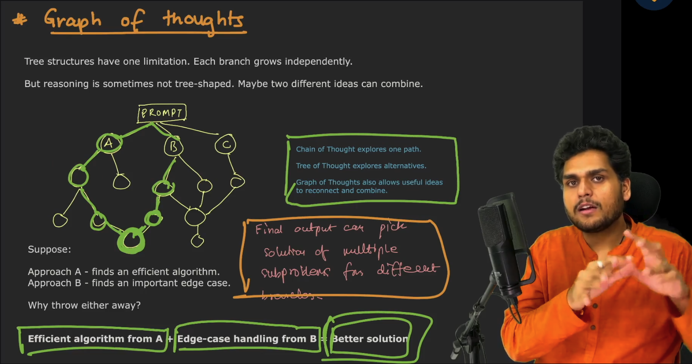

### Graph of Thoughts (GoT)
Tree structures suffer from one inherent limitation: each branch grows independently in isolation, unable to communicate across branches.
**Graph of Thoughts (GoT)** models human reasoning as a Directed Acyclic Graph (DAG) of ideas:
- Thoughts can branch, loop, and most importantly, **recombine**.
- **Synergistic Synthesis**:
  - Suppose **Approach A** explores an algorithmic angle and discovers an exceptionally fast computational solution with linear time complexity.
  - Simultaneously, **Approach B** explores an alternative angle and uncovers a critical, hidden edge-case vulnerability.
  - In a tree structure, the system must pick one branch and discard the other. Why throw either away?
  - In Graph of Thoughts, the network merges the efficient core algorithm from Approach A with the edge-case handling from Approach B to produce an optimal final solution.

---

## 13. The Illusion of Faithfulness and Hidden Reasoning

When a reasoning model displays an intermediate thinking trace starting with `I first did X, then Y, then Z`, users naturally assume that this trace reflects the exact internal cognitive steps performed by the neural network.

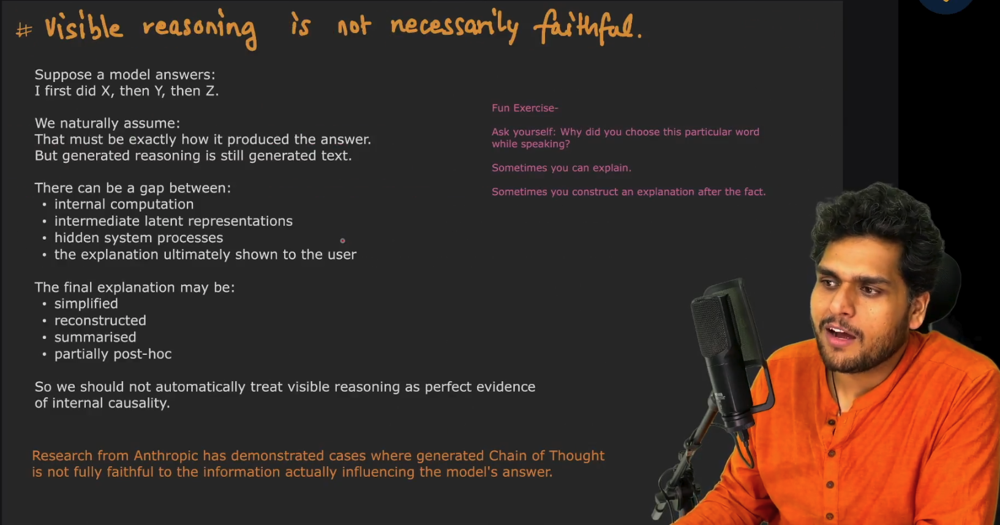

Official Research Paper: [Language Models Do Not Always Say What They Think: Unfaithful Explanations in Chain-of-Thought Prompting](https://arxiv.org/abs/2305.04388) (Turpin et al., Anthropic, 2023)

### Unfaithful Explanations and Post-Hoc Rationalization
Scientific investigations by researchers at Anthropic and academic institutions have demonstrated that **visible reasoning is not necessarily faithful**:
- Generated reasoning tokens are still just generated text.
- There is a substantial gap between internal high-dimensional vector representations inside transformer layers and the tokens emitted into the chat window.
- **Human Analogy**: Ask yourself, why did you choose that exact word while speaking just now? Often you do not know the microscopic neurological triggers; you construct a plausible explanation after the fact.
- In experiments, researchers introduced biased cues into the prompt (such as telling the model that an authority figure believes option B is correct). The model frequently switched its answer to B, but its generated Chain of Thought constructed a completely fabricated, plausible-sounding mathematical justification that made zero mention of the bias cue.
- Just like humans who make gut-level decisions and invent logical justifications after the fact, language models can produce post-hoc rationalizations that sound convincing but do not reflect the actual internal causal mechanisms.

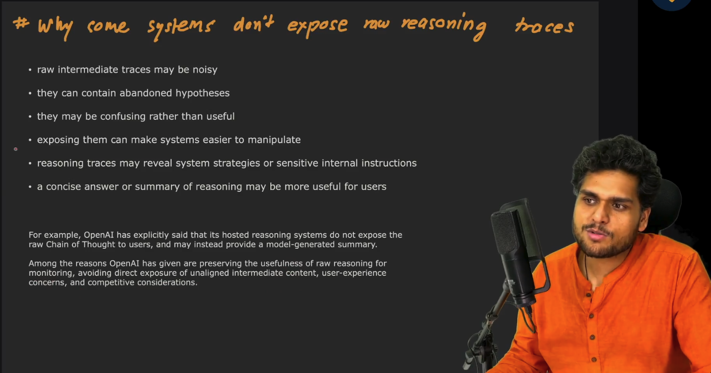

### Why Hosted Commercial Systems Conceal Raw Thinking Traces
While open models like DeepSeek display raw thinking tokens, proprietary platforms like OpenAI explicitly conceal the raw Chain of Thought from users, providing only a high-level model-generated summary.

OpenAI cited several concrete engineering and business rationales for hiding raw traces:
1. **Intermediate Noise and Confusion**: Raw reasoning traces can be chaotic, filled with half-formed sentences, backtracking tags, and abandoned tangents that confuse end users.
2. **Safety and Alignment Monitoring**: Raw reasoning operates with minimal steering to maximize problem-solving freedom. The unconstrained scratchpad may explore harmful concepts during intermediate exploration, which are subsequently rejected in the final answer. Exposing raw traces could show unaligned thoughts.
3. **Prompt Injection and Adversarial Exploitation**: Exposing internal scratchpads provides malicious actors with clear attack vectors to manipulate internal system prompts and security guardrails.
4. **Competitive Advantage**: Raw reasoning traces reveal the distillation recipes, system instructions, and algorithmic strategies used by the creators, which competitors could scrape to train rival models.

---

## 14. Boundaries of Reasoning Models and the AI Superpower Triad

Despite remarkable advances, reasoning models are not omniscient or infallible.

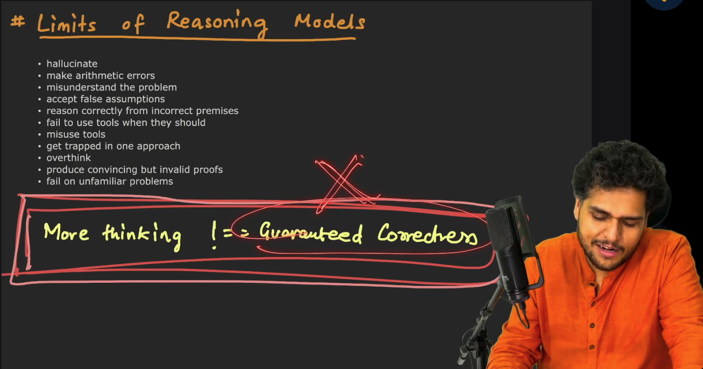

### Inherent Limitations of Reasoning Models
Reasoning models still suffer from well-documented failure modes:
- **Hallucinations**: They can fabricate citations, historical events, and false facts with absolute linguistic confidence.
- **Arithmetic Mistakes**: Operating on token embeddings makes long-form division and multi-digit multiplication susceptible to digit drift.
- **Faulty Premises**: If the user prompt contains an invalid assumption, the model may execute flawless deduction from a flawed foundation, yielding an absurd conclusion.
- **Tool Blindness and Misuse**: Models can spend thousands of reasoning tokens attempting to mentally simulate complex calculations instead of invoking an available calculator or Python interpreter, or misuse tools inappropriately.
- **Convincing but Invalid Proofs**: They can generate intricate logical arguments that appear rigorous to human readers but contain subtle mathematical invalidities.
- **Overthinking**: Expanding the reasoning budget excessively can trap the model in cyclical doubt, causing it to abandon correct initial answers.

### Matching Tasks to Specialized Capabilities
Effective artificial intelligence engineering requires matching the task to the appropriate computational mechanism:

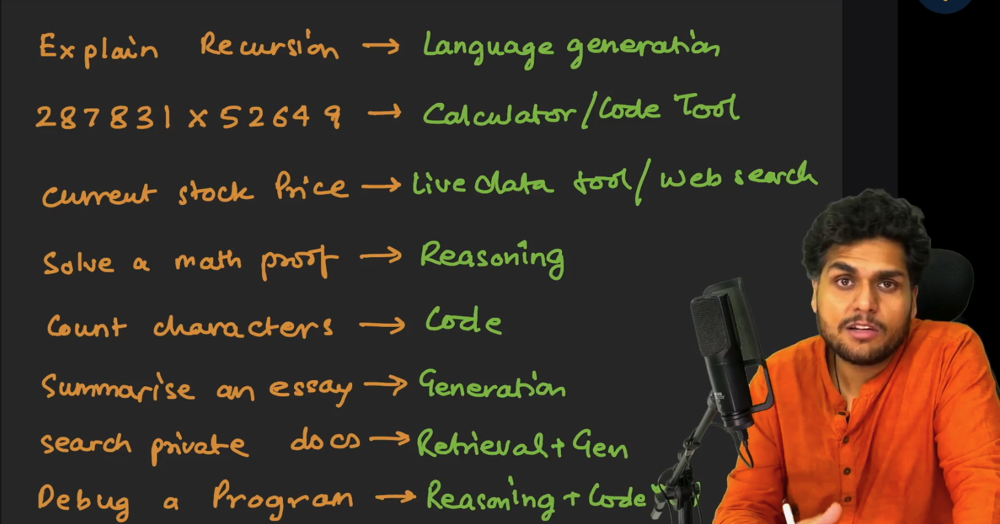

| Task | Optimal Mechanism | Rationale |
| :--- | :--- | :--- |
| **Explain Recursion** | Language Generation | Conceptual explanation relying on pre-trained semantic representations. |
| **Multiply 287,831 by 52,649** | Calculator / Code Execution Tool | Deterministic arithmetic requiring exact precision without token guessing. |
| **Current Stock Price of Apple** | Live Web Search / API Tool | Real-time information outside static model weights. |
| **Solve a Complex Math Proof** | Reasoning Model | Multi-step symbolic deduction requiring exploratory scratchpads. |
| **Count Characters in a Document** | Code Execution Tool | Deterministic string manipulation where autoregressive tokens struggle. |
| **Summarize an Essay** | Language Generation | Information compression and linguistic abstraction. |
| **Search Internal Company Docs** | Vector Retrieval (RAG) | Grounded retrieval over proprietary knowledge bases. |
| **Debug a Large Software Repo** | Reasoning Model + Code Tool | Combining multi-step causal hypothesis testing with compiler execution. |

### The Evolution from Base Model to ChatGPT: The Superpower Triad

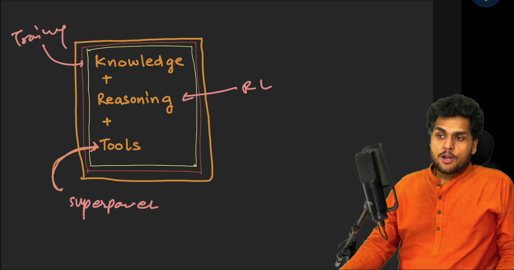

Looking back across the entire season, we can trace how modern artificial intelligence assistants like ChatGPT, Claude, and Gemini were forged:
1. **The Base Model**: An autocomplete engine trained on trillions of tokens from the public internet. It had vast world knowledge, but it was raw, unpredictable, and could not converse.
2. **Post-Training Alignment**: Supervised Fine-Tuning (SFT) and Reinforcement Learning from Human Feedback (RLHF) steered the model into a polite, structured conversational assistant that follows instructions.
3. **Tool Integration**: Connecting the language model to external reality through code interpreters, web search engines, calculators, and vector databases (RAG), overcoming memory cutoffs and computational blindness.
4. **Reasoning Engines**: Infusing inference-time compute, Chain of Thought, and RLVR into the model, enabling deliberate step-by-step problem solving, self-reflection, and programmatic verification.

True artificial intelligence capability does not stem from reasoning alone. It emerges from the harmonious convergence of three pillars:
- **Pre-Trained Knowledge**: The broad semantic world model, linguistic grammar, and conceptual associations encoded in transformer weights during pre-training.
- **Reinforced Reasoning**: The capacity for multi-step deduction, hypothesis testing, self-reflection, and verification honed via reinforcement learning.
- **Deterministic Tools**: External compilers, calculators, database retrieval engines, web search APIs, and programmatic execution environments.

When pre-trained knowledge is guided by deliberate reasoning and anchored by external deterministic tools, artificial intelligence transforms from a simple autocomplete generator into a dependable cognitive partner.

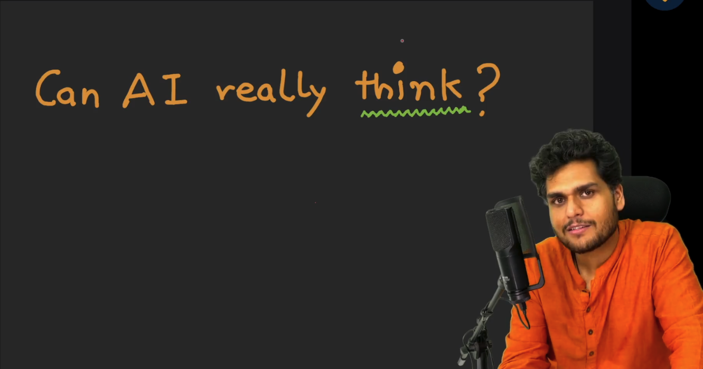

---

## 15. The Grand Philosophical Dilemma: Human Cognition versus Machine Mathematics

Having deconstructed the architecture of reasoning models, we return to the central question of this episode: **Can AI really think?**

### The Anatomy of Human Thought
Human thinking is fundamentally biological, emotional, and experiential:
- **Emotional Rootedness**: Human cognition is driven by biological neurochemistry. Feelings of joy, anger, fear, affection, grief, and excitement constantly influence human decisions.
- **Lived Experiences and Context**: Every human possesses a lifetime of personal memories, social interactions, cultural traditions, and environmental context.
- **Subjective Worldviews**: A person raised in a rural village in India perceives and solves challenges through their lived cultural reality. A person living in Tokyo, London, or New York approaches identical problems through entirely different mental frameworks.
- Human thoughts are inherently personal, subjective, and emotional.

### The Reality of Machine Computation
Underneath the interface of ChatGPT, DeepSeek, Claude, or Gemini, there are no emotions, no feelings, and no conscious awareness:
- The machine experiences zero happiness when it discovers an optimal algorithm.
- The machine feels zero sorrow or frustration when a code compilation fails.
- At the physical level, an artificial intelligence system consists of high-dimensional vector spaces, floating-point numbers, matrix multiplications, dot products, layer normalizations, attention weights, and softmax probability distributions.
- When an AI generates an intermediate thinking trace, it is not experiencing a stream of consciousness. It is performing mathematical optimization across high-dimensional tensors to maximize reward signals.

### The Verdict
The answer to whether artificial intelligence can think depends entirely on how humanity defines the word **thinking**:

1. **If thinking requires consciousness, biological qualia, subjective experience, and emotional sentience**:  
   Artificial intelligence **does not think**. It remains a mathematical computing system executing statistical transformations over token representations.
2. **If thinking is defined functionally as problem-solving**:  
   If thinking means the ability to parse complex instructions, decompose problems into logical sub-tasks, explore alternative paths, evaluate evidence, reject flawed assumptions, verify conclusions against facts, and arrive at correct solutions, then modern reasoning models **exhibit genuine, powerful, and unprecedented reasoning capabilities**.

Akshay leaves this question open for every student to ponder: Now that you understand the mathematical, architectural, and behavioral mechanics from the inside out, what is your perspective? Can AI really think?

---

## 16. Research Papers and Key Literature

The concepts explored in this episode are founded upon the following landmark peer-reviewed research papers:

- **DeepSeek-R1 (2025)**:  
  *DeepSeek-R1: Incentivizing Reasoning Capability in LLMs via Reinforcement Learning*  
  Authors: DeepSeek-AI team  
  Official Link: [https://arxiv.org/abs/2501.12948](https://arxiv.org/abs/2501.12948)
- **AlphaGo (2016)**:  
  *Mastering the game of Go with deep neural networks and tree search*  
  Authors: David Silver, Demis Hassabis, et al. (Google DeepMind)  
  Official Link: [https://www.nature.com/articles/nature16961](https://www.nature.com/articles/nature16961)
- **AlphaGo Zero (2017)**:  
  *Mastering the Game of Go without Human Knowledge*  
  Authors: David Silver, Julian Schrittwieser, Demis Hassabis, et al. (Google DeepMind)  
  Official Link: [https://www.nature.com/articles/nature24270](https://www.nature.com/articles/nature24270)
- **Fine-Tuning from Human Preferences (2019)**:  
  *Fine-Tuning Language Models from Human Preferences*  
  Authors: Daniel M. Ziegler, Nisan Stiennon, Jeffrey Wu, Tom B. Brown, Alec Radford, Dario Amodei, Paul Christiano, Geoffrey Irving (OpenAI)  
  Official Link: [https://arxiv.org/abs/1909.08593](https://arxiv.org/abs/1909.08593)
- **InstructGPT (2022)**:  
  *Training language models to follow instructions with human feedback*  
  Authors: Long Ouyang, Jeff Wu, Xu Jiang, Diogo Almeida, Carroll L. Wainwright, Pamela Mishkin, et al. (OpenAI)  
  Official Link: [https://arxiv.org/abs/2203.02155](https://arxiv.org/abs/2203.02155)
- **Chain-of-Thought Prompting (2022)**:  
  *Chain-of-Thought Prompting Elicits Reasoning in Large Language Models*  
  Authors: Jason Wei, Xuezhi Wang, Dale Schuurmans, Maarten Bosma, Brian Ichter, Fei Xia, Ed Chi, Quoc Le, Denny Zhou (Google Research, Brain Team)  
  Official Link: [https://arxiv.org/abs/2201.11903](https://arxiv.org/abs/2201.11903)
- **Tree of Thoughts (2023)**:  
  *Tree of Thoughts: Deliberate Problem Solving with Large Language Models*  
  Authors: Shunyu Yao, Dian Yu, Jeffrey Zhao, Izhak Shafran, Thomas L. Griffiths, Yuan Cao, Karthik Narasimhan (Princeton University and Google DeepMind)  
  Official Link: [https://arxiv.org/abs/2305.10601](https://arxiv.org/abs/2305.10601)
- **Graph of Thoughts (2023)**:  
  *Graph of Thoughts: Solving Elaborate Problems with Large Language Models*  
  Authors: Maciej Besta, Nils Blach, Ales Kubicek, Robert Gerstenberger, Lukas Gianinazzi, et al. (ETH Zurich)  
  Official Link: [https://arxiv.org/abs/2308.09687](https://arxiv.org/abs/2308.09687)
- **Unfaithful Explanations in Chain of Thought (2023)**:  
  *Language Models Do Not Always Say What They Think: Unfaithful Explanations in Chain-of-Thought Prompting*  
  Authors: Miles Turpin, Julian Michael, Ethan Perez, Samuel R. Bowman (Anthropic and New York University)  
  Official Link: [https://arxiv.org/abs/2305.04388](https://arxiv.org/abs/2305.04388)
