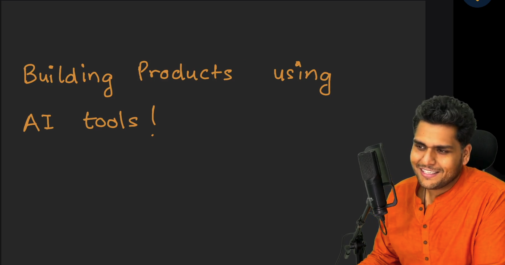
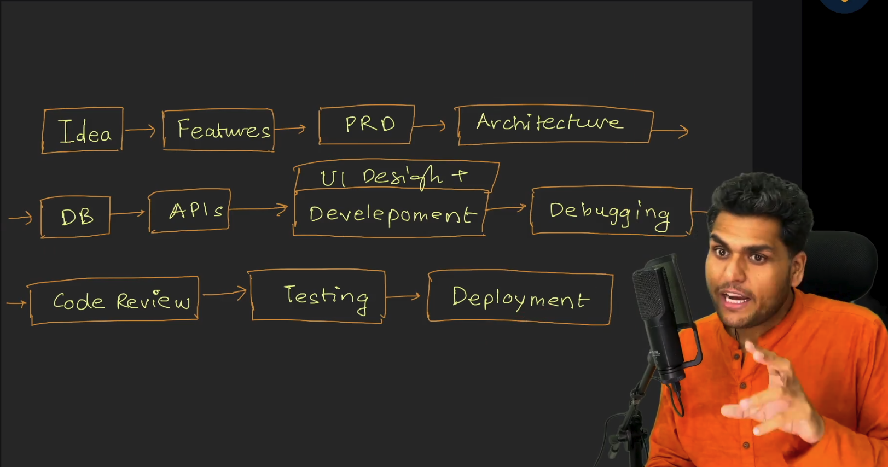
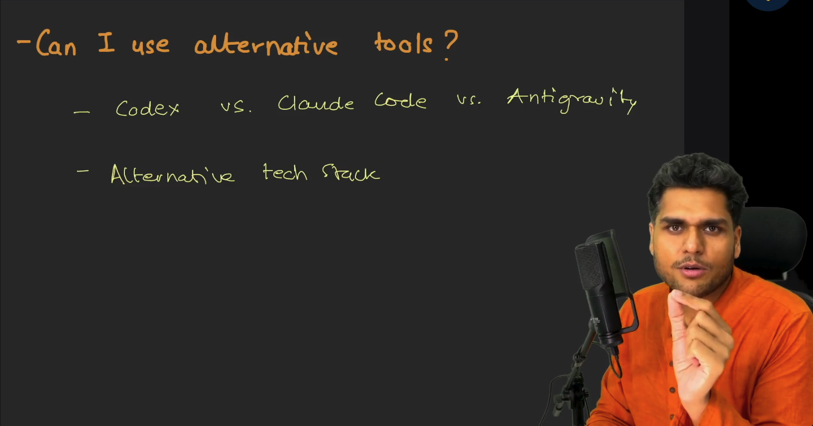
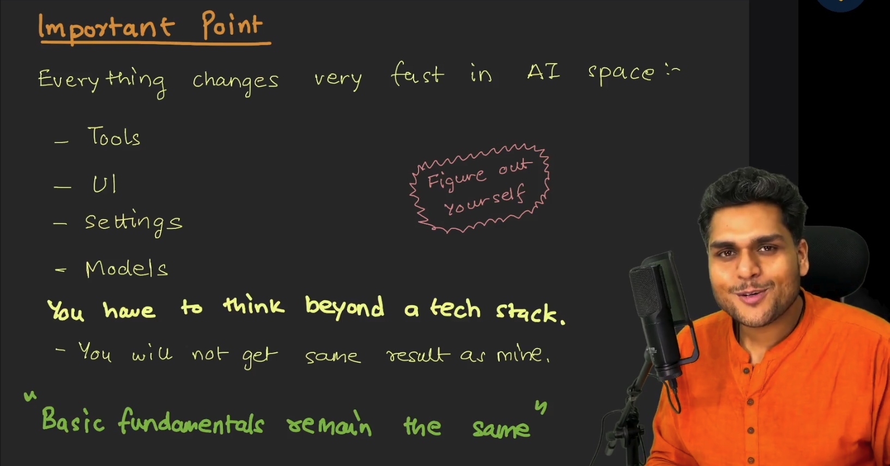

# Episode 01: Project Introduction - Fundamentals of Building with AI

> **Season 2: AI Native Software Engineer**  
> Instructor: **Akshay Saini** (NamasteDev)  
> Topic: Transitioning to AI Native Development, SDLC in the AI Era, Tools, and Engineering Philosophy

---

## 1. Transition from Theory to Production: The AI Native Paradigm

Season 1 uncovered the internal mechanics of artificial intelligence from first principles: transformers, tokenization, embeddings, vector spaces, fine-tuning, RLHF, and reasoning models. Season 2 marks a complete paradigm shift: moving from foundational theory to practical implementation and building real-world software products using modern artificial intelligence tools.

### The Instructor Stance

Akshay Saini has worked as a full-stack software engineer and system architect for almost a decade, writing thousands of lines of code across frontend, backend, and distributed systems, and teaching programs such as Namaste React, Namaste Node.js, and System Design.

In Season 2, however, the approach is intentionally inverted:
- The engineer takes a deliberate step back from typing manual lines of code by hand.
- The goal is to explore the true boundary and potential of modern artificial intelligence.
- The workflow relies on artificial intelligence for nearly 99% of code generation.
- The engineer acts as an architect, supervisor, and commander, intervening with manual engineering expertise only when necessary to unblock, debug, or steer.

### Do Not Remain in the Stone Age

Technology has crossed an inflection point. Continuing to write boilerplate software purely by hand when advanced intelligence engines exist is akin to remaining in the Stone Age.

A dialogue from Mirzapur captures this transition:
> *"Bahubali marte nahi hain, maarne ka order dete hain."*

Translated to modern software engineering:
> *"Namaste AI wale code likhte nahi hain, likhwane ka order dete hain."*  
> *(Namaste AI developers do not write code, they give orders to get it written.)*



### Empowerment over Replacement

Artificial intelligence does not replace software engineers. It empowers engineers to operate with unprecedented leverage:
- **10x to 20x Productivity**: Routine boilerplate, scaffolding, test generation, and documentation are accelerated.
- **Universal Relevance**: This paradigm serves developers, product managers, quality assurance engineers, DevOps professionals, engineering leaders, and students alike.
- **Higher-Order Focus**: Human cognition shifts away from syntactic memorization toward system design, logic verification, requirement precision, and architectural decisions.

---

## 2. Software Development Life Cycle (SDLC) in the AI Era

A common misconception among beginners is that artificial intelligence can build an entire production-grade product from a single vague prompt. Attempting to generate a full application in one step invariably yields chaotic, broken, and unmaintainable code.

Professional engineering demands breaking down complex systems into disciplined phases. The Software Development Life Cycle (SDLC) remains the foundational spine of software engineering, whether code is typed by hand or generated through artificial intelligence.



### The Twelve Stages of Product Development

```
Ideation → Features → PRD → Architecture → DB → APIs → UI Design → Development → Debugging → Code Review → Testing → Deployment
```

1. **Ideation**:  
   Identifying a genuine user problem or market opportunity and conceptualizing a practical solution.
2. **Features**:  
   Deconstructing the core idea into tangible functional capabilities. Determining feasibility and defining the Minimum Viable Product (MVP) to prevent scope creep.
3. **Product Requirement Document (PRD)**:  
   A comprehensive engineering specification detailing every user flow, functional requirement, business rule, and edge case (e.g. edge cases in authentication, error responses, session timeouts, and payment retries). Clear PRDs provide the context necessary to guide artificial intelligence models accurately.
4. **Architecture**:  
   Structuring the overall technical system: deciding service boundaries, communication protocols (REST, WebSockets), frontend and backend separation, and technology stack selection.
5. **Database (DB) Design & ERD**:  
   Constructing the Entity Relationship Diagram (ERD). Modeling collections or tables, attributes, relationships (one-to-one, one-to-many, many-to-many), indices, and access patterns.
6. **API Design**:  
   Establishing contracts between frontend and backend services: defining endpoints, HTTP verbs, payload structures, headers, validation schemas, and error responses.
7. **UI Design (Wireframing & Prototyping)**:  
   Visualizing interface structure and user journeys through wireframes and high-fidelity mockups in tools like Figma before implementation starts.
8. **Development**:  
   Translating designs, specifications, and architecture into working software by guiding artificial intelligence to write clean, modular, and maintainable code.
9. **Debugging**:  
   Diagnosing runtime defects, unexpected behavior, and environment mismatches through iterative diagnostic prompts and log analysis.
10. **Code Review**:  
    Subjecting generated implementations to strict code reviews using artificial intelligence models to catch anti-patterns, security vulnerabilities, edge-case omissions, and readability concerns.
11. **Testing**:  
    Generating and executing unit tests, integration tests, and end-to-end tests to guarantee system stability and regression protection.
12. **Deployment**:  
    Provisioning cloud infrastructure, configuring environment variables, setting up Continuous Integration and Continuous Deployment (CI/CD) pipelines, and mapping production services to a live custom domain.

---

## 3. Tools, Subscriptions, and Free Alternatives

Modern artificial intelligence development relies on interactive environments that combine code editors with language model reasoning engines.


### The Tool Landscape

Several dedicated artificial intelligence code editors and interfaces exist today:
- **Codex by OpenAI**: Interactive agentic coding environment used as the primary demonstration tool in this series.
- **Cursor**: Artificial intelligence native code editor built on top of VS Code.
- **Claude Code by Anthropic**: Command-line agentic coding assistant powered by Claude models.
- **Antigravity IDE by Google**: Integrated development environment leveraging advanced Google intelligence.
- **Lovable, v0, Bolt**: Specialized tools for rapid full-stack scaffolding and UI generation.

### Free Limits versus Paid Subscriptions

Most artificial intelligence development tools offer free introductory tiers, but free limits come with severe drawbacks:
- Strict rate limits and low request quotas that interrupt long coding sessions.
- Inability to use top-tier flagship models consistently.
- Context window truncation during large codebase modifications.

### The Recommendation: Invest in Your Craft

For anyone serious about learning and career advancement:
- Consider dropping a consumer entertainment subscription, such as Netflix, for a single month.
- Reallocate that budget into an artificial intelligence tool subscription (such as Codex, Cursor, or ChatGPT Plus).
- The return on investment in productivity, skill acquisition, and time saved vastly outweighs the nominal monthly cost.

---

## 4. Alternative Tools and Technology Stacks

Tools and frameworks are transient vehicles: the underlying architectural principles are what endure.



### Freedom of Tool Choice

Students are free to follow along using any editor or environment they prefer:
- Codex by OpenAI
- Cursor
- Claude Code
- Antigravity IDE
- Standard VS Code with extensions

The specific interface does not dictate success. What matters is learning how to instruct, guide, evaluate, and steer the intelligence engine.

### Selection of Flagship Models

When choosing a model within any tool, always select the strongest available reasoning or coding model (for example, GPT-4.5, Claude 3.7 Sonnet, or o-series reasoning models):
- Coding benchmarks such as SWE-bench provide general indicators, but daily practical reliability matters most.
- High-tier models demonstrate superior context tracking, fewer hallucinations, and more resilient code generation compared to lightweight or deprecated models.

### Course Technology Stack: MERN

The primary project built across Season 2 utilizes the **MERN** stack:
- **MongoDB**: Document database offering schema flexibility and rapid prototyping.
- **Express.js**: Minimalist, fast backend web application framework for Node.js.
- **React**: Declarative, component-based frontend user interface library.
- **Node.js**: Asynchronous event-driven JavaScript runtime environment.

### Technology Stack Agnosticism

While MERN is chosen because many students already have familiarity with full-stack JavaScript:
- The fundamental principles taught throughout this course apply identically to Python, Django, FastAPI, Java, Spring Boot, Go, Next.js, or Rust.
- Modern artificial intelligence models are polyglot engines capable of writing and debugging any language.
- Students are encouraged to experiment and replicate the project in alternative languages once the core workflow is understood.

---

## 5. Adapting to Rapid Change and Core Fundamentals

The artificial intelligence domain experiences rapid, continuous evolution. Developing the correct mindset is essential for long-term engineering success.



### The Inevitability of Change

Over the coming weeks and months, the surrounding ecosystem will change:
- User interfaces of editors will be redesigned.
- Settings, buttons, panels, and keyboard shortcuts will relocate.
- Existing models will be replaced by newer architectures.

Engineers must adopt a proactive, curious attitude: **Figure out yourself**. Do not become reliant on fixed buttons or visual layouts. Adapt smoothly whenever tools evolve.

### Non-Deterministic Output: Your Journey is Unique

Large language models are probabilistic token predictors, not deterministic static code repositories:
- When you provide the exact same prompt that Akshay provides, your model will generate different code, different naming conventions, and different structure.
- You will encounter different errors, unique edge cases, and unexpected model mistakes.
- This variance is an advantage: it forces you to understand the problem rather than blindly copy pasting text.

### How to Approach the Course

- **Understand the Intent**: Observe how prompts are structured, how context is supplied, and how errors are resolved.
- **Embrace Imperfection**: Artificial intelligence will occasionally generate hallucinations, introduce syntax bugs, or misunderstand specifications. Learn how to diagnose these breakdowns and guide the model back on track.
- **Leverage the Community**: Collaborate with peers in the NamasteDev community, share novel failure modes, and learn together.

### The Enduring Rule

Tools, user interfaces, settings, and models will constantly change.  
**Basic fundamentals remain the same.**
