# Episode 02: Ideation & Brainstorming Features using AI

> **Season 2: AI Native Software Engineer**  
> Instructor: **Akshay Saini** (NamasteDev)  
> Topic: Product Ideation, Selection Criteria, AI-Assisted Brainstorming, Voice Prompting, and Freezing Scope

---

## 1. Ideation from First Principles: Selecting the Right Problem

Before writing a single line of code or drafting an engineering prompt, an engineer must achieve absolute clarity on what is being built. Software engineering without rigorous ideation leads to wasted tokens, disjointed architecture, and abandoned codebases.

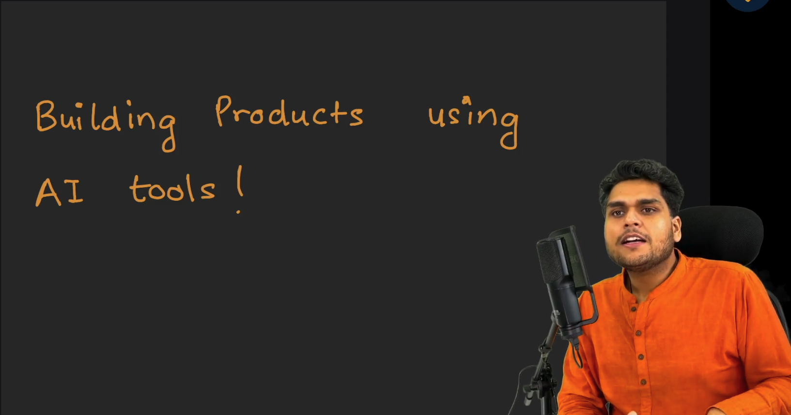

### Project Selection Criteria

Selecting a project to demonstrate AI-native development requires satisfying four deliberate constraints:

- **Relatable Domain**: The application must solve a problem that resonates with everyone: college students, junior developers, engineering leaders, and non-technical stakeholders alike. Narrow developer tooling or niche domains disconnect learners from the core product experience.
- **Full-Stack Web Architecture**: The application must span a real database (DB), application programming interfaces (APIs), and a dynamic user interface (UI). It cannot be a standalone terminal script.
- **Multiple Interconnected Modules**: Toy examples like calculators, todo lists, tic-tac-toe games, or simple kanban boards fail to expose real-world orchestration challenges. A production-grade project demands multiple distinct sub-systems interacting harmoniously.
- **Simple Concept, Complex Architecture**: The core value proposition should be intuitive to understand, while the underlying technical implementation presents genuine engineering challenges: role-based access control (RBAC), multi-entity database schemas, state synchronization, media uploads, and public versus private route boundaries.

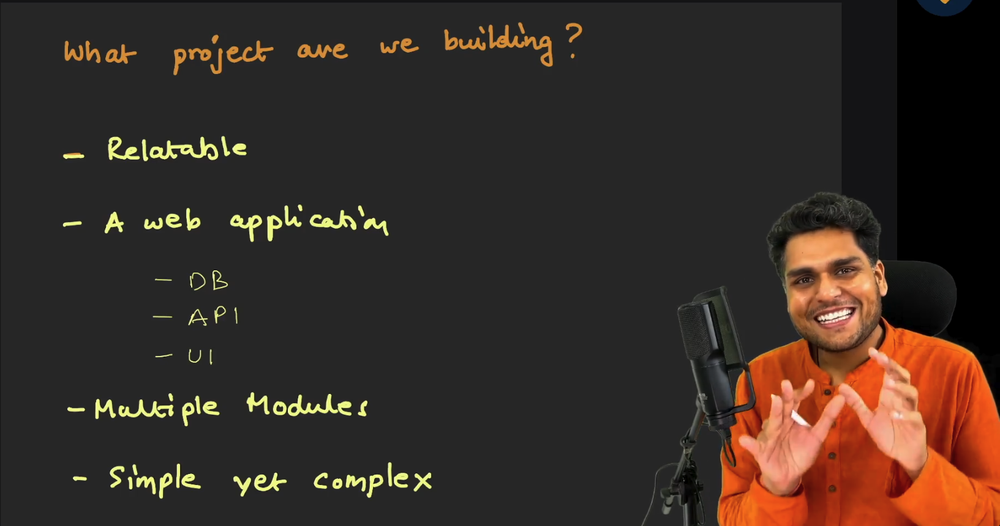

---

## 2. The Product Vision: Make My Marriage

The selected project for Season 2 is **Make My Marriage**.

### The Real-World Problem

Anyone who has organized or participated in an Indian wedding recognizes the sheer chaos involved:
- An Indian wedding is rarely a single-day event. It spans multiple distinct sub-events: Haldi, Mehndi, Sangeet, Wedding Ceremony, and Reception.
- Planning an Indian wedding is functionally equivalent to running a temporary startup for three to six months: managing budgets, negotiating with dozens of vendors, coordinating hundreds of guests, assigning responsibilities across extended family members, tracking payments, and archiving voluminous media.
- In conventional execution, critical information is fractured across scattered notebooks, isolated spreadsheets, WhatsApp chats, and disconnected photo albums.

### Core Architecture Concept

Make My Marriage addresses this fragmentation as an all-in-one digital command center: a **Wedding Operating System**.

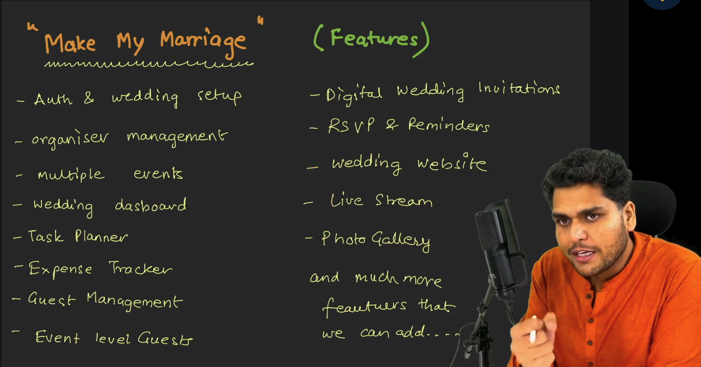

### Core Modules Identified

- **Authentication & Wedding Setup**: Initial onboarding where the couple defines dates, locations, and foundational details.
- **Organizer Management**: Multi-user collaboration permitting bride, groom, parents, and siblings to co-manage the wedding.
- **Multiple Events**: Granular configuration for each ceremonial function with unique schedules and locations.
- **Wedding Dashboard**: Central cockpit displaying days remaining, pending milestones, task metrics, and budget overviews.
- **Task Planner**: Assigning logistical duties to specific organizers with status tracking.
- **Expense Tracker**: Central budget tracking, category breakdowns (venue, catering, photography), and payment statuses.
- **Central Guest Management & Event-Level Guests**: Unified guest master list with granular assignment (e.g. close friends invited to all events, distant acquaintances invited solely to the reception).
- **Digital Wedding Invitations & Automated Reminders**: Sending digital invites via email or messaging with automated attendance nudges.
- **RSVP Tracking**: Collecting headcounts and dietary or attendance notes directly through the portal.
- **Wedding Website**: Public-facing themed destination detailing the couple story, event schedule, and venue directions.
- **Live Stream Integration**: Embedded video feeds (such as YouTube Live) for remote well-wishers unable to attend in person.
- **Shared Photo Gallery**: Central media repository with QR-code mobile uploads, eliminating fragmented post-wedding photo collection.

---

## 3. Setting Up the AI Development Workspace

AI-assisted engineering requires a fluid setup that balances high-level reasoning with fast execution.

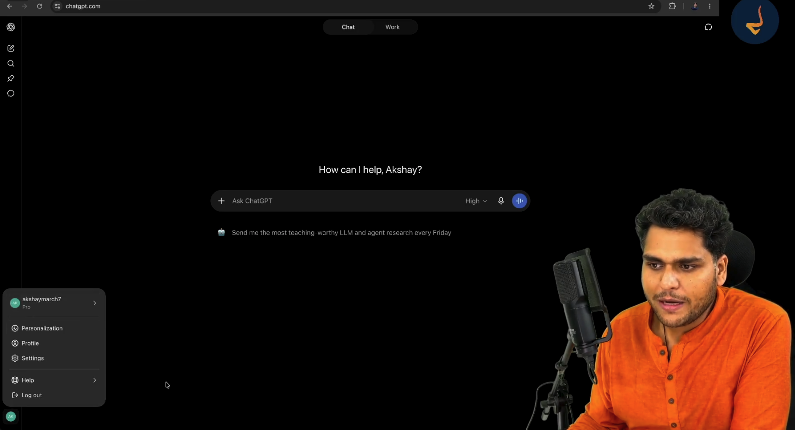

### Tool Distribution Strategy

- **ChatGPT Web (chatgpt.com)**: Utilized for high-level conceptual brainstorming, product critique, architectural debate, and PRD generation using flagship reasoning models.
- **OpenAI Codex Desktop**: Specialized desktop environment built by OpenAI for agentic coding, project scaffolding, and direct file manipulation.
- **VS Code**: Primary local source code editor paired with extension ecosystems and terminal tooling.

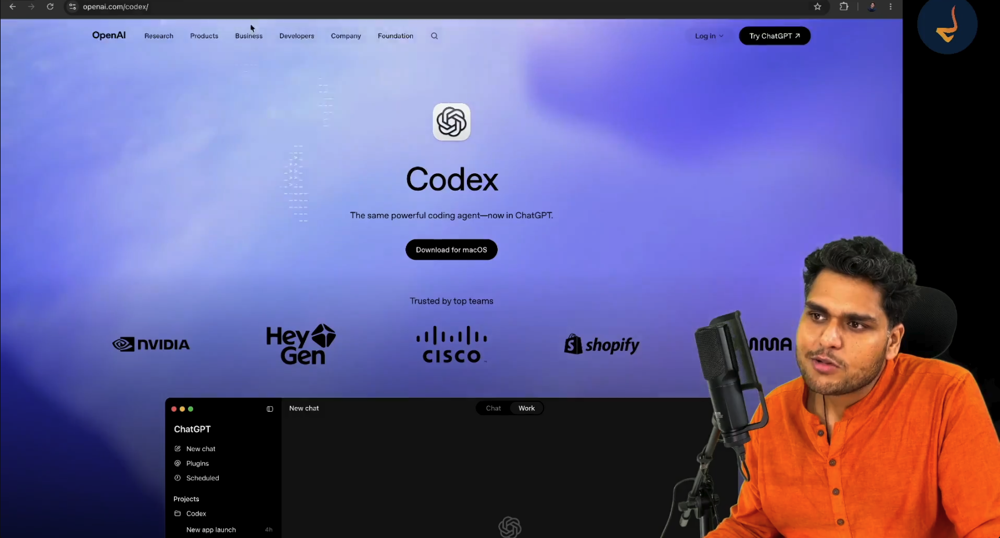

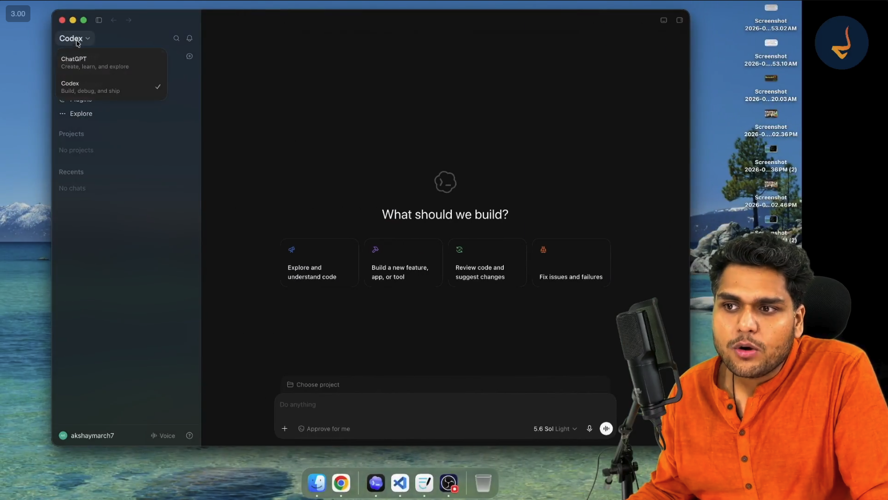

---

## 4. Orchestrating AI for Ideation: The Voice-First Workflow

The fundamental difference between a novice prompt-user and an AI-native engineer lies in communication efficiency.

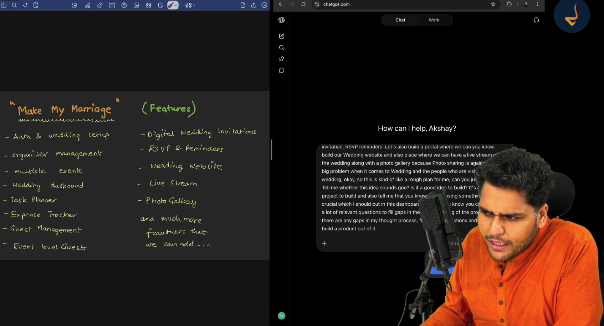

### Why Voice Dictation is Essential

- Typing detailed requirements by hand creates cognitive friction. Engineers instinctively shorten sentences, drop edge cases, and omit context when forced to type long paragraphs.
- Short, cryptic prompts produce superficial, generic AI outputs.
- **Speech-to-Text (Voice-to-Text)** removes this barrier:
  - On macOS: Built-in voice dictation.
  - On Windows: `Win + H` or keyboard voice dictation shortcuts.
- Speaking naturally allows an engineer to dump hundreds of thoughts, real-world context, constraints, and operational nuances in two minutes. The richer the conversational context, the sharper the model architectural critique.

### Proactive Gap Analysis Prompting

Instead of ordering the model to generate immediate solutions, an AI-native engineer instructs the model to act as a critical sounding board:
- Present the initial vision and domain problem.
- Ask whether the idea is technically viable.
- Explicitly prompt the model to identify architectural gaps, unaddressed edge cases, and missing operational features.
- Request the model to interrogate the human with clarifying questions before producing any specifications.

---

## 5. AI Critique: The Wedding Operating System Concept

When presented with the comprehensive voice prompt, the model validates the premise and refines its positioning.

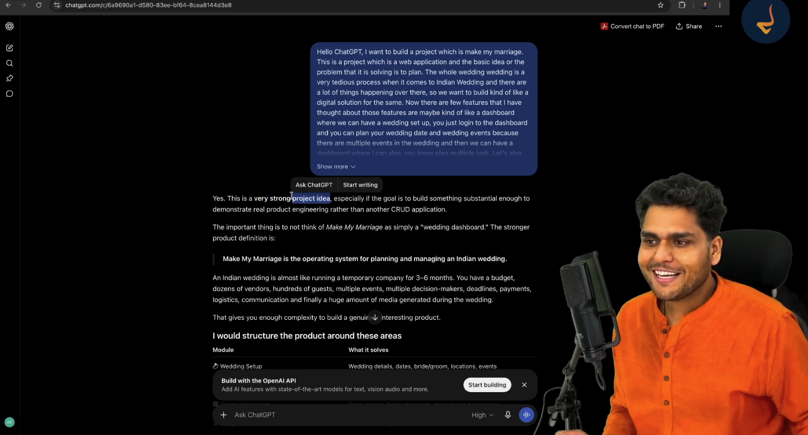

### Reframing the Solution

- The model notes that treating the project merely as a "wedding website" drastically undervalues the problem.
- The stronger definition is a **Wedding Operating System for Indian Weddings**.
- The value lies not in static informational pages, but in solving the messy operational realities: multi-party decision making, expense splitting, vendor contracts, guest lists, RSVPs, and media ingestion.

---

## 6. Interactive Gap Resolution: Clarifying Architectural Ambiguities

Rather than rushing to generate a Product Requirement Document (PRD), the model poses thirty foundational product and architectural questions. Resolving these questions early prevents costly refactors during database modeling and coding.

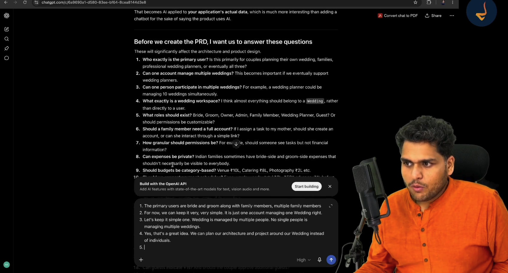

### Key Decisions Established via Q&A

1. **Primary Workspace Entity**:
   - Almost every resource in the database belongs to a central `Wedding` workspace rather than to an individual user profile.
   - This decision ensures modularity and simplifies schema associations across events, tasks, guests, and media.
2. **Multi-Tenancy Scope for Version 1**:
   - One user account manages one wedding workspace in V1.
   - Enterprise multi-wedding management for professional event planners is deferred to future iterations to prevent premature architectural bloat.
3. **Role and Permission Hierarchy**:
   - **Admin (Bride & Groom)**: Full ownership, billing, member deletion, and workspace control.
   - **Manager (Family & Siblings)**: Operational access to assign tasks, check off expenses, and update guest statuses.
   - **Guest**: No account or password required. Guests interact exclusively via unique, tokenized invitation links and QR codes.
4. **Expense and Budget Boundaries**:
   - Centralized expense tracking across events and categories (catering, venue, decorations).
   - Visibility scoped strictly to authenticated organizers; hidden from guests.
5. **Vendor Management**:
   - Discovery catalog of local vendors (caterers, photographers, tent houses, venues).
   - Ability to attach vendors directly to specific wedding events.
6. **Public Website versus Private Gallery**:
   - The wedding website is public for convenience.
   - The photo gallery remains private by default, unlocked only through attendee QR codes or tokenized access links.

---

## 7. Freezing the Product V1 Scope

A critical failure mode in software engineering is runaway scope creep. When brainstorming with artificial intelligence, ideas multiply rapidly. An engineer must exercise deliberate restraint: filter, refine, and freeze.

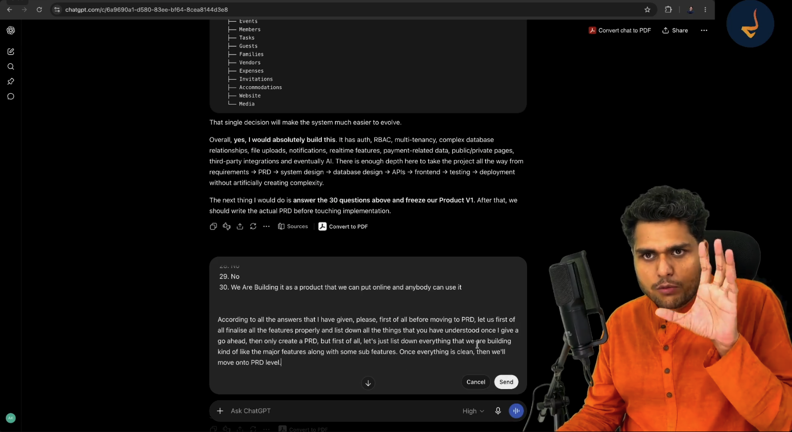

### Pruning Unnecessary Complexity for Version 1

- **No Custom Video Streaming Servers**: Avoid building complex WebRTC or RTMP streaming backends; leverage embedded YouTube Live streams instead.
- **No Complex Automated Vendor Bidding**: Avoid complex real-time reverse auction engines; maintain a clean vendor directory and contract tracker.
- **No Guest Accounts**: Eliminating mandatory user signups for guests maximizes RSVP conversion and simplifies authentication architecture.

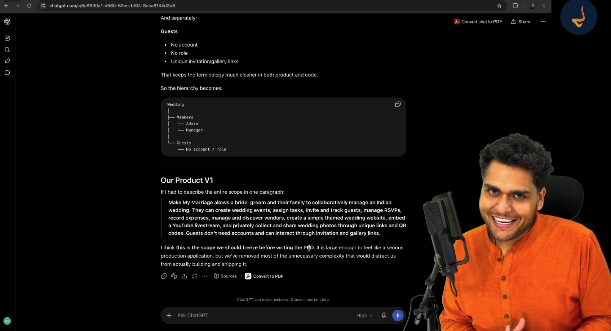

### The Final Product V1 Definition

Make My Marriage empowers a couple and their family to collaboratively organize an Indian wedding. Organizers can configure multiple ceremonial events, assign tasks, track guest invitations and RSVPs, record budgets and expenses, associate vendors, launch a public wedding website with live-stream integration, and privately collect and share media through QR codes. Guests require zero accounts, accessing invites and galleries through unique tokenized links.

---

## 8. Transition to the PRD (Product Requirement Document)

With all architectural ambiguities resolved and the feature set frozen, the ideation phase concludes.

A Product Requirement Document (PRD) serves as the definitive engineering blueprint:
- Details the business purpose, functional requirements, non-functional constraints, and user stories.
- Acts as the single source of truth for all subsequent phases: system design, database modeling, API contracts, and frontend development.
- With AI orchestration, drafting an exhaustive PRD transforms from a multi-week managerial bottleneck into a rigorous, minutes-long collaborative session.
