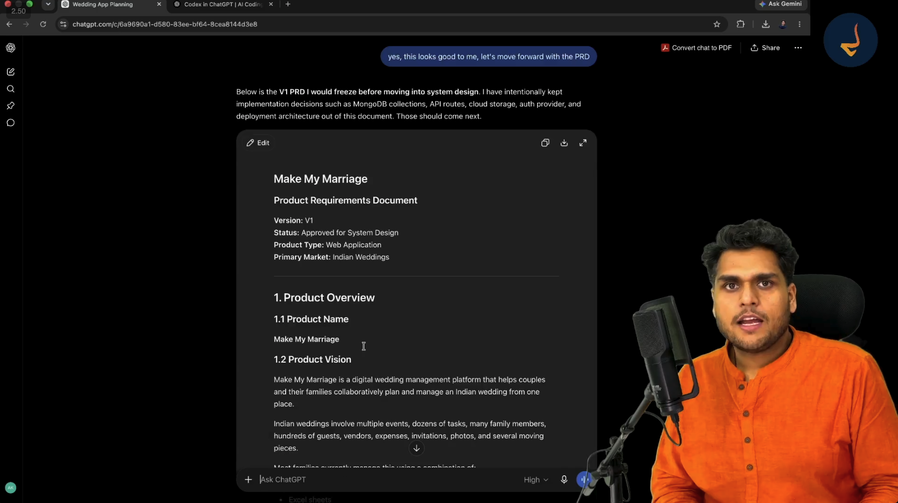

# Episode 03: Product Requirements Documentation (PRD) using AI

> **Season 2: AI Native Software Engineer**  
> Instructor: **Akshay Saini** (NamasteDev)  
> Topic: Purpose of a PRD, AI-Driven PRD Generation, Make My Marriage V1 Specifications, and the Engineering Handoff

---

## 1. What is a PRD? First Principles and Engineering Purpose

A **Product Requirements Document (PRD)** is the foundational blueprint for any software application. In traditional software companies, product managers spend weeks or months conducting user research, interviewing stakeholders, and drafting comprehensive specifications before an engineer writes a single line of code.



### Core Function of a PRD

A PRD answers four fundamental questions:
- **What is being built?** Clear definitions of features, workflows, and deliverables.
- **Why is it being built?** The overarching vision, market problem, and user value proposition.
- **For whom is it being built?** Target user personas, primary actors, and permission hierarchies.
- **How must it behave?** Functional rules, edge cases, input validation, and release milestones.

### Why Engineering Demands a PRD Before Implementation

Attempting to build software directly from brainstorming thoughts leads to severe pitfalls:
- **Ambiguous Architecture**: Engineers guess user intentions, resulting in mismatched data models and rewritten APIs.
- **Scope Creep**: Features expand uncontrollably mid-sprint without clear boundaries.
- **Wasted AI Compute**: Vague prompts force AI models to make arbitrary design decisions, creating brittle and fragmented implementations.

The PRD serves as the contract between product management and engineering. It freezes requirements, aligns all stakeholders, and establishes the exact baseline for system architecture.

---

## 2. The AI-Native PRD Workflow: Orchestration and Separation of Concerns

In modern AI-assisted software engineering, developers do not wait weeks for a dedicated product manager. Instead, the developer adopts the product manager persona and leverages conversational context from previous ideation to generate an exhaustive PRD in minutes.

### The Separation of Product and Technical Implementation

A crucial principle in writing a PRD is maintaining a strict boundary between product requirements and engineering implementation:
- **Included in a PRD**: Problem statements, user personas, functional feature sets, user journeys, role permissions, edge cases, and rollout phases.
- **Intentionally Excluded from a PRD**: Database schemas (MongoDB collections), API routes (REST or GraphQL endpoints), authentication libraries, cloud storage providers (AWS S3 or Cloudinary), and deployment containerization.

Technical implementation details belong strictly to System Design and Architecture (High-Level and Low-Level Design), which follow once the product scope is locked. Mixing database choices into a PRD prematurely constrains architectural thinking.

---

## 3. Deconstructing the Make My Marriage Product Requirements Document

Following the frozen scope established during Episode 02, ChatGPT generates the official V1 PRD for **Make My Marriage**.

### 3.1 Document Metadata

- **Product Name**: Make My Marriage
- **Version**: V1 (Frozen for System Design)
- **Product Classification**: Full-Stack Collaborative Web Application
- **Target Market**: Indian Wedding Logistics and Coordination

### 3.2 Product Vision and Core Value Proposition

An Indian wedding is functionally equivalent to running a temporary startup for three to six months. It involves multiple ceremonial events, dozens of external vendors, hundreds of guests, large budgets, and distributed family tasks.

Make My Marriage centralizes this logistical complexity into a unified digital command center: a **Wedding Operating System**. It replaces scattered paper notebooks, disjointed Excel sheets, and chaotic WhatsApp groups with a single collaborative platform.

### 3.3 Target Personas

1. **Primary Users (The Couple)**: Bride and Groom driving key decisions, schedules, and overall wedding setup.
2. **Secondary Users (Family Organizers)**: Parents, siblings, and close relatives responsible for specific operations (catering, decorations, transport, and task execution).
3. **Tertiary Users (Wedding Guests)**: Attendees receiving digital invitations, submitting RSVPs, checking event locations, viewing live streams, and sharing candid photos.

---

## 4. User Roles and the Zero-Account Guest Architecture

Defining clean permission boundaries early is essential for secure database design and route protection.

```
                      ┌─────────────────────────────────┐
                      │        Wedding Workspace        │
                      └────────────────┬────────────────┘
                                       │
        ┌──────────────────────────────┴──────────────────────────────┐
        │                                                             │
  [Authenticated]                                               [Public Access]
        │                                                             │
   ┌────┴────────────────────────┐                              ┌─────┴───────────────┐
   │ Members (Google OAuth)      │                              │ Guests (No Account) │
   ├─────────────────────────────┤                              ├─────────────────────┤
   │ • Admin: Bride & Groom      │                              │ • Secure Tokens     │
   │ • Manager: Family Members   │                              │ • Unique RSVP Links │
   └─────────────────────────────┘                              │ • QR Photo Uploads  │
                                                                └─────────────────────┘
```

### Role Breakdown

- **Admin (Bride & Groom)**:
  - Full system ownership and wedding workspace configuration.
  - Manage organizers: invite members, assign roles, or remove access.
  - Unrestricted read and write access across all modules: events, tasks, expenses, vendors, invitations, media, and global settings.
  - Exclusive authority to delete the wedding workspace.
- **Manager (Family Organizers)**:
  - Authenticated via secure Google Login.
  - Create, update, and resolve assigned logistical tasks.
  - Manage designated events, update vendor statuses, record actual expenses, and monitor RSVPs.
  - Guardrail: Cannot delete the wedding workspace or modify Admin accounts.
- **Guest (Zero-Account Architecture)**:
  - **Key Design Decision**: Guests are never forced to register or create accounts.
  - Requiring app downloads or password creation causes massive drop-offs in RSVP rates.
  - Guests interact exclusively through unique, tokenized web links and QR codes.
  - Can view the public wedding itinerary, submit RSVPs with dietary preferences, view directions, access the private photo gallery, and upload photos directly.

---

## 5. Core Functional Modules and Product Rules

The PRD defines twelve interconnected functional modules structured around a single workspace entity:

### 1. Workspace Isolation
Every database entity (events, tasks, expenses, guests, vendors, invitations, media) strictly belongs to a single `Wedding` workspace. In Version 1, one user account creates and manages one wedding workspace.

### 2. Multi-Event Architecture
Indian weddings feature distinct ceremonial milestones (Haldi, Mehndi, Sangeet, Wedding Ceremony, Reception). Each event maintains its own independent date, time, location coordinates, venue instructions, and assigned organizers.

### 3. Unified Guest Registry and Event-Level Mapping
A central master directory of all invited individuals. Guests can be invited globally or tagged to specific sub-events (for instance, close friends invited to all ceremonies, while distant acquaintances attend only the Reception).

### 4. Digital Invitations and Automated Reminders
Customizable digital invitation cards distributed via automated email or personalized WhatsApp share links. The system supports scheduling automated attendance reminders leading up to event dates.

### 5. Frictionless RSVP Management
Secure tokenized links allow guests to confirm attendance, specify plus-one headcounts, and state dietary requirements with a single click.

### 6. Centralized Task Planner
Kanban-style or list-based operational task board. Organizers assign responsibilities (for example: pick up garlands, confirm transport) with due dates, priority tags, and status trackers.

### 7. Expense Tracker and Budget Estimation
Financial dashboard tracking estimated total budget versus actual expenditures across categories (venue, catering, photography, attire). Records paid deposits, remaining balances, and payment milestones.

### 8. Local Vendor Directory
Catalog of local vendors (caterers, photographers, decorators, sound engineers, hotels) linked directly to ceremonial events for seamless contract and contact tracking.

### 9. Public Wedding Website
Automated landing page featuring couple photographs, the love story, countdown timer, event itineraries, accommodation guidance, and interactive venue map directions.

### 10. Embedded Live Streaming
Integration of video streams (such as YouTube Live embeds) directly on the wedding portal, enabling distant relatives and international guests to watch ceremonies live without external downloads.

### 11. Shared Photo Gallery with QR Code Ingestion
Central media repository. Physical tables at wedding venues display custom QR codes. Guests scan the code with mobile cameras to upload candid event photos directly to the gallery without logging in.

### 12. Security and Privacy Boundaries
The wedding landing page is public. Financial records, detailed organizer task lists, and full guest contact directories remain strictly private to authenticated organizers. Photo galleries remain protected behind tokenized attendee links.

---

## 6. Edge Cases and Operational Safeguards

A mature PRD anticipates real-world failures and edge cases before coding starts:

| Scenario / Edge Case | Product Safeguard Specified in PRD |
| :--- | :--- |
| **Duplicate RSVP Submissions** | If a guest clicks their invitation link multiple times, the system updates their existing RSVP record rather than creating duplicate entries. |
| **Uncontrolled Plus-Ones** | Admins configure maximum allowed plus-ones per invitation to prevent venue overcrowding. |
| **Inappropriate Photo Uploads** | All public-facing guest gallery uploads enter an organizer moderation queue or can be deleted immediately by Admins and Managers. |
| **Offline Connectivity at Venues** | Core guest check-in lists and schedules are cached locally on client devices to tolerate weak cellular reception at wedding banquet halls. |
| **Concurrent Organizer Edits** | Optimistic concurrency control and clear real-time updates prevent two family members from overwriting identical expense records. |

---

## 7. Version 1 Rollout Strategy: Phased Delivery

To ensure rapid iteration and eliminate overwhelming complexity, the PRD groups feature delivery into disciplined phases:

- **Phase 1: Foundation**: User authentication, wedding setup wizard, organizer invitations, and central dashboard.
- **Phase 2: Event & Task Operations**: Multi-event management and the collaborative task planner.
- **Phase 3: Guest Relations**: Central guest directory, digital invitation dispatch, tokenized RSVP engine, and automated reminders.
- **Phase 4: Financials & Vendors**: Expense tracking, category budgets, and vendor management.
- **Phase 5: Public Experience**: Wedding website themes, embedded YouTube Live streams, and QR-code photo gallery.
- **Phase 6: Hardening & Launch**: Responsive design testing, security audits, and production cloud deployment.

### Features Deferred to Future Versions

To protect Version 1 delivery, several concepts are explicitly marked as out of scope:
- Multi-wedding enterprise planner agency portals.
- Custom WebRTC video streaming server infrastructure.
- Reverse-auction vendor bidding marketplaces.
- Automated payment gateway payouts to vendors.

---

## 8. The Engineering Handoff

The approval of the Product Requirements Document marks the formal conclusion of the Product Management phase.

With requirements frozen, ambiguities eliminated, and scope protected:
- The development team transitions directly into **System Design and High-Level Architecture (HLD)**.
- In the next episode, the team designs system block diagrams, data flow models, database entity relationships (ERD), API specifications, and frontend component hierarchies based entirely on this frozen PRD.
