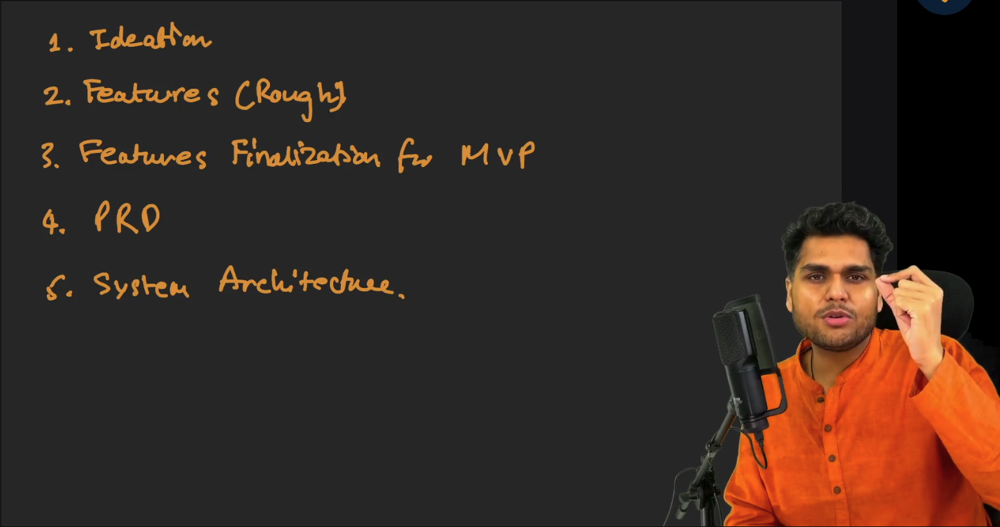
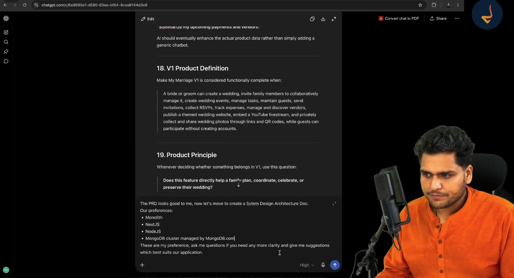
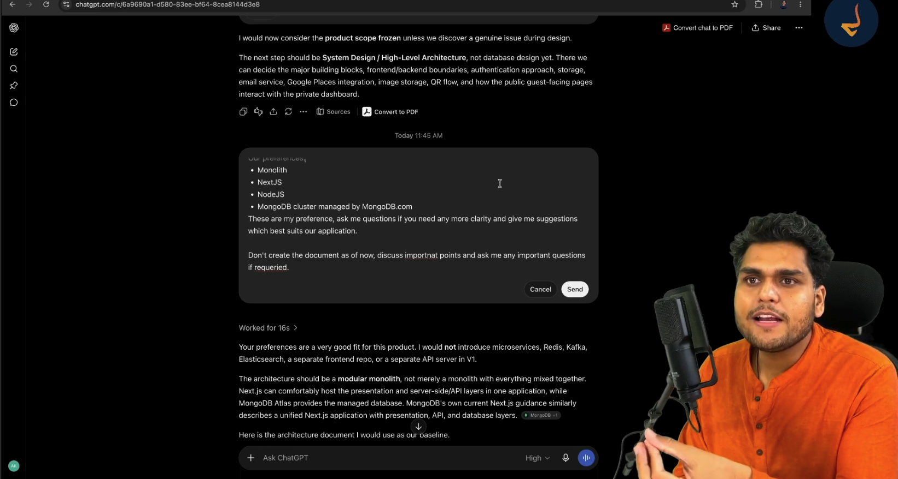
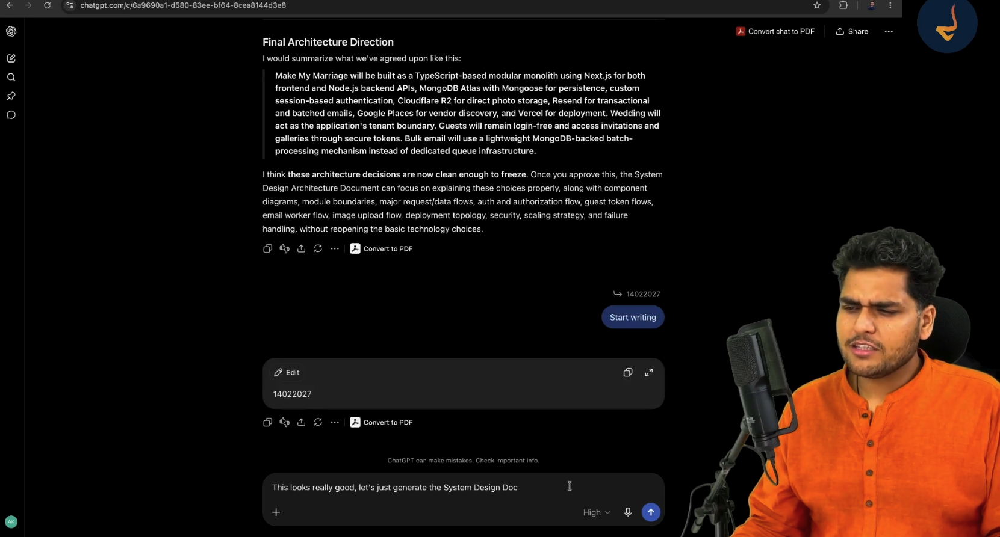

# Episode 04: System Design Architecture Documentation using AI

> **Season 2: AI Native Software Engineer**  
> Instructor: **Akshay Saini** (NamasteDev)  
> Topic: System Architecture from First Principles, Guiding AI in Architectural Decisions, Modular Monolith vs Microservices, and the Technical Baseline for Make My Marriage

---

## 1. The Engineering Handoff: From Product Requirements to System Architecture

Software development moves through distinct, disciplined stages. In Episode 01 through Episode 03, the focus remained entirely on the product side: ideating the concept, capturing raw feature thoughts, filtering features down to a minimum viable product (MVP), and producing a frozen Product Requirements Document (PRD).



### The Five Core Milestones of Software Creation

1. **Ideation**: Identifying the domain problem, target audience, and core value proposition.
2. **Features (Rough)**: Unconstrained brainstorming of capabilities and workflows.
3. **Features Finalization for MVP**: Pruning non-essential complexity to define Version 1.
4. **Product Requirements Document (PRD)**: Documenting functional specifications, user roles, journeys, and edge cases.
5. **System Architecture**: Defining high-level building blocks, component interactions, data stores, API boundaries, and deployment topology.

### Why Architecture is Non-Negotiable Before Coding

A PRD specifies **what** to build and **why**. System architecture specifies **how** to build it reliably. 

Skipping system design and jumping straight into coding leads to severe architectural failures:
- **Tangled Dependencies**: Business logic gets scattered across user interfaces and database queries without clear separation of concerns.
- **Premature Rework**: Changing data models or authentication methods mid-development breaks existing application routes.
- **Performance Choke Points**: Storing large binary files in databases or dispatching thousands of synchronous API calls crashes production servers.
- **Uncontrolled Cloud Costs**: Inappropriate cloud services introduce unexpected data transfer fees and compute bills.

The PRD is now handed over from the Product Manager role to the Engineering Lead role. The engineer must supervise technical decision-making and establish an architectural contract before writing implementation code.

---

## 2. The AI-Native Engineering Mindset: Steering AI and Architectural Intent

A fundamental principle of Season 2 is that modern software engineering with AI is not about memorizing prompts or copying rigid boilerplate code. Every developer embarks on a unique technical journey. One engineer may choose Next.js and MongoDB, another may select Python with FastAPI and PostgreSQL, while a third may opt for Go and Redis.

The true objective of an AI-native engineer is understanding **how to guide AI**, evaluate technical trade-offs, and maintain architectural command.



### Prompting with Intent and Constraints

When initiating system architecture with AI, developers must supply clear preferences while inviting technical scrutiny. Rather than asking an open-ended question, provide a baseline and demand that the AI identify gaps:

> "The PRD looks good to me. Now let us move to create a System Design Architecture Document.  
> Our preferences:  
> - Monolith  
> - Next.js  
> - Node.js  
> - MongoDB cluster managed by MongoDB Atlas  
> These are my preferences. Ask me questions if you need any more clarity and give me suggestions which best suit our application."

### Stopping Premature Document Generation

When presented with architectural preferences, AI assistants frequently rush to generate a complete system design document immediately. This is a common pitfall. Accepting a full architectural document on the first prompt bypasses essential engineering analysis.



The engineer must actively steer the model by intervening:

> "Do not create the document as of now. Discuss important points and ask me any important questions if required."

By pausing document generation, the engineer forces the AI into an interactive architectural interview. This collaborative back-and-forth surfaces hidden bottlenecks, clarifies trade-offs, and ensures deliberate design choices.

### The Golden Rule of AI System Design

> **More time spent discussing and refining architecture with AI leads to significantly less time wasted debugging and rewriting code later.**

---

## 3. High-Level Architecture: Modular Monolith vs Microservices

One of the most consequential decisions in system design is choosing between a monolithic architecture and a microservices architecture.

### Why Microservices are an Anti-Pattern for Version 1

Many developers mistakenly believe that modern architecture requires microservices from day one. For an early-stage application or MVP, microservices introduce massive operational overhead:
- **Distributed Latency**: Network round-trips between services introduce latency and failure modes.
- **Complex Deployments**: Multiple repositories, independent Docker containers, Kubernetes clusters, and API gateways consume excessive engineering time.
- **Data Inconsistency**: Maintaining consistency across distributed databases requires two-phase commits, saga patterns, or distributed message queues.
- **Team Mismatch**: Microservices are designed to solve organizational scaling problems across hundreds of engineers, not single-team product development.

### The Power of the Modular Monolith

For Make My Marriage, the optimal architectural pattern is a **Modular Monolith**.

```
┌────────────────────────────────────────────────────────────────────────┐
│                     Make My Marriage Application                       │
│                     (Unified Next.js Monolith)                         │
├────────────────────────────────────────────────────────────────────────┤
│  Presentation Layer: React Server Components & Client UI               │
├────────────────────────────────────────────────────────────────────────┤
│  API & Routing Layer: Next.js Route Handlers (Node.js Runtime)         │
├────────────────────────────────────────────────────────────────────────┤
│  Internal Business Modules (Strict Logical Boundaries):               │
│  ┌───────────────┐ ┌───────────────┐ ┌───────────────┐ ┌─────────────┐ │
│  │ Auth & Users  │ │ Wedding & Core│ │ Events Module │ │ Guest & RSVP│ │
│  └───────────────┘ └───────────────┘ └───────────────┘ └─────────────┘ │
│  ┌───────────────┐ ┌───────────────┐ ┌───────────────┐ ┌─────────────┐ │
│  │ Tasks & Shop  │ │ Budget/Expense│ │ Vendor Mgmt   │ │ Media Module│ │
│  └───────────────┘ └───────────────┘ └───────────────┘ └─────────────┘ │
├────────────────────────────────────────────────────────────────────────┤
│  Data Access Layer: Mongoose ODM Models                                │
└────────────────────────────────────────────────────────────────────────┘
```

A modular monolith combines the simplicity of a single deployable application with the discipline of decoupled code modules:
- **Unified Codebase**: Frontend interfaces and backend API routes reside together in TypeScript, eliminating context switching and duplicate type declarations.
- **Zero Network Boundary Overhead**: Modules communicate through direct internal function calls rather than HTTP or RPC calls.
- **Future Extraction Path**: Because module boundaries are strictly enforced inside the codebase, any module that experiences extreme load in the future (such as the media processing or RSVP engine) can be cleanly extracted into an independent microservice later without refactoring the entire product.

---

## 4. Data Layer Architecture: Persistence and Storage Separation

Data storage requires separating structured transactional records from large unstructured media assets.

### Managed Database: MongoDB Atlas vs Self-Hosted Instances

Running a self-managed database on an infrastructure server requires handling operating system updates, storage volume expansion, automated replication, failover orchestration, and backup scripting.

For Version 1, the architecture leverages **MongoDB Atlas**:
- Fully managed cloud database with high availability and automated security patching.
- Free-tier cluster provisions sufficient compute and storage for initial development and testing.
- Automated daily backups and operational metric dashboards out of the box.

### Visual Data Inspection with MongoDB Compass

Developers utilize **MongoDB Compass** as the local desktop graphical interface to connect directly to the remote MongoDB Atlas cluster via secure connection strings (`mongodb+srv://...`). This enables immediate verification of collections, schema shapes, index performance, and query execution plans during development.

### Object Document Modeling: Mongoose vs Raw Drivers

While raw MongoDB drivers offer direct query capabilities, **Mongoose** is selected as the Object Document Mapper (ODM):
- **Schema Validation**: Enforces strict property types, required fields, and custom validation rules at the application layer.
- **Middleware Hooks**: Supports pre-save and post-save hooks for automated timestamp management and cascade updates.
- **Type Safety**: Maps directly to TypeScript interfaces for full compile-time type verification.

### Fundamental Rule: Databases Store Data, Not Physical Files

A critical system design principle is that databases must store **structured data and resource URLs**, never raw binary media files (JPEG, PNG, MP4):
- Storing binary files (BLOBs) inside MongoDB documents degrades document cache efficiency, increases memory consumption, and exhausts query bandwidth.
- Binary media belongs strictly in object storage. MongoDB stores only the resulting public or secure uniform resource locators (URLs).

---

## 5. Media Storage and Direct Upload Architecture

Indian weddings generate hundreds or thousands of high-resolution photographs and videos uploaded by family members and guests. Routing this traffic through backend application servers causes severe performance degradation.

```
┌──────────────┐         1. Request Upload URL          ┌───────────────────┐
│              │ ─────────────────────────────────────> │                   │
│ Guest / User │                                        │ Next.js API Route │
│  Web Client  │ <───────────────────────────────────── │   (FastAPI/Node)  │
│              │       2. Return Presigned URL          └───────────────────┘
└──────────────┘
       │
       │ 3. Direct Binary Upload (PUT)
       ▼
┌──────────────────────────────────────┐
│        Cloudflare R2 Storage         │
│         (S3-Compatible Object)       │
└──────────────────────────────────────┘
```

### Direct Client Upload via Presigned URLs

1. The client sends a lightweight JSON request to the backend requesting an upload slot for an image.
2. The backend generates a temporary, cryptographically signed upload URL with an expiration window (for example: five minutes).
3. The client uploads the binary image directly to the cloud storage bucket using the signed URL via an HTTP PUT request.
4. The backend server never buffers or processes the heavy binary payload, keeping server memory and network consumption near zero.

### Cloudflare R2 vs Amazon AWS S3: Eliminating Egress Fees

While Amazon S3 is the industry standard object store, it charges significant bandwidth fees whenever data leaves the storage region (data egress fees). In a public wedding portal where thousands of attendees view and download high-resolution gallery images, egress costs can accumulate rapidly.

**Cloudflare R2** is chosen for the media layer:
- **Zero Egress Fees**: Cloudflare R2 does not charge for outgoing data transfer, eliminating unexpected bandwidth charges.
- **S3 API Compatibility**: R2 implements the standard Amazon S3 API, allowing existing S3 client libraries (`@aws-sdk/client-s3`) to work without code changes.
- **Global Edge Integration**: Pairs directly with Cloudflare global Content Delivery Network (CDN) to cache photos at edge servers close to guests worldwide.

### Preventing Storage Abuse and Spam

Because guests can upload photos without creating user accounts, the system applies strict security constraints:
- Upload URLs expire rapidly after generation.
- Allowed file types are restricted to standard image formats (JPEG, PNG, WebP) with strict file size limits enforced at the pre-signed URL policy level.
- Uploaded media records link directly to the wedding identifier and remain isolated within the wedding workspace.

---

## 6. Communication and Background Processing: Avoiding Premature Queues

A key responsibility of system design is balancing technical robustness with operational simplicity.

### The Mass Email Challenge

The Make My Marriage application dispatches digital invitations, RSVP confirmations, and schedule updates to wedding attendees. 

Sending an email involves calling an external email service provider (Resend API):
- If an organizer clicks "Send Invitations" to 1,000 guests, triggering 1,000 synchronous API calls inside a standard HTTP request will cause the web request to time out, crash the server, or hit API rate limits.
- Network glitches or transient external provider downtime will cause partial failures with no record of which emails were dispatched.

### Lightweight Batching vs Heavyweight Message Brokers

Traditional enterprise architectures introduce dedicated message brokers such as Apache Kafka, RabbitMQ, or AWS Simple Queue Service (SQS) paired with Celery or BullMQ workers:
- These tools require running independent worker servers, managing Redis instances, monitoring queue backlogs, and handling complex dead-letter queues.
- For an MVP sending hundreds to a few thousand wedding emails, running separate broker infrastructure is excessive over-engineering.

### The Lightweight Solution: MongoDB-Backed Batch Processing

Make My Marriage implements a lightweight, database-backed batch queue:
- When invitations are dispatched, the system creates structured records in an `email_jobs` collection with statuses: `PENDING`, `PROCESSING`, `SENT`, or `FAILED`.
- A background runner or scheduled serverless routine processes pending email records in manageable chunks (such as batches of 25 to 50 emails).
- Resend API handles transactional email delivery with its generous free tier (100 free emails per day for development, scalable to production plans).
- This pattern provides reliability, retry capabilities, and rate-limit compliance without introducing external queue infrastructure.

---

## 7. Multi-Tenancy, Access Control, and Guest Experience

The security and data isolation model must accommodate three distinct user tiers across every wedding workspace.

```
                               ┌────────────────────────────────┐
                               │       Wedding Workspace        │
                               │      (Multi-Tenant Boundary)   │
                               └───────────────┬────────────────┘
                                               │
               ┌───────────────────────────────┴───────────────────────────────┐
               │                                                               │
     [Authenticated Members]                                         [Public Guest Access]
               │                                                               │
     ┌─────────┴─────────────────────┐                               ┌─────────┴─────────────────────┐
     │ • Admin: Bride & Groom        │                               │ • No Account Required         │
     │ • Manager: Family Members     │                               │ • Unique Signed Token URLs    │
     │ • Google OAuth Session Auth   │                               │ • QR Code Photo Uploads       │
     │ • Unrestricted Workspace Mgmt │                               │ • Interactive RSVP Forms      │
     └───────────────────────────────┘                               └───────────────────────────────┘
```

### Wedding as the Multi-Tenant Boundary

Every database collection (events, guests, tasks, expenses, vendors, photos, invitations) contains a `weddingId` reference. In Version 1, one user account creates and administers one wedding workspace. All internal queries strictly filter by `weddingId` to prevent cross-wedding data leakage.

### Authentication Tiers

1. **Admins (Bride & Groom)**:
   - Authenticated via secure Google OAuth.
   - Complete ownership of wedding configuration, member invitations, financial records, and deletion authority.
2. **Managers (Family Organizers)**:
   - Invited via unique email invitation links.
   - Authenticated via Google OAuth.
   - Read and write permissions for assigned events, tasks, vendor coordination, and RSVP monitoring.
   - Safeguard: Cannot delete the wedding workspace or remove Admins.
3. **Guests (Zero-Account Architecture)**:
   - No login or registration required.
   - Access invitations and submit RSVPs through unique tokenized web links.
   - Scan venue QR codes to access private photo galleries and upload pictures directly.

### Content Moderation for MVP

While commercial photo portals employ automated artificial intelligence content moderation to screen images, Make My Marriage keeps Version 1 lean:
- Automatic machine learning moderation pipelines introduce unnecessary latency, external API costs, and false positives.
- Instead, the platform grants Admins and Managers instant deletion authority directly from the live gallery interface. If an inappropriate image is uploaded, organizers remove it with a single tap.

---

## 8. Finalizing and Freezing the System Architecture

After conducting the interactive Q&A discussion, the engineering choices for Make My Marriage are finalized and frozen.



### Technical Architecture Baseline Specification

| Dimension | Architectural Choice | Justification and Trade-Off Analysis |
| :--- | :--- | :--- |
| **Architecture Pattern** | Modular Monolith | Single codebase and deployment. Avoids microservices networking and deployment complexity while preserving strict logical module boundaries. |
| **Primary Language** | TypeScript | End-to-end type safety across client interfaces, server API route handlers, and database models. |
| **Frontend Framework** | Next.js (App Router) | High-performance server-side rendering for public wedding portals, rich interactive dashboards for organizers, and automatic image optimization. |
| **Backend API Layer** | Next.js API Route Handlers | Colocated API routes running on the Node.js runtime within the unified Next.js application environment. |
| **Primary Database** | MongoDB Atlas | Fully managed cloud document database. Document model naturally represents nested wedding ceremonies, guest lists, and flexible vendor data. |
| **Data Modeling / ODM** | Mongoose | Strict schema validation, lifecycle hooks, and strong typing at the application layer. |
| **Binary Media Storage** | Cloudflare R2 | S3-compatible object storage with zero egress fees, eliminating bandwidth costs for photo-heavy galleries. |
| **Media Ingestion Flow** | Client Direct via Presigned URLs | Clients upload images directly to Cloudflare R2 using short-lived signed URLs, bypassing application servers. |
| **Email Service** | Resend | Modern, developer-friendly transactional email delivery with high deliverability rates. |
| **Bulk Email Processing** | MongoDB-Backed Batching | Queue-like batch processing using database status fields, avoiding premature message broker infrastructure. |
| **Vendor Discovery** | Google Places API | Enables organizers to discover, search, and map local wedding vendors (caterers, florists, venues) directly within the dashboard. |
| **Authentication** | Google OAuth & Session Cookies | Fast, frictionless sign-in for organizers without managing custom password hashing and password reset flows. |
| **Guest Access Flow** | Tokenized URLs and QR Codes | Zero-account guest access model maximizes RSVP completion and guest photo engagement. |
| **Initial Deployment** | Vercel | Seamless Next.js deployment with automated Git continuous deployment, preview environments, and global edge distribution. |

---

## 9. Deployment Topology, Observability, and Future Evolution

The architecture accounts for both initial MVP speed and long-term evolutionary growth.

### Initial Deployment on Vercel

Vercel provides native optimization for Next.js applications:
- Automatic continuous integration and continuous deployment (CI/CD) directly from the Git repository.
- Edge network caching for public wedding websites.
- Serverless scaling of API routes without configuring load balancers or managing Linux virtual machines.

### Cloud Migration Roadmap

While Vercel serves as the rapid deployment platform for Version 1, the course roadmap includes demonstrating production cloud migration:
- Containerizing the Next.js application using Docker.
- Deploying the container to an Amazon AWS EC2 virtual machine or AWS Elastic Container Service (ECS).
- Configuring Nginx reverse proxies, SSL certificates via Let us Encrypt, and custom production environments.
- This dual-phase approach teaches both rapid MVP delivery and enterprise cloud infrastructure management.

### Lean Observability for Version 1

Enterprise monitoring solutions like Datadog, New Relic, or self-hosted Elasticsearch-Logstash-Kibana (ELK) clusters introduce substantial configuration and running costs.

For Version 1:
- The system relies on structured application logging using standard output streams.
- Vercel and Node.js runtime consoles capture errors and performance metrics directly.
- External monitoring stacks remain deferred until product adoption warrants dedicated observability budgets.

---

## 10. The Path Forward: Transitioning to Low-Level Design

With the System Design Architecture Document finalized and frozen:
- The technical boundaries between client, server, database, object store, and external APIs are established.
- The team has eliminated architectural ambiguity without over-engineering the initial product.
- In Episode 05, the development process advances to **Low-Level Design (LLD)**: defining detailed Mongoose database schemas, model relationships, data validation rules, and REST API endpoint contracts.
