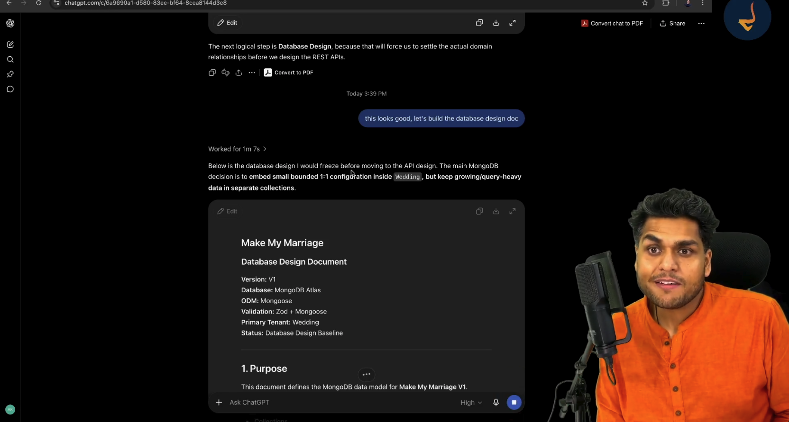
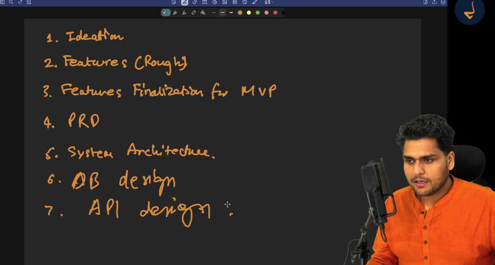

# Episode 05: Database and API Design Documentation using AI

> **Season 2: AI Native Software Engineer**  
> Instructor: **Akshay Saini** (NamasteDev)  
> Topic: Database Design from First Principles, MongoDB Modeling Patterns, 13 Core Collections, Soft Delete versus Hard Delete, REST API Design, and Specification-Driven Development

---

## 1. The Engineering Progression: Moving from Architecture to Data Contracts

Software engineering moves through disciplined, interdependent milestones. In the previous episodes, the technical foundation for Make My Marriage was established: ideating core workflows, defining MVP feature boundaries, freezing the Product Requirements Document (PRD), and producing the System Design Architecture Document.



### The Traditional Velocity versus AI-Native Velocity

In traditional software organizations, reaching this milestone requires substantial time and human resources:
- **Traditional Enterprise Timeline**: Generating a comprehensive PRD typically consumes multiple weeks of product management interviews. System design architecture demands another several weeks of engineering review. Database modeling and API schema specifications require additional weeks of architectural committee meetings. The entire process takes minimum one to two months in a large technology company, or several weeks in a fast startup.
- **AI-Native Engineering Velocity**: Guided by an experienced engineer, the entire specification suite (PRD, System Design Architecture, Database Design Document, and REST API Design Document) is produced and refined in just four to five hours.
- **The Reality of AI Quality**: While some industry commentary claims AI cannot design real-world software, directing modern AI models with precise constraints yields production-grade specifications that satisfy the scrutiny of senior software engineers.

### Why Database Design Must Precede API Design

A common mistake among junior developers is attempting to design REST API endpoints or frontend screens before settling the database design.

Database design must strictly precede API design for two foundational reasons:
1. **Data Model as Ground Truth**: The database defines core domain boundaries, entity cardinalities, primary keys, and data isolation rules. APIs are merely transport interfaces exposing subsets of that underlying domain.
2. **Eliminating Schema Guesswork**: When developers attempt to write API contracts without a defined database model, they invent arbitrary query parameters, create inconsistent naming conventions, and produce fragile contracts that require painful rewrites during implementation.

### Prompting with Trust and Supervisory Review

When initiating database design, the engineer leverages the system architecture context already established in the conversation:

> "This looks good, let us build the database design doc."

Rather than micromanaging the model with low-level table definitions, the engineer allows AI to act as the primary driver. The engineer evaluates the resulting model through a senior engineering lens: ensuring appropriate isolation, validating bounded embedding, checking indexing strategies, and identifying security boundaries.

---

## 2. Specification-Driven Development (SDD) and the Seven Milestones

Make My Marriage follows **Specification-Driven Development (SDD)**, a software engineering methodology where all requirements, architectural patterns, entity schemas, and communication interfaces are completely specified and locked before writing application code.



### The Seven Sequential Milestones of Software Creation

1. **Ideation**: Identifying the domain problem, target audience, and core product proposition.
2. **Features (Rough)**: Unconstrained brainstorming of capabilities and workflows.
3. **Features Finalization for MVP**: Pruning non-essential complexity to establish Version 1 boundaries.
4. **Product Requirements Document (PRD)**: Freezing functional specifications, user roles, user journeys, and edge cases.
5. **System Architecture**: Defining the architectural topology (Modular Monolith), deployment infrastructure, and technology stack.
6. **Database Design (DB Design)**: Defining collections, relationships, constraints, indexes, and storage rules.
7. **API Design**: Defining HTTP endpoints, request and response envelopes, status codes, and authentication flows.

### Why SDD Eliminates AI Coding Hallucinations

When developers prompt AI to build an application without prior specifications, the AI must guess database fields, invent route paths, and fabricate validation rules. This causes conflicting data models, broken routes, and tangled spaghetti code.

With the four core specifications frozen (PRD, System Architecture, Database Design, and API Design), AI is never forced to guess. Every field name, data type, relationship, and status code is established. The AI functions as a precise implementation engine, generating over 95 percent of the code correctly on the first attempt.

---

## 3. MongoDB Data Modeling Principles for Make My Marriage

Designing a database schema in a document database like MongoDB requires different trade-offs than relational modeling in PostgreSQL or MySQL.

```
┌────────────────────────────────────────────────────────────────────────┐
│                        Make My Marriage Database                       │
│                        Primary Tenant: Wedding                         │
├────────────────────────────────────────────────────────────────────────┤
│  Aggregate Root:                                                       │
│  weddings collection (wedding_id)                                      │
├────────────────────────────────────────────────────────────────────────┤
│  Bounded Embedded Configurations (1:1 Relationships):                  │
│  - Website Settings (slug, theme, welcome_message, is_published)       │
│  - Gallery Settings (is_enabled, allow_guest_uploads)                  │
│  - Livestream Settings (is_enabled, stream_url)                        │
│  - Venue Location Details (address, coordinates, google_place_id)      │
├────────────────────────────────────────────────────────────────────────┤
│  Referenced Unbounded Collections (1:N Relationships):                 │
│  - events (wedding_id)                                                 │
│  - guests (wedding_id)                                                 │
│  - tasks (wedding_id, optional event_id)                               │
│  - vendors (wedding_id)                                                │
│  - expenses (wedding_id, optional event_id, optional vendor_id)        │
│  - photos (wedding_id, optional event_id, storage_path)                │
│  - email_jobs (wedding_id, job_type, idempotency_key)                  │
└────────────────────────────────────────────────────────────────────────┘
```

### 3.1 The Wedding as the Central Entity and Primary Tenant

Make My Marriage is structured entirely around the **Wedding** as the aggregate root:
- When a user creates a wedding, a unique `wedding_id` is generated.
- Every downstream domain entity (events, guests, tasks, vendors, expenses, photos, and email jobs) stores this `wedding_id`.
- The `wedding_id` provides strict tenant isolation, simplifies security authorization checks, and enables fast partition-based database queries.

### 3.2 Bounded Embedding versus Unbounded Referencing

A core architectural principle in MongoDB is knowing when to embed documents versus when to reference them across separate collections:

- **When to Embed**: Embed small, bounded sub-documents that have a strict 1:1 relationship with the parent and do not grow over time.
  - Examples in Make My Marriage: Wedding website settings, public gallery configuration, livestream URLs, and venue location details. Because there is only one website and one livestream per wedding, embedding these objects directly inside the `weddings` collection keeps queries simple and eliminates unnecessary database lookups.
- **When to Reference**: Use separate collections and reference identifiers whenever data is unbounded, query-heavy, or grows independently.
  - Anti-Pattern: Embedding guest lists, tasks, or photo metadata directly inside the `weddings` document. A wedding can have 1,000 guests, dozens of events, and thousands of photos. Storing this data in a single document violates the MongoDB 16MB document size limit, creates memory bloat, and degrades query performance.
  - Resolution: Maintain separate collections (`guests`, `events`, `tasks`, `photos`) linked by `wedding_id`.

### 3.3 Selective Denormalization

Denormalization should only be introduced when strictly justified by read performance:
- Avoid maintaining calculated counters (such as `wedding_total_guests` or `total_attending_count`) inside parent documents during initial development.
- When guests are deleted, modified, or re-invited concurrently, manual counter fields easily drift out of synchronization, corrupting data integrity.
- Compute totals dynamically through queries or database aggregation pipelines until high-traffic profiling proves a cached counter is necessary.

### 3.4 Application-Level Referential Integrity

Unlike traditional relational database management systems, MongoDB does not enforce native foreign key constraints, cascading deletes, or referential integrity:
- The responsibility for enforcing relationships, permissions, and entity lifecycles falls entirely on the application layer.
- In Make My Marriage, the Next.js route handlers and Mongoose models validate that `wedding_id`, `event_id`, and `user_id` exist and belong to the authenticated tenant before persisting changes.

---

## 4. The 13 Core Collections: Schema Specifications and Technical Constraints

The database design achieves complete functional coverage across the Make My Marriage PRD using exactly 13 well-bounded collections.

```
┌────────────────────────────────────────────────────────────────────────┐
│                      The 13 MongoDB Collections                        │
├─────────────────────────┬──────────────────────────────────────────────┤
│ Category                │ Collections                                  │
├─────────────────────────┼──────────────────────────────────────────────┤
│ Identity & Security     │ users, sessions, password_reset_tokens       │
├─────────────────────────┼──────────────────────────────────────────────┤
│ Tenancy & Collaboration │ weddings, wedding_members,                   │
│                         │ wedding_member_invitations                   │
├─────────────────────────┼──────────────────────────────────────────────┤
│ Scheduling & Execution  │ events, tasks                                │
├─────────────────────────┼──────────────────────────────────────────────┤
│ Guest Logistics & RSVPs │ guests                                       │
├─────────────────────────┼──────────────────────────────────────────────┤
│ Finance & Vendors       │ vendors, expenses                            │
├─────────────────────────┼──────────────────────────────────────────────┤
│ Media & Processing      │ photos, email_jobs                           │
└─────────────────────────┴──────────────────────────────────────────────┘
```

### 4.1 Identity and Security Collections

#### 1. `users` Collection
Stores user identity, credentials, and profile information:
- `_id`: Unique MongoDB ObjectId.
- `name`: Full name of the user.
- `email`: Original email address entered by the user.
- `email_normalized`: Lowercased and trimmed email string.
  - **Technical Rationale**: Email addresses are case-insensitive by Internet standard RFC 5321, but databases treat `User@Domain.com` and `user@domain.com` as distinct strings. Storing a normalized version prevents duplicate registrations and query mismatches.
- `password_hash`: Secure salted password hash (Argon2id or bcrypt). Raw passwords are never persisted.
- `created_at`, `updated_at`: ISO UTC timestamps.
- **Indexes**: Unique index on `email_normalized`.

#### 2. `sessions` Collection
Manages stateful server-side sessions for authenticated users:
- `_id`: Unique ObjectId.
- `session_token_hash`: Cryptographic SHA-256 hash of the session token.
  - **Security Rationale**: Storing raw session tokens in the database exposes users to session hijacking if the database is compromised. The client holds the raw token in an HttpOnly cookie, while the database stores only the hash.
- `user_id`: Reference ObjectId pointing to `users._id`.
- `expires_at`: Timestamp indicating when the session becomes invalid.
- `created_at`, `last_active_at`: Timestamps for session activity auditing.
- **Indexes**: Unique index on `session_token_hash`; Time-To-Live (TTL) index on `expires_at` that instructs MongoDB to automatically purge expired session documents.

#### 3. `password_reset_tokens` Collection
Stores single-use tokens for password recovery:
- `_id`: Unique ObjectId.
- `token_hash`: Cryptographic hash of the recovery token.
- `user_id`: Reference ObjectId pointing to `users._id`.
- `expires_at`: Expiration timestamp (typically 15 to 30 minutes).
- `used_at`: Timestamp recording when the token was consumed.
- **Indexes**: Unique index on `token_hash`; TTL index on `expires_at`.

---

### 4.2 Tenancy and Collaboration Collections

#### 4. `weddings` Collection
The aggregate root storing primary wedding details and bounded configurations:
- `_id`: Unique ObjectId (`wedding_id`).
- `title`: Display title of the wedding.
- `slug`: Unique URL-friendly slug for public wedding websites (e.g. `rohit-and-priya-2026`).
- `bride_name`, `groom_name`: Names of the couple.
- `wedding_date`: Primary date of the wedding ceremony.
- `timezone`: IANA timezone string (e.g. `Asia/Kolkata`) ensuring all sub-event times render correctly.
- `cover_image_key`: Object storage key for the hero cover image.
- `location`: Embedded object containing `address`, `city`, `state`, `country`, `latitude`, `longitude`, and `google_place_id`.
- `website_settings`: Embedded object (`is_published`, `welcome_message`, `theme`, `story_html`).
- `gallery_settings`: Embedded object (`is_enabled`, `allow_guest_uploads`, `moderation_required`).
- `livestream_settings`: Embedded object (`is_enabled`, `stream_url`, `scheduled_start_time`).
- **Indexes**: Unique index on `slug`.

#### 5. `wedding_members` Collection
Represents collaborative access and permissions for a wedding:
- `_id`: Unique ObjectId.
- `wedding_id`: Reference to `weddings._id`.
- `user_id`: Reference to `users._id`.
- `role`: Permission level (`Admin`, `Manager`, `Member`).
  - `Admin`: Full control over wedding settings, financial data, collaborator invites, and deletions.
  - `Manager`: Can manage events, vendors, guests, and tasks, but cannot delete the wedding.
  - `Member`: Read-only access or limited task assignment.
- `created_at`: Timestamp of addition.
- **Indexes**: Compound unique index on `(wedding_id, user_id)` preventing a user from being assigned duplicate roles within the same wedding.

#### 6. `wedding_member_invitations` Collection
Handles invitations for team members and wedding planners:
- `_id`: Unique ObjectId.
- `wedding_id`: Reference to `weddings._id`.
- `email_normalized`: Email address of the invited collaborator.
- `role`: Assigned role upon acceptance (`Admin`, `Manager`, `Member`).
- `token_hash`: Hashed invitation token sent via email.
- `status`: Lifecycle state (`pending`, `accepted`, `expired`, `revoked`).
- `expires_at`: Expiration timestamp.
- **Indexes**: Unique index on `token_hash`; compound index on `(wedding_id, email_normalized)`.

---

### 4.3 Scheduling and Execution Collections

#### 7. `events` Collection
Stores the itinerary of celebrations comprising the wedding:
- `_id`: Unique ObjectId (`event_id`).
- `wedding_id`: Reference to `weddings._id`.
- `name`: Event name (e.g. Haldi, Mehendi, Sangeet, Wedding Ceremony, Reception).
- `event_type`: Standard enumeration or custom string.
- `start_time`, `end_time`: UTC timestamps representing scheduled event duration.
- `location`: Specific venue, room, or address for this particular event.
- **Indexes**: Compound index on `(wedding_id, start_time)`.

#### 8. `tasks` Collection
Tracks operational todo items and checklists:
- `_id`: Unique ObjectId (`task_id`).
- `wedding_id`: Reference to `weddings._id`.
- `event_id`: Optional reference to `events._id` for event-specific tasks.
- `title`: Description of the action item.
- `assigned_to_membership_id`: Reference pointing to `wedding_members._id`.
  - **Technical Rationale**: Assigning tasks to a membership record rather than a raw `user_id` ensures that task responsibility is scoped strictly to the context of that wedding membership.
- `due_date`: Target completion deadline.
- `priority`: Enumeration (`low`, `medium`, `high`).
- `status`: Workflow state (`todo`, `in_progress`, `completed`).
- `completed_at`: Completion timestamp.
- **Indexes**: Compound index on `(wedding_id, status)`; index on `(wedding_id, assigned_to_membership_id)`.

---

### 4.4 Guest Logistics and RSVP Collections

#### 9. `guests` Collection
Consolidates guest records, party sizes, invitation states, and RSVP attendance:
- `_id`: Unique ObjectId (`guest_id`).
- `wedding_id`: Reference to `weddings._id`.
- `name`: Primary contact name.
- `email`: Contact email address.
- `email_normalized`: Normalized email for lookup.
- `phone_number`: Phone contact for WhatsApp or SMS invitations.
- `max_guests`: Maximum party size / plus-ones permitted for this invitation entry (e.g. 2 for a couple, 4 for a family).
- `invited_event_ids`: Array of `event_id` ObjectIds indicating which specific events this party is invited to attend.
- `notes`: Dietary requirements, special accommodations, or family notes.
- `invitation_token_hash`: Hashed secret token enabling direct one-click RSVP without requiring user login.
- `invitation_sent_at`, `last_reminder_sent_at`: Delivery auditing timestamps.
- `reminder_count`: Counter tracking dispatched notification reminders.
- `rsvp_status`: Current response state (`pending`, `attending`, `not_attending`).
- `attending_count`: Total number of individuals confirmed to attend.
  - **Data Constraint**: Application validation must enforce that `attending_count` is less than or equal to `max_guests`. If `rsvp_status` is `not_attending`, `attending_count` must be set to zero.
- **Indexes**: Unique index on `invitation_token_hash`; compound index on `(wedding_id, email_normalized)`.

---

### 4.5 Financial and Vendor Management Collections

#### 10. `vendors` Collection
Maintains external contractors and service providers:
- `_id`: Unique ObjectId (`vendor_id`).
- `wedding_id`: Reference to `weddings._id`.
- `name`: Company or business name.
- `category`: Category enumeration (`Catering`, `Photography`, `Videography`, `Venue`, `Decor`, `Music_DJ`, `Makeup`, `Attire`, `Transportation`, `Other`).
- `contact_name`, `phone`, `email`: Vendor contact details.
- `contract_amount_paisa`: Total negotiated contract value stored in smallest currency units.
  - **The Currency Storage Rule**: Never store money as floating point numbers (such as `1500.50`). Floating point arithmetic suffers from IEEE-754 precision inaccuracies where calculations like `0.1 + 0.2` do not equal `0.3`. Store all monetary values as integers in the smallest currency unit (paisa for Indian Rupee, cents for US Dollar).
- `notes`: Contract terms or scope details.
- **Indexes**: Compound index on `(wedding_id, category)`.

#### 11. `expenses` Collection
Tracks individual financial line items and payment milestones:
- `_id`: Unique ObjectId (`expense_id`).
- `wedding_id`: Reference to `weddings._id`.
- `event_id`: Optional reference to `events._id` attributing the cost to a specific ceremony.
- `vendor_id`: Optional reference to `vendors._id` linking the payment to a contracted vendor.
- `category`: Budget category matching the expense domain.
- `title`: Description of the payment (e.g. Venue Advance Deposit).
- `amount_paisa`: Total invoiced expense in paisa.
- `paid_amount_paisa`: Amount disbursed to date in paisa.
- `payment_status`: State enumeration (`unpaid`, `partially_paid`, `paid`).
- `paid_at`: Timestamp of final settlement.
- **Indexes**: Compound index on `(wedding_id, category)`; index on `(wedding_id, vendor_id)`.

---

### 4.6 Media Storage and Background Processing Collections

#### 12. `photos` Collection
Catalogs wedding gallery pictures and guest uploads:
- `_id`: Unique ObjectId (`photo_id`).
- `wedding_id`: Reference to `weddings._id`.
- `event_id`: Optional reference to `events._id`.
- `uploader_guest_id`: Optional reference to `guests._id` if uploaded via guest gallery link.
- `uploader_member_id`: Optional reference to `wedding_members._id` if uploaded by an organizer.
  - **Ownership Rationale**: Every upload must record an explicit uploader identity. Anonymous uploads are prohibited to prevent malicious content injection and maintain accountability.
- `storage_path`: Cloudflare R2 or Google Cloud Storage object key. MongoDB never stores binary photo files; it stores only object storage references.
- `thumbnail_path`: Object key for the compressed thumbnail preview.
- `width`, `height`, `file_size`, `mime_type`: Technical image metadata.
- `created_at`: Upload timestamp.
- **Indexes**: Compound index on `(wedding_id, created_at)`; index on `(wedding_id, event_id)`.

#### 13. `email_jobs` Collection
Powers asynchronous transactional email delivery:
- `_id`: Unique ObjectId (`job_id`).
- `wedding_id`: Reference to `weddings._id`.
- `job_type`: Enumeration (`guest_invitation`, `rsvp_reminder`, `member_invitation`, `password_reset`).
- `recipient_email`: Target email address.
- `status`: Queue status (`pending`, `processing`, `sent`, `failed`).
- `attempt_count`: Delivery retry counter.
- `last_error`: Error message payload if the mail provider rejects delivery.
- `idempotency_key`: Unique hash derived from the wedding, recipient, and job type.
  - **Idempotency Rationale**: Background cron jobs or queue workers can safely retry failed batches without risking sending duplicate invitation emails to wedding guests.
- **Indexes**: Compound index on `(status, created_at)`; unique index on `idempotency_key`.

---

## 5. Architectural Strategy: Soft Delete versus Hard Delete

A critical architectural decision in multi-entity databases is determining how deletions are executed.

```
┌────────────────────────────────────────────────────────────────────────┐
│                      Deletion Strategy Comparison                      │
├───────────────────────┬────────────────────────────────────────────────┤
│ Dimension             │ Hard Delete vs Soft Delete                     │
├───────────────────────┼────────────────────────────────────────────────┤
│ Mechanism             │ Hard: deleteOne() physically purges bytes      │
│                       │ Soft: is_deleted = true or deleted_at recorded │
├───────────────────────┼────────────────────────────────────────────────┤
│ Data Recovery         │ Hard: Permanent, unrecoverable data loss       │
│                       │ Soft: Instant restoration by reverting flag    │
├───────────────────────┼────────────────────────────────────────────────┤
│ Referential Integrity │ Hard: Breaks child references (orphaned IDs)   │
│                       │ Soft: Preserves relational tree and history    │
├───────────────────────┼────────────────────────────────────────────────┤
│ Primary Use Cases     │ Hard: Expired sessions, stale tokens, purge    │
│                       │ Soft: Events, guests, expenses, tasks, photos  │
└───────────────────────┴────────────────────────────────────────────────┘
```

### The Hazards of Hard Deletion in Relational Event Graphs

Executing a hard delete permanently removes the document from disk:
- If a wedding organizer cancels a Sangeet ceremony and the system executes a hard delete on the `events` document, every task, expense receipt, photo, and guest RSVP tied to that `event_id` is orphaned.
- When frontend dashboard components attempt to resolve the deleted event name, missing entity references trigger runtime null errors and break user interfaces.
- Accidental deletions by users become permanent disasters that require restoring entire database backups.

### The Power of Soft Deletion

Soft deletion retains the document on disk while marking it inactive via flags:
- An `is_deleted: true` boolean or `deleted_at: ISODate()` timestamp is updated.
- Application queries automatically filter out archived documents:
  ```javascript
  const activeEvents = await Event.find({ wedding_id, is_deleted: false });
  ```
- If a guest mistakenly declines an invitation or an organizer cancels an event prematurely, the record can be reinstated immediately without loss of historical context.

### The Storage and Cost Balance

While soft deletion preserves data integrity, retaining every record indefinitely increases cloud database storage costs:
- **Core Domain Entities**: Soft delete events, guests, tasks, vendors, and expenses. These records contain historical, legal, and operational value.
- **Ephemeral Operational Data**: Hard delete temporary session records, expired password reset tokens, and failed transient queue jobs during scheduled database maintenance.

---

## 6. The REST API Design Contract

With the database data model frozen, the API Design Document translates data operations into explicit HTTP communication contracts between the client and backend.


### 6.1 Architectural Conventions

- **Base Endpoint Routing**: All API routes are namespaced under `/api/v1`.
- **Resource Naming**: Plural nouns represent resource collections (e.g. `/weddings`, `/events`, `/guests`, `/tasks`, `/expenses`).
- **HTTP Methods**:
  - `GET`: Safe, idempotent resource retrieval.
  - `POST`: Resource creation or state-changing action execution.
  - `PATCH`: Partial update of specific resource properties.
  - `DELETE`: Resource archiving or removal.
- **Standard HTTP Status Codes**:
  - `200 OK`: Successful read or update operation.
  - `201 Created`: Successful resource creation.
  - `400 Bad Request`: Malformed request syntax.
  - `401 Unauthorized`: Missing or invalid session authentication.
  - `403 Forbidden`: Authenticated user lacks permission for the requested wedding tenant.
  - `404 Not Found`: Target resource does not exist.
  - `409 Conflict`: Unique constraint violation (e.g. duplicate slug or email).
  - `422 Unprocessable Entity`: Request body failed Zod schema validation.
  - `500 Internal Server Error`: Unhandled server-side exception.

### 6.2 Standard JSON Response Envelopes

Every API endpoint returns a predictable response envelope.

#### Success Envelope
```json
{
  "success": true,
  "data": {
    "wedding_id": "6724a8f1e4b0a1a2b3c4d5e6",
    "title": "Rohit and Priya Wedding",
    "slug": "rohit-and-priya-2026"
  }
}
```

#### Error Envelope
```json
{
  "success": false,
  "error": {
    "code": "VALIDATION_FAILED",
    "message": "Invalid request payload",
    "details": [
      {
        "field": "contract_amount_paisa",
        "message": "Amount must be a positive integer"
      }
    ]
  }
}
```

### 6.3 Authentication and Session Transport

- **Cookie-Based Security**: Authentication uses server-side sessions delivered via an `HttpOnly`, `Secure`, and `SameSite=Lax` cookie named `session_token`.
- **Protection Against XSS**: Because the cookie is marked `HttpOnly`, client-side JavaScript cannot read the session secret, neutralizing Cross-Site Scripting (XSS) token theft.
- **Validation Pipeline**: On every incoming request, middleware extracts the session token, computes its SHA-256 hash, looks up the session in MongoDB, verifies `expires_at`, and attaches the authenticated user and tenant role to the request context.

---

### 6.4 Comprehensive REST Endpoint Catalog

#### Authentication and Session Routes
- `POST /api/v1/auth/signup`: Create a new user account with validated credentials.
- `POST /api/v1/auth/login`: Authenticate credentials and establish an HttpOnly session cookie.
- `POST /api/v1/auth/logout`: Revoke active session token and clear authentication cookie.
- `GET /api/v1/auth/me`: Return profile and tenant memberships for the authenticated user.
- `POST /api/v1/auth/forgot-password`: Generate and dispatch a password reset token email.
- `POST /api/v1/auth/reset-password`: Validate reset token and update password hash.

#### Wedding Core and Settings Routes
- `POST /api/v1/weddings`: Create a new wedding aggregate root.
- `GET /api/v1/weddings/:weddingId`: Fetch complete wedding configuration and embedded settings.
- `PATCH /api/v1/weddings/:weddingId`: Update wedding metadata, location, or embedded configurations.
- `GET /api/v1/weddings/:weddingId/dashboard`: Fetch summary metrics (guest count, budget totals, upcoming events).

#### Wedding Team and Collaboration Routes
- `GET /api/v1/weddings/:weddingId/members`: List all active collaborators and assigned roles.
- `POST /api/v1/weddings/:weddingId/members/invite`: Dispatch a collaboration invitation to an email address.
- `POST /api/v1/weddings/members/invitations/:token/accept`: Accept team invitation and establish role membership.
- `PATCH /api/v1/weddings/:weddingId/members/:memberId`: Update collaborator role (Admin, Manager, Member).
- `DELETE /api/v1/weddings/:weddingId/members/:memberId`: Remove collaborator access from the wedding.

#### Event Scheduling Routes
- `GET /api/v1/weddings/:weddingId/events`: List all scheduled wedding celebrations in chronological order.
- `POST /api/v1/weddings/:weddingId/events`: Create a new event with start and end UTC timestamps.
- `PATCH /api/v1/weddings/:weddingId/events/:eventId`: Modify event schedule, venue, or description.
- `DELETE /api/v1/weddings/:weddingId/events/:eventId`: Soft delete an event while preserving linked records.

#### Guest Management and RSVP Routes
- `GET /api/v1/weddings/:weddingId/guests`: Retrieve paginated guest list with RSVP status filters.
- `POST /api/v1/weddings/:weddingId/guests`: Add an individual guest party entry.
- `POST /api/v1/weddings/:weddingId/guests/import`: Bulk import guest records from a uploaded CSV file.
- `PATCH /api/v1/weddings/:weddingId/guests/:guestId`: Update guest details, party size, or invited events.
- `DELETE /api/v1/weddings/:weddingId/guests/:guestId`: Soft delete guest record from active list.
- `POST /api/v1/weddings/:weddingId/guests/:guestId/send-invite`: Queue transactional invitation email or SMS.
- `POST /api/v1/weddings/:weddingId/guests/bulk-send-invite`: Trigger bulk invitation job queue.

#### Public Guest RSVP Routes
- `GET /api/v1/public/weddings/:slug/rsvp/:token`: Retrieve personalized invitation details for a guest token.
- `POST /api/v1/public/weddings/:slug/rsvp/:token`: Submit RSVP response and confirmed party attendance count.

#### Task and Coordination Routes
- `GET /api/v1/weddings/:weddingId/tasks`: Retrieve tasks filtered by event, assignee, or completion status.
- `POST /api/v1/weddings/:weddingId/tasks`: Create an operational task assigned to a wedding member.
- `PATCH /api/v1/weddings/:weddingId/tasks/:taskId`: Update task status, priority, due date, or notes.
- `DELETE /api/v1/weddings/:weddingId/tasks/:taskId`: Archive or remove task item.

#### Vendor Management Routes
- `GET /api/v1/weddings/:weddingId/vendors`: List contracted vendors categorized by service domain.
- `POST /api/v1/weddings/:weddingId/vendors`: Register a vendor and record negotiated contract amount in paisa.
- `PATCH /api/v1/weddings/:weddingId/vendors/:vendorId`: Modify vendor contact information or terms.
- `DELETE /api/v1/weddings/:weddingId/vendors/:vendorId`: Remove or archive vendor record.

#### Expense and Budget Tracking Routes
- `GET /api/v1/weddings/:weddingId/expenses`: Retrieve all expenses, category summaries, and total disbursements.
- `POST /api/v1/weddings/:weddingId/expenses`: Record an expense line item linked to an event or vendor.
- `PATCH /api/v1/weddings/:weddingId/expenses/:expenseId`: Update expense payment status or paid amounts.
- `DELETE /api/v1/weddings/:weddingId/expenses/:expenseId`: Archive expense record.

#### Media and Direct Upload Routes
- `POST /api/v1/weddings/:weddingId/photos/presigned-url`: Request a secure direct upload presigned URL for Cloudflare R2 or Google Cloud Storage.
  - **Upload Architecture**: Client uploads binary media directly to object storage, bypassing the Next.js server to prevent memory bottlenecks.
- `POST /api/v1/weddings/:weddingId/photos`: Record photo metadata in MongoDB after direct upload succeeds.
- `GET /api/v1/weddings/:weddingId/photos`: Fetch paginated gallery photos with event filters.
- `DELETE /api/v1/weddings/:weddingId/photos/:photoId`: Remove photo metadata and queue object storage deletion.
- `POST /api/v1/public/weddings/:slug/photos`: Allow authenticated guests to upload photos via public gallery token.

#### Public Wedding Website Routes
- `GET /api/v1/public/weddings/:slug`: Fetch published wedding website data, couple story, and public event itinerary.
- `GET /api/v1/public/weddings/:slug/gallery`: Fetch approved public photo gallery stream.
- `GET /api/v1/public/weddings/:slug/livestream`: Fetch active livestream embed configuration.

---

## 7. The Power of Specifications Before Implementation

By completing the Database Design Document and REST API Design Document, the technical contract for Make My Marriage is locked.

```
┌────────────────────────────────────────────────────────────────────────┐
│                   The Complete Specification Suite                     │
├─────────────────────────┬──────────────────────────────────────────────┤
│ Specification Document  │ Core Engineering Purpose                     │
├─────────────────────────┼──────────────────────────────────────────────┤
│ 1. PRD                  │ What to build, why, and functional rules     │
├─────────────────────────┼──────────────────────────────────────────────┤
│ 2. System Architecture  │ Modular monolith pattern and cloud stack     │
├─────────────────────────┼──────────────────────────────────────────────┤
│ 3. Database Design      │ 13 MongoDB collections, boundaries, indexes  │
├─────────────────────────┼──────────────────────────────────────────────┤
│ 4. REST API Design      │ HTTP routes, envelopes, status codes, auth   │
└─────────────────────────┴──────────────────────────────────────────────┘
```

When development shifts to frontend user flows, wireframes, and backend code in the subsequent episodes, implementation proceeds with speed and accuracy. The engineer and AI do not spend time debating data structures, guessing field names, or fixing mismatched endpoints. Every interface is backed by a frozen specification.
