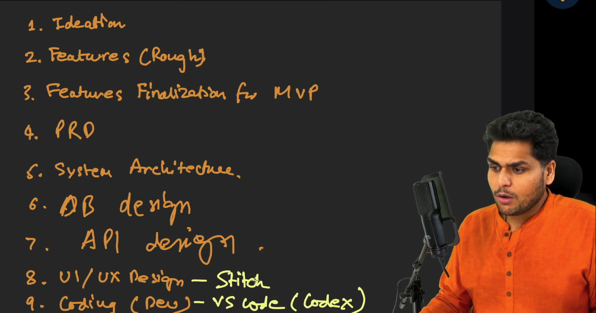
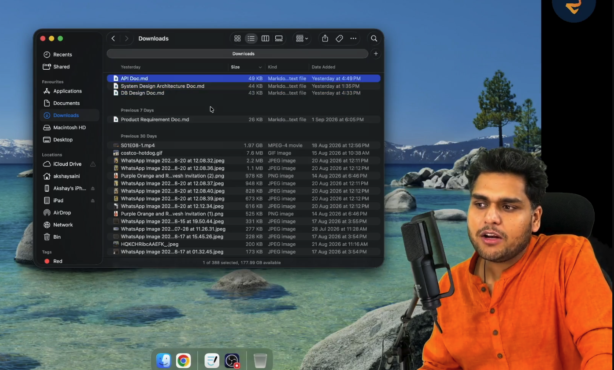
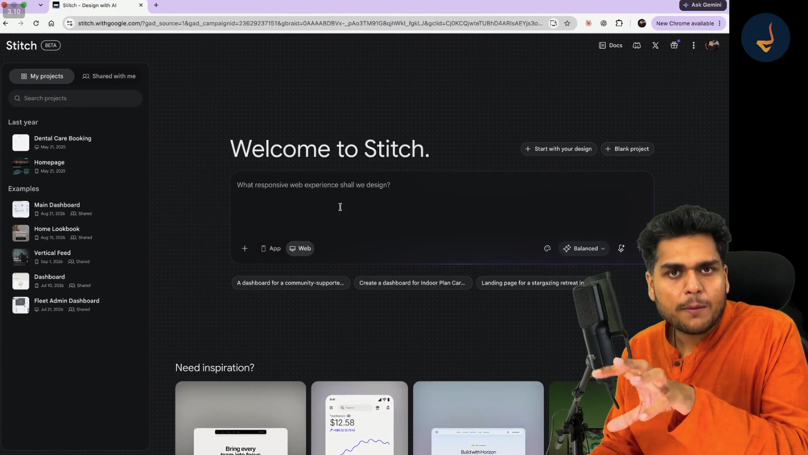
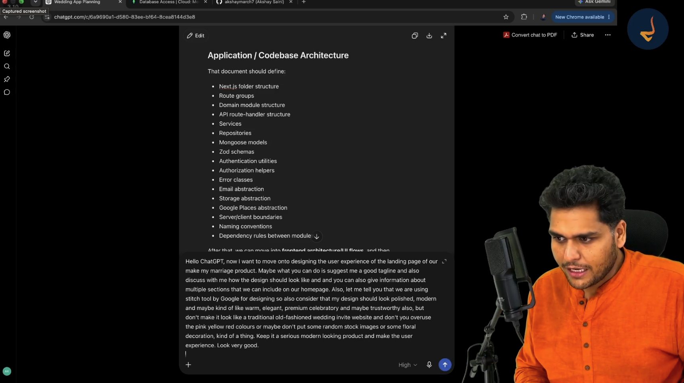
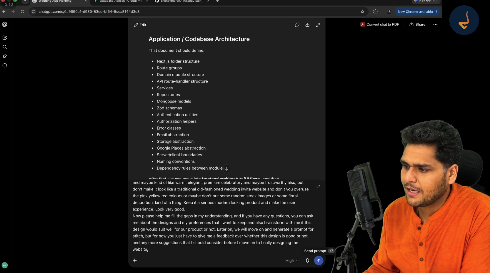
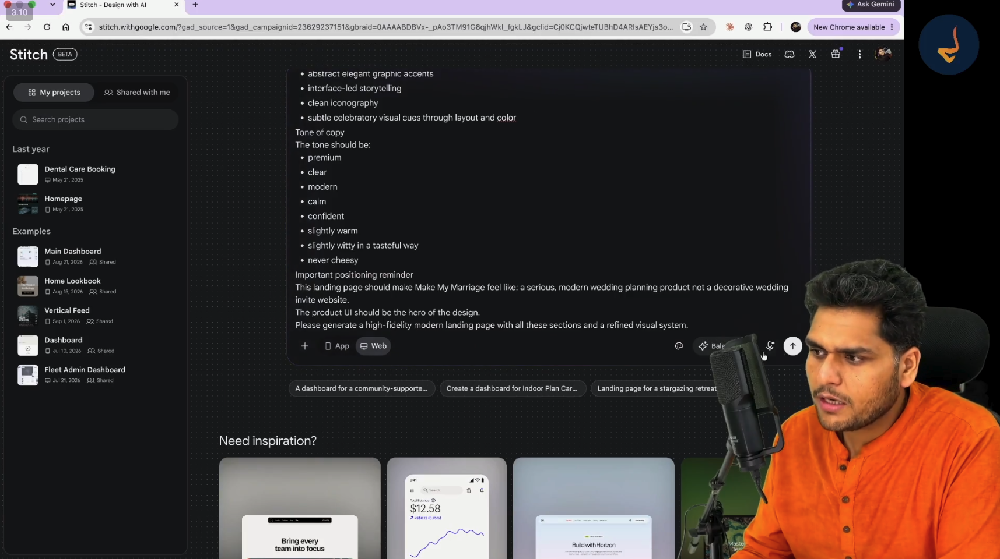
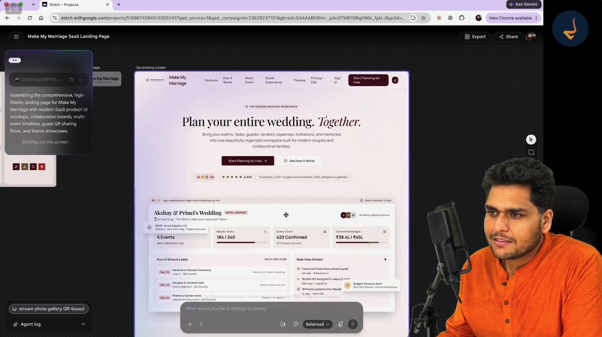
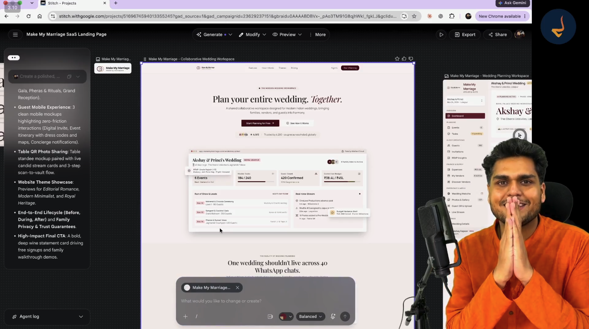

# Episode 06: UI and UX Design using AI

> **Season 2: AI Native Software Engineer**  
> Instructor: **Akshay Saini** (NamasteDev)  
> Topic: UI and UX Design from First Principles, AI-Driven Wireframing and Prototyping, Google Stitch Deep Dive, DESIGN.md System Contracts, ChatGPT Collaborative Brainstorming, and Iterative UI Refinement

---

## 1. The Engineering Progression: Moving into the Building Phase

Software engineering moves through disciplined, sequential milestones. In the previous episodes of Season 2, the complete foundation for Make My Marriage was established on the product and architectural side:
- Ideating the core product concept and workflows
- Capturing and filtering raw features for the minimum viable product (MVP)
- Authoring and freezing the Product Requirements Document (PRD)
- Architecting the system topology and infrastructure in the System Design Architecture Document
- Modeling the database collections, schemas, and relationships in the Database Design Document
- Specifying the HTTP routes, envelopes, and status codes in the REST API Design Document

With these four core documentation files downloaded and finalized, the discussion and planning phase is officially complete. The project now enters the building phase.



### The Nine Sequential Milestones of the Software Engineering Lifecycle

1. **Ideation**: Identifying the domain problem, target audience, and primary value proposition.
2. **Features (Rough)**: Unconstrained brainstorming of user capabilities and operational workflows.
3. **Features Finalization for MVP**: Pruning non-essential complexity to establish Version 1 boundaries.
4. **Product Requirements Document (PRD)**: Freezing functional specifications, personas, user journeys, and edge cases.
5. **System Architecture**: Defining the architectural topology, modular boundaries, deployment infrastructure, and technology stack.
6. **Database Design (DB Design)**: Defining collections, entity relationships, constraints, indexes, and storage rules.
7. **API Design**: Defining HTTP endpoints, payload envelopes, error schemas, and authentication flows.
8. **UI / UX Design (Google Stitch)**: Generating interactive wireframes, design systems, visual tokens, and responsive user flows.
9. **Coding / Development (VS Code and AI Coding Extensions)**: Implementing the full-stack codebase in rapid, testable increments using AI coding assistants.

### The Two Pillars of the Building Phase: Coding and Designing

When transitioning into implementation, software development splits into two interdependent pillars:
1. **Frontend and Backend Coding**: Writing the application code, routing handlers, database queries, and business logic.
2. **User Interface and User Experience (UI/UX) Design**: Establishing layout hierarchy, typography, color palettes, component styling, and interactive user journeys.

Jumping directly into coding without prior UI/UX design is a common mistake that leads to severe engineering friction:
- **Component Guesswork**: Developers waste hours deciding button padding, modal placements, and color schemes while writing code.
- **Inconsistent User Flows**: Screens built in isolation end up with conflicting navigation patterns and disjointed interfaces.
- **Costly Frontend Rework**: Rewriting CSS layouts and component hierarchies after logic has already been attached takes three to four times longer than adjusting a visual mockup.

Designing user interfaces is a distinct, specialized engineering skill. In traditional tech companies, product managers hand PRDs over to dedicated UI/UX designers who build detailed prototypes in Figma. Once those designs are reviewed and approved, frontend engineers inspect the mockups and write the implementation code.



### The Four Foundational Specifications as Ground Truth

Before writing a single line of frontend code or generating a mockup, the engineer ensures that all four foundational markdown documents are saved locally:
- `Product Requirement Doc.md`
- `System Design Architecture Doc.md`
- `DB Design Doc.md`
- `API Doc.md`

These four files contain all accumulated domain knowledge and act as the absolute ground truth for every UI component, data field, and interaction flow created in subsequent stages.

### Traditional Velocity versus AI-Native Velocity

In traditional enterprise environments, moving from requirements to completed UI mockups requires substantial overhead:
- **Traditional Workflow**: Dedicated product managers and design teams spend weeks conducting design sprints, creating wireframes, and iterating inside Figma. The process takes several weeks to several months and costs thousands of dollars in design agency fees or internal team hours.
- **AI-Native Workflow**: An AI-native software engineer guides modern generative AI tools to produce production-grade, responsive user interfaces and complete design systems in a matter of hours.

### The Chunked, Parallel Design and Development Strategy

A critical principle of AI-native software engineering is avoiding monolithic upfront design. 

Rather than attempting to design every single screen and edge case for the entire application at once, the engineer executes design and development in parallel chunks:
1. **Design a Focused Chunk**: Create high-fidelity mockups for a tightly coupled set of screens (such as the Public Landing Page, Authentication Login Screen, and Core Couple Dashboard).
2. **Code the Focused Chunk**: Implement the frontend components, API routes, and database models for those specific screens in VS Code.
3. **Iterate and Expand**: Move to the next functional chunk (such as Event Management, Guest List and RSVP Tracking, or Vendor Management), design the screens, and implement the code.

This iterative approach maintains tight feedback loops, avoids cognitive overload, and ensures steady engineering progress.

---

## 2. Introducing Google Stitch: The AI-Powered UI Design Engine

To execute high-velocity UI/UX design without requiring years of manual design tool expertise, the course introduces **Google Stitch**.



### What is Google Stitch?

Google Stitch is an experimental AI-powered design tool developed by Google Labs. It transforms natural language text prompts, wireframe sketches, or uploaded screenshots into high-fidelity, responsive user interfaces and exportable front-end code.

Key architectural capabilities of Google Stitch include:
- **Multi-Screen Mockup Generation**: Generates cohesive, multi-page application flows that share a consistent design system, typography scale, and color palette.
- **Natural Language Iteration**: Allows engineers to refine generated designs through follow-up prompts, conversational instructions, or targeted element modifications.
- **Responsive Viewport Previews**: Instantly toggles between Desktop, Tablet, and Mobile layouts to evaluate responsive behavior.
- **Code Generation and Export**: Outputs clean frontend code (HTML, Tailwind CSS, and modern framework markup) and supports direct export to Figma for further professional collaboration.
- **Zero Cost Barrier**: Available to developers through Google Labs, enabling rapid prototyping without expensive proprietary design licenses.

### Setting Up a Project in Google Stitch

When starting a project in Google Stitch, the interface presents key configuration choices:
- **Experience Type**: Selecting between **Web** (responsive web applications and landing pages) and **App** (mobile native application screens). For Make My Marriage, the **Web** option is selected.
- **Generation Modes**:
  - **Fast**: Generates rapid visual concepts with minimal latency, useful for quick layout explorations.
  - **Balanced**: Balances generation speed with detailed layout fidelity, component structure, and copy refinement. This is the recommended mode for production prototyping.
  - **Quality**: Focuses on maximum visual fidelity, nuanced typography, and complex component hierarchies.
- **Prompt Input Box**: The primary entry point where engineers provide context, component requirements, aesthetic guidelines, and negative constraints.

---

## 3. The Pitfall of Blind Prompting and the Two-Step Collaborative Protocol

Many developers make a fundamental mistake when using generative UI tools like Google Stitch: they jump directly into the prompt box and submit vague, unconstrained requests such as:

> "Make an elegant modern design, use pastel colors."

Because the AI receives no domain context, no structural boundaries, and no specific user personas, it produces generic, abstract mockups that look like cookie-cutter website templates.

### The AI-Native Philosophy: Discussing Before Building

If UI/UX design is not your native strength, you should not guess or prompt blindly. Instead, use AI as your collaborative design partner.

The disciplined engineering approach follows a strict rule: **always discuss and brainstorm the design with an advanced conversational model like ChatGPT before feeding prompts into a generation tool like Google Stitch.**



### Crafting the Initial Design Brainstorming Prompt

To initiate the design phase, the engineer dictates a structured brainstorming prompt to ChatGPT using voice dictation:

```text
Hello ChatGPT, now I want to move onto designing the user experience of the landing page of our 
Make My Marriage product. Maybe what you can do is suggest me a good tagline and also discuss 
with me how the design should look like and you can also give information about multiple sections 
that we can include on our homepage. 

Also, let me tell you that we are using Stitch tool by Google for designing so also consider 
that my design should look polished, modern and maybe kind of like warm, elegant, premium, 
celebratory and maybe trustworthy also. 

But do not make it look like a traditional old-fashioned wedding invite website and do not 
overuse the pink, yellow, red colours or maybe do not put some random stock images or some floral 
decoration, kind of a thing. Keep it a serious modern looking product and make the user 
experience look very good.
```

### Deconstructing the Prompt Constraints

This initial prompt establishes crucial boundaries that prevent generic AI output:

1. **Explicit Domain and Scope**: Focuses strictly on the user experience and layout of the public landing page for Make My Marriage.
2. **Tool-Specific Awareness**: Explicitly informs the AI that Google Stitch is the target design engine, allowing the AI to optimize recommendations for Stitch capabilities.
3. **Positive Aesthetic Anchors**: Establishes clear emotional and visual benchmarks: *polished*, *modern*, *warm*, *elegant*, *premium*, *celebratory*, and *trustworthy*.
4. **Negative Aesthetic Constraints**: Explicitly forbids common wedding website clichés:
   - No traditional, old-fashioned wedding invitation aesthetics.
   - No loud, garish primary colors (such as overused bright pink, bright yellow, or harsh bridal red).
   - No cheesy, generic stock photography of random couples.
   - No floral mandalas, heavy filigree borders, or ornamental decorations.
5. **Core Positioning Contract**: Positions Make My Marriage as a **serious, modern SaaS productivity platform** for couples and collaborative families, rather than a decorative digital wedding card.

---

## 4. The Interactive Design Interview and Aesthetic Alignment

Rather than asking ChatGPT to generate a Google Stitch prompt immediately, the engineer establishes a two-step conversational protocol:
- **Phase 1 (Brainstorming and Alignment)**: The AI reviews the requirements, highlights gaps, asks clarifying questions, and aligns on aesthetic choices.
- **Phase 2 (Prompt Synthesis)**: Once decisions are frozen, the AI synthesizes an optimized, high-density prompt tailored specifically for Google Stitch.



### The Gap-Analysis and Brainstorming Instruction

To enforce Phase 1, the engineer appends explicit supervisory instructions:

```text
Now please help me fill the gaps in my understanding, and if you have any questions, you can ask 
me about the designs and my preferences that I want to keep and also brainstorm with me if this 
design would suit well for our product or not. 

Later on, we will move on and generate a prompt for Stitch, but for now you just have to give me 
feedback over whether this design is good or not, and any more suggestions that I should consider 
before I move on to finally designing the website.
```

### The Six Strategic Design Decisions

During the interactive consultation, ChatGPT validates the positioning and presents six strategic design questions. The engineer evaluates each question and establishes technical ground truth:

#### 1. Primary Color Palette
- **Options Considered**: Deep burgundy/wine accents versus neutral forest green/teal accents.
- **Decision**: **Deep Burgundy and Rich Wine** (`#6B1D2F` to `#800020`) paired with warm editorial neutrals (champagne, warm off-white, soft cream).
- **Rationale**: Burgundy conveys luxury, celebratory warmth, and premium sophistication without resorting to garish bridal pink or aggressive crimson.

#### 2. Imagery and Visual Strategy
- **Options Considered**: Real wedding photography versus interface-led illustrations and product mockups.
- **Decision**: **Zero stock wedding photography**. The product user interface itself must be the visual hero.
- **Rationale**: Stock wedding photos look artificial and cheap. Modern SaaS landing pages showcase real interactive dashboard cards, timeline widgets, QR codes, and clean vector accents.

#### 3. Primary Audience and User Persona
- **Options Considered**: Guests and extended relatives versus the engaged couple.
- **Decision**: **The Couple (Bride and Groom)** as primary operators, supported by collaborative access for parents and close family members.
- **Rationale**: The couple makes purchasing decisions, tracks budgets, coordinates vendors, and manages event timelines. The landing page messaging must speak directly to their pain points.

#### 4. Brand Voice and Copywriting Tone
- **Options Considered**: Playful and humorous versus serious, refined, and calm.
- **Decision**: **Premium, clear, modern, calm, confident, slightly warm, and tastefully witty, but never cheesy**.
- **Rationale**: Weddings are high-stakes, high-stress events involving substantial family finances. A reassuring, organized, and serious tone builds trust, while corny jokes degrade credibility.

#### 5. Commercial and Pricing Strategy
- **Options Considered**: Strict upfront paywall versus freemium onboarding.
- **Decision**: **Freemium model with immediate free onboarding**.
- **Rationale**: Users can start planning their wedding and explore features at zero cost. Monetization occurs downstream through premium add-ons, custom domains, high-volume guest capacity, and dedicated storage.

#### 6. Brand Identity and Logo
- **Options Considered**: Complex heraldic crest versus clean typographical mark.
- **Decision**: **Modern typographical logo mark (such as "Make My Marriage: The Wedding Workspace")**.
- **Rationale**: Clean typography scales cleanly across mobile navigation bars, favicon assets, and email headers.

---

## 5. DESIGN.md: The Design System Contract

Just as a PRD governs product requirements and an API documentation file governs network endpoints, a **`DESIGN.md`** file establishes the visual rules and styling contract for AI coding assistants.

```
┌────────────────────────────────────────────────────────────────────────┐
│                        DESIGN.md System Contract                       │
├────────────────────────────────────────────────────────────────────────┤
│  1. Design Principles: Modern SaaS, Editorial Warmth, Zero Clutter    │
│  2. Color Palette: Burgundy / Wine Primary, Warm Cream Backgrounds     │
│  3. Typography Scale: Clean Serif Display, High-Legibility Sans Body   │
│  4. Spacing and Radii: 8px Grid System, 12px-16px Rounded Cards        │
│  5. Visual Hero: Interactive UI Mockups, Timelines, RSVP Widgets       │
│  6. Copywriting Tone: Calm, Confident, Reassuring, Tasteful            │
└────────────────────────────────────────────────────────────────────────┘
```

### What is a DESIGN.md File?

A `DESIGN.md` file is a structured markdown document stored at the root of a project that defines the design system, color tokens, typography rules, component constraints, and UX guidelines.

### The New Designer Analogy

Think of `DESIGN.md` like hiring a new senior designer or frontend engineer and handing them a one-page rulebook before they open an editor. 

Instead of forcing AI coding assistants (such as GitHub Copilot, Codex, Cursor, or Claude Code) to guess font families, invent arbitrary hex codes, or generate conflicting button padding, the AI reads `DESIGN.md`. Every button, modal, badge, and navbar generated across the codebase strictly adheres to the established visual contract.

### Sample DESIGN.md Specification for Make My Marriage

```markdown
# Design System Specification: Make My Marriage

## 1. Visual Philosophy and Identity
- Make My Marriage is a premium, collaborative wedding planning workspace.
- The interface must feel like a modern, high-end productivity SaaS application, not a decorative invitation website.
- The product user interface is the visual hero. Avoid generic stock photos and floral clip art.

## 2. Color Palette and Semantic Tokens
- Primary Accent: Deep Burgundy / Rich Wine (`#6B1D2F` / `#7B1123`)
- Primary Hover: Dark Wine (`#521321`)
- Secondary Accent: Warm Rose / Muted Blush (`#DDA7A5` / `#E8C5C8`)
- Surface Background: Warm Neutral Cream (`#FAF8F5`)
- Surface Card: Pure White (`#FFFFFF`) with subtle border (`#EFECE6`)
- Text Primary: Deep Charcoal Slate (`#1A1A1A`)
- Text Secondary: Muted Warm Slate (`#66615B`)
- Border Subtle: Soft Sand (`#E6E2DC`)
- Success: Muted Emerald (`#2E7D32`)
- Warning: Warm Amber (`#D97706`)

## 3. Typography Hierarchy
- Display / Headings: Modern Elegant Serif (such as Playfair Display or Cormorant Garamond)
- Body / Interface / Code: High-legibility Geometric Sans-Serif (such as Inter, Plus Jakarta Sans, or Geist)
- Scale:
  - Hero Display: 48px to 56px, Bold
  - Section Title: 32px to 36px, Semi-Bold
  - Card Heading: 18px to 20px, Medium
  - Body Text: 14px to 16px, Regular (line-height: 1.6)
  - Microcopy / Badges: 11px to 12px, Medium, uppercase tracking

## 4. Layout and Elevation
- Container: 1200px max width with responsive gutter padding (16px mobile, 32px desktop)
- Grid: 8-point spatial system (8px, 16px, 24px, 32px, 48px, 64px)
- Border Radius: 8px for buttons and inputs, 16px for surface cards
- Shadows: Soft, diffused warm shadows (`0 4px 20px -2px rgba(107, 29, 47, 0.06)`)
```

---

## 6. Crafting the Production Prompt for Google Stitch

Once the design interview with ChatGPT is complete and aesthetic choices are frozen, ChatGPT synthesizes a dense, highly structured production prompt for Google Stitch.



### Key Elements of the Synthesized Stitch Prompt

The prompt submitted to Google Stitch incorporates explicit layout hierarchies, copy guidelines, component blueprints, and negative boundaries:

```text
Create a polished, modern, high-fidelity responsive landing page for Make My Marriage: 
A collaborative wedding planning workspace for modern couples and collaborative families.

Visual System and Theme:
- Warm editorial tone with deep burgundy / rich wine accents (#6B1D2F) and warm cream surfaces (#FAF8F5).
- Elegant typography pairing modern serif display headlines with crisp sans-serif interface body text.
- Abstract elegant graphic accents, clean iconography, and subtle celebratory visual cues through layout.
- Interface-led storytelling: The product UI is the visual hero. No generic stock wedding photos.

Tone of Copy:
- Premium, clear, modern, calm, confident, slightly warm, slightly witty, never cheesy.

Page Architecture and Sections:
1. Navigation Bar: Clean logo ("Make My Marriage"), navigation links (Features, Multi-Event, 
   Guest Experience, Themes, FAQ), Sign In button, and primary CTA ("Start Planning for Free").
2. Hero Section: Powerful headline ("Plan your entire wedding. Together."), supporting value copy, 
   dual CTAs ("Start Planning for Free" and "See How It Works"), trust badge, and an interactive 
   multi-day wedding workspace dashboard mockup.
3. Multi-Event Timeline Section: Visual cards for multi-day ceremonies (Mehendi, Sangeet Gala, 
   Pheras and Rituals, Grand Reception) with run-of-show leads, logistics alerts, and vendor tracking.
4. Guest Mobile Experience Section: Clean mobile mockups highlighting zero-friction digital invites, 
   event itineraries with maps, and RSVP status.
5. Table QR Photo Sharing Section: Table standee card paired with live candid photo streams and 
   instant scan-to-vault guest upload flows.
6. Website Theme Showcase: Previews of customizable couple wedding websites (Editorial Romance, 
   Modern Minimalist, Royal Heritage).
7. Family Collaboration and Trust Guarantees: Highlighting shared budgets, permission controls, 
   and eliminating scattered WhatsApp coordination.
8. High-Impact Final CTA: Bold deep wine statement card driving free signups and family walkthroughs.

Important Positioning Reminder:
This landing page should make Make My Marriage feel like a serious, modern wedding planning product, 
not a decorative wedding invite website.
```

---

## 7. Generating and Iterating the Landing Page in Google Stitch

The synthesized prompt is pasted into Google Stitch in **Web** mode with **Balanced** generation fidelity. Within seconds, Stitch synthesizes the design tokens, constructs the component tree, and renders a complete responsive page.



### Inspecting the Generated Hero Section

The output generated by Google Stitch immediately reflects the constraints established during the ChatGPT brainstorming phase:
- **Clean Header Navigation**: A balanced navigation bar featuring the Make My Marriage brand mark, top-level navigation links, a subtle Sign In link, and an attention-grabbing burgundy CTA button (`Start Planning for Free →`).
- **Clear Value Proposition**:
  - Category Tag: `THE MODERN WEDDING WORKSPACE`
  - Headline: `Plan your entire wedding. Together.`
  - Sub-headline: `Bring your events, tasks, guests, vendors, expenses, invitations, and memories into one beautifully organized workspace built for modern couples and collaborative families.`
- **Realistic Dashboard Preview Mockup**: Rather than displaying an empty abstract illustration, Stitch generates a concrete, data-rich product preview:
  - Event Header: `Akshay and Princi Wedding · Royal Udaipur · 42 days to go · The Oberoi Udaivilas`
  - Metric Card 1: `6 Events (Next: Mehendi in 14d)`
  - Metric Card 2: `Master Tasks (184 / 240 completed)`
  - Metric Card 3: `Guest Count (420 Confirmed · 92% Response rate)`
  - Metric Card 4: `Committed Budget (₹38.4L / ₹45L)`
  - Real-Time Activity Feed: Live operational updates including milestone vendor payments, shuttle bus arrivals for out-of-town guests, and photo stream uploads.

### Iterative AI Refinement inside Google Stitch

AI generation is rarely perfect on the first execution. An engineer must actively review the output, identify usability defects, and issue precise refinements.

During the initial inspection of the landing page, two key visual issues were identified:
1. **Excessive Text Density**: Several explanatory cards contained long paragraphs that made the page feel heavy and cluttered.
2. **Clumsy Navigation Bar**: The brand title was unnecessarily repeated next to the logo, and link spacing felt crowded.

### Directing Stitch to Refine Components

Using the Stitch modification bar, the engineer issued iterative revision prompts:

> "This design looks very text-heavy. Can we reduce overall text from the design? Also improve the navbar, make it clean, minimalist, and remove the duplicated title."

Stitch regenerated the interface:
- Condensing text into crisp, scannable bullet points and metric badges.
- Streamlining the navigation bar to a minimalist layout.
- Enlarging the logo slightly to anchor the upper left visual hierarchy.

---

## 8. Expanding the Multi-Screen Workspace: Login and Dashboard UI

A complete application requires cohesive user journeys beyond the public marketing page. Once the landing page aesthetic was frozen, the engineer used Stitch to generate the next two critical screens in the Make My Marriage flow:
1. **The Authentication / Login Page**
2. **The Wedding Workspace Dashboard**



### Screen 1: The Public SaaS Landing Page
- Highlights product capabilities, multi-event coordination, family collaboration, and table QR photo sharing.
- Showcases the customizable couple website themes (Editorial Romance, Modern Minimalist, and Royal Heritage).
- Drives guest conversion and couple registrations through frictionless call-to-action cards.

### Screen 2: The Authentication / Login Page
- Prompted to maintain strict visual continuity with the landing page design system.
- Clean, centered authentication card rendered in warm neutral cream with deep burgundy button states.
- Supports one-click Google OAuth and passwordless magic link email authentication, minimizing registration friction.

### Screen 3: The Couple Planning Workspace Dashboard
- The operational command center where the bride, groom, and authorized family members manage wedding operations.
- **Persistent Left Navigation Sidebar**:
  - `Dashboard` (overview and key performance indicators)
  - `Events` (multi-day itinerary and run-of-show schedules)
  - `Tasks` (checklist assignments with family member ownership)
  - `Guests` and `Invitations` (digital delivery and RSVP insights)
  - `Expenses` (budget breakdown, paid advances, and pending balances)
  - `My Vendors` and `Discover Vendors` (contracts and contact details)
  - `Wedding Website` (slug settings and theme customization)
  - `Photo Gallery` and `Guest QR Upload` (moderated media vault)
  - `Agent Log` (automated system notifications and background sync)
- **High-Impact Brand Tagline**: `"One wedding should not live across 40 WhatsApp chats."` This concise, relatable tagline directly targets the fragmentation pain point experienced by families planning multi-day weddings.

### Inspecting Responsive Behavior across Viewports

Before signing off on the mockups, the engineer used the Stitch viewport switcher to preview the screens across mobile and desktop form factors:
- **Desktop Viewport**: Displays full multi-column dashboard layouts, side-by-side metric comparisons, and persistent sidebar navigation.
- **Mobile Viewport**: Collapses sidebar navigation into a sleek bottom sheet or hamburger menu, stacks dashboard metric cards vertically, and formats guest invitation itineraries for single-thumb scrolling.

---

## 9. Transitioning from Visual Design to AI-Assisted Implementation

With Episode 06 complete, the entire specification and design foundation for Make My Marriage is locked:
- **What to build**: Defined in the Product Requirements Document (PRD)
- **How to architect it**: Defined in the System Design Architecture Document
- **How to store data**: Defined in the Database Design Document
- **How services communicate**: Defined in the REST API Design Document
- **How it should look and behave**: Defined in Google Stitch and codified in `DESIGN.md`

### What Lies Ahead in Episode 07

In the upcoming episode, the project transitions directly into code development. 

Equipped with these five synchronized contracts, the engineer will launch **Visual Studio Code** paired with cutting-edge AI coding extensions (such as Codex, Claude Code, and Cursor). Because every endpoint, database model, UI component, and color token has already been defined without ambiguity, the AI coding assistants will generate clean, type-safe, production-ready code with minimal hallucinations.
