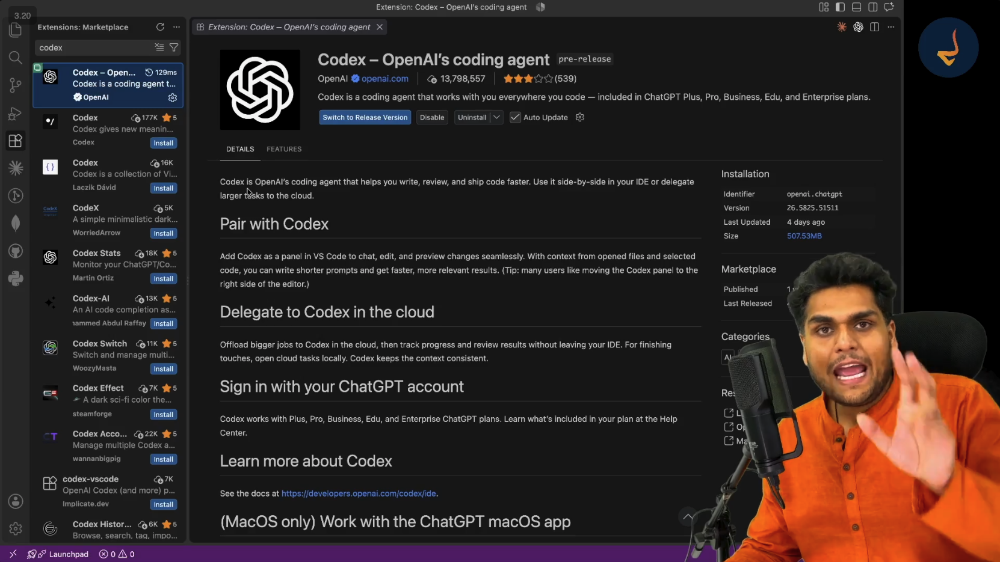
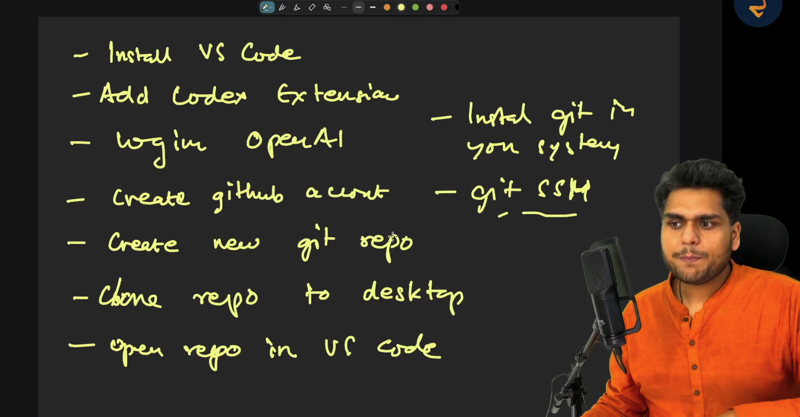
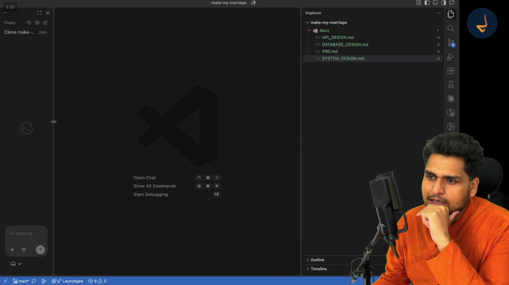
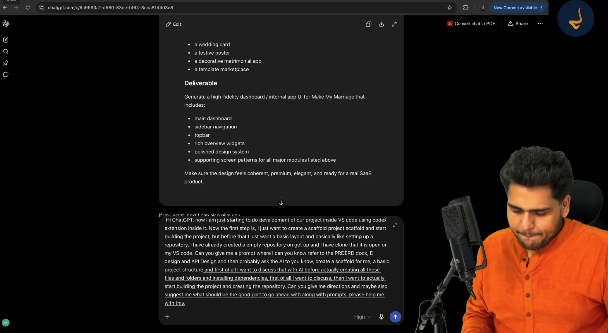
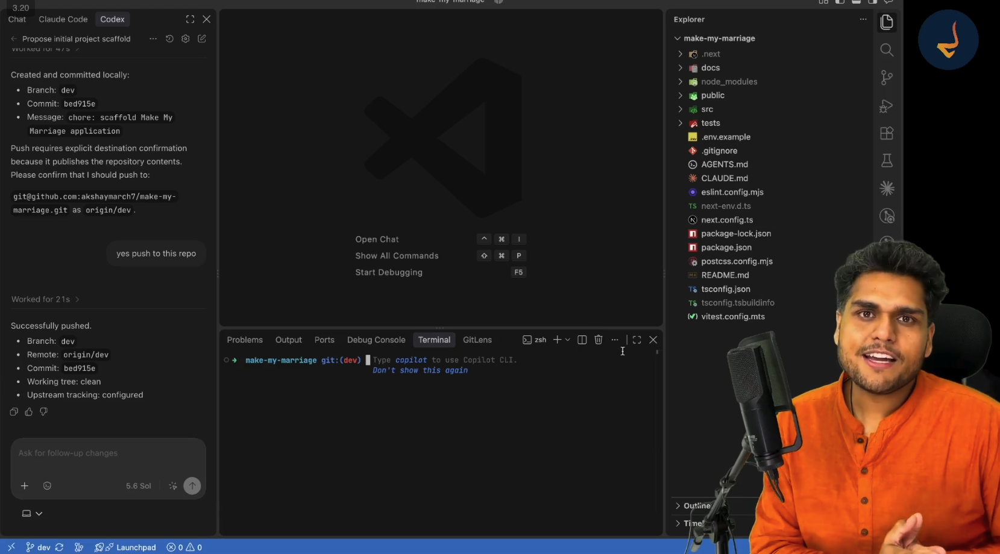

# Episode 07: Building the Scaffold using AI

> **Season 2: AI Native Software Engineer**  
> Instructor: **Akshay Saini** (NamasteDev)  
> Topic: Development Environment Setup, AI Coding Assistants, Git and GitHub Integration, Specification Ingestion, AI-Driven Scaffolding, Maker-Checker Architecture Pattern, and Automated Project Bootstrapping

---

## 1. Transitioning from Specification to Implementation

Software engineering follows disciplined, sequential milestones. In the previous episodes of Season 2, the complete foundation for Make My Marriage was established across product specification, system architecture, database modeling, API contracts, and user interface designs:
- Ideating the core product concept and feature landscape
- Filtering and freezing the Product Requirements Document (PRD)
- Architecting the system topology and infrastructure in the System Design Document
- Modeling MongoDB schemas, relationships, and indexes in the Database Design Document
- Specifying REST HTTP routes, status codes, and payload envelopes in the API Design Document
- Prototyping visual tokens, landing pages, and interactive dashboards in Google Stitch

With all architectural documentation finalized, the planning phase is officially complete. The project now enters the building phase.

In traditional software development, building an application required software engineers to manually write every configuration file, configure build tools, install libraries by hand, and write repetitive boilerplate code line by line. In an AI-native engineering workflow, this dynamic fundamentally changes. The software engineer transitions from a manual typist to an architectural director, supervisor, and reviewer. The AI assistant handles the mechanics of file generation, dependency installation, and boilerplate scaffolding, while the engineer maintains absolute control over architecture, design contracts, and system integrity.

---

## 2. Development Tooling Ecosystem and AI Coding Assistants

Selecting the proper development environment is the initial step in establishing an AI-native development workflow. Today, several categories of development environments and AI coding assistants exist across the industry.

```
+-----------------------------------------------------------------------+
|                    AI CODING ASSISTANT ECOSYSTEM                      |
+-----------------------------------------------------------------------+
|                                                                       |
|  [ Traditional IDE + AI Extension ]    [ AI-Native Standalone IDEs ]  |
|  - Visual Studio Code (Open Source)    - Cursor AI ($20/month sub)    |
|  - OpenAI Codex Extension              - Windsurf                     |
|  - GitHub Copilot Extension            - Claude Code                  |
|                                                                       |
|  Models Powered: GPT-5.6, GPT-4o, Claude 3.5 Sonnet, Gemini 1.5 Pro   |
+-----------------------------------------------------------------------+
```

### Visual Studio Code and the OpenAI Codex Extension

Visual Studio Code (VS Code) is a widely adopted, open-source code editor. Developers can enhance VS Code into an autonomous AI development environment by installing AI agent extensions. 

In this project, the **Codex** extension developed by OpenAI is utilized:
- **Direct IDE Integration**: Embeds an autonomous coding agent directly into the VS Code interface alongside the editor, terminal, and file explorer.
- **Context Awareness**: Indexes open files, workspace directories, and specification documents to inform code generation.
- **Account Connectivity**: Connects directly to an existing ChatGPT Plus, Pro, Business, or Enterprise subscription without requiring separate third-party API token billing.
- **Tool Execution**: Possesses the ability to read workspace files, write new source code, propose directory reorganizations, and execute terminal commands under developer supervision.



### Alternative AI-Native Editors

While VS Code with the Codex extension serves as the primary setup in this walkthrough, several dedicated AI IDEs are equally capable:
- **Cursor AI**: A specialized fork of VS Code built from the ground up for AI-first programming. Cursor provides multi-model selection (allowing developers to switch between Claude models, OpenAI models, and Google Gemini models) under a single monthly subscription ($20 per month).
- **Windsurf**: An AI-native editor offering deep agentic flow capabilities and integrated workspace reasoning.
- **Claude Code and Terminal Agents**: Command-line interface tools that run autonomous coding agents directly inside terminal sessions.

Regardless of the specific tool selected, the underlying principles of AI supervision, prompt architecture, and specification ingestion remain identical.

---

## 3. Environment Setup and Version Control Workflow

Before generating any application code, the local development system and version control infrastructure must be properly configured.



### The Seven-Step Setup Pipeline

1. **Install VS Code**: Download and install the latest stable version of Visual Studio Code.
2. **Add Codex Extension**: Locate and install the official OpenAI Codex extension from the VS Code Extensions Marketplace.
3. **Login to OpenAI Account**: Authenticate the extension using an active OpenAI subscription.
4. **Create GitHub Account**: Establish an account on GitHub for centralized remote code hosting.
5. **Create New Git Repository**: Initialize an empty remote repository named `make-my-marriage`.
6. **Clone Repository to Desktop**: Clone the empty repository to the local filesystem using Git.
7. **Open Repository in VS Code**: Open the cloned project directory in the editor to establish the workspace root.

### Understanding Git and GitHub from First Principles

Version control is an absolute prerequisite for professional software engineering, particularly when collaborating with AI agents that generate numerous file changes:

```
+--------------------------------------------------------------------------+
|                     VERSION CONTROL ARCHITECTURE                         |
+--------------------------------------------------------------------------+
|                                                                          |
|   LOCAL WORKSPACE (Your Machine)               REMOTE REPOSITORY (Cloud) |
|   +----------------------------+               +-----------------------+ |
|   | Working Directory          |               | GitHub                | |
|   |  - Untracked files         |               |  - Remote branches    | |
|   |  - Modified files          |  git push     |  - Pull requests      | |
|   |                            | ------------> |  - Team visibility    | |
|   | Staging Area (git add)     |               |  - Cloud backup       | |
|   | Local Commits (git commit) |               +-----------------------+ |
|   +----------------------------+                                         |
|                                                                          |
+--------------------------------------------------------------------------+
```

- **Git (Local Engine)**: A distributed version control software running locally on the operating system. Git tracks incremental diffs, records commit history, enables branch isolation, and allows developers to roll back unintended changes.
- **GitHub (Remote Platform)**: A cloud-based hosting platform for Git repositories. GitHub provides remote storage, team collaboration, continuous integration pipelines, and code visibility.
- **Authentication Protocols**: Repositories can be cloned and pushed via HTTPS (requiring personal access tokens) or SSH (using an asymmetric keypair generated via `ssh-keygen` and uploaded to GitHub settings). SSH authentication eliminates repetitive password prompts during automated AI commits.

Developers can execute git commands manually inside their terminal or delegate repository cloning and setup directly to the AI agent:

```bash
# Clone the newly created empty repository
git clone git@github.com:akshaymarch7/make-my-marriage.git

# Navigate into the project root
cd make-my-marriage

# Open the workspace in Visual Studio Code
code .
```

---

## 4. Injecting Project Specifications into the Repository

An AI coding agent cannot generate an accurate system architecture without explicit context. Relying on an AI model to guess technical requirements produces generic, fragmented, or conflicting code. To anchor the AI model to our exact business rules and architectural standards, the documentation created during previous episodes is imported directly into the workspace.



### The Specifications Container: The `docs` Directory

Inside the root directory of the cloned `make-my-marriage` repository, a dedicated `docs` directory is created. The four foundational design documents are placed inside:

```
make-my-marriage/
└── docs/
    ├── PRD.md              # Product Requirements Document
    ├── SYSTEM_DESIGN.md    # System Design and Architecture Specification
    ├── DATABASE_DESIGN.md  # Database Schemas and Entity Relationships
    └── API_DESIGN.md       # REST API Endpoints and Contract Envelopes
```

### Purpose of Each Specification File

1. **`PRD.md` (Product Requirements Document)**:
   Defines the functional requirements, user personas (couples, guests, vendors, administrators), feature boundaries for the minimum viable product (MVP), and core user journeys.
2. **`SYSTEM_DESIGN.md` (System Design Document)**:
   Defines the high-level system topology, module separation, frontend and backend technology stack, caching layers, and security policies.
3. **`DATABASE_DESIGN.md` (Database Design Document)**:
   Defines MongoDB document structures, collection names, schema validations, index optimizations, and cross-entity relationships.
4. **`API_DESIGN.md` (API Design Document)**:
   Defines RESTful route paths, standard response envelopes (`status`, `data`, `message`), query parameter filters, HTTP status codes, and error formats.

By checking these documents into the repository, the documents become living technical contracts accessible to both human developers and autonomous AI coding agents.

---

## 5. AI-Driven Project Scaffolding: Concepts and Strategy

With the project workspace and specification documents in place, the project enters the scaffolding stage.

### What is Scaffolding?

In software development, **scaffolding** refers to the automated generation of the foundational project structure, build configuration files, dependency manifests, core directories, and baseline boilerplate code required to compile and run an application.

Scaffolding does not implement application business logic or final user interfaces. Instead, scaffolding establishes the skeleton upon which feature modules will be built:
- Root project manifests (`package.json`, `tsconfig.json`)
- Framework and routing configuration (`next.config.ts`, `tailwind.config.ts`)
- Testing harness setup (`vitest.config.mts`)
- Environment variable templates (`.env.example`)
- Directory trees separating components, services, models, and routes

### The Golden Rule of AI Scaffolding

A frequent mistake when developing with AI is instructing the model to generate the entire application in a single monolithic prompt. Prompts such as "Build Make My Marriage from these docs" fail because language models encounter output token limits, introduce architectural inconsistencies, and generate untested, fragile code.

A disciplined AI-native engineer follows a two-phase scaffolding protocol:
1. **Phase 1: Ingestion and Discussion**:
   Instruct the AI to read the documentation, summarize its understanding, and propose a project folder structure. Discuss, debate, and refine the architecture before writing a single line of code.
2. **Phase 2: Execution and Validation**:
   Once the structure is reviewed and approved, instruct the AI to execute terminal commands, install dependencies, create directory trees, and start the local development server.

---

## 6. Multi-Agent Collaboration: Prompt Crafting with ChatGPT

To maximize scaffolding quality, developers can apply a multi-agent workflow: using a conversational reasoning assistant (such as ChatGPT) to synthesize requirements and compose an airtight prompt for the execution assistant (OpenAI Codex inside VS Code).



### The Meta-Prompting Strategy

Rather than manually writing a raw prompt, the developer asks ChatGPT to act as a software architect and formulate a structured scaffolding prompt tailored for an in-editor AI agent.

```
+-------------------------------------------------------------------------+
|                  MULTI-AGENT COLLABORATION PATTERN                      |
+-------------------------------------------------------------------------+
|                                                                         |
|  [ Human Architect ]                                                    |
|         │                                                               |
|         │ 1. Supplies vision and design constraints                     |
|         ▼                                                               |
|  [ ChatGPT (Architect Assistant) ]                                      |
|         │                                                               |
|         │ 2. Synthesizes documents and drafts precision scaffold prompt |
|         ▼                                                               |
|  [ OpenAI Codex (VS Code In-Editor Agent) ]                             |
|         │                                                               |
|         │ 3. Reads docs/, proposes folder structure, runs commands      |
|         ▼                                                               |
|  [ Local Workspace (Next.js Application Scaffold) ]                     |
|                                                                         |
+-------------------------------------------------------------------------+
```

### The Structured Scaffolding Prompt

The resulting prompt instructs the IDE coding agent with explicit roles, constraints, and instructions:

```markdown
You are the lead software architect for this project. We are building:
MAKE MY MARRIAGE: A wedding planning and management SaaS application.

I have already prepared complete project documentation in this repository under the docs/ folder:
1. docs/PRD.md
2. docs/SYSTEM_DESIGN.md
3. docs/DATABASE_DESIGN.md
4. docs/API_DESIGN.md

Please follow this strict step-by-step protocol:
Step 1: Read all four documents in the docs/ folder and summarize your technical understanding.
Step 2: Propose a clean, modular full-stack project directory structure. Do NOT create files yet.
Step 3: Discuss the architectural boundaries (frontend, backend, shared types, database connections).
Step 4: Once I approve the proposed structure, generate the initial application scaffold, configure dependencies, and ensure the application boots cleanly on localhost.
```

---

## 7. Architectural Directory Structure and Design Patterns

When OpenAI Codex processes the documentation, it analyzes the requirements and presents a proposed folder hierarchy. Evaluating this proposal requires understanding architectural patterns and directory organization.

### Monorepo versus Unified Full-Stack Architecture

During the architectural review, software engineers evaluate two primary structural strategies:
- **Monorepo Structure (Separate Frontend and Backend)**:
  Splitting the codebase into separate `frontend/` (Next.js, React) and `backend/` (Express, Node.js, or FastAPI Python) directories. This pattern is advantageous when independent scaling, distinct deployment targets, or multi-language services are required.
- **Unified Full-Stack App Router Structure**:
  Utilizing the Next.js App Router where `src/app` hosts both user-facing React server components and serverless backend API route handlers (`/api/*`). This approach simplifies state management, enables shared TypeScript types across client and server, and minimizes deployment complexity.

### Classic MVC versus Modern Domain-Driven Modularity

When reviewing directory layouts, software engineers reference established design patterns:

```
+-------------------------------------------------------------------------+
|               MODEL - VIEW - CONTROLLER (MVC) PATTERN                   |
+-------------------------------------------------------------------------+
|                                                                         |
|  [ View ]         Displays UI, captures user input (React Components)   |
|     │                                                                   |
|     ▼                                                                   |
|  [ Controller ]   Processes requests, validates input, invokes logic    |
|     │             (Next.js Route Handlers / API Controllers)            |
|     ▼                                                                   |
|  [ Model ]        Enforces data schema, manages database queries        |
|                   (Mongoose Models / MongoDB Collections)               |
|                                                                         |
+-------------------------------------------------------------------------+
```

Modern web applications frequently organize code by domain modules rather than strictly by technical role. Instead of grouping all controllers in one folder and all models in another, domain modularity groups related logic (such as authentication, events, budget, guests) into dedicated modules containing their respective schemas, services, and route handlers.

### The Standardized Full-Stack Scaffold Layout

Following the discussion between the engineer and the AI assistant, the accepted directory layout provides clear separation of concerns:

```
make-my-marriage/
├── .next/                    # Next.js build and development artifacts
├── docs/                     # Architectural specifications and design contracts
│   ├── API_DESIGN.md
│   ├── DATABASE_DESIGN.md
│   ├── PRD.md
│   └── SYSTEM_DESIGN.md
├── node_modules/             # Installed application dependencies
├── public/                   # Static public assets (images, icons, fonts)
├── src/                      # Application source code
│   ├── app/                  # Next.js App Router (pages and API routes)
│   ├── components/           # Reusable UI component library
│   ├── lib/                  # Shared utilities, database client, and configurations
│   ├── models/               # Mongoose database schemas
│   ├── services/             # Core business logic and database queries
│   └── types/                # Shared TypeScript type definitions
├── tests/                    # Unit, integration, and contract tests
├── .env.example              # Template for environment variables
├── .gitignore                # Git ignore patterns for build artifacts and secrets
├── AGENTS.md                 # Project rules and directives for AI coding agents
├── CLAUDE.md                 # Guidelines and commands for Claude-based agents
├── eslint.config.mjs         # ESLint code quality configuration
├── next.config.ts            # Next.js framework configuration
├── package.json              # Project dependencies, scripts, and metadata
├── postcss.config.mjs        # PostCSS configuration for Tailwind CSS
├── README.md                 # Project introduction, setup steps, and documentation
├── tsconfig.json             # TypeScript compiler settings
└── vitest.config.mts         # Vitest automated test suite configuration
```

---

## 8. The Maker-Checker Pattern in AI-Native Development

The interaction between the software engineer, ChatGPT, and OpenAI Codex illustrates a foundational governance concept known as the **Maker-Checker** pattern.

```
+-------------------------------------------------------------------------+
|                        MAKER - CHECKER PATTERN                          |
+-------------------------------------------------------------------------+
|                                                                         |
|    MAKER (Generator)                     CHECKER (Validator / Auditor)  |
|  +--------------------+                  +--------------------------+   |
|  | AI Coding Agent    |                  | Human Lead Architect     |   |
|  | (OpenAI Codex)     |                  | or Secondary AI Agent    |   |
|  |                    |                  | (ChatGPT / Claude)       |   |
|  | - Generates code   |  Proposes        |                          |   |
|  | - Proposes folders | ---------------> | - Audits specifications  |   |
|  | - Suggests scripts |  Changes         | - Validates architecture |   |
|  | - Runs commands    |                  | - Grants approval        |   |
|  +--------------------+                  +--------------------------+   |
|                                                       │                 |
|                                                       ▼                 |
|                                            Approved & Committed Code    |
+-------------------------------------------------------------------------+
```

### Origins in Enterprise Governance

In high-risk domains such as banking, financial transactions, and aerospace, the Maker-Checker principle mandates that no critical action can be completed by a single individual:
- The **Maker** inputs or initiates the operation.
- The **Checker** independently validates the data against policy rules and authorizes the execution.

This dual-custody model prevents fraud, human error, and unchecked operational failures.

### Application to AI Software Engineering

In an AI-native development environment, the Maker-Checker pattern resolves the primary risk of autonomous coding assistants: unchecked hallucinations and architectural drift.

- **The Maker (AI Coding Assistant)**: Generates boilerplate code, configures dependencies, writes directory paths, and runs automated terminal commands.
- **The Checker (Human Software Engineer or Secondary AI)**: Validates that the generated structure complies with the system design document, verifies that security configurations are respected, and approves file creation.

### Redefining Code Review in the AI Era

Software engineers previously spent substantial time reading repetitive lines of boilerplate during code reviews. In an AI-native workflow:
- Line-by-line reading of thousands of lines of mechanical boilerplate is replaced by **contract verification**.
- The engineer audits architectural boundaries, interface schemas, data flow models, and automated test results.
- Automated tests, linters, and type checkers act as continuous programmatic checkers validating the AI Maker output.

---

## 9. Executing Scaffolding, Local Verification, and Git Remote Push

Once the directory architecture is approved, the AI coding agent executes the terminal commands required to generate the project scaffold.



### Automated Scaffolding Commands

The AI agent invokes standard package generation commands inside the VS Code terminal environment:

```bash
# Initialize Next.js project with TypeScript, Tailwind CSS, and App Router
npx create-next-app@latest . --typescript --tailwind --eslint --app --src-dir --import-alias "@/*"

# Install production dependencies
npm install mongoose clsx tailwind-merge lucide-react

# Install development and testing dependencies
npm install -D vitest @vitejs/plugin-react
```

### Managing AI Terminal Permissions

Modern AI coding extensions execute shell commands inside the integrated terminal. To prevent unintended modifications, the extension presents execution requests for developer authorization:
- **Allow Once**: Authorizes the single displayed command.
- **Always Allow / Auto-Approve**: Configures permissions to allow the AI agent to run safe development scripts (such as `npm run build`, `npm test`, or dependency installations) without interrupting the workflow.

### Local Verification on Localhost

Once the dependencies are installed and the files generated, the application is verified by launching the local development server:

```bash
npm run dev
```

Navigating to `http://localhost:3000` in the browser confirms that:
- The Next.js development server compiles successfully.
- React server components render without runtime errors.
- Tailwind CSS styles and global style sheets load correctly.
- The base application scaffold is alive, healthy, and operational.

### Feature Branch Isolation and Remote Push

Professional version control hygiene mandates that code is never committed directly to the `main` production branch during active development. A dedicated development branch is created:

```bash
# Create and switch to the development branch
git checkout -b dev

# Stage all scaffolded files, configurations, and documentation
git add .

# Record a descriptive conventional commit
git commit -m "chore: scaffold Make My Marriage application"

# Push the branch to the remote GitHub repository
git push -u origin dev
```

In the VS Code interface, the Codex agent requests confirmation:
`Push requires explicit destination confirmation because it publishes the repository contents. Please confirm that I should push to: git@github.com:akshaymarch7/make-my-marriage.git as origin/dev.`

Upon approving the destination (`yes push to this repo`), the changes are published remotely to GitHub. The repository on GitHub reflects the complete scaffold, the initial commit hash (`bed915e`), and the documentation directory on the `dev` branch.

With the scaffold established and verified, the project infrastructure is complete. Subsequent episodes will build application feature modules, implement authentication flows, and connect live database models on top of this scaffold.

