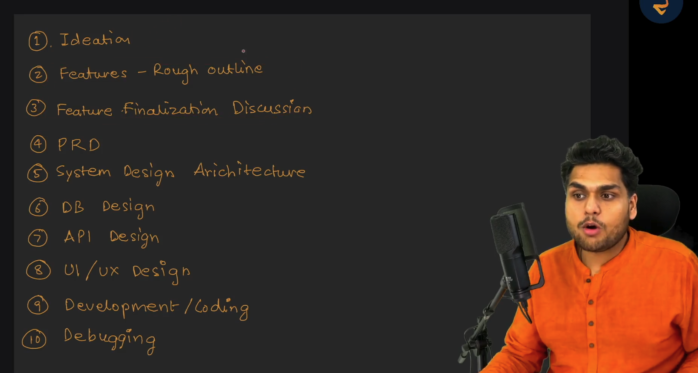
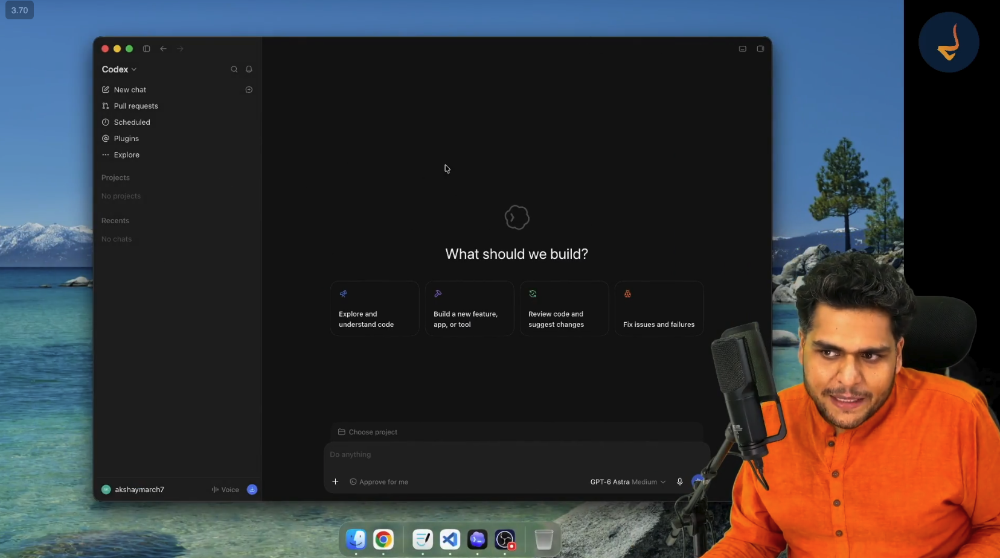
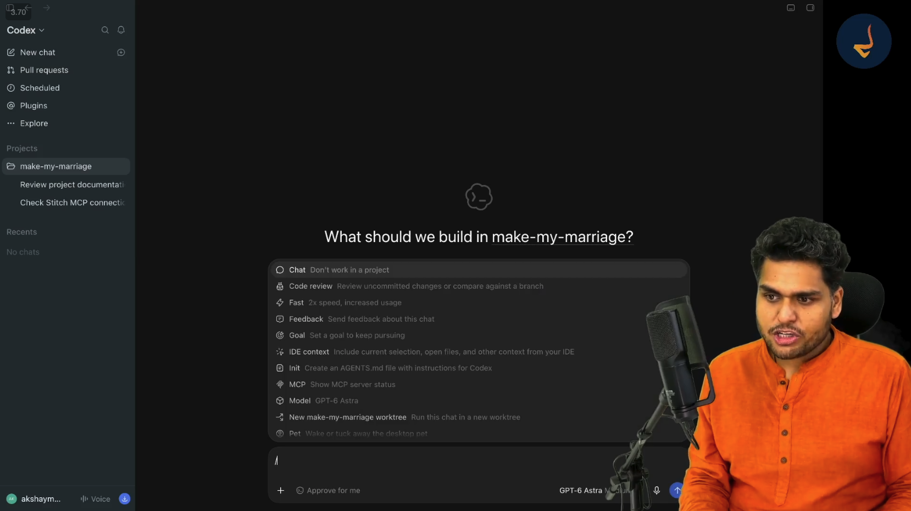

# Episode 08: Building Features using AI

> **Season 2: AI Native Software Engineer**  
> Instructor: **Akshay Saini** (NamasteDev)  
> Topic: Feature Development Lifecycle, Context Ingestion, Model Context Protocol (MCP), Architectural Pruning, Maker-Checker Code Review, Security Auditing, and Persistent Project Memory

---

## 1. The Software Development Lifecycle: Moving from Design to Feature Delivery

Building software is a structured, step-by-step discipline. Prior episodes established the complete architectural groundwork for Make My Marriage: ideation, rough feature definition, scope finalization, PRD, system architecture, database design, API contracts, UI and UX prototypes, and the base project scaffold.



The software engineering lifecycle consists of ten clear milestones:
1. Ideation
2. Features: Rough outline
3. Feature Finalization Discussion
4. Product Requirements Document (PRD)
5. System Design Architecture
6. Database Design
7. API Design
8. UI and UX Design
9. Development and Coding
10. Debugging and Review

With scaffolding complete, the development phase enters an iterative loop. For every feature in the product roadmap, the engineer executes the core cycle:
- Understand design and requirements
- Discuss and refine scope with AI
- Generate modular implementation
- Review code and verify security
- Commit progress and update persistent project memory

---

## 2. The Context Loss Problem and the Context Recovery Strategy

A frequent issue in AI-assisted software engineering is sudden context loss. During a development session, software updates, extension crashes, system reboots, or context window limits can wipe out active chat history.

AI models are stateless across sessions. When an active conversation disappears, the model loses all memory of previous instructions, file locations, and architectural decisions.

```
+-----------------------------------------------------------------------+
|                       CONTEXT RECOVERY PIPELINE                       |
+-----------------------------------------------------------------------+
|                                                                       |
|   [Session Wiped / Reset]                                             |
|              |                                                        |
|              v                                                        |
|   1. Documentation Layer   --> Ingest PRD, System Design, DB, API     |
|              |                                                        |
|              v                                                        |
|   2. Project Rules Layer   --> Ingest AGENTS.md (conventions, rules)  |
|              |                                                        |
|              v                                                        |
|   3. Comprehension Gate    --> Demand AI summary before writing code  |
|              |                                                        |
|              v                                                        |
|   4. Verified Foundation   --> Safe to resume feature development     |
|                                                                       |
+-----------------------------------------------------------------------+
```

### The Recovery Protocol
- **Do not prompt blindly**: Never ask the AI to jump straight into code generation inside a blank session.
- **Reference the Single Source of Truth**: The four files in the `docs/` directory (`PRD.md`, `system-design.md`, `db-design.md`, `api-design.md`) hold all architectural facts.
- **Provide Project Rules**: The `AGENTS.md` file defines code structure, styling standards, module boundaries, and execution rules.
- **Enforce a Comprehension Gate**: Prompt the AI to read the documentation and summarize its understanding first. Only proceed once the assistant demonstrates complete alignment with the project architecture.

---

## 3. Development Tooling and Workspace Orchestration

Modern AI engineering utilizes specialized coding environments, including IDE extensions and standalone desktop assistants such as Codex.



### Environment Configuration
- **Model Selection**: Select high-reasoning frontier models for architecture, design analysis, and complex code generation.
- **Workspace Ingestion**: Open the repository root so the AI agent maintains visibility across all project directories and configuration files.
- **Health Verification**: Before adding new features, instruct the AI to inspect the existing project scaffold, start the local development server, and verify that all base dependencies run without errors.



### Built-in Agent Workflows
Modern AI coding tools provide specialized slash commands to standardize operations:
- `/init`: Creates or updates an `AGENTS.md` instructions file.
- `/mcp`: Displays the connection status of external tool servers.
- `/code review`: Audits uncommitted changes or branch diffs against project rules.
- `/goal`: Establishes persistent goals that guide multi-step agent actions.

---

## 4. Connecting Design Tools via Model Context Protocol (MCP)

In traditional workflows, translating UI prototypes into frontend code requires manual visual inspection, manual measurement of padding and margins, and repetitive copy-pasting of CSS values.

Model Context Protocol (MCP) solves this problem by providing an open, standardized protocol that enables AI models to connect directly to external tools, databases, and design systems.

```
+-----------------------------------------------------------------------+
|                    MODEL CONTEXT PROTOCOL (MCP) FLOW                  |
+-----------------------------------------------------------------------+
|                                                                       |
|   +-------------------+              +----------------------------+   |
|   |   Google Stitch   | <----------> |     Stitch MCP Server      |   |
|   |  (UI Prototypes)  |              +----------------------------+   |
|   +-------------------+                            ^                  |
|                                                    | JSON-RPC         |
|                                                    v                  |
|   +---------------------------------------------------------------+   |
|   |                    AI Assistant / Coding Agent                |   |
|   +---------------------------------------------------------------+   |
|                                    |                                  |
|                                    v                                  |
|             Inspects Tokens, Layouts, Assets, Components              |
|                                                                       |
+-----------------------------------------------------------------------+
```

### Steps to Connect Google Stitch via MCP
1. **Server Configuration**: Add the Stitch MCP server URL and authentication credentials to the MCP configuration settings of the assistant.
2. **Connection Handshake**: Verify that the assistant successfully establishes a link with the MCP server.
3. **Design Asset Retrieval**: Instruct the AI to fetch the Google Stitch project designs directly through MCP.
4. **Contextual Analysis**: The AI reads the visual hierarchy, component breakdown, typography, color codes, and layout structure directly into context.

---

## 5. Architectural Scoping and Feature Pruning Before Coding

A major difference between junior and senior software engineers lies in how they direct AI tools.

```
+-----------------------------------------------------------------------+
|                        ENGINEERING MINDSET SHIFT                      |
+-----------------------------------------------------------------------+
|                                                                       |
|   Junior Approach:                                                    |
|   [Prompt AI: "Build Homepage"]  --> [Unchecked Generation]           |
|                                  --> [Bloat, Out of Scope Code]       |
|                                                                       |
|   Senior Approach:                                                    |
|   [Fetch Design]  --> [Compare with PRD]                              |
|                   --> [Prune Non-MVP Elements]                        |
|                   --> [Plan Component Architecture]                   |
|                   --> [Targeted Implementation]                       |
|                                                                       |
+-----------------------------------------------------------------------+
```

### The Pruning Process
Prototypes in design tools often include aspirational, exploratory, or out of scope content. For example, the Google Stitch designs for Make My Marriage contained sections for travel packages, honeymoon tours, and venue bookings.
- **Consult the PRD**: The Product Requirements Document defines the strict boundaries of the Minimum Viable Product (MVP).
- **Prune Non-MVP Content**: Explicitly instruct the AI to discard unsupported sections before generating code.
- **Retain Core Homepage Modules**: Keep only primary MVP sections: navigation header, hero banner with search controls, value propositions, featured profiles, success stories, and footer.
- **Architect Component Boundaries**: Enforce a modular structure where each section lives in a dedicated file rather than a monolithic page.

---

## 6. Implementation and Frontend Construction

Once scope and component boundaries are agreed upon, the AI generates the implementation:
- **Component Modularity**: The homepage is divided into clear, isolated components (such as Hero, Features, ProfileCards, Testimonials, and Navigation).
- **Styling Architecture**: Modern utility CSS (such as Tailwind CSS) provides responsive layouts, flexible grids, accessible color contrast, and clean hover transitions.
- **Responsive Layout Verification**: Check the generated UI in both desktop viewports and mobile screen sizes to ensure proper stacking, correct padding, and readable typography.

The human engineer remains in the director seat, inspecting visual fidelity and structural organization while delegating line-by-line typing to the AI assistant.

---

## 7. Code Review and Security Auditing: The Maker-Checker Pattern

Never accept generated code without rigorous review. Code produced by AI may compile and look visually appealing while concealing structural defects, performance bottlenecks, or security flaws.

### The Maker-Checker Architecture Pattern
- **The Maker**: The primary agent or conversational thread responsible for generating the code implementation.
- **The Checker**: An independent review agent, a dedicated review slash command (`/code review`), or the human engineer evaluating the diff.

```
+-----------------------------------------------------------------------+
|                      THE MAKER-CHECKER PATTERN                        |
+-----------------------------------------------------------------------+
|                                                                       |
|   +-----------------------+              +------------------------+   |
|   |         MAKER         |              |        CHECKER         |   |
|   | (Implementation Agent)|              |  (Review Agent / Human)|   |
|   +-----------------------+              +------------------------+   |
|               |                                       ^               |
|               | Generates Code                        | Audits Code   |
|               v                                       |               |
|   +-------------------------------------------------------+           |
|   |                    Codebase / Git Diff                |           |
|   +-------------------------------------------------------+           |
|                                                                       |
+-----------------------------------------------------------------------+
```

### Critical Review Finding: Exposed Secret Tokens
During the code review of the homepage feature, the audit identified an urgent vulnerability: the private Google Stitch API key was hardcoded directly inside a configuration file.

### The Cardinal Security Rule
Never commit private API keys, secrets, or authentication tokens into source code or Git repositories. Anyone with repository access can extract hardcoded keys, leading to credential theft, account compromise, and unauthorized billing.

### Remediation Workflow
1. Remove all hardcoded secret strings from the codebase immediately.
2. Relocate secrets to environment variable files (`.env.local`) that are explicitly listed in `.gitignore`.
3. Read secrets securely at runtime through environment variables.
4. Verify that no secret traces remain in git staging before committing.

---

## 8. Persistent Project Memory Across AI Sessions

As projects grow across multiple weeks and features, maintaining continuity becomes a major engineering challenge. Conversations reset, context windows fill up, and different team members or agents join the project.

Relying on chat history for long-term project context is a critical anti-pattern. Chat logs are fragile and ephemeral.

### The Living Documentation Pattern: `PROJECT_STATUS.md`
To establish persistent memory that outlives any individual chat session, maintain a dedicated status document inside the `docs/` directory:

```
+-----------------------------------------------------------------------+
|                    docs/PROJECT_STATUS.md STRUCTURE                   |
+-----------------------------------------------------------------------+
|                                                                       |
|   1. Current Phase      -> Current active development milestone       |
|   2. Completed Features -> List of built and verified modules         |
|   3. Active Task        -> What is being implemented right now        |
|   4. Upcoming Backlog   -> Sequential list of next planned features   |
|   5. Key Decisions      -> Architectural and design choices made      |
|                                                                       |
+-----------------------------------------------------------------------+
```

### Benefits of Living Project Memory
- **Instant Context Bootstrapping**: When starting a fresh session with any AI model, feeding `PROJECT_STATUS.md` alongside `PRD.md` and `AGENTS.md` restores full project situational awareness within seconds.
- **Multi-Agent Interoperability**: Different AI agents (or human team members) can pick up work without re-explaining past progress.
- **Drift Prevention**: Ensures the project remains strictly aligned with the PRD across successive development sessions.
- **Rule Evolution**: As new patterns or conventions are discovered during implementation, proactively record them into `AGENTS.md`.

---

## 9. Version Control Hygiene and Milestone Delivery

Every completed feature must conclude with disciplined version control practices:
- **Clean Git Diff**: Run a complete diff inspection to ensure only intentional code changes are staged.
- **Conventional Commits**: Write clear, descriptive commit messages documenting feature scope (for example: `feat: implement responsive homepage UI with modular components`).
- **Feature Branch Isolation**: Push committed changes to the remote development branch on GitHub.
- **Documentation Synchronization**: Commit updates to `PROJECT_STATUS.md` and `AGENTS.md` alongside feature code so project documentation never falls behind implementation.

