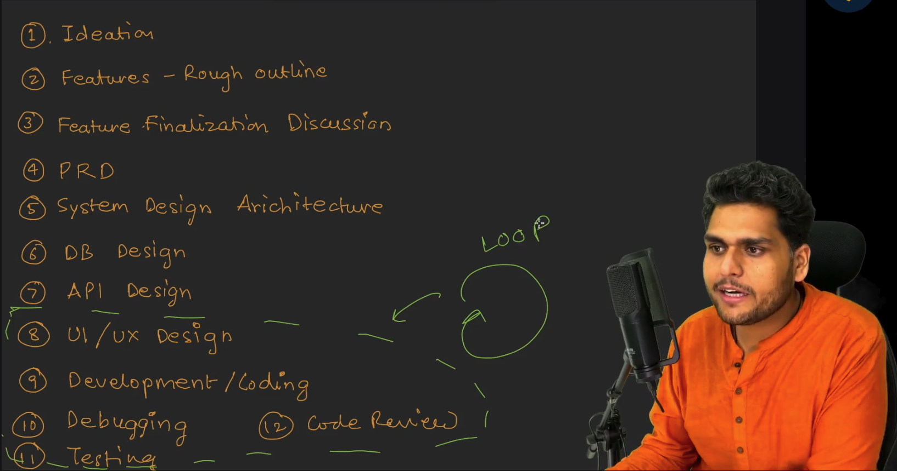
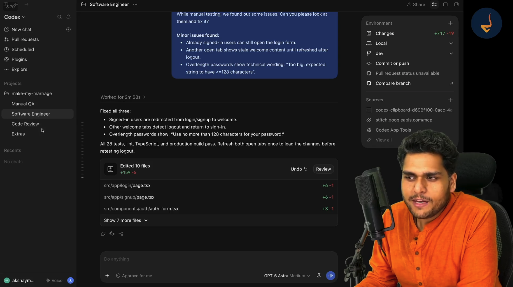

# Episode 09: Testing and Code Review using AI

> **Season 2: AI Native Software Engineer**  
> Instructor: **Akshay Saini** (NamasteDev)  
> Topic: Feature Implementation, Iterative SDLC Loop, Manual QA Browser Testing, Bug Triage, and Multi-Agent Code Review

---

## 1. The Twelve Stages of Software Development: The Iterative Feature Loop

Software engineering is not a one-time waterfall or a single prompt generation. Building reliable, production-grade applications requires structured stages.

Prior stages established the broad project foundation:
1. Ideation
2. Features: Rough outline
3. Feature Finalization Discussion
4. Product Requirements Document (PRD)
5. System Design Architecture
6. Database Design
7. API Design

Once the baseline architecture exists, the remaining five stages form a continuous, iterative loop executed for every individual feature:
8. UI and UX Design
9. Development and Coding
10. Debugging
11. Testing
12. Code Review

For each feature, the engineer cycles through UI and UX design, generates code, debugs issues, performs manual and automated testing, and conducts code review before committing and moving forward.

---

## 2. Feature Selection and Clearing Blockers: Authentication

When planning what to build next:
- **Consult the AI Assistant**: When facing an open roadmap, consult the AI assistant with current project status to recommend the logical next milestone.
- **Why Authentication First**: Authentication is the bedrock of application security. Without user identity, features such as profiles, preferences, saved matches, and protected routes cannot function.
- **Unblocking the Team**: Clear all prerequisite blockers before starting code generation:
  - Wireframes and page layouts (Sign In, Sign Up).
  - Database schema models (User collection, Session collection).
  - API endpoint contracts (`/api/auth/login`, `/api/auth/register`, `/api/auth/logout`).
  - Validation rules and test expectations.

---

## 3. Environment Configuration and Secrets Hygiene

First principles of secret management dictate that sensitive tokens and credentials must never live inside codebase source files:

- **`.env.local` (Private Secrets)**:
  - Stores actual connection strings, database credentials, and secret tokens.
  - Kept strictly local to developer machines.
  - Included in `.gitignore` so secrets are never pushed to GitHub repositories.
- **`.env.example` (Public Template)**:
  - A clean template listing all required variable keys with empty or placeholder values (for example: `MONGODB_URI=`, `MONGODB_DB=`).
  - Committed to version control so team members know which variables must be configured.
- **Pre-Flight Connection Check**:
  - Always verify that database connection strings connect successfully before writing application features.

---

## 4. Rapid Feature Implementation: AI Speed vs Manual Velocity

With blockers removed, the AI software engineer implements the entire authentication slice end-to-end:
- **Sign In and Sign Up Pages**: Clean user interfaces with responsive input fields and client validation.
- **Data Layer**: User schema models, password hashing routines, and MongoDB connection logic.
- **Velocity Comparison**:
  - Building this complete flow manually typically takes an experienced engineer one to two days.
  - With an AI software engineer, the entire functional slice was completed in roughly 13 minutes.
- **Direct Database Verification**:
  - Inspecting MongoDB collections directly confirms:
    - User records are correctly created.
    - Passwords are securely hashed with cryptographic algorithms, never stored in plaintext.
    - Active user sessions are properly registered.

---

## 5. The Necessity of Manual Verification and Runtime Debugging

Rapid code generation does not eliminate the need for engineering rigor. Human testing is critical to uncover real-world runtime defects:

- **Happy Path Testing**: Registering an account, signing in, and verifying successful route navigation.
- **Edge Case Validation**: Testing invalid email formats, short passwords, and empty submissions to ensure input validation triggers appropriately.
- **Catching Runtime Bugs**:
  - Manual testing of the sign out button triggered an unexpected HTTP 400 error (`We could not sign you out`).
  - The bug was caused by invalid session termination handling on the backend.
- **Fast Diagnostic Loop**:
  - Providing the exact runtime error and observed behavior to the AI software engineer.
  - The agent pinpointed the session cleanup flaw, patched the handler, and restored working sign in and sign out flows.

---

## 6. Multi-Agent Orchestration: Software Engineer, Manual QA, and Code Review

In an AI-native workflow, engineers do not rely on a single catch-all prompt. Instead, work is delegated to specialized agent personas:
- **Software Engineer Agent**: Writes and modifies code, fixes bugs, and runs builds.
- **Manual QA Agent**: Uses browser automation tools and browser extensions to interact with the live running application like a real human user.
- **Code Review Agent**: Audits code diffs for security, cleanliness, and maintainability.

### The Manual QA Browser Testing Workflow
The Manual QA agent was tasked to open `localhost:3000` via a browser extension, register test users, verify login and logout, and probe edge cases across the interface.

The agent uncovered three critical bugs:
1. **Unprotected Auth Routes**: Already signed-in users could navigate back to the login form instead of being redirected to the welcome page.
2. **Multi-Tab Session Desynchronization**: Logging out in one browser tab left stale welcome content visible in another open tab until a manual refresh.
3. **Leaked Technical Validation Messages**: Submitting an overlength password displayed raw backend schema errors (`Too big: expected string to have <=128 characters`) directly to users.

### Resolving Issues with the Software Engineer Agent
Handing these exact QA findings to the Software Engineer agent resolved all three defects:
- Redirected authenticated users away from auth forms toward the welcome dashboard.
- Added cross-tab storage listeners to detect logout events and synchronize user state across open tabs immediately.
- Replaced technical schema text with user-friendly error messages (`Use no more than 128 characters for your password.`).
- Ran all 28 automated tests, linter checks, TypeScript compilation, and production builds successfully.

---

## 7. Maker-Checker Code Review and Version Control Hygiene

Before finalizing any feature milestone, enforce the Maker-Checker principle:
- **Independent Audit**: The agent that wrote the code should not be the sole reviewer. The Code Review agent audits the diff for security vulnerabilities, unnecessary complexity, and edge cases.
- **Diff Inspection**: Inspect git status and staged changes to ensure no extraneous files or secrets are included.
- **Conventional Commits**: Commit verified code with descriptive messages.
- **Remote Push**: Push the feature branch to GitHub to lock in milestone progress before proceeding to the next feature: user onboarding and profile completion.

---

## 8. The AI Native Engineer Mindset: From Typist to Orchestrator

The role of the software engineer has fundamentally evolved:
- **Syntax is Delegated**: Writing repetitive boilerplate and memorizing syntax is handled by AI models.
- **The Engineer as Orchestrator**: The engineer acts as an engineering manager, architect, and quality lead.
- **Core Human Responsibilities**:
  - Defining clear system requirements and scope.
  - Guarding security boundaries and environment secrets.
  - Designing multi-agent workflows and orchestrating handoffs between development, QA, and review.
  - Verifying real-world user behavior and making critical design decisions.
